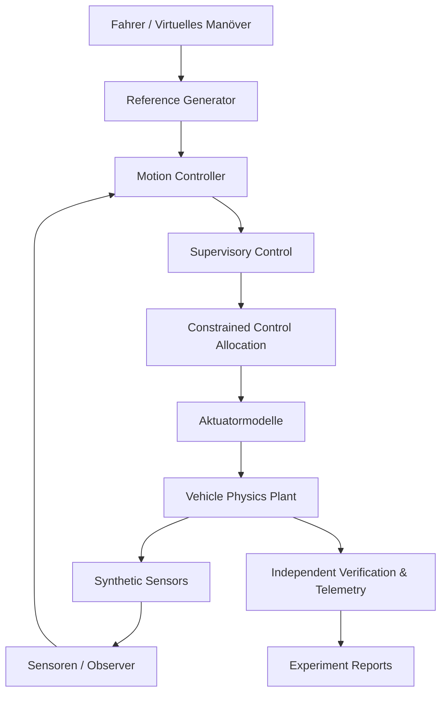

# VEHICLE DYNAMICS – MASTER ENGINEERING PLAN V3.0

**Titel:** Advanced Vehicle Dynamics, Nonlinear Stability & Robust Motion Control Research Platform

**Repository:** https://github.com/CagriCatik/Vehicle-Dynamics  
**Ausgangsbranch:** `main`  
**Geprüfter Basis-Commit:** `8419ede724bc8a86526b52342021aef2cdac5553`  
**Datum:** 28. Oktober 2026  
**Vorheriger Plan:** Master Engineering Plan V2.0, M0–M9  
**Neue Roadmap:** M10–M15  
**Entwicklungsansatz:** Simulation First, Physics First, Structure First

---

## 1. Mission

Entwickle das bestehende Vehicle-Dynamics-Repository zu einer fortgeschrittenen, vollständig virtuellen Forschungsplattform für nichtlineare Fahrzeugdynamik, Grenzbereichsstabilität, robuste Fahrdynamikregelung und Mehrzieloptimierung.

Das Projekt soll nicht mehr primär durch die Anzahl verfügbarer Modelle, Regler und Simulationsfunktionen wachsen.

Die neue Entwicklungsstufe verfolgt stattdessen sechs Hauptziele:

1. **Scientific Integrity:** Mathematische, numerische und regelungstechnische Ergebnisse nachweisbar und reproduzierbar machen.
2. **Nonlinear Stability:** Gleichgewichtszustände, Stabilitätsgrenzen und Rückführverhalten nichtlinearer Fahrzeugmodelle untersuchen.
3. **Robust Motion Control:** Regelungsverfahren für Modellunsicherheit, wechselnde Fahrbahnreibung und eingeschränkte Stellmöglichkeiten weiterentwickeln.
4. **Adversarial Virtual Testing:** Kritische Fahrmanöver und Reglergrenzen durch systematische Szenariosuche identifizieren.
5. **Vehicle Design Optimization:** Fahrwerk, Lenkung, Antrieb und Regler anhand mehrerer Zielgrößen gemeinsam optimieren.
6. **Engineering Workbench:** Die bestehenden Simulations- und Experimentfunktionen über eine einheitliche, wissenschaftlich nachvollziehbare Arbeitsumgebung zugänglich machen.

Das Projekt bleibt vollständig simulationsbasiert.

Reale Messdaten, Prüfstände, Versuchsfahrzeuge, HiL-Hardware oder experimentelle Kalibrierung sind keine Entwicklungsanforderungen.

Alle Ergebnisse beziehen sich ausdrücklich auf die verwendeten mathematischen Modelle und synthetischen Fahrzeugparameter.

---

## 2. Ausgangszustand – Bestand V2.0

Die im bestehenden Repository implementierten Funktionen bilden die Grundlage von V3.0.

### 2.1 Vorhandene Fahrzeugphysik

Bereits vorhanden:

- Kinematisches Einspurmodell.
- Dynamisches Einspurmodell.
- Analytisches lineares Querdynamikmodell.
- Nichtlineares 7-DOF-Zweispurmodell.
- Transientes 7-DOF-Modell mit Reifenrelaxation.
- Erweitertes 14-DOF-Modell.
- Viertelfahrzeugmodell.
- Normalkraft- und Kontaktmodellierung.
- Reifenmodelle mit verschiedenen Formulierungen.
- Quasistatische Fahrwerkskinematik und Elastokinematik.
- Längs- und Querlastverlagerung.
- Synthetische Fahrbahnunebenheiten.
- Räumlich variable Reibwertmodelle.

Diese Funktionen dürfen nicht erneut implementiert werden, sofern der bestehende Code die neue Aufgabe erfüllen kann.

### 2.2 Vorhandene Regelungssysteme

Bereits vorhanden:

- Front- und Hinterachslenkung.
- Geschwindigkeitabhängige 4WS.
- ABS und Antriebsschlupfregelung.
- ESC und Torque Vectoring.
- Constrained Wheel-Force Allocation.
- PI-Gierregelung.
- LQR.
- Gain-Scheduled LQR.
- LTV-MPC.
- Kinematisches NMPC.
- Dynamisches Zweispur-NMPC.
- Phase-Plane-Stabilitätsüberwachung.
- Integrated Vehicle Motion Control.
- Aktive Wankstabilisierung.

Die bestehende gemeinsame `MotionController`-Architektur aus M6 bleibt der bevorzugte Integrationspfad.

### 2.3 Vorhandene Infrastruktur

Bereits vorhanden:

- YAML-Konfigurationen.
- Reproduzierbare Experiment-Spezifikationen.
- Szenariobenchmarking.
- Virtuelle Sensorik.
- Zustandsbeobachter.
- Monte-Carlo-Untersuchungen.
- Solverdiagnostik.
- Physikalische Konsistenztests.
- CSV-, JSON-, PNG-, GIF- und Markdown-Ausgabe.
- GitHub-Actions-CI.

Neue Komponenten müssen diese Infrastruktur erweitern, nicht umgehen.

---

## 3. Bestätigte technische Verbesserungspunkte

Die folgenden Punkte ergeben sich aus dem geprüften Repository-Stand und den eigenen Audit-Dokumenten.

### G01 – NMPC-Zulässigkeit und Laufzeitverhalten

Die SLSQP-basierten NMPC-Controller verfügen bereits über die Statusklassen `nominal`, `suboptimal`, `fallback` und `degraded`.

Es fehlen jedoch durchgängig nachgewiesene harte Zustands- und Stellratenbeschränkungen.

Die dynamische NMPC verwendet außerdem weiche Reibgrenzenstrafen und eine eigene vereinfachte Radmomentenaufteilung.

**Ziel:** Verbesserung der Lösungsgüte, Zustands- und Nebenbedingungsprüfung, Nutzung der gemeinsamen Control Allocation und nachvollziehbare Laufzeitdiagnostik.

### G02 – Unvollständige Integration der virtuellen Sensorik

Die Zustandsbeobachter nutzen eine definierte Sensorschnittstelle. Der Wrapper `EstimatedStateFeedback` leitet jedoch weiterhin interne Reifen-, Radlast- und Reibwerttelemetrie an die nachgelagerte Allokation und Schlupfregelung weiter.

**Ziel:** Strikte Trennung zwischen idealer Zustandsinformation, sensornaher Simulation und geschätzten Zuständen.

### G03 – Heuristische Stabilitätsgrenzen

Das vorhandene Phase-Plane-System ist ein funktionsfähiger heuristischer Stabilitätsmonitor.

Seine Schwimmwinkel- und Schwimmwinkelgeschwindigkeitsgrenzen sind jedoch nicht als mathematisch bestimmte Attraktionsbereiche des nichtlinearen Fahrzeugmodells nachgewiesen.

**Ziel:** Ergänzung durch Gleichgewichtsanalyse, numerische Stabilitätskarten und die Untersuchung stabilisierbarer Zustände.

### G04 – Unvollständiger Szenariozugriff

Das neue YAML-Experiment-Framework unterstützt bisher insbesondere Gierstabilitätsmanöver und die Regler `passive`, `pi`, `lqr`, `gs_lqr` und `ltv_mpc`.

Die vorhandenen NMPC-Pfadfolgeszenarien und mehrere ältere Szenariogruppen sind noch nicht vollständig eingebunden.

**Ziel:** Gemeinsame Experimentinfrastruktur für alle geeigneten Fahrzeugmodelle, Regelungen und Szenarien.

### G05 – Offener 4WS-Split-µ-Regressionsfall

Das Repository dokumentiert einen bestehenden Split-µ-Bremsfall, in dem reine 4WS-Gierdämpfung das Eindrehen des Fahrzeugs nicht verhindert.

Der betreffende Regressionstest ist als erwarteter Fehler (`xfail`) dokumentiert.

**Ziel:** Den Unterschied zwischen einer physikalisch unzureichenden Aktuatorkonfiguration und einem Softwarefehler explizit modellieren und testen.

### G06 – Große Szenariomodule

Mehrere Szenariodateien enthalten sehr umfangreiche Implementierungen.

**Ziel:** Verantwortlichkeiten für Manöverdefinition, Fahrbahn, Fahrermodell, Simulationsausführung, Ergebnisberechnung und Visualisierung in kleine, unabhängig testbare Einheiten trennen.

### G07 – Fehlende umfassende Mehrziel- und Grenzbereichsoptimierung

Vorhandene PSO- und Monte-Carlo-Funktionen bilden eine Grundlage.

Es fehlt jedoch eine gemeinsame Infrastruktur für die Optimierung vollständiger Fahrzeugkonfigurationen anhand von Fahrdynamik, Sicherheit, Komfort, Aktuatorbedarf und Energieverbrauch.

**Ziel:** Wiederverwendbare Design-Optimization- und Pareto-Analysis-Module.

---

# 4. Zielarchitektur V3.0

Die bisherige modulare Architektur bleibt bestehen.

Neue Module werden nur eingeführt, wenn sie eine eigene, klar abgrenzbare fachliche Verantwortung erfüllen.

## 4.1 Geplante Module

| Modul | Verantwortung |
|---|---|
| `controllers/constraints/` | Zustands-, Stellgrößen- und Stellratenbegrenzungen |
| `controllers/robust/` | Robuste und adaptive Regler |
| `controllers/supervision/` | Sicherheitsüberwachung und Rückfalllogik |
| `handling_analysis/nonlinear_stability/` | Gleichgewichte, Stabilität und Attraktionsbereiche |
| `simulation/adversarial/` | Suche nach kritischen virtuellen Szenarien |
| `simulation/uncertainty/` | Unsicherheitsmodelle und Parametervariation |
| `optimization/` | Mehrzieloptimierung von Fahrzeug und Regler |
| `experiments/` | Erweiterung der vorhandenen Experimentverwaltung |
| `verification/` | Nur bei nachgewiesenem Bedarf: gemeinsame Verifikationsabstraktionen |
| `workbench/` | Spätere grafische Bedienoberfläche |

Bestehende Module wie `simulation/robustness.py`, `experiments/verification.py` und `allocation/wheel_forces.py` werden erweitert beziehungsweise wiederverwendet.

Es darf keine parallele zweite Simulationsengine entstehen.

## 4.2 Architekturregeln

Abhängigkeiten folgen diesen Regeln:

- Fahrzeugphysik kennt keine Regler.
- Regler kennen keine konkrete Visualisierung.
- Regelungsgesetze liefern Sollgrößen, aber wenden keine individuellen Radmomente direkt an, wenn dafür der gemeinsame Allokationspfad vorgesehen ist.
- Der Allocator kennt Aktuatorgrenzen und verfügbare Kräfte, aber nicht die grafische Anwendung.
- Zustandsschätzer greifen ausschließlich auf deklarierte Beobachtungen zu.
- Experimente konfigurieren und orchestrieren Modelle, enthalten aber keine eigenen Fahrzeugbewegungsgleichungen.
- Die grafische Oberfläche ruft dieselben Anwendungsdienste auf wie die CLI.
- Keine zirkulären Abhängigkeiten zwischen Physik, Regelung, Experimenten und Visualisierung.

## 4.3 Verbindlicher Signalfluss

Der vollständige Ground-Truth-Zustand bleibt ausschließlich im Simulations- und Verifikationsbereich zugänglich.

Für idealisierte Untersuchungen ist eine ausdrücklich deklarierte Full-State-Feedback-Betriebsart zulässig.

---

# 5. M10 – Scientific Integrity & Control Architecture Consolidation

**Priorität:** P0  
**Abhängigkeit:** Abgeschlossene V2.0-Baseline  
**Ziel:** Die vorhandene Regelungstechnik auf einer durchgängig nachvollziehbaren, physikalisch beschränkten und reproduzierbaren Architektur betreiben.

## 5.1 NMPC-Constraint-Framework

Ein gemeinsames Framework für mathematische Nebenbedingungen entwickeln.

Unterstützte Beschränkungen:

- Maximaler Vorder- und Hinterachslenkwinkel.
- Lenkwinkelgeschwindigkeit.
- Antriebs- und Bremsmomentgrenzen.
- Drehzahl- und Leistungsgrenzen.
- Reifenkräfte und Combined Slip.
- Stabilitätsorientierte Schwimmwinkel- und Gierratengrenzen.
- Straßen- und Korridorbegrenzungen bei Pfadfolge.
- Aktuatorverfügbarkeit.

Nicht jede Bedingung muss für jeden Regler hart sein. Die Semantik muss jedoch eindeutig sein.

Erforderliche Unterscheidung:

- Hard Constraint.
- Soft Constraint.
- Penalty.
- Advisory Limit.
- Physikalisch erzwungene Streckengrenze.

Der Solverstatus allein darf nicht als Nachweis der physikalischen Zulässigkeit interpretiert werden.

## 5.2 NMPC-Solverdiagnostik verbessern

Die vorhandene Diagnostik erweitern um:

- Nebenbedingungsverletzungen.
- Größenordnung der Verletzung.
- Optimierungs-KKT-Residuen, soweit auswertbar.
- Solverkonvergenz.
- Rechenzeit.
- Kostenverbesserung.
- Warm-Start-Güte.
- Fallback-Häufigkeit.
- Anteil suboptimaler Lösungen.
- Anteil degradierten Betriebs.
- Tatsächlich erzeugte Stellgrößen.

Ein Zeitbudgetüberschreiten muss sichtbar bleiben.

Bei nicht unterbrechbaren SciPy-Solvern ist eine harte Echtzeitgarantie nicht zu behaupten. Für verbindliche Laufzeitbudgets kann später ein geeigneter unterbrechbarer Solveradapter untersucht werden.

## 5.3 Einheitliche Control Allocation

Die dynamische NMPC und ältere Regelungspfade werden an den bestehenden `WheelForceAllocator` beziehungsweise die `ActuationLayer` angebunden.

Dabei ist der Unterschied zwischen einer angeforderten Radkraft und einem realisierten Antriebs- oder Bremsmoment zu berücksichtigen.

Der Bericht muss getrennt ausweisen:

- Soll-Längskraft.
- Soll-Giermoment.
- Durch Allokation erreichbare Kräfte und Momente.
- Ausgegebene Aktuatoranforderung.
- Tatsächlich aus dem Fahrzeugmodell resultierende Radkräfte und Momente.

Die Allokation muss Grenzverletzungen, unerfüllbare Anforderungen und Aktuatorausfälle ausdrücklich berichten.

## 5.4 Sensor- und Estimator-Architektur

Drei Betriebsarten definieren:

**Mode A – Ideal Feedback**

Vollständige Zustandsinformation und idealisierte Reibwertkenntnis.

**Mode B – Estimated Motion State**

Fahrzeugbewegung aus virtuellen Sensoren und Beobachtern. Die Allokation darf noch als idealisierte Referenz gekennzeichnete Informationen nutzen.

**Mode C – Sensor-Constrained Closed Loop**

Alle Regelungs- und Aktuatorfunktionen erhalten nur virtuelle Sensorinformationen, beobachtete Zustände und zulässige Schätzgrößen.

Mode C benötigt gegebenenfalls zusätzliche Schätzer für Radlasten, Seitenkräfte und Reifen-Fahrbahn-Reibung.

Unbeobachtbare Größen dürfen nicht durch versteckte Ground-Truth-Zugriffe ersetzt werden.

## 5.5 Szenario- und Regressionstests

Den dokumentierten 4WS-Split-µ-Fall fachlich aufarbeiten.

Dazu:

- Reine 4WS ohne ABS/ESC.
- 4WS mit ABS.
- 4WS mit ABS und ESC.
- Torque Vectoring.
- Vollständige Integrated Vehicle Motion Control.

Für jede Konfiguration werden Stabilität, Bremsweg, Radschlupf, Querabweichung und verfügbare Stellautorität ausgewertet.

Ein physikalisch nicht stabilisierbarer Fall darf ausdrücklich scheitern. Ein erwartetes physikalisches Versagen soll als bestandener Test der korrekten Grenzabbildung gelten, nicht durch Abschwächung des Tests verdeckt werden.

## 5.6 Abnahmekriterien M10

M10 gilt als abgeschlossen, wenn:

1. Alle vorgesehenen Controller dieselbe definierte Stellgrößenkette verwenden oder begründete Ausnahmen dokumentiert sind.
2. Solverstatus und Constraint-Zulässigkeit getrennt ausgewertet werden.
3. Die virtuelle Sensorarchitektur keine undeklarierten Ground-Truth-Zugriffe zulässt.
4. Der 4WS-Split-µ-Fall technisch erklärt und durch aussagekräftige Tests abgesichert ist.
5. Bestehende V2.0-Regressionsfälle weiterhin bestehen.
6. Der CI-Zustand überprüft und dokumentiert wurde.
7. Die vorhandenen YAML-Experimente und Visualisierungen unverändert verfügbar bleiben.

---

# 6. M11 – Nonlinear Vehicle Stability & Limit Handling

**Priorität:** P0  
**Ziel:** Nichtlineare Fahrzeugstabilität systematisch untersuchen und numerisch begründete Stabilitätskarten aufbauen.

## 6.1 Nichtlineare Gleichgewichtszustände

Für feste Betriebsbedingungen Gleichgewichtszustände bestimmen.

Konfigurierbare Größen:

- Geschwindigkeit.
- Fahrbahnreibwert.
- Vorderachslenkwinkel.
- Hinterachslenkwinkel.
- Antriebs- und Bremsmomente.
- Schwerpunktlage.
- Reifenparameter.

Für die Analyse sind geeignete fahrzeugfeste Zustände zu verwenden, nicht globale Positionen, die bei stationärer Kurvenfahrt zwangsläufig zeitabhängig bleiben.

Gleichgewichtszustände müssen die Bewegungsgleichungen und Kontaktbedingungen innerhalb dokumentierter Toleranzen erfüllen.

## 6.2 Lokale Stabilitätsanalyse

Das nichtlineare Modell um identifizierte Gleichgewichtszustände linearisieren.

Analysieren:

- Jacobi-Matrizen.
- Eigenwerte.
- Lokale Stabilität.
- Dämpfung.
- Einfluss der Geschwindigkeit.
- Einfluss der Reibung.
- Einfluss der Reifensteifigkeit.
- Einfluss von 4WS und Torque Vectoring.

Die numerische Linearisierung benötigt eigene Schrittweiten- und Konvergenztests.

## 6.3 Nichtlineare Phasenraumanalyse

Phasenporträts entwickeln für:

- Schwimmwinkel und Schwimmwinkelgeschwindigkeit.
- Schwimmwinkel und Giergeschwindigkeit.
- Giergeschwindigkeit und Gierbeschleunigung, wo fachlich sinnvoll.

Für unterschiedliche Anfangszustände werden Trajektorien simuliert.

Die Ergebnisse unterscheiden:

- Rückkehr in einen definierten stabilen Zielbereich.
- Anhaltend große Abweichungen.
- Verlust der Fahrzeugbeherrschbarkeit nach einem expliziten Kriterium.
- Numerisches Versagen.
- Unzureichende Simulationsdauer für eine eindeutige Klassifikation.

## 6.4 Numerische Stabilitätsregionen

Aus einer Vielzahl von Anfangszuständen wird eine approximierte Rückführregion berechnet.

Untersuche:

- Passives Fahrzeug.
- Frontlenkung mit ESC.
- 4WS.
- Torque Vectoring.
- Integrated Vehicle Motion Control.
- Robuste Regler aus M12.

Eine numerisch ermittelte Rückführregion darf nicht ohne weiteren mathematischen Beweis als exakter Attraktionsbereich bezeichnet werden.

Erforderliche Ausgaben:

- 2D-Stabilitätskarten.
- Vergleich von Stabilitätsregionen.
- Verlauf der Zustandsgrößen.
- Grenzfälle.
- Klassifikationssicherheit.
- Einfluss von Gitternetz, Integrationsschritt und Simulationsdauer.

## 6.5 Abnahmekriterien M11

- Gleichgewichtszustände besitzen überprüfbare Residuen.
- Lokale Stabilitätsaussagen stimmen mit der linearisierten Dynamik überein.
- Stabilitätsregionen können reproduzierbar berechnet werden.
- Numerische Unsicherheit wird separat ausgewiesen.
- Ein Wechsel des Reifen- oder Fahrzeugmodells ist über vorhandene Schnittstellen möglich.
- Die bisherige heuristische Phase-Plane-Regelung bleibt erhalten und wird als Vergleichsbasis genutzt.

---

# 7. M12 – Robust & Adaptive Vehicle Motion Control

**Priorität:** P0  
**Ziel:** Regler entwickeln, die auch bei veränderten Modellparametern, unbekannten Reibwerten und begrenzten Aktuatoren zuverlässiger arbeiten.

## 7.1 Modellunsicherheit

Ein gemeinsames Unsicherheitsmodell definieren für:

- Fahrzeugmasse.
- Gierträgheitsmoment.
- Schwerpunktlage.
- Schräglaufsteifigkeit.
- Reibwert.
- Aktuatorverzögerung.
- Sensorrauschen.
- Sensorbias.
- Steuer- und Sensorlatenz.

Nominale Modellparameter und reale Simulationsparameter dürfen bewusst voneinander abweichen.

Alle Abweichungen müssen als Teil der Experimentkonfiguration dokumentiert sein.

## 7.2 Robuste Regler

Folgende Ansätze schrittweise untersuchen:

**A. Robust LQR / Gain Scheduling**

Analyse der Stabilitätsbereiche bei Parameterstreuung und Unsicherheitsgrenzen.

**B. Disturbance Observer**

Schätzung aggregierter Modellstörungen und ihrer Auswirkungen auf die Fahrzeugbewegung.

**C. Robust MPC**

Bei geeigneter Problemformulierung beispielsweise constraint-tightening oder Tube-MPC untersuchen.

**D. Adaptive Regelung**

Langsame Anpassung ausgewählter Reglerparameter anhand geschätzter Betriebsbedingungen.

**E. Constraint-Aware NMPC**

Verbesserung der bestehenden NMPC durch zuverlässigere Nebenbedingungsbehandlung und zulässige Stellgrößen.

Neue Verfahren sind jeweils mathematisch herzuleiten und dürfen nicht nur durch Umbenennung vorhandener Heuristiken entstehen.

## 7.3 Sicherheitsüberwachung

Eine klar abgegrenzte Supervisory-Control-Schicht entwickeln.

Sie entscheidet anhand dokumentierter Kriterien über:

- Nominalbetrieb.
- Begrenzte Regelung.
- Suboptimalen Solverbetrieb.
- Fallback.
- Degraded Mode.
- Unterdrückung unzulässiger Stellgrößen.
- Kontrollierte Rückkehr in den Normalbetrieb.

Dabei darf keine funktionale Sicherheitszertifizierung oder garantierte Fahrzeugstabilisierung behauptet werden.

## 7.4 Reglerbenchmarking

Alle geeigneten Regler werden unter identischen Bedingungen verglichen.

Pflichtgrößen:

- Gierratenfehler.
- Schwimmwinkel.
- Querabweichung.
- Stellsättigung.
- Stellraten.
- Reifenutilisierung.
- Rechenzeit.
- Infeasibility Rate.
- Fallback Rate.
- Degraded-Mode-Anteil.
- Energie- beziehungsweise Aktuatoraufwand.

Die Benchmarkmatrix muss zwischen idealer, geschätzter und sensorbeschränkter Zustandsrückführung unterscheiden.

## 7.5 Abnahmekriterien M12

- Jeder Regler besitzt eine dokumentierte mathematische Formulierung.
- Der Regler bleibt austauschbar.
- Eine unabhängige nichtlineare Strecke wird verwendet.
- Unsicherheiten werden nicht vor jedem Versuch durch automatische Neuoptimierung kompensiert.
- Verbesserungen werden gegenüber einer festen V2.0-Baseline nachgewiesen.
- Solver- und Constraint-Fehler bleiben sichtbar.
- Reproduzierbare Berichte enthalten auch Fälle, in denen ein fortgeschrittener Regler schlechter abschneidet.

---

# 8. M13 – Adversarial Virtual Testing & Critical Scenario Discovery

**Priorität:** P1  
**Ziel:** Kritische Fahrzeugzustände automatisch finden, statt ausschließlich manuell entworfene Szenarien zu untersuchen.

## 8.1 Szenario-Parameterraum

Die vorhandenen Szenarien werden um variable Eingangsgrößen ergänzt.

Mögliche Variationsgrößen:

- Anfangsgeschwindigkeit.
- Lenkwinkelamplitude.
- Lenkwinkelgradient.
- Bremsbeginn.
- Bremsmoment.
- Reibwert.
- Länge einer Niedrigreibwertzone.
- Lage einer Reibwertgrenze.
- Schwerpunktposition.
- Reifensteifigkeit.
- Aktuatorausfall.
- Sensorverzögerung.

Alle Variablen benötigen zulässige Grenzen und physikalisch begründete Kombinationen.

## 8.2 Kritische Zustände automatisch suchen

Ein Offline-Szenariooptimierer sucht nach Zuständen oder Manövern, die die größten Regelungsprobleme verursachen.

Mögliche Zielfunktionen:

- Maximaler Schwimmwinkel.
- Maximale Gierratenabweichung.
- Maximale Querabweichung.
- Minimale Stabilitätsreserve.
- Maximale Constraint-Verletzung.
- Maximale Dauer des Degraded Mode.
- Minimale Reifen- oder Aktuatorreserve.

Geeignete Suchmethoden:

- Parameter-Sweeps.
- Latin Hypercube Sampling.
- Differential Evolution.
- Particle Swarm Optimization.
- Bayesian Optimization, sofern technisch gerechtfertigt.

Diese Methoden arbeiten ausschließlich offline.

## 8.3 Counterexample Minimization

Wenn eine kritische Simulation gefunden wurde, soll das Framework den Fall systematisch vereinfachen.

Beispiele:

- Geringste notwendige Lenkwinkelamplitude.
- Kleinste Reibwertänderung.
- Kürzeste kritische Niedrigreibwertzone.
- Kleinste Aktuatorverzögerung, bei der das Kriterium verletzt wird.

So entstehen nachvollziehbare, minimal kritische Referenzszenarien.

## 8.4 Kritische Szenariosammlung

Jeder gefundene Grenzfall erhält:

- YAML-Konfiguration.
- Seed.
- Modell- und Softwareversion.
- Auslösebedingung.
- Verletztes Kriterium.
- Numerische Diagnose.
- Vergleich mit nominaler Regelung.
- CSV-Zeitverläufe.
- PNG/GIF.
- Engineering-Report.

Geeignete reproduzierbare Fälle werden in die Regressionstests übernommen.

## 8.5 Abnahmekriterien M13

- Kritische Szenarien lassen sich mit gleichem Seed reproduzieren.
- Die Zielfunktion ist messbar und dokumentiert.
- Fehler durch Solver oder Numerik werden nicht fälschlich als physikalisches Versagen interpretiert.
- Kritische Ergebnisse bestehen eine zusätzliche Schrittweiten- oder Solverprüfung.
- Bestehende Szenarien bleiben ausführbar.
- Mindestens ein nachweislich kritischer Fall wird automatisiert gefunden und als Regressionstest gesichert.

---

# 9. M14 – Vehicle Design & Multi-Objective Optimization

**Priorität:** P1  
**Ziel:** Das virtuelle Referenzfahrzeug nicht nur regeln, sondern seine fahrdynamischen Eigenschaften systematisch auslegen.

## 9.1 Designparameter

Optimierbare Größen:

### Fahrwerk

- Wanksteifigkeitsverteilung.
- Federsteifigkeiten.
- Dämpferparameter.
- Stabilisatorsteifigkeiten.
- Spur- und Sturzparameter innerhalb der unterstützten Modelltreue.
- K&C-Kennfeldparameter.

### Lenkung

- Vorderachslenkübersetzung.
- Hinterachslenkverhältnis.
- Übergangsgeschwindigkeit zwischen gegenphasiger und gleichphasiger 4WS.
- Maximale Hinterachslenkwinkel.
- Stellraten und Aktuatorverzögerungen.

### Torque Vectoring

- Giermomentverstärkungen.
- Kraftverteilung.
- Aktuatorprioritäten.
- Reibungsreserve.
- Begrenzungsstrategien.

### Regelung

- LQR-Kostenmatrizen.
- MPC-Gewichtungen.
- Horizontlänge.
- Regelungsabtastraten.
- Observer-Parameter.

## 9.2 Mehrzieloptimierung

Mindestens folgende Ziele getrennt abbilden:

1. Handling und Spurtreue.
2. Fahrstabilität und Rückführbarkeit.
3. Fahrkomfort.
4. Energie- und Aktuatoraufwand.
5. Regelungsrobustheit.
6. Rechenaufwand.

Nicht alle Ziele werden gleichzeitig optimiert, wenn das gewählte Fahrzeugmodell sie nicht sinnvoll abbildet.

Beispielsweise ist eine Komfortoptimierung nur mit einem geeigneten Vertikaldynamikmodell sinnvoll.

## 9.3 Pareto-Analyse

Es wird ein Pareto-Optimierungsframework eingeführt.

Untersucht werden unter anderem:

- Handling gegen Komfort.
- Stabilität gegen Agilität.
- Spurtreue gegen Energiebedarf.
- Reglerleistung gegen Rechenzeit.
- Stabilitätsreserve gegen Aktuatorbeanspruchung.

Erforderliche Ausgaben:

- Pareto-Fronten.
- Designparameter der Pareto-Lösungen.
- Verteilung der Zielfunktionswerte.
- Vergleich mit dem ursprünglichen Referenzfahrzeug.
- Sensitivitätsdiagramme.
- Konfigurationsdateien der ausgewählten Entwürfe.

## 9.4 Robuste Auslegung

Eine optimierte Fahrzeugkonfiguration darf nicht ausschließlich am nominalen Arbeitspunkt bewertet werden.

Es müssen unabhängige virtuelle Prüfszenarien und Parameterabweichungen verwendet werden.

Optimierungs- und Evaluationsszenarien sind zu trennen, um Überanpassung zu reduzieren.

## 9.5 Abnahmekriterien M14

- Optimierung verwendet die bestehenden Fahrzeugmodelle.
- Parameter bleiben durch YAML nachvollziehbar.
- Ungültige Fahrzeugkonfigurationen werden ausgeschlossen.
- Optimierungsergebnisse sind reproduzierbar.
- Pareto-Dominanz wird korrekt berechnet.
- Ausgewählte Designs bestehen unabhängige Nachprüfungen.
- Verbesserungen und Zielkonflikte werden quantitativ dokumentiert.

---

# 10. M15 – Interactive Engineering Workbench

**Priorität:** P2  
**Ziel:** Die vorhandene CLI- und Experimentinfrastruktur durch eine benutzbare grafische Forschungsumgebung ergänzen.

M15 beginnt erst nach Stabilisierung der wesentlichen Schnittstellen aus M10–M14.

Die grafische Oberfläche ist ein Adapter über der vorhandenen Anwendungsschicht.

## 10.1 Experiment Configuration

Ein Experiment soll grafisch konfigurierbar sein:

- Fahrzeug auswählen.
- Reifenmodell auswählen.
- Fahrwerk auswählen.
- Regler auswählen.
- Fahrbahn auswählen.
- Fahrmanöver auswählen.
- Anfangsbedingungen einstellen.
- Parameter-Sweeps konfigurieren.

Alle Einstellungen werden als YAML gespeichert.

Es darf keine zweite, GUI-spezifische Konfigurationslogik entstehen.

## 10.2 Simulation Execution

Die Oberfläche ermöglicht:

- Starten.
- Fortschritt anzeigen.
- Abbrechen.
- Ergebnisse öffnen.
- Versuche vergleichen.
- Konfigurationen wiederverwenden.

Langlaufende Simulationen dürfen die Oberfläche nicht blockieren.

Simulation und grafischer Event Loop sind strikt zu trennen.

## 10.3 Engineering Dashboard

Vorgesehene Ansichten:

**Vehicle Dynamics**

- Fahrzeugtrajektorie.
- Gierrate.
- Schwimmwinkel.
- Beschleunigungen.
- Lenkwinkel.
- Reifenkräfte.
- Radlasten.

**Motion Control**

- Soll- und Istgrößen.
- Stellgrößen.
- Solverdiagnostik.
- Constraint-Verletzungen.
- Reglerstatus.
- Control Allocation.

**Nonlinear Stability**

- Phasenporträts.
- Stabilitätskarten.
- Gleichgewichtszustände.
- Eigenwerte.
- Rückführtrajektorien.

**Optimization**

- Pareto-Front.
- Sensitivitätsanalyse.
- Parameterkorrelationen.
- Designvarianten.

**Experiment Comparison**

- Überlagerte Zeitverläufe.
- KPI-Vergleiche.
- Differenzdiagramme.
- Animierte Fahrzeugbewegung.

## 10.4 Visualisierung

Die bestehenden Live-Matplotlib-Plots, PNG-, GIF- und CSV-Exporte bleiben erhalten.

Die Workbench darf deren Funktionen wiederverwenden, aber nicht durch inkompatible Implementierungen ersetzen.

## 10.5 Technologieentscheidung

Die GUI-Technologie wird erst nach Analyse der konkreten Anforderungen festgelegt.

Mögliche Ansätze:

- PySide6 für eine Desktop-Anwendung.
- Webbasierte Oberfläche mit Python-Backend.
- Bestehende Plotting- und Reporting-Komponenten als eingebettete Ansichten.

Entscheidungsmaßstäbe:

- Wartbarkeit.
- Plattformunabhängigkeit.
- Unterstützung längerer Rechenprozesse.
- Wiederverwendbarkeit vorhandener Software.
- Aufwand der Distribution.
- Abhängigkeiten.

## 10.6 Abnahmekriterien M15

Ein Nutzer kann einen vollständigen Versuch grafisch konfigurieren, über die vorhandene Experiment-Engine ausführen, Ergebnisse vergleichen und einen technischen Bericht exportieren.

Derselbe Versuch muss über die CLI reproduzierbar bleiben.

---

# 11. Wissenschaftliche Verifikation V3.0

Für die neue Entwicklungsstufe gelten verbindliche Nachweisregeln.

## 11.1 Modellverifikation

Neue physikalische Modelle benötigen:

- Mathematische Herleitung.
- Eindeutige Zustandsdefinition.
- Dokumentierte Parameter.
- Analytische Referenzen, sofern möglich.
- Physikalische Grenzfalltests.
- Numerische Konvergenztests.
- Gültigkeitsgrenzen.

## 11.2 Reglerverifikation

Neue Regler benötigen:

- Mathematische Problemformulierung.
- Zustands- und Stellgrößendefinitionen.
- Dokumentierte Kostenfunktionen.
- Nebenbedingungen.
- Zulässigkeitsprüfung.
- Solverdiagnostik.
- Fallback-Verhalten.
- Vergleich mit einem einfacheren Referenzregler.

## 11.3 Robustheitsprüfung

Reglervergleiche müssen nachvollziehbare Modellabweichungen und Störungen berücksichtigen.

Erforderlich sind:

- Nominale Ergebnisse.
- Ergebnisse bei Parameterabweichungen.
- Schlechteste beobachtete Fälle.
- Verletzungsraten.
- Solverfehler.
- Rechenzeitverteilung.

## 11.4 Numerische Stabilität

Tests sollen insbesondere abdecken:

- Stillstand und niedrige Geschwindigkeiten.
- Große Schräglaufwinkel.
- Hohen longitudinalen Schlupf.
- Kombinierten Schlupf.
- Reibwertsprünge.
- Kontaktverlust.
- Stellsättigung.
- Sensorfehler.
- Solvernichtkonvergenz.
- Ungültige Konfigurationen.

Numerisch nicht aussagekräftige Ergebnisse müssen als ungültig gekennzeichnet werden.

---

# 12. Erweiterung des Experiment-Frameworks

Die vorhandenen Pakete `experiments/spec.py`, `experiments/runner.py` und `experiments/verification.py` bleiben der zentrale Anwendungseinstieg.

Sie werden schrittweise ergänzt.

Neue Experimentarten:

| Typ | Beschreibung |
|---|---|
| `stability_map` | Numerische Stabilitätsregionen |
| `equilibrium_analysis` | Nichtlineare Gleichgewichtszustände |
| `robust_control` | Regelungsvergleich bei Unsicherheit |
| `monte_carlo` | Reproduzierbare Zufallsstudien |
| `adversarial_search` | Automatische Grenzfallsuche |
| `design_optimization` | Parametrische Fahrzeugoptimierung |
| `pareto_analysis` | Mehrzieloptimierung |
| `solver_benchmark` | Rechenaufwand und Lösungsqualität |
| `controller_comparison` | Bestehende Reglervergleichsfunktion |

Bestehende Experiment-Spezifikationen müssen kompatibel bleiben.

Jeder Experimenttyp definiert sein eigenes validiertes Schema, verwendet aber gemeinsame Mechanismen für Ausführung, Provenienz und Reporting.

Die Runner-Architektur sollte die verschiedenen Experimenttypen über eine kleine gemeinsame Schnittstelle anbinden, statt immer mehr typabhängige Verzweigungen in einer einzigen Datei anzusammeln.

---

# 13. Qualitäts- und Abnahmekriterien

Ein Meilenstein gilt nicht als abgeschlossen, nur weil Klassen, Dateien und Beispiele vorhanden sind.

Für jede Umsetzung sind folgende Nachweise erforderlich:

| Bereich | Mindestanforderung |
|---|---|
| Architektur | Eindeutige Modulverantwortung und geprüfte Abhängigkeitsrichtung |
| Mathematik | Dokumentierte Gleichungen und Annahmen |
| Physik | Konsistente Kräfte, Momente und zulässige Zustände |
| Numerik | Dokumentierte Solver- und Konvergenzeigenschaften |
| Tests | Relevante Unit-, Integrations-, Physik- und Regressionstests |
| Regler | Verhalten bei Sättigung, Unzulässigkeit und Solverfehlern |
| Experimente | Reproduzierbare Konfigurationen und Ergebnisse |
| Reporting | Nachvollziehbare Kennzahlen, Status und Grenzen |
| Dokumentation | Übereinstimmung mit dem tatsächlichen Code |
| Bestandsschutz | Keine unbeabsichtigten Änderungen vorhandener Ergebnisse oder APIs |

Für jeden Meilenstein werden diese Dimensionen mit nachvollziehbaren Kriterien bewertet.

Es dürfen keine unbelegten 10/10-Bewertungen vergeben werden.

---

# 14. Priorisierte Ausführungsreihenfolge

Die verbindliche Reihenfolge lautet:

**M10 → M11 → M12 → M13 → M14 → M15**

M13 wird bewusst vor M14 entwickelt.

Die automatisierte Grenzfallsuche kann dadurch anschließend als zusätzliche Bewertungsinstanz für optimierte Fahrwerke und Regler verwendet werden.

M15 folgt zuletzt, weil eine grafische Oberfläche erst auf einer stabilisierten Anwendungs- und Datenarchitektur aufgebaut werden sollte.

Einzelne dokumentarische und infrastrukturelle Verbesserungen können parallel stattfinden, sofern sie die technische Abnahme der jeweiligen Meilensteine nicht umgehen.

---

# 15. Sofortiger Implementierungsauftrag für einen Code-Agenten

## Rolle

Du arbeitest als:

- Principal Vehicle Dynamics Engineer.
- Nonlinear Vehicle Dynamics Researcher.
- Model Predictive Control Specialist.
- Numerical Optimization Engineer.
- Senior Python Software Architect.
- Engineering Verification Specialist.

## Auftrag

Implementiere die Master Engineering Plan V3.0 schrittweise im bestehenden Repository.

Dies ist ein Implementierungsauftrag, nicht nur eine Machbarkeitsstudie oder eine erneute Roadmap-Erstellung.

### Schritt 1 – Neuen Stand prüfen

- Aktuellen Git-Branch bestimmen.
- Aktuellen Commit erfassen.
- Uncommittete Änderungen schützen.
- Gesamte Repository-Struktur inspizieren.
- Bestehende Testbaseline ausführen.
- Bestehende Demonstratoren ausführen.
- Bereits umgesetzte V3-Funktionen identifizieren.
- Offene Punkte aus den aktuellen Audit-Dokumenten mit dem Code abgleichen.

Niemals annehmen, dass eine Funktion fehlt, nur weil sie in diesem Plan als Entwicklungsaufgabe aufgeführt ist.

### Schritt 2 – V3-Baseline dokumentieren

Erzeuge einen Bericht über:

- Vorhandene Fahrzeugmodelle.
- Vorhandene Controller.
- Aktuelle gemeinsame Schnittstellen.
- Solverdiagnostik.
- Zustandsschätzung.
- Control Allocation.
- Experiment-Framework.
- Regressionsabdeckung.
- Noch bestehende Architekturprobleme.

### Schritt 3 – M10 umsetzen

Beginne mit dem Scientific-Integrity- und Control-Architecture-Paket.

Relevante vorhandene Module:

- `src/vehicle_model/controllers/dynamic_two_track_nmpc.py`
- `src/vehicle_model/controllers/nmpc.py`
- `src/vehicle_model/controllers/solver_diagnostics.py`
- `src/vehicle_model/controllers/motion_control.py`
- `src/vehicle_model/controllers/estimated_feedback.py`
- `src/vehicle_model/allocation/wheel_forces.py`
- `src/vehicle_model/simulation/scenario_runner.py`
- `src/vehicle_model/experiments/`

Neue Module nur dann ergänzen, wenn bestehende Verantwortlichkeiten nicht sinnvoll erweitert werden können.

### Schritt 4 – Technische Verifikation

Für jede relevante Änderung:

1. Tests ergänzen.
2. Implementierung durchführen.
3. Schnelle Tests ausführen.
4. Relevante physikalische Grenzfälle ausführen.
5. Simulationen und Ergebnisse prüfen.
6. Regressionsvergleiche durchführen.
7. Dokumentation aktualisieren.
8. Erst bei erfüllter Abnahme den nächsten Entwicklungsschritt beginnen.

### Schritt 5 – Weitere Meilensteine

Nach Abschluss von M10 sukzessive M11 bis M15 umsetzen.

Jeder Meilenstein muss unabhängig überprüfbar und sinnvoll ausführbar sein.

Kein massenhaftes Erstellen leerer Module oder Platzhalterimplementierungen.

---

# 16. Verbindliche Entwicklungsregeln

**Rule 1 – Preserve Existing Functionality**

Bestehende Fahrzeugmodelle, Controller, CLI-Funktionen, Live-Plots und Exportformate erhalten.

**Rule 2 – Physics Before Features**

Keine neuen komplexen Regelungsverfahren auf mathematisch ungeprüften Fahrzeugmodellen entwickeln.

**Rule 3 – No Fake Validation**

Keine synthetischen Daten als reale Fahrzeugmessungen darstellen.

**Rule 4 – No Silent Constraint Violations**

Unzulässige Zustände und unerfüllbare Anforderungen müssen nachvollziehbar gemeldet werden.

**Rule 5 – Controller/Plant Separation**

Reglerentwurfsmodell und Simulationsstrecke bleiben unabhängig konfigurierbar.

**Rule 6 – No Hidden Ground Truth**

Der Informationszugriff jedes Reglers und Estimators muss eindeutig deklariert sein.

**Rule 7 – YAML First**

Parameter und Experimentdefinitionen bleiben extern konfigurierbar.

**Rule 8 – Reproducibility**

Jeder relevante Versuch erhält einen reproduzierbaren Ergebnisnachweis.

**Rule 9 – Small, Cohesive Modules**

Keine neuen monolithischen Simulations- oder Controllerklassen.

**Rule 10 – No Automatic Push**

Keine Änderungen auf GitHub pushen, sofern keine ausdrückliche Freigabe vorliegt.

---

# 17. Erforderliche Deliverables

Nach jedem Meilenstein:

**A. Implementierungsbericht**  
Tatsächlich entwickelte Funktionen.

**B. Architekturbericht**  
Neue und geänderte Module, Schnittstellen und Abhängigkeiten.

**C. Mathematische Beschreibung**  
Gleichungen, Annahmen, Modellbereiche und Einschränkungen.

**D. Verifikationsbericht**  
Testfälle, exakte Kommandos und Ergebnisse.

**E. Simulationsbericht**  
Szenarien, KPIs, numerische Ergebnisse und Auffälligkeiten.

**F. Visualisierung**  
PNG, GIF und vorhandene Live-Plots, soweit zum jeweiligen Modul passend.

**G. Konfiguration**  
Neue YAML-Schemata und Parameter.

**H. Qualitätseinschätzung**  
Evidenzbasierte Bewertung der technischen Kriterien.

**I. Bekannte Probleme**  
Offene Defekte, Grenzen und technische Risiken.

**J. Nächster Entwicklungsschritt**  
Konkreter, fachlich begründeter nächster Meilenstein.

---

## 18. Langfristiges Forschungsziel

Die V3.0-Plattform soll folgende Fragen reproduzierbar beantworten können:

- Welche Fahrzeugzustände sind unter gegebenen Betriebsbedingungen stabil oder stabilisierbar?
- Wie verändern 4WS und Torque Vectoring die fahrdynamischen Grenzen?
- Unter welchen Bedingungen versagen bestimmte Regelungsstrategien?
- Welche Modellunsicherheiten beeinflussen das Regelergebnis am stärksten?
- Wie lassen sich Aktuatoren unter begrenztem Reifen-Fahrbahn-Kraftschluss optimal koordinieren?
- Welche Fahrzeugparameter beeinflussen Stabilität, Agilität, Komfort und Energiebedarf?
- Wie lassen sich virtuelle Worst-Case-Manöver automatisch identifizieren?
- Welche Fahrzeug- und Reglerkonfigurationen bieten unter definierten Zielkonflikten die besten Ergebnisse?

**Final Objective**

Build a modular, scientifically traceable, physically consistent and reproducible virtual vehicle dynamics research platform capable of nonlinear stability analysis, robust chassis motion control, critical-scenario discovery and multi-objective vehicle optimization.

**Do not optimize for feature count. Optimize for mathematical credibility, architectural integrity, physical consistency, robustness and meaningful engineering evidence.**