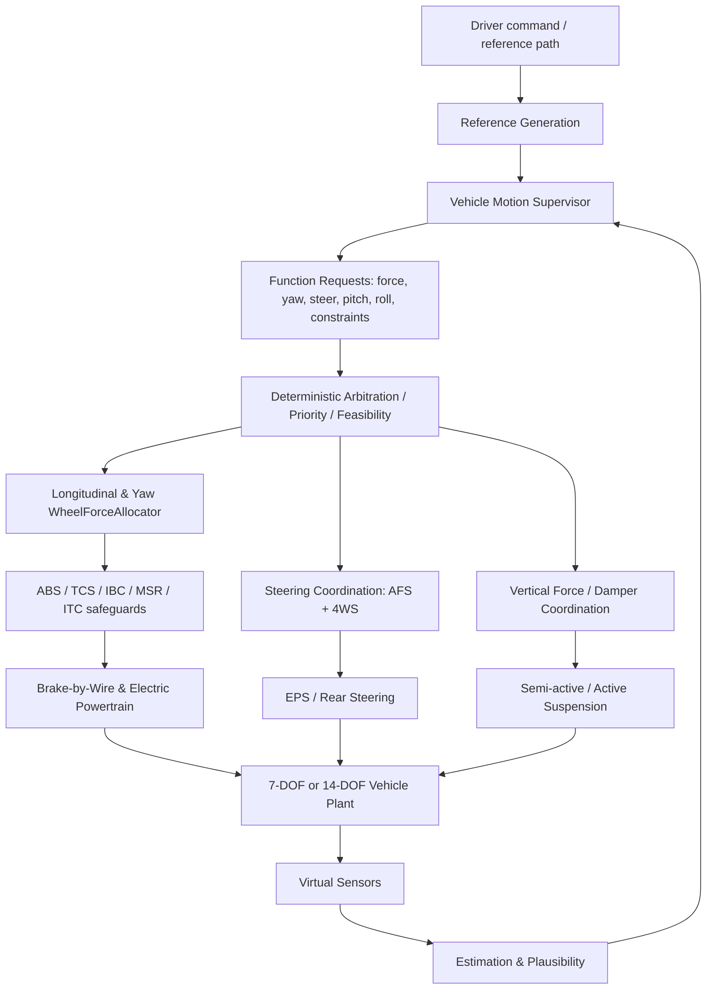
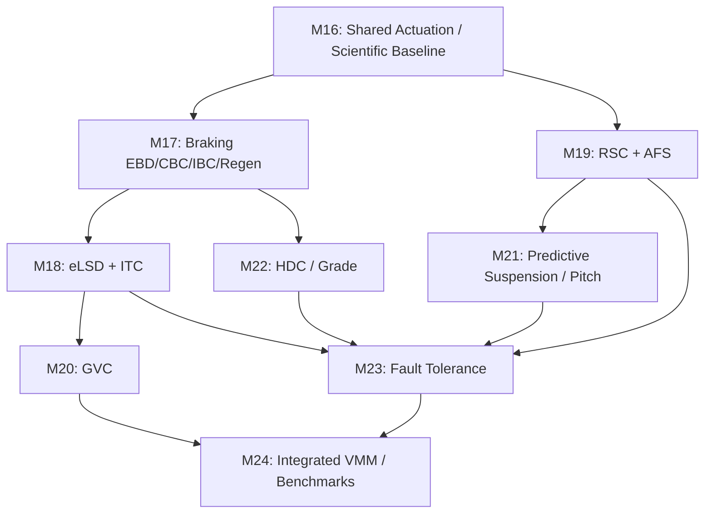

# VEHICLE DYNAMICS — MASTER IMPLEMENTATION PLAN V4.0

**Projekt:** [CagriCatik/Vehicle-Dynamics](https://github.com/CagriCatik/Vehicle-Dynamics)  
**Zweck:** Direkt ausführbarer Entwicklungsauftrag für Claude Code oder OpenAI Codex  
**Datum:** 29. Oktober 2026  
**Analysierte Referenz:** `main`, Tree-Commit `992cc399e561e80b6be49b9c86ebc628d4475339` (GitHub-Abfrage am 29.10.2026); vor jeder Umsetzung aktuellen HEAD erneut bestimmen.  
**Status:** Plan, keine Aussage über bereits erfolgte Implementierung.  
**Scope:** Virtuelle, modellbasierte Entwicklung für ein **unskaliertes Pkw-Referenzfahrzeug**. Kein RC-Fahrzeug, keine Seriensteuergerätefreigabe, kein Anspruch auf reale Messvalidierung.

---

## 0. Anweisung an den Code-Agenten — unbedingt lesen

**AUFTRAG:** Implementiere die in diesem Dokument spezifizierten Arbeitspakete in dem bestehenden Repository; beginne mit der Ist-Aufnahme und M16. Dies ist ein Ausführungsplan, kein Auftrag zur Erstellung eines weiteren Plans. Kein Neuschreiben des gesamten Projekts. Verwende bestehende Komponenten wieder, implementiere keine leeren Klassen und springe bei fehlgeschlagenen Gates nicht zum nächsten Meilenstein. Erhalte alle vorhandenen Szenarien, Live-Plots, GIF/PNG/CSV/JSON/Markdown-Exports und CLI-Befehle.

1. `git status --short`, `git branch --show-current`, `git rev-parse HEAD`; vorhandene uncommittete Änderungen weder überschreiben noch wegwerfen. Auf einem eigenen Feature-Branch arbeiten, sofern möglich.
2. `python -m pip install -e '.[test]'`; `python -m pytest -q -m 'not slow'`; `python -m vehicle_model.experiments validate configs/experiments/*.yaml`; bei Bedarf vollständige Suite separat ausführen. Baseline und Fehlermeldungen dokumentieren.
3. Repo, insbesondere `Plan.md`, `docs/V3_BASELINE.md`, `docs/AUDIT.md`, `docs/MOTION_CONTROL.md`, `docs/CONTROL_ALLOCATION.md`, `docs/CHASSIS_CONTROL.md`, `docs/ACTUATORS.md` und Quellcode inspizieren. **Dokumentationsbehauptungen immer mit implementiertem Code und Testbelegen abgleichen**; V3-Meilensteine können seit der Erstellung dieses Plans fortgeschritten sein.
4. Vor Codeänderungen das bestehende Verhalten mit Golden Tests/Regressionsszenarien fixieren. Pro Meilenstein: Tests -> Implementierung -> fachliche Modellprüfung -> reproduzierbare Benchmarks -> Dokumentation -> Abnahme.
5. Bestehende Methoden/Dateien nicht blind umbenennen; bei API-Änderungen explizite Kompatibilitätsschicht oder dokumentierte Migration mit Tests.
6. Standards und Herstellerseiten dienen zur **Ableitung konzeptioneller Anforderungen**, nicht als Quelle proprietärer Algorithmen oder automatisch erfüllter Homologationskriterien.
7. Keine erfundenen Reifen- oder Fahrzeugmessdaten, keine pauschalen Leistungsversprechen. Synthetische Parameter immer kennzeichnen und ihre Empfindlichkeit untersuchen.
8. Keine Abhängigkeit hinzufügen, bevor deren Nutzen, Isolierung, Lizenz und Fallback geklärt sind. Bestand: NumPy, SciPy, Matplotlib, PyYAML, pytest; Python >=3.10.

**Endprodukt jedes Meilensteins:** funktionsfähiger Code auf bestehendem Interface, YAML, deterministische Tests, mindestens ein reproduzierbares Vergleichsexperiment, Datenexport, ein aussagekräftiges Ergebnisbild und technische Dokumentation mit Referenzen und bekannten Grenzen.

---

## 1. Zielbild und Definition of Done

Die Plattform soll aus einem integrierten Fahrzeugmodell eine **modular koordinierte Fahrdynamikregelungsplattform** machen, die Bremsen, Antrieb, Front-/Hinterachslenkung und Fahrwerk unter physikalischen Stellgrößen-, Haftungs-, Sensor- und Leistungsgrenzen koordiniert.

### Geplante zusätzliche Funktionen

| Bereich | Funktion | Klassifikation |
|---|---|---|
| Bremsen | EBD (Electronic Brakeforce Distribution) | neue Funktion auf vorhandener Allocation |
| Bremsen | CBC (Cornering Brake Control) | explizite Regelstrategie auf ESC-/Allocation-Basis |
| Bremsen | IBC (Integrated Brake Slip Control) | Koordination/Verbesserung von ABS, EBD, CBC |
| Antrieb/Bremsen | MSR und regenerative Schlupfregelung | Schlupfkontrolle beim negativen Antriebsmoment |
| Antrieb | eLSD (virtuelles elektronisches Sperrdifferenzial) | Achs-/Radmomentverteilung |
| Antrieb | ITC (Integrated Traction Control) | Koordination von TCS, eLSD, TV, Leistungslimits |
| Querdynamik | RSC (Roll Stability Control) | Kipp-Risikomanagement mit Brems- und Antriebseingriff |
| Lenkung | AFS (Active Front Steering) | zusätzliches Frontlenkungs-Stellgesetz |
| Fahrverhalten | GVC-artige Längsdynamik-/Lasttransferregelung | eigenständig beschriebene Referenzstrategie; keine Mazda-Nachbildung |
| Vertikaldynamik | Predictive Damping / Road Preview | vier Dämpfer mit begrenzter Vorschau |
| Vertikaldynamik | Active Pitch Control | vier begrenzte aktive Federbeinkräfte |
| Längsdynamik | HDC (Hill Descent Control) | geschlossene Geschwindigkeitsregelung bei Neigung |
| Integration | Fault-Tolerant VMM | Gesundheitszustand, Degraded Modes, Reallocation |
| Integration | Vehicle Motion Supervisor (VMM) | zentrale Arbitrierung, Energie- und Prioritätsmanagement |

**Nicht als neu deklarieren:** ABS, TCS, ESC, Torque Vectoring, 4WS, PI/LQR/GS-LQR/LTV-MPC/NMPC, 7-/14-DOF, Skyhook/Groundhook, Reifen-/Reibwertmodelle, 4-Motor-Antrieb, BBW und bestehende WheelForceAllocator. Diese werden erweitert bzw. integriert.

**Definition of Done:** Jede Funktion ist einzeln abschaltbar, im YAML parametrierbar, gegen die identische passive Vergleichskonfiguration getestet und kann einen begründeten Fehler-/Sättigungsstatus ausgeben. Die Kombination erzeugt keine widersprüchlichen doppelten Radmomentbefehle und hält explizit modellierte physikalische Grenzen ein. Funktionstests beweisen eine verifizierbare Eigenschaft; Verbesserungen sind nur unter benannten Bedingungen zu fordern, nicht universell.

---

## 2. Bestandsanalyse und bekannte Integrationsrisiken

### 2.1 Existierende Dateien (prüfen, wiederverwenden)

- `src/vehicle_model/core/types.py` — Radindizes FL/FR/RL/RR, Zustände, Fahrzeugparameter, Radtelemetrie.
- `src/vehicle_model/controllers/framework.py` — `ControlTarget`, `ControlOutput`, `VehicleController`.
- `src/vehicle_model/controllers/motion_control.py` — `MotionLaw`, `MotionRequest`, `ActuationLayer`, `MotionController`.
- `src/vehicle_model/controllers/integrated_controller.py` — ältere IVMC-Koordination mit eigener radmomentbasierter Strecke.
- `src/vehicle_model/controllers/slip_control.py` — vorhandene PI-Schlupfregelung für ABS/TCS.
- `src/vehicle_model/controllers/abs.py`, `tcs.py`, `stability_control.py`, `torque_vectoring.py`, `active_roll.py`, `phase_plane.py`, `yaw_laws.py`.
- `src/vehicle_model/allocation/wheel_forces.py`, `wls.py` — beschränkte 4-Rad-Längskraftallokation.
- `src/vehicle_model/actuators/brake_actuator.py`, `powertrain_actuator.py`, `steering_actuator.py`.
- `src/vehicle_model/vehicle_models/seven_dof.py`, `fourteen_dof.py`, `normal_loads.py`.
- `src/vehicle_model/suspension/controllers.py`, `quarter_car.py`; `src/vehicle_model/roads/road_profile.py`, `surface.py`.
- `src/vehicle_model/estimation/` — virtueller Sensor, EKF, Reibwertschätzung.
- `src/vehicle_model/simulation/scenario_runner.py`, `simulation/kpi.py`, `simulation/report_generator.py`, `simulation/validation/`.
- `src/vehicle_model/experiments/spec.py`, `runner.py`, `verification.py`; `configs/experiments/`.
- Tests unter `tests/vehicle_model/`; CI `.github/workflows/ci.yml`.

### 2.2 BLOCKER vor der Erweiterung

**A. Geteilte Stellgrößenautorität:** `IntegratedChassisController` verteilt derzeit in einem eigenen Pfad TV/ESC-Momente, addiert Bremsmomente und ruft ältere ABS/TCS-Implementierungen auf. Demgegenüber integriert die neue `ActuationLayer` WheelForceAllocator und PI-Schlupfregelung. Die Systeme dürfen nicht gleichzeitig unabhängige finale Radmomente setzen.

**B. Physikalische Allokation vs. Ausführung:** Bestehender `WheelForceAllocator` arbeitet mit vier Reifenlängskräften `F_xi` und den Zielen `(F_x, M_z)`. Er modelliert nicht automatisch die vollständigen sechs Freiheitsgrade, Federmomente, Lenkaktuatorwirkung, Energieverteilung oder dynamische hydraulische Stellraten. Zuerst bestehende 2-DOF-Allokation konsolidieren; später bewusste Erweiterung in getrennte Allokationsdomänen mit Vertrag/Einheitentests.

**C. Informationszugriff:** `MotionController.compute_control` nutzt aktuell bei vorhandener Telemetrie `Fz`, `mu`, `Fy` und andere Größen direkt aus der Simulationsstrecke. Das ist im Ideal-Feedback-Modus zulässig, **nicht** in einem als sensorbeschränkt bezeichneten Regelbetrieb. Drei bestehende Modi A/B/C aus `Plan.md` erhalten und durchgängig durchsetzen.

**D. Split-µ-Regressionswiderspruch:** `docs/MOTION_CONTROL.md` und `docs/VALIDATION_PLATFORM.md` berichten unterschiedliche Resultate für den IVMC-Split-µ-Fall. Vor Erweiterungen reproduzieren, Ursache feststellen (unterschiedliche Soll-/Ist-Momente, Ablauf, Streckenparameter oder Controller-Pfade) und mit Tests schließen. Kein Grenzwert-Abschwächen zur Erzeugung grüner Tests.

**E. Unterschiedliche Plant-Modelle:** 7-DOF plant kann keine expliziten vier Dämpfer- oder aktiven Hubkräfte realisieren. RSC mit Radlast-/Kontaktwirkung und Preview/Pitch müssen daher gegen 14-DOF getestet werden. Für reine 7-DOF-Szenarien ggf. nur eine **klar deklarierte approximative** RSC-Variante erlauben, keine fiktive 14-DOF-Wirkung.

**F. Brems-/Rekuperations-Schnittstelle:** `BrakeByWireActuator.step` liefert Reib- und regeneratives Bremsmoment. Der signierte Elektroantrieb darf nicht zusätzlich dasselbe negative Moment als Antrieb-/Bremskraft einbringen. Physikalische Energiefluss- und Signaldefinition vor Implementierung fixieren.

**G. Experiment-DSL:** `experiments/spec.py` erlaubt derzeit nur begrenzte Controller-, Straßen- und Manövertypen; eine Datei im `configs/`-Verzeichnis allein macht kein neues Experiment ausführbar. Parser, Validator, Controller-Factory, Runner und Reporting jeweils gemeinsam erweitern.

**H. Aktuelle V3-Arbeiten:** V3 `Plan.md` definiert M10–M15. V4 darf nicht stillschweigend behaupten, diese Phasen seien bereits bestanden. Nicht abgeschlossene Aufgaben als V4-Eingangsblocker oder dokumentierte Abhängigkeiten kennzeichnen; numerische Forschung M11–M15 ggf. parallel weiterführen, ohne Abnahmekriterien zu überspringen.

---

## 3. Zielarchitektur (kleine Bausteine, klare Ownership)



### 3.1 Empfohlene neue Module (erst nach Code-Istaufnahme finalisieren)

```text
src/vehicle_model/
  controllers/
    motion_supervisor.py       # Funktionstrigger, Priorisierung, Arbitrierung, Moduswechsel
    requests.py                # typisierte FunctionRequest / MotionDemand / status, keine Physik
    brake_distribution.py      # EBD-Strategie; Vorgabe, nicht Aktuatorphysik
    cornering_brake.py         # CBC-Stellwunsch
    integrated_brake.py        # IBC-Koordination der bestehenden ABS/BBW-Schleifen
    regenerative_slip.py      # Schlupfregelung bei negativem Motormoment / MSR
    differential_lock.py      # virtuelle eLSD-Strategie
    integrated_traction.py    # ITC-Koordination: TCS/eLSD/TV
    roll_stability.py         # RSC: LTR, Intervention und Freigaben
    active_front_steering.py  # AFS: Überlagerungswinkel / Lenkübersetzung
    g_vectoring.py            # GVC-artige Lasttransferstrategie
    hill_descent.py           # HDC-Geschwindigkeitsregler
    fault_management.py       # Fehlersignale, Fallback, Reconfiguration
  allocation/
    constraints.py            # gemeinsame Grenz-/Ratenbedingungen, nur falls nötig
    vertical_forces.py        # vier Federbeinkräfte / pitch-roll-Kommandos, 14-DOF
  suspension/
    preview_control.py        # Road-preview-Dämpferregelung
    pitch_control.py          # Active Pitch
  estimation/
    road_preview.py           # gestörte/zeitverzögerte Road Preview, sensorabhängig
  roads/
    grade.py                  # Steigungsprofil und geometrische Schnittstelle
  simulation/
    v4_benchmarks.py          # Orchestriert Szenarien; keine Fachreglerlogik
  tests/...                   # im bestehenden Tests-Layout unter tests/vehicle_model/
configs/
  braking/{ebd,cbc,ibc,regenerative_slip}.yaml
  controllers/{elsd,itc,rsc,afs,g_vectoring,hdc,motion_supervisor}.yaml
  suspension/{preview_damping,active_pitch}.yaml
  experiments/v4_*.yaml
  roads/grade_profiles.yaml

docs/
  V4_ARCHITECTURE.md
  V4_BRAKING.md
  V4_TRACTION.md
  V4_STABILITY_STEERING.md
  V4_SUSPENSION.md
  V4_FAULT_TOLERANCE.md
  V4_VALIDATION.md
  V4_REFERENCES.md
```

**Hinweis:** Dateien sind eine Orientierungsstruktur, keine Verpflichtung zu einem Modul pro Funktion. Wenn vorhandene Module den richtigen Verantwortungsbereich haben, dort erweitern. Keine `common.py`/`utils.py`-Sammelstellen.

### 3.2 Unidirektionale Abhängigkeiten

- `core` enthält reine Zustände, Einheiten, physikalische Typen, Protokolle; importiert **nicht** aus `controllers`, `simulation`, `visualization` oder `experiments`.
- Fachregler können `core` und reine numerische Modell-/Grenzschnittstellen nutzen, aber weder Matplotlib noch YAML-Dateizugriff, globale CLI-Zustände, Exportdateien oder Szenario-Runner importieren.
- `allocation` erhält **Anforderungen und Grenzen**, keine Namen von Spezialreglern; ein CBC-/eLSD-Modul darf die Allokation nicht mit Side-Effects umgehen.
- `actuators` besitzen nur Aktuatordynamik, Sättigungen, Energiegrenzen, Fehlerverhalten; die Orchestrierung bleibt außerhalb.
- `simulation`, `experiments`, `visualization` hängen nach innen von stabilen Fach-Interfaces ab; die Gegenrichtung ist verboten.
- Ein Modul darf keinen bisher laufenden Controller implizit einschalten. Jede Funktion über Konfiguration explizit aktivieren.
- Langfristig optional: portbasierte/hexagonale Schnittstellen. Kein Framework-Overengineering oder Zwangsrefactor des gesamten Repos.

### 3.3 Neue typisierte Verträge

Neuen, schlanken `FunctionRequest` definieren (oder `MotionRequest` kompatibel erweitern). Felder: `source`, `timestamp_s`, `priority_class`, `requested_fx_n`, `requested_mz_nm`, `front_steer_delta_rad`, `rear_steer_delta_rad`, `pitch_moment_nm`, `roll_moment_nm`, `wheel_constraints`, `confidence`, `valid`, `reason`, `diagnostics`. `None` von `0.0` unterscheiden: *keine Anforderung* vs. *explizit Null*. Klare positive Vorzeichenkonvention nach ISO 8855.

`AllocationResult` soll unverändert konsumierbar bleiben; additive V4-Diagnose enthält `requested`, `accepted`, `allocated`, `commanded`, `realised_previous_step`, `residual`, `active_constraints`, `saturation`, `fallback`, `authority_available`, `sensor_mode`, `timing`.

Die gemeinsame Stellebene kennt drei getrennte Vorgaben:

- Longitudinal + yaw: `(Fx_des[N], Mz_des[Nm])`, pro Rad wirkende Reifenlängskräfte und Brems-/Antriebsmomente.
- Steering: Front- und Hinterachs-Radlenkwinkel mit Winkel-, Winkelgeschwindigkeits- und Zeitverzögerungslimits.
- Vertical: Dämpferkoeffizienten `[Ns/m]` **oder** vier aktive Federbeinkräfte `[N]`, physikalisch nur im 14-DOF plant.

Keine unzulässige Addition verschiedener Domänen; ein übergeordnetes Gesamtziel darf mehrere Domänen beanspruchen, aber zugewiesene Autorität muss eindeutig sein. `reset()` muss sämtliche Integratoren, Warmstarts, Hysteresen und Zustandsmaschinen deterministisch zurücksetzen.

### 3.4 Mehrziel- und Sicherheitsprioritäten

Für den ersten Supervisor deterministic hierarchical priority (nicht sofort große NMPC-Monolithen):

1. Physikalische und aktuatortechnische Unverletzbarkeit: Kapazitäten, Konnektivität, kein negativer Reibwert, keine doppelten Motormomente.
2. Radschlupf-/Radkontakt-/Kippgefahr und notwendige Stabilisierung.
3. Erfüllbare Sollbewegung einschließlich Quer-/Gierrate.
4. Fahrerwunsch für Längsbeschleunigung / Verzögerung.
5. Komfort, Reifenverschleiß, elektrische Energieeffizienz.

Bei Konflikten klarer `feasibility`-Status und kontrollierter Degradationspfad. Keine stillschweigende Sättigung ohne Diagnosedaten; keine Garantie, dass physikalisch unmögliche Stabilitätszustände wiederhergestellt werden.

---

## 4. Gemeinsame physikalische Grundlagen und Invarianten

**Reifenkraftkapazität:** Für die einfache Kamm-Kreis-Näherung `Fx_i^2 + Fy_i^2 <= (mu_i * Fz_i)^2`; für Magic-Formula-Reifen kann die charakteristische tatsächliche Hüllkurve davon abweichen. Prüfungen müssen die jeweils **vom Modell deklarierte** Haftungsgrenze verwenden, nicht unreflektiert ein überschreibendes µg-Kriterium.

**Radrotationsdynamik:** `Iw * domega_i/dt = T_drive_i - T_friction_brake_i - T_regen_i - Reff * Fx_i - weitere explizite Verluste` in einer konsistenten Vorzeichenkonvention; Regen darf nicht zugleich an zwei Stellen abgezogen werden. Vorzeichen bei Vorwärts-/Rückwärtsfahrt und Stillstand gesondert testen.

**Gewichtstransfer:** Näherung `DeltaFz_long_axle = m * ax * h_CG / L` (Vorzeichen passend zu Fahrzeugkoordinaten); bei 14-DOF relevante dynamische Lasten aus der Strecke verwenden. Radlasten nicht zusätzlich zweimal verschieben.

**Gierrate / Moment:** `Iz * dr/dt = Sum_i (x_i*Fy_body_i - y_i*Fx_body_i)` einschließlich korrekter Einzelradlenkwinkel und sonstiger modellierter Momente.

**RSC-LTR:** `LTR_axle = |Fz_right - Fz_left| / max(Fz_right+Fz_left, eps)`, getrennt vorne/hinten und/oder für Gesamtfahrzeug. Bei angehobenem Rad explizite Kontaktlogik statt unsinniger Division.

**Energie:** Mechanische Leistung pro Rad `P_i = T_machine_i * omega_i`, Batterie-/Invertergrenzen und Rekuperationswirkungsgrad konsistent modellieren. Ohne thermisches/Batteriemodell nur begrenzte vereinfachte Energiekennzahl ausweisen.

**Prüfinvarianten:** endliche Zahlen/Zeitschritte, passende Einheiten, erlaubte Stellraten und Momente, kein Zugmoment bei ausgefallenem Antrieb, keine Bremskraft bei ausgefallener Bremse, keine negative Normalkraft, Kontakt-/Radlastbehandlung, kein unplausibles Entstehen zusätzlicher Energie durch Regelsoftware, gleiche Eingänge nach `reset()` ergeben gleiche Resultate.

**Abnahmekriterien quantitativ:** Präzise Toleranzen pro Test aus Modell-/Solvergenauigkeit ableiten. Vorab konservative Vorschlagswerte nur für **numerische Invarianten** (z. B. nichtnegative finale Bremsmomente bis 1e-9 Toleranz, keine NaN, deterministic replay). Keine erfundenen allgemeinen Bremsweg-/Kippgrenzen oder gesetzlichen Grenzwerte.

---

# 5. Meilensteine

## M16 — Architecture Consolidation / Scientific Integrity

**Ziel:** Ein einziger nachvollziehbarer und testbarer Weg von Fahrwunsch zu tatsächlicher Fahrzeugaktuatorik; bestehendes Verhalten und Regressionen schützen.

**Arbeitspakete:**

1. Ist-Baseline per vollständiger Dateiliste, Commit, Teststatus, Versionsnummern und Bestandscontroller aufnehmen; Output `docs/V4_BASELINE.md`.
2. In `controllers/integrated_controller.py` den bisherigen additiven Verteilpfad von den Regleranforderungen trennen. Eine Kompatibilitäts-/Adapterstrategie für bestehende `compute_control`-Aufrufe entwickeln. Den vorhandenen `MotionController`/`ActuationLayer` bevorzugen; insbesondere **keine** neue zweite ABS-Regelung implementieren.
3. Integration der `BrakeByWireActuator`- und `ElectricPowertrainActuator`-Dynamik in geschlossene Szenarien prüfen/ergänzen. Ideale Aktuatoren weiterhin als Vergleich verfügbar lassen.
4. Priorisierung des Fehlers `Split-µ IVMC` in den beiden Dokumenten: identische Strecke, Startgeschwindigkeit, Bremsanforderung, Reifentyp, `mu`, Radlast und Zeitintegration reproduzieren; die Abweichung auf Ursachen zurückführen. Erwartetes Scheitern klar erklären.
5. `InformationMode A/B/C` im Protokoll kenntlich machen; in Modus C darf keine Ground-Truth-Telemetrie aus dem Plant in Regler gelangen. Sensor- und Beobachtergrenzen mit Fakes/Faults prüfen.
6. `requested/allocated/issued/realised` als zeitlich korrekte Diagnose definieren; Verzögerung zwischen issued und realised loggen.
7. Unit-Grenzen, Status und Benchmark-Schnittstellen vereinheitlichen. Altes Verhalten als bewusst auswählbare Baseline erhalten, sofern fachlich nötig.

**Unit-/Integrationstests:** Alt- vs. Neu-IVMC, falsche Radreihenfolge, signiertes Lenkmoment, deaktivierte ABS/TCS, niedriger Reibwert, Brake-only, Motor-only, Sensor-Modus C ohne Truth, ausgefallene einzelne Bremse, komplette Saturation, Reset/Replay, Split-µ-Bremsung mit und ohne Lenkeingriff.

**Abnahme:** Alle aktiven V4-Funktionen verwenden die koordinierte Ausgabestelle; keine zwei Owner pro Radmoment; altes und neues Verhalten belegt; Split-µ-Differenz nachvollziehbar erklärt; keine ungeklärten M16-Regressionen.

**Referenzen:** `docs/MOTION_CONTROL.md`, `docs/CONTROL_ALLOCATION.md`, `Plan.md` M10, Johansen & Fossen (2013) [R3].

## M17 — EBD, CBC, Integrated Brake Slip Control und Regenerative Slip / MSR

### M17.1 EBD

**Funktion:** Geschwindigkeits-, Radlast- und Reibwertabhängige Aufteilung des Gesamtbremswunschs zwischen Achsen/Rädern. *EBD ist eine Strategie/Begrenzung und keine zweite physikalische Bremse.*

**Vorgehen:**
- Statische 60:40-Bias als Referenz belassen; neue `BrakeDistributionStrategy` liefert pro Rad zulässige Nachfrage/Grenzen für die bestehende Allocation.
- Vorder-/Hinterachs-Radlast, Reifenreibwert, Raddrehzahl, Kurvenfahrt und ABS-Aktivität berücksichtigen. Kein Zugriff auf ideale `Fz` oder `mu` in Sensor-Modus C.
- Sonderfall Ausfall einzelner Bremse, µ-split und dynamische Lastverlagerung.
- EBD niemals als eigene zweite finale Radmomentinstanz nach ABS implementieren.

### M17.2 CBC

**Funktion:** In Kurven koordinierte Bremswirkung bei Quer-/Längskraftkonflikten, um Spur-/Gierstabilität zu berücksichtigen.

**Vorgehen:**
- Unter-/Übersteuerrisiko aus Soll-/Ist-Gierrate und `beta`/Reifenreserve ableiten.
- Bremsanforderung als `(Fx_des, Mz_des)` oder zusätzliche Bounds an den gemeinsamen Allocator übergeben.
- Konflikte mit ESC: CBC erzeugt Anfrage, Supervisor arbitriert; **nicht** zwei additive Giereingriffe auf denselben Bremsen.
- Vergleich gegen identisches ESC+ABS ohne CBC; nicht voraussetzen, dass jede Kurve besser wird.

### M17.3 IBC

**Funktion:** Schicht zur koordinierten Optimierung des Schlupfs beim Bremsen einschließlich Rekuperation; vorhandenen `WheelSlipController` adaptieren, nicht kopieren.

**Regelidee:** Sollschlupf `kappa_ref(mu_hat, Fz_hat, speed, tyre_params, thermal_state_if_modelled)` und anti-windup begrenzte Stellgröße; schaltbare PI- und optional MPC-Schlupfvariante. Längs- und Querkraft-/Bremswegkonflikt offenlegen. Physikalische Sollschlupfwahl anhand `Fx(kappa)` bzw. combined-slip envelope aus vorhandenen Reifenmodellen.

### M17.4 Regenerative Slip / MSR

**Funktion:** Negatives Motormoment kann auf glatter Straße zu starkem Bremsschlupf führen. Rücknahme des rekuperativen/schleppenden Moments und bedarfsweise Übergabe an hydraulisches Bremsen; Fahrerbremswunsch bleibt begrenzt erfüllbar.

**WICHTIG:** Bestehender BBW-Code setzt bei ABS-Aktivität Regen auf Null. **Verbesserte Regeneration unter ABS** ist ein eigenes experimentelles Upgrade und darf nicht als kostenlos/sofort verfügbar angenommen werden. Erst baseline `regen_cut_on_abs`, später optional `regen_modulated_abs` unter E-Motor-, Inverter- und Zeitkonstantenlimits implementieren; beide vergleichen.

**Beispielkonfiguration:** `configs/braking/{ebd,cbc,ibc,regenerative_slip}.yaml`; Werte aus vorhandenen Referenzfahrzeug-/Reifen-YAML übernehmen, nicht frei verstreuen.

**Experimente:** Geradeaus-Vollbremsung µ=1/0.5/0.2, Bremsen in Kurve, Split-µ, µ-Sprung, Rekuperation bei 80/40/10 km/h, Notbremsung nach normaler Rekuperation, Bremsen-/E-Antriebsausfall, niedrige Geschwindigkeit bis Stillstand.

**KPIs:** Bremsweg und Durchschnittsverzögerung, maximale Gierratenabweichung, `beta_max`, Raddrehzahl/Schlupf, Dauer ABS aktiv, Anzahl Schaltvorgänge, Rekuperationsenergie, Energiebilanz, hydraulischer Bremsanteil, Stellgrößen-Slew, Allokations-Residual.

**Abnahme:** Unterschiedliche Bremsstrategien messbar und reproduzierbar; kein einzelnes Rad > deklarierter Aktuatorgrenzen; bei Split-µ verständliches Stabilität/Verzögerung-Trade-off; negativer Motorantrieb nicht doppelt verrechnet; keine stillschweigende Übernahme von idealem µ in Modus C; CBC- und ESC-Konfliktfälle durch zentrale Arbitration erklärt.

**Quellen:** Bosch IBC/IPR [R4], ISO 7975 [R7], FMVSS 126 [R9], Fahrdynamik Rajamani [R12].

## M18 — Virtual eLSD & Integrated Traction Control (ITC)

### M18.1 Virtuelles eLSD

Für vier unabhängig angetriebene Räder ein **virtuelles Sperrmoment-Konzept** modellieren. Keine mechanische Sperrdifferentialphysik suggerieren, sofern kein mechanisches Differentialmodell existiert. Grundversion: per-Achse oder per-Rad elektronisch geregelte Torque-Bias-Anforderung mit begrenzter Differenz, Radschlupf-, Reibwert- und Motortemperatur/Leistungsgrenzen (wenn verfügbar). `T_left + T_right` bleibt mit der Gesamtantriebsanforderung konsistent; Übertragung zwischen Rädern nicht als kostenloses positives Moment verbuchen.

**Vergleiche:** offene gleiche Torque-Verteilung, TCS-only, TV-only, eLSD-only, ITC kombiniert; keine Eingriffe des einen Systems als die des anderen bezeichnen.

### M18.2 ITC

Ziel: verfügbare Reifen-Längskraft bei Beschleunigung nutzen und gleichzeitig Gierraten-/Querstabilitätsgrenzen erhalten. Vorhandene TCS- und TV-Bausteine als Unterfunktionen nutzen. `Fx_des`, `Mz_des` sowie fahrdynamische Restriktionen aus dem Supervisor an den vorhandenen Allocator. Optimierung optional mit Reifenverlust-, Leistungseffizienz- und Schlupfterm; **kein** eigener zweiter unabhängiger Allokator.

**Experimente:** µ-split-Anfahren, Kurvenausgang, Diagonal-µ, abrupter µ-Wechsel, starker Anfahrwunsch, Vorder-/Hinterachs-Antriebskonfiguration, ausgefallener Inverter, zwei Motoren ausgefallen, lange Sättigung und Controller-Neustart.

**KPIs:** 0–v Beschleunigungszeit bzw. `Fx_actual`, `kappa_max`, yaw error, delta-beta, Leistungslimit, Energie, Drehmomentbilanz, erreichbare vs. verlangte Momente.

**Abnahme:** Im deterministischen µ-Split-Benchmark muss ITC gegenüber dem geeigneten passiven Vergleich eine plausible, messbare Verbesserung **oder eine begründete Nichtverbesserung mit Limits** zeigen; niemals rechts/links falsche Vorzeichen, keine zusätzliche Energie, keine Verletzung von Motortorque/Batteriegrenzen.

**Quellen:** Bosch ITC [R4], bestehende `controllers/torque_vectoring.py`, `powertrain_actuator.py`, Johansen & Fossen [R3].

## M19 — Roll Stability Control (RSC) & Active Front Steering (AFS)

### M19.1 RSC

Die vorhandene `ActiveRollDistributionController`-Funktion bereits nutzen, nicht überschreiben. Neuer `RollStabilitySupervisor`: roll-rate/roll-angle, `LTR`, Radkontakt und Reibungsreserven aus 14-DOF beurteilen; abhängig von Gefahr Antrieb begrenzen, Bremseingriff anfragen, ggf. aktive Wankverteilung beauftragen. Hysterese, Aktivierungs-/Deaktivierungszeiten und gesonderte Notfallbegrenzung. **LTR nicht als alleiniger Beweis für tatsächlichen Überschlag behandeln**; Kontakt- und Modellgrenzen beachten.

**Experimente:** Fishhook, hoher Schwerpunkt, teilbeladen vs. vollbeladen (synthetische Varianten), 120->60 km/h schneller Lenkeingriff, unterschiedliche Reibwerte, aktive Federung gesund/ausgefallen, transienter Radverlustkontakt.

**KPIs:** LTR, Mindest-Radlast, Kontaktzustände, Rollwinkel/-geschwindigkeit, yaw error, Verzögerung, korrigierbare vs. unerreichbare Fälle, Eingriffshäufigkeit.

### M19.2 AFS

Frontlenkwinkel als Summe/Funktion `delta_f_actual = saturate(delta_driver/ratio(v) + delta_overlay)` mit EPS-Dynamik und Grenzen modellieren. Regelung: variable Lenkübersetzung und stabilisierendes Yaw-Feedback bzw. LQR-basierte Frontüberlagerung. Vorhandene `steering_actuator.py`, 4WS-LUT und `yaw_laws.py` nutzen. AFS, 4WS und TV können dieselbe Sollgierrate unterstützen; **Frontlenkwinkel nur an einer Stelle finalisieren**.

**Experimente:** ISO-7401-orientierter Lenkwinkelsprung, Sinus-/Sine-with-Dwell, DLC, Spurwechsel mit überlagerter Lenkkorrektur, AFS-Aktuatorlag und -Ausfall; AFS/4WS/TV getrennt und kombiniert.

**KPIs:** yaw-rate response/settling, beta, Lenkbeschleunigung/-gradient, Überschwingen, Fahrerlenkarbeit, laterale Abweichung, maximaler Lenkwinkel/Steer-Rate.

**Abnahme:** RSC bewahrt Stellgrenzen und protokolliert auch nicht rettbare Grenzfälle; AFS arbeitet mit physikalisch wirksamen Lenkwinkeln und zeigt aktive Wirkung gegenüber 2WS/4WS-Baselines; Vorzeichen und saturierte Stellraten nachweisbar.

**Quellen:** FMVSS 126 [R9], ISO 7401 [R6], ISO 3888-2 [R8], ZF cubiX [R2].

## M20 — G-Vectoring Control (GVC-artige Lasttransferregelung)

**Ziel:** Kleine, glatte Längsmomentmodulation zur Unterstützung der Einlenk- und Auslenkphase; keine zusätzliche Zauber-Seitenkraft.

**Algorithmus, pragmatisch:** Filterung von Fahrerlenkgeschwindigkeit und Krümmungs-/Gierinformation; bei Einlenken begrenzte Reduktion des positiven Antriebsmoments oder kleine Verzögerungsanforderung; in Auslenkphase glatte Freigabe; optional minimaler stabilisierender Bremseingriff als **explizite** Untervariante. Jerk-/Komfortlimit, Phasenlogik, Fahrerwunschlimit und Sicherheit über Supervisor. Quasi-statischer Radlasttransfer im 7-DOF, dynamischer Nick-/Lasttransfereffekt im 14-DOF.

**Experimente:** Lenkrampe, Kurvenein-/ausfahrt, Fahrstreifenwechsel, wechselnder Reibwert, Fahrer hebt das Gas abrupt, Notbremsung während GVC. Vergleiche GVC off/on bei identischer Fahrerführung und festen Anfangszuständen.

**KPIs:** Lenkfolgefehler, `ax`-jerk, Nickdynamik, Frontachs-Radlast, Raddreh-/Gierratenverlauf, subjektnah aber objektiv messbarer Steueraufwand.

**Abnahme:** Der berichtete Radlast-/Reaktionsmechanismus existiert im verwendeten Plant; Priorität der Sicherheitsfunktionen; GVC kann durch `enabled: false` vollständig verschwinden; kein nachträglich künstlich verbesserter Solltrajektorienvergleich.

**Quellen:** Mazda G-Vectoring Control [R10]. Markierung als **eigene vereinfachte Referenzstrategie**, nicht exakter proprietärer Mazda-Algorithmus.

## M21 — Predictive Suspension / Road Preview & Active Pitch

### M21.1 Vierkanal-Predictive Damping

Auf vorhandenem 14-DOF `damper_c_override` und ISO-8608-Profile basieren; 7-DOF nicht fälschlich für Dämpferbenchmark verwenden. Start bei kausaler Vorschau `z_road(x + v * T_preview)` mit deklarierten Mess-/Schätz-/Latenzannahmen, später Modus C mit Sensorausfall und Fehler. Pro Rad separate räumliche Kontaktposition, Road-Preview-Zeit und Dämpfergrenzen. Baselines passive, Skyhook, Groundhook, Hybrid. Erst regelbasiertes Preview-Skyhook, danach optional constrained MPC, **falls** spürbarer Mehrwert gegen die Baselines nachweisbar.

### M21.2 Active Pitch

Nickmoment aus vier aktiven Federbeinkräften erzeugen, während Netto-Hubkraft und Rollmoment kontrolliert bleiben. Minimiere z. B. `w_pitch*theta^2 + w_pitch_rate*dtheta^2 + w_heave*z^2 + w_load*load_variance + w_u*||F_act||^2` unter Kraft-, Leistungs- und Federweglimits. Keine unmodellierten Kräfte direkt am Fahrzeugschwerpunkt einspeisen. `allocation/vertical_forces.py` kann Bedarf `(Fz_body, M_pitch, M_roll)` auf vier aktive Strut-Kräfte abbilden.

**Experimente:** ISO-8608-Profile A–D (und ggf. weitere), Einzelhindernisse, aufeinanderfolgende Querrillen, Bremsung aus 100 km/h auf welliger Strecke, Anfahrnicken, Kurve mit welligem Fahrbahnbelag, Ausfall eines Dämpfers, Preview-Verzug/Noise.

**KPIs:** Karosserievertikalbeschleunigung RMS, pitch RMS/peak, Federweg, tire-load variation, Durchschlag-/Aufsetzkontakt, aktive Leistung/Energie, Komfort/Handling-Pareto.

**Abnahme:** Keine Preview-Information aus zukünftigen Plant-Zuständen, nur aus explizit modellierter externer Vorschau; Dämpfer passiv dissipativ; aktive Kräfte und Energie begrenzt; Vergleich zeigt Trade-off zwischen Komfort und Straßenlage; Live-Plots und GIF bleiben vorhanden.

**Quellen:** ISO 8608 [R11], ZF cubiX [R2], bestehende `docs/SUSPENSION_DYNAMICS.md`.

## M22 — Hill Descent Control (HDC) und Straßenneigung

**Vorbedingung:** Bisheriges RoadSurface liefert primär `mu(X,Y)`, nicht automatisch die Hangneigung. Erweitere die Umgebung um eine ortsabhängige Längssteigung `grade(X,Y)` mit Ein-/Auslauf und klarer Koordinatenkonvention. Nur wenn nötig zusätzlich räumliche Höhenfunktion `Z(X,Y)` und Ableitung für Aufbauexcitation.

**Physik:** In Längsrichtung Gravitationsterm `-m*g*sin(theta_grade)` mit signiertem Gefälle; prüfen, dass Steigung, Straßennormale, Radlast und Reifenhaftung konsistent verwendet werden. Falls eine Erweiterung des Plant unverhältnismäßig ist, M22 als separat ausgewiesenes Longitudinal-Plant mit Radschlupf koppeln, **nicht** HDC ohne Schwerkrafteinfluss als fertige Fahrdynamikfunktion deklarieren.

**Regler:** `v_ref`, PI/PID mit anti-windup und begrenzter Verzögerungsanforderung, ABS/EBD/IBC bleibt letzte radbezogene Instanz. HDC als fahrerseitig aktivier-/deaktivierbare Funktion, begrenzte Geschwindigkeits- und Hangfreigabe.

**Tests:** trockene/nasse 5/10/20-%-Gefälle als **synthetische** Prüfmatrix, Gefällewechsel, seitliches µ-Split, Fahrerbremswunsch übernimmt, einzelner Bremsausfall, Kupplung des Systems mit 14-DOF nur wenn physikalisch durchgängig.

**KPIs:** Geschwindigkeitstreue, Maximalgeschwindigkeit, Schlupf, Verzögerung, Stabilität, Bremsleistung, Übersteuerungsstatus.

**Abnahme:** Hangabtriebskraft reproduziert analytischen Grenzfall bei geringer Geschwindigkeit; HDC greift nur bei aktivem Modus ein; fehlende Bremsautorität wird als `infeasible` gemeldet.

## M23 — Fault-Tolerant Motion Control / Degraded Modes

**Ziel:** Zentrale, explizite Fehlerdiagnostik und begrenzte Rekonfiguration statt stiller Fortsetzung mit falschen Sensor-/Aktuatorwerten.

**Fault-Catalogue:** Bremse blockiert/ausgefallen; Motor begrenzt/aus; Front- oder Hinterachslenkwinkel stuck; verlorene IMU; ungültige Wheel-Speed-Signale; µ-Schätzer-Drift; Lastsensorfehler; gesättigte Dämpfer; Preview ausgefallen; Kommunikationsverzögerung und stale message; widersprüchliche Funktionsanfragen.

**Fault-Modell:** `FaultEvent(t_start, duration, channel, mode, severity)` als deterministische YAML-Eventfolge; trenne Plant-Fehler, Sensorausfall, Aktuatorgrenzen und Reglerfehler. `ActuatorHealth` kompatibel erweitern ohne alte Tests zu zerstören. Plausibilisierung von Zeitstempel, Endlichkeit, Signalbereich; getrennte Zustände `nominal`, `limited`, `degraded`, `fallback`, `unavailable`.

**Reaktion:** Health-Mask und wirksame Limits an `WheelForceAllocator` senden; rückführbare `allocation residual`, vorsichtigere Solltrajektorien, ggf. deaktivierte Komfortsysteme; bei unbeherrschbarem Zustand `infeasible` statt behaupteter Stabilität.

**Tests:** ein, zwei und drei Stellpfade gestört; Fehlerreihenfolge/Reset; verlorene Sensorinformation während ABS; stuck-rear-steering mit RSC; Energieausfall während Rekuperation; tickweise verzögerte Signale; Fuzzing malformed YAML/config und Latenzen. Fail-operational nur behaupten, wenn unter benannten Bedingungen belegt.

**Abnahme:** Keine unbemerkten Command-Leaks zu defekten Kanälen; Grenzen und Degraded State korrekt; Safety-Recovery-Lauf dokumentiert; Abhängigkeit zu Health/MotionSupervisor ohne Monolith.

**Quellen:** Johansen & Fossen [R3], Bestand `ActuatorHealth`, `solver_diagnostics.py`, `ESTIMATION_ROBUSTNESS.md`.

## M24 — Vehicle Motion Supervisor, Full-Stack-Integration & Benchmark

**Ziel:** Ein überprüfbarer Supervisor koordiniert alle vorhandenen und neuen Funktionen, ohne dass diese gegenseitig Radmomente, Lenkwinkel oder aktive Hubkräfte überschreiben.

### M24.1 Function Registry / deterministische Arbitrierung

- Funktionsfähigkeit und Verfügbarkeit deklarieren: `enabled`, `eligible`, `request`, `limits`, `priority`, `health`, `status`.
- Sicherheitsanfragen höher priorisieren als Agilitäts-/Komfortfunktionen. Eigentliche Regelung in den kleinen Fachfunktionen belassen.
- Nur der Supervisor/Coordinator entscheidet über konsolidierte Bewegungsanforderungen; pro physikalischem Aktuator exakt eine finale Ansteuerstelle.
- Funktionstrigger, Hysterese, Konflikte und Übergaben protokollieren. Beispielsweise CBC vs. ESC vs. RSC und GVC vs. Notbremsung.
- Bei unerreichbaren Vektorwünschen Prioritätslösung mit `residual`, einschließlich begründeter Sollgeschwindigkeitsreduktion; kein ungebundener Summationsoperator.

### M24.2 Multi-domain Control Allocation

Die aktuelle WheelForceAllocator ist **2 Zielgrößen x 4 Längsradkräfte**. Behalte sie für longitudinal/yaw. Separates Steering-/Vertical-Allocation-Problem, physikalisch richtige Effektivitätsmatrix und harte Grenzen. Optional in einer **äußeren Koordinationsiteration** koppeln, wenn Effektorwechselwirkungen relevant sind; keine gigantische unbegründete Allzweckoptimierung. Definiere Abbruchkriterien, Konditionierungs-/Konvergenzstatus und numerische Diagnostics. Stabilitätslast vor Komfort-/Energiegewichten.

### M24.3 Benchmark-Matrix (obligatorisch)

**Vergleichskonfigurationen:**

- P0: Passives Referenzfahrzeug, starre 60:40 Bremse, 2WS.
- P1: ABS+TCS+ESC klassisch.
- P2: P1 + TV + 4WS (vorhandenes IVMC nach M16-Konsolidierung).
- P3: P2 + EBD + CBC + IBC + Regenerative Slip.
- P4: P3 + eLSD + ITC.
- P5: P4 + RSC + AFS + GVC.
- P6: P5 + Predictive Suspension + Pitch (14-DOF).
- P7: P6 + Supervisor + Fault Tolerance.

**Testmanöver:** 1) Bremsung trocken, 2) Bremsung nass/eisähnlich, 3) Split-µ-Bremsen, 4) Bremsen in Kurve nach ISO-7975-Vorbild, 5) Sine-with-Dwell nach FMVSS-126-Vorbild, 6) Lenkwinkelsprung ISO-7401-Vorbild, 7) doppelter Spurwechsel ISO-3888-2-Vorbild, 8) Fishhook, 9) µ-Patches/Grenzflächen, 10) Beschleunigen im Bogen, 11) hill descent, 12) unebene Fahrbahn, 13) Bremsen+Querführung+Vertikaldynamik, 14) Aktuatorausfall, 15) Sensorverzögerung/µ-Fehlschätzung.

**Variation:** Geschwindigkeit, µ, Masse, Höhe CG, Trägheiten, Reifencharakteristik, Aktuatorlag, Rate Limits, Sensorsampling, Messrauschen, Reibwertschätzfehler, Seed. Niedrige/hohe Geschwindigkeiten, Endzustände und Tests ohne verfügbare Haftreserve abdecken.

**KPIs:** Verzögerung/Bremsweg; yaw reference error und tracking RMSE; maximaler `beta`, Rollwinkel und LTR; Reifen-Kraftnutzung; Radschlupf und Intervention-Duty-Cycles; Querabweichung; Fahrerlenkarbeit; Jerk/Komfort; dynamische Radlast; Energie-Rekuperation; Actuator-Slew/Work; numerische Fehler und Verletzungen; Request-vs.-Command-vs.-Realised-Abweichung; Runtime/p95, Fallback-Häufigkeit.

**Statistik:** deterministische Basisläufe plus Saat-/Parameter-Sweeps; Median, Quartile, Worst Case, Konfidenzintervalle sofern methodisch zulässig. `paired scenarios` verwenden (identische Startzustände/Noise für Controller-A/B), keine geschönten Beispielvergleiche. Verbesserungen können Zielkonflikte aufweisen; Pareto-Plot oder Zielkonflikttabelle erstellen.

**Abnahme:** P0–P7 mit Feature Flags lauffähig; jede Konfiguration vollständig reproduzierbar, für 7-DOF/14-DOF fachlich zulässige Matrix; Ergebnisse als CSV, JSON, PNG, Markdown, optional GIF exportiert; explizite Methodik und Grenzen; Regressionen der bestehenden Beispieldemos bestehen.

---

## 6. Konfiguration und Versionierung

Es gilt `configs/` als zentrale benutzerseitige Konfigurationsquelle; bestehende Paketressourcen in `src/vehicle_model/config` nur dort pflegen, wo sie durch Packagedaten erforderlich sind. Doppelte YAML-Kopien nicht still divergieren lassen. Bestehende `get_configs_root`-Mechanik prüfen.

Beispiel für **vorgeschlagene** V4-Semantik, an realen Loader/Schema anpassen (keine unvalidierte YAML-Schlüsselerfindung in Produktionskonfig):

```yaml
vmm:
  enabled: true
  information_mode: ideal_feedback   # estimated_motion | sensor_constrained
  safety_priority: [physical_limits, rollover, slip, yaw, driver, comfort]
  features:
    abs: true
    tcs: true
    esc: true
    tv: true
    four_wheel_steering: true
    ebd: true
    cbc: true
    ibc: true
    regenerative_slip: true
    virtual_elsd: true
    integrated_traction: true
    roll_stability: true
    active_front_steering: true
    g_vectoring: false
    predictive_damping: false
    active_pitch: false
    hill_descent: false
    fault_tolerance: true
```

Jeder zusätzliche YAML-Parameter braucht Standardwert, Typ, Einheit, zulässigen Bereich, physikalische Bedeutung, Quelle und sinnvolle Warnung. Keine fest codierten Reifen-/Fahrzeugwerte in Regelklassen. Ungültige Konfigurationskombinationen (z. B. predictive_damping mit 7-DOF) explizit mit erklärendem Fehler abweisen.

`experiments/spec.py` erweitert Regler- und Szenariotypes **rückwärtskompatibel**; `runner.py` wählt die richtige Factory/Plant. Experimente vollständig serialisieren und Parametervarianten samt Quellen/Seeds/Versionshash in Ergebnis-Metadaten festhalten.

---

## 7. Tests, CI und Qualitätsgate

**Bestehende schnelle Tests:** `python -m pytest -q -m 'not slow'`  
**Vollständige Tests:** `python -m pytest -q`  
**DSL-Validierung:** `python -m vehicle_model.experiments validate configs/experiments/*.yaml`  
**Referenz-Experiment:** `python -m vehicle_model.experiments run configs/experiments/split_mu_braking.yaml --out output/v4_baseline`  
**Neue V4-Experimente:** Nach jeweiliger Schema-/Runner-Erweiterung mit derselben CLI ausführbar; keine erfundenen CLI-Argumente.

**Testpyramide:**

1. **Reine Unit-Tests:** signierte Kräfte, Radindexreihenfolge, Determinismus, Konfigurationsvalidation, Flags, Controllerzustandsreset, Hysterese und Sättigung.
2. **Schnittstellentests:** Req->Arbitration->Allocation->Actuator für alle Funktionen; falsche Einheiten, unmögliche Ziele, NaN/Inf, Sensor-Stale, gleichzeitige inkompatible Befehle.
3. **Physikalische Referenztests:** Geradeaus-Symmetrie, Newton-/Energie-/Radrotationsbilanz, Hangabtriebskraft, Feder-Dämpfer-Dissipation, Reib- und Leistungshüllkurve, dynamische Radlast.
4. **Geschlossene Szenarien:** passive vs. aktive Variante, identische Seeds, dieselben Tyres/Plant/Integration, keine unterschiedlichen versteckten Simulatorpfade.
5. **Metamorphe Tests:** Links/Rechts-Spiegelung, Deaktivierung einer Funktion = Baseline, Null-Anforderung = kein Eingriff, zunehmende Grenzparameter konsistent, Wiederholung liefert identische Metriken.
6. **Robustheit:** µ falsch/zeitverzögert, Aktuator-Lag, Fault-Matrix, Solver-Abbruch, Parameter-Sweeps, Monte Carlo. Fallbacks müssen nachweisbar sicherer/limitiert sein, nicht nur `status="fallback"` ausgeben.

**CI:** `.github/workflows/ci.yml` erhalten: schnelle Matrix unter Python 3.10 und 3.13, full suite als separater Job. Schweres Monte Carlo, Animation und Sensitivitäts-Sweeps als `slow` markieren. Keine Dutzende Sekunden pro Commit ohne expliziten Grund. Verwendungszweck und Laufzeit der zusätzlichen Tests dokumentieren.

**Gate je Phase:**

- Bestands- und neue Tests grün, oder Fehler exakt dokumentiert, ohne unklaren „accepted failure“.
- Echte End-to-End-Wirkung nachgewiesen (nicht nur Class-Import).
- Physikalische Grenzprüfung bestanden oder begründet unmöglich (`infeasible`).
- Reproduzierbare Benchmark-Configs und signierte KPIs vorhanden.
- Konfigurationswerte nachvollziehbar, keine Modelltruth-Leaks im Modus C.
- README/Dokumentation/Beispiele und Bilder konsistent; Legacy-Schnittstellen erhalten bzw. migriert.
- Erst danach nächste Phase beginnen.

---

## 8. Visualisierung und Berichte

**Bestehende Live-Plots, 2D-Animationen, PNG/GIF-Ausgabe nicht entfernen.** Pro Meilenstein mindestens eine aussagekräftige Vergleichsvisualisierung erzeugen:

- Top-Down-Fahrzeugtrajektorien und 4 Rad-Pfeile `Fx/Fy` mit unterschiedlich farbigen µ-Zonen.
- Zeitverläufe `kappa_FL/FR/RL/RR`, Radbrems-/Motormomente, ABS/IBC-Status, `Fz`.
- Soll-/Allokations-/Aktuator-/realisierte Gierrate und Giermoment zusammen mit Residual.
- Bremsweg, Energie/Regeneration und Fahrstabilität als Trade-off.
- 14-DOF Rollwinkel/LTR/Kontaktzustände sowie Nickwinkel/vertikale Radlast.
- Dashboard für aktive Features, Priorität, Eingriffsdauer und Degraded Mode.
- GIFs vor allem für µ-Split, DLC, Fishhook, kurviges Bremsen und unterschiedliche Störungen; deterministisches Export-Backend.

Artefakte nach `output/v4/<milestone>/<experiment>/<run_id>/` schreiben und `metadata.json` mit Commit/Parametern/Szenario/Seed/Model/Controller-Version einfügen; Repo nicht mit generierten Binärdateien fluten. Kleine ausgewählte Referenzbilder unter `docs/assets/` nur falls gewünscht und vertretbar.

---

## 9. Referenzen (quellengeprüfte Grundlagen)

**Hersteller-Systemarchitektur und Funktionsumfang**

- **[R1] Bosch Mobility — Vehicle Motion Management.** Zentral koordinierte Längs-, Quer- und Vertikaldynamik, Multi-Aktuatorik, Motion Software Stack. https://www.bosch-mobility.com/de/loesungen/software/vehicle-motion-management/
- **[R2] ZF — cubiX, Vehicle Motion Control Coordinator.** Koordination von Lenkung, Bremse, Fahrwerk und Antrieb. https://www.zf.com/products/en/cars/driving/cubix.html
- **[R3] Johansen, T. A.; Fossen, T. I. (2013), Control allocation—A survey, Automatica 49(5), 1087–1103.** DOI: https://doi.org/10.1016/j.automatica.2013.01.035 (Primärreferenz für hierarchische Allokation, Sättigungen, Fehlerfälle).
- **[R4] Bosch Engineering — Bremssysteme / Integrated Vehicle Dynamics Control (IVC), ITC, IBC, Integrated Performance Recuperation.** https://www.bosch-engineering.com/de/leistungen/mobility-solutions/motion/bremssysteme/
- **[R5] Bosch Engineering — Vehicle Dynamics Management.** https://www.bosch-engineering.com/de/stories/vdm/

**Fahrdynamik, Normen und virtuelle Versuche**

- **[R6] ISO 7401:2011**, Road vehicles — Lateral transient response test methods — Open-loop test methods. Offizielle Normseite: https://committee.iso.org/standard/54144.html (2011er Fassung aktuell/2023 bestätigt).
- **[R7] ISO 7975:2019**, Passenger cars — Braking in a turn — Open-loop test method. Die 2019er Ausgabe ist im Oktober 2026 noch Referenz; ein Entwurf zur Revision ist in Bearbeitung. Projektstatus: https://dps.gov.al/en/project/show/iso%3Aproj%3A90543 ; öffentliches Normportal: https://www.iso.org/obp/ui?_escaped_fragment_=iso%3Astd%3Aiso%3A7975%3Aed-4%3Av1%3Aen
- **[R8] ISO 3888-2:2025**, Passenger cars — Test track for a severe lane-change manoeuvre — Part 2: Obstacle avoidance; seit November 2025 Ausgabe 3. https://committee.iso.org/cms/live/live/en/sites/isoorg/contents/data/standard/08/63/86381.html
- **[R9] FMVSS No. 126**, Electronic Stability Control Systems, US Department of Transportation/NHTSA. https://www.transportation.gov/regulations/federal-register-documents/07-1649
- **[R10] Mazda — G-Vectoring Control**, Beschreibung des Brems-/Antriebsmoment- und Radlastmechanismus. https://de.mazda-press.com/technologie/fahrwerk-karosserie/gvc/
- **[R11] ISO 8608:2016**, Mechanical vibration — Road surface profiles — Reporting of measured data. https://www.iso.org/standard/71202.html
- **[R12] Rajamani, R. — Vehicle Dynamics and Control, 2nd ed., Springer (2012).** Grundlagen Einspur-/Zweispurmodell, aktive Lenkung, Brems-/Stabilitätsregelung. DOI: https://doi.org/10.1007/978-1-4614-1433-9
- **[R13] ISO 8855:2011**, Road vehicles — Vehicle dynamics and road-holding ability — Vocabulary. https://committee.iso.org/cms/live/live/en/sites/isoorg/contents/data/standard/05/11/51180.html

**Nutzungshinweis:** Normenverweise sind bibliografische Referenzen und helfen, Testszenarien korrekt zu benennen. Volltextnormen können kostenpflichtig sein. Wenn die normativen Fahrereingaben/Abnahmekriterien nicht vollständig und rechtmäßig vorliegen, Tests als `-inspired`/`-orientiert` kennzeichnen. Keine Behauptung von ISO-, FMVSS-, UNECE- oder ASIL-Konformität aus virtuellen Ergebnissen.

---

## 10. Implementierungssequenz, Issues und Commit-Strategie

Ein Meilenstein = ein eigenständiges Feature/Issue mit abgrenzbarem Ziel, Fach-Tests und Abnahme. Empfohlene Abhängigkeiten:



**Kleine commits:** zuerst Characterization/Tests, dann Funktion, dann E2E und Doku. Konzentriere Änderungen auf einer fachlichen Domäne je Commit. Keine git history rewrites, keine fremden Branch-Änderungen, keine automatischen Pushes/PR-Merges ohne expliziten Auftrag.

### Abschlussbericht pro Meilenstein (Pflichtformat)

```text
Milestone / Commit / Branch:
Geprüfter Ausgangsstand:
Vorhandene Funktion wiederverwendet:
Geänderte und neue Dateien:
Physikalische Annahmen und Gültigkeitsbereich:
Neue YAML-Parameter + Herkunft:
Tests (Befehl, Ergebnis, Dauer):
Benchmark (Szenario, Config, Seed, Baseline, KPI, Artefaktpfad):
Diagnostizierte Limitierungen und Fehlversuche:
Unveränderte Legacy-Funktionen:
Offene Risiken:
Freigabestatus: PASS / BLOCKED (+ Begründung)
Nächster Meilenstein:
```

---

## 11. Direkt kopierbarer Auftrag für Claude Code / Codex

> Du arbeitest im bestehenden Repository `CagriCatik/Vehicle-Dynamics` als Principal Vehicle Dynamics Engineer, Control Systems Researcher und Senior Python Software Architect. Lies `Vehicle_Dynamics_V4_Implementation_Plan.md` vollständig und befolge **alle** Gates. Arbeite **nicht** an einem neuen separaten Projekt.
>
> **Sofort ausführen:** Git- und Testbaseline ermitteln, `Plan.md` (M10–M15), `docs/V3_BASELINE.md`, `docs/MOTION_CONTROL.md`, `docs/CONTROL_ALLOCATION.md`, `docs/VALIDATION_PLATFORM.md`, bestehende Controller/Allocator/Plant/Experiment-Schnittstellen gegen Code prüfen. Danach mit **M16** beginnen und wirklich implementieren.
>
> **Technische Direktive:** Die bestehende `MotionController`/`ActuationLayer`/`WheelForceAllocator` als gemeinsamen Pfad nutzen. Ältere IVMC-Sonderpfade schrittweise konsolidieren und durch Characterization/Regressionstests schützen. Kein weiterer konkurrierender finaler Radmoment-Owner. Stets `requested / allocated / issued / realised` trennen und Sensor-Informationsmodi beachten. Neue Funktionen nur in echten geschlossenen Simulationen als fertig melden.
>
> **Architektur:** Kleine, einzelne Verantwortlichkeiten, eindeutige Modulgrenzen, erlaubte Abhängigkeitsrichtung, stabile Protokolle; kein Import von Visualization/CLI in Controller/Physik; kein globaler mutable State. Neue Abhängigkeiten nur mit nachvollziehbarer Rechtfertigung. Physikalische Grenzen, Sättigung, Hysterese und alle Aktuatortimekonstanten beachten. Synthetische Parameter mit Provenienz.
>
> **Tests:** Vor jeder Änderung Regressionen fixieren. Unit-, Grenz-, Mirror-, Failure-, Reset-, Integrations- und E2E-Tests entwickeln. Vorher bestehende Baseline und nachher identische Vergleichsszenarien. CI, bestehende Plots/GIFs/Exporte und YAML-Kompatibilität erhalten. Nichtnumerische Leistungsverbesserungen nicht behaupten; keinen Messdatenabgleich vorgeben.
>
> **Arbeitsstil:** Implementiere jeweils genau einen Meilenstein vollständig. Nach jedem Gate Testbefehle, echte Resultate, neue Dateien, Benchmarks, Annahmen, Risiken und nicht erfüllte Kriterien berichten. Bei Blocker niemals auf grün umetikettieren; Fehler eingrenzen und beheben. Keine bloße Roadmap-Repetition, keine Platzhalter, kein unaufgefordertes Push/Merge. Beginne jetzt mit M16.

---

## 12. Erfüllungskriterien für V4.0 insgesamt

- M16 bis M24 sind einzeln nachvollziehbar abgeschlossen oder mit Gründen als offen markiert.
- Vorhandene Funktionen und Schnittstellen erhalten oder kontrolliert migriert; vollständige CI nachweisbar.
- EBD/CBC/IBC/Regen, eLSD/ITC, RSC/AFS, GVC, Preview/Pitch, HDC und Fault Tolerance haben **echte** Closed-Loop-Nachweise.
- Die physikalische Modellgrenze 7-DOF vs. 14-DOF ist strikt eingehalten.
- Jedes neue System hat eine abschaltbare Referenz und reproduzierbare YAML-Szenarien.
- Der zentrale Supervisor ist ein Koordinator und keine duplizierte Modell-/Aktuatorimplementierung.
- Regelung und virtuelle Sensorik sind getrennt; unzulässige Ground-Truth-Zugriffe im Sensor-Constrained-Modus verboten.
- Multi-Controller-Konflikte, Restfehler, Aktuatorausfälle und Grenzbereiche werden offen ausgewiesen.
- Wissenschaftliche Referenzen, Parametrierungsquellen, Annahmen und Grenzen sind dokumentiert.
- Alle Benchmarks sind nachvollziehbar, inklusive misslungener/physikalisch unmöglicher Szenarien.

**Endzustand:** Eine modular strukturierte, reproduzierbare, wissenschaftlich transparent dokumentierte virtuelle Integrated-Chassis-/Vehicle-Motion-Management-Plattform — **kein** als serienreif ausgegebenes System.
