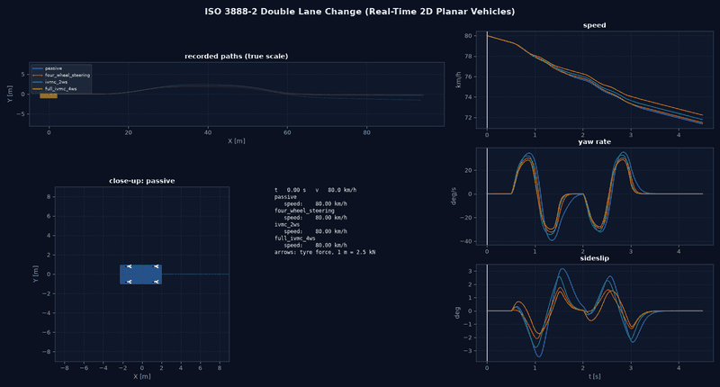
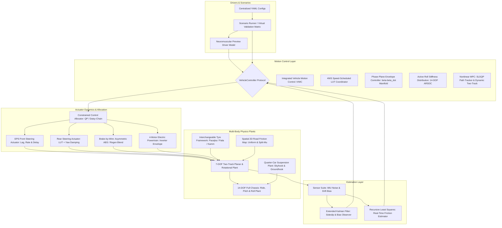

# Vehicle Dynamics & Integrated Chassis Control Development Platform

[](https://www.python.org/)
[](docs/01_architecture.md)
[](tests/)
[](https://cagricatik.github.io/Vehicle-Dynamics/)
[](LICENSE)

A modular, physically consistent Python research and engineering platform for non-linear vehicle dynamics, interchangeable tyre models, physical actuator dynamics, four-wheel steering (4WS), torque vectoring, and integrated vehicle motion control (ABS, TCS, ESC, IVMC).

**Documentation website:** <https://cagricatik.github.io/Vehicle-Dynamics/>

### Results at a glance

All results are simulations with synthetic parameters, not measurements. Each chapter under [docs/](docs/) ends with its own result figures and animations; they are refreshed with `python tools/publish_doc_figures.py` after running the example scripts.

| Rear-axle steering at walking pace (U-turn) | Double lane change, four configurations |
| :---: | :---: |
|  |  |
| The rear axle steers −8° against the front; the street width needed drops from 12.75 m to 11.10 m ([details](docs/13_rear_wheel_steering.md)). | Passive, 4WS, IVMC and IVMC + 4WS in a lane change modelled on ISO 3888-2 ([details](docs/38_validation_platform.md)). |


*Split-µ full braking with the steering held straight: only the wheel-force allocation, which reduces brake torque on the high-friction side, keeps the car straight; rear steering and additive ESC cannot ([details](docs/11_motion_control.md)).*

---

## Architecture & System Overview



---

## 4-Vehicle Benchmark Quartet

All validation maneuvers, animation engines, and telemetry comparisons evaluate a standardized 4-vehicle quartet to provide clean ablation benchmarks across passive and active chassis architectures:

| # | Vehicle Configuration | Steering Architecture | Powertrain & Braking Systems | Active Chassis Systems |
| :-: | :--- | :--- | :--- | :--- |
| **1** | **Passive Baseline** | Front-axle steering (2WS) | Open differential ($T_d/4$), fixed 60:40 brake bias | None (Unregulated baseline) |
| **2** | **Active 4WS Standalone** | Coordinated 4WS (LUT + rear yaw damping) | Open differential ($T_d/4$), fixed 60:40 brake bias | Standalone 4WS (**no ABS, no TCS, $M_z = 0$**) |
| **3** | **IVMC 2WS** | Front-axle steering (2WS) | 4-Motor torque vectoring, brake-by-wire | ESC + TV + ABS + TCS + Phase-Plane Envelope |
| **4** | **Full-Stack IVMC + 4WS** | Coordinated 4WS ($\delta_f, \delta_r$) | 4-Motor torque vectoring, brake-by-wire | Coordinated 4WS + TV + ABS + TCS + ESC + GMR |

> **Physics Note on Standalone 4WS:**  
> The standalone 4WS vehicle demonstrates the physical limitation of pure kinematic rear-wheel steering without integrated slip control. Under high braking torque on low friction ($\mu = 0.20$), wheels lock up ($\kappa \to -1$). By the Kamm friction circle ($F_y \le \sqrt{(\mu F_z)^2 - F_x^2}$), lateral tire force collapses to zero ($F_y \approx 0$), stripping rear steering of control authority and resulting in spinout during combined-slip braking. In contrast, the **Full-Stack IVMC + 4WS** system coordinates rear steering with ABS slip control, torque vectoring, and phase-plane envelope protection to maintain complete stability.

---

## Comprehensive Technical Documentation

The documentation is published as a website: <https://cagricatik.github.io/Vehicle-Dynamics/>. It is written in [docs/](docs/) as numbered chapters, built with [Zensical](https://zensical.org/) and deployed by [.github/workflows/docs.yml](.github/workflows/docs.yml). Most chapters are in German. Start at the [Documentation Hub](docs/index.md).

| Part | Chapters |
| :--- | :--- |
| **Fundamentals** | [01 Architecture](docs/01_architecture.md), [02 Vehicle models](docs/02_vehicle_models.md), [03 Tyre models](docs/03_tyre_models.md), [04 Chassis kinematics](docs/04_chassis_kinematics.md), [05 Actuators](docs/05_actuators.md), [06 Handling analysis](docs/06_handling_analysis.md), [07 Handling limits](docs/07_handling_limits.md), [08 Vertical dynamics](docs/08_vertical_dynamics.md), [09 Suspension dynamics](docs/09_suspension_dynamics.md) |
| **Control** | [10 Control allocation](docs/10_control_allocation.md), [11 Motion control](docs/11_motion_control.md), [12 Chassis control](docs/12_chassis_control.md), [13 Rear-wheel steering](docs/13_rear_wheel_steering.md), [14 Split-µ dynamics](docs/14_split_mu_dynamics.md), [15 Driver model](docs/15_driver_model.md), [16 NMPC](docs/16_nmpc_control.md), [17 NMPC path tracking](docs/17_nmpc_path_tracking.md) |
| **Estimation and stability** | [18 State estimation](docs/18_state_estimation.md), [19 Estimation robustness](docs/19_estimation_robustness.md), [20 Nonlinear stability](docs/20_nonlinear_stability.md), [21 Robust control](docs/21_robust_control.md) |
| **Drift** | [22 Model validity](docs/22_drift_model_validity.md), [23 Drift controller](docs/23_drift_controller.md), [24 Drift results](docs/24_drift_results.md) |
| **Integrated motion control** | [25 Actuation chain](docs/25_actuation_chain.md), [26 Brake functions](docs/26_brake_functions.md), [27 Traction control](docs/27_traction_control.md), [28 Roll stability and active steering](docs/28_roll_stability_active_steering.md), [29 G-vectoring](docs/29_g_vectoring.md), [30 Preview damping and active pitch](docs/30_preview_damping_active_pitch.md), [31 Hill descent control](docs/31_hill_descent_control.md), [32 Fault tolerance](docs/32_fault_tolerance.md), [33 Motion management benchmark](docs/33_motion_management_benchmark.md) |
| **Tools** | [34 Experiments](docs/34_experiments.md), [35 Scenario book](docs/35_scenario_book.md), [36 Critical scenarios](docs/36_critical_scenarios.md), [37 Design optimisation](docs/37_design_optimization.md), [38 Validation platform](docs/38_validation_platform.md), [39 Visualisation guide](docs/39_visualization_guide.md), [40 Workbench](docs/40_workbench.md) |
| **Appendix** | [41 Audit](docs/41_audit.md), [42 Baseline audit](docs/42_baseline_audit.md), [43 Traceability](docs/43_traceability.md), [44 References](docs/44_references.md), [plans](docs/plans/) |

Book and paper references in chapter 44 are checked against Crossref. [Chapter 43](docs/43_traceability.md) is the only place that maps plan milestones to today's topic names.

---

## Platform Highlights

- **Multi-Body Dynamics Plants:** Non-linear 7-DOF two-track chassis with exact vertical load conservation ($\sum F_{z,i} \equiv mg$ to $< 10^{-11}\text{ N}$) and coupled 14-DOF full vehicle ride, pitch, and roll dynamics.
- **Interchangeable Tyre Framework:** Full provenance tracking (`TyreProvenance`) across `LinearTyre`, `FialaTyre`, `SimplifiedCombinedSlipTyre`, `MagicFormulaTyre` (MF 5.2 subset with aligning moment) and the legacy `PacejkaTyre` adapter; optional first-order tyre relaxation (`TransientSevenDOFModel`).
- **Physical Actuator Dynamics:** Models EPS first-order lag ($\tau = 45\text{ ms}$), slew rate limits ($60^\circ/\text{s}$), pure transport delay ($\tau_d = 25\text{ ms}$), 4-motor EV field-weakening envelope, and brake-by-wire asymmetric ABS pressure rates.
- **Active Chassis Control:** Integrated Vehicle Motion Control (IVMC) combining feedforward steady-state steering, feedback PID/LQR yaw damping, 4WS speed scheduling, and constrained torque vectoring.
- **Handling Limits & Understeer Evaluation (ISO 4138):** Full circular steady-state driving test measuring understeer gradient $K_{\text{us}}(a_y)$, Ackermann reference line, characteristic speed $v_{\text{char}}$, critical speed $v_{\text{crit}}$, and combined G-G acceleration envelopes.
- **Advanced Stability Envelopes:** $(\beta, \dot{\beta})$ Phase-Plane Envelope Control for lift-off oversteer recovery and 14-DOF Active Roll Stiffness Distribution Control (ARSDC) for rollover mitigation ($LTR < 0.70$).
- **Nonlinear Model Predictive Control (NMPC):** SLSQP single-shooting kinematic path tracker and Dynamic Two-Track NMPC with a soft friction-circle penalty (no C/GMRES implementation).
- **Closed-Loop Driver-in-the-Loop Dynamics:** MacAdam/Salvucci preview driver with human neural latency ($\tau_d \approx 160\text{ ms}$) and neuromuscular lag ($\tau_n \approx 100\text{ ms}$) for driver workload evaluation.
- **State Estimation Suite:** Extended Kalman Filter (EKF) sideslip observer, Recursive Least Squares (RLS) real-time friction estimator, and Particle Swarm Optimization (PSO) tuning engine.
- **Integrated Motion Control:** One shared chain (motion controller, wheel-force allocation, ABS/TCS, actuator models) carrying EBD, cornering brake control, integrated brake control, regenerative slip control, virtual eLSD, integrated traction control, active front steering, a G-Vectoring-like load-transfer strategy and hill descent control on graded roads.
- **14-DOF Functions:** Roll stability control, preview damping from a modelled road sensor, active pitch control and vertical force allocation.
- **Fault Tolerance:** Deterministic fault catalogue, health monitor working only from corrupted signals and actuator self-reports, degraded modes and recovery; fail-operational behaviour is not claimed.
- **Motion Management Benchmark:** Function registry, deterministic arbitration and a matrix of eight configuration levels (`passive` to `fault_tolerant`) over 15 manoeuvres with paired parameter variations.
- **Drift Control:** Stationary drift equilibria, LQR hold, initiation, exit and recovery, circle and figure-eight tracking.
- **Research Tooling:** Nonlinear stability maps, robust control benchmarks, critical scenario search, NSGA-II design optimisation and an optional web workbench.
- **Automated Validation Platform:** Executes 10 standardized ISO and NHTSA maneuvers, compiling interactive HTML dashboards, markdown validation reports, and synchronized 20 FPS real-time 2D planar animations (GIFs).

---

## Directory Structure

```text
Vehicle-Dynamics/
├── README.md                 # This overview
├── pyproject.toml            # Package metadata; extras: test, workbench, docs
├── zensical.toml             # Documentation website configuration
├── .github/workflows/        # ci.yml (tests), docs.yml (GitHub Pages)
├── configs/
│   ├── experiments/          # YAML experiments named by topic and scenario,
│   │                         #   e.g. brake_functions_split_mu, hill_descent_control
│   ├── critical/             # Frozen critical scenarios (regression cases)
│   └── vehicles/ tyres/ steering/ powertrains/ braking/ controllers/
│       estimators/ suspension/ validation/ visualization/ drift/ roads/ scenarios/
├── docs/
│   ├── index.md              # Website start page
│   ├── 01_architecture.md … 44_references.md
│   ├── plans/                # Platform, integrated motion control and drift plans
│   └── assets/               # Figures and GIFs published from output/
├── src/vehicle_model/
│   ├── core/ vehicle_models/ tire_model/ roads/ actuators/ steering/ suspension/
│   ├── allocation/           # Wheel-force and vertical force allocation
│   ├── controllers/          # Yaw laws, brake, traction, stability, HDC, health monitor, supervisor
│   ├── drift/                # Drift equilibria, control and supervisor
│   ├── estimation/           # Sensors, observers, friction estimation
│   ├── simulation/           # Scenarios, actuator chain, ride, fault injection
│   ├── experiments/          # YAML experiment engine and benchmark types
│   ├── scenario_book/        # Catalogue of runnable scenarios
│   ├── visualization/        # Unified plan-view and side-view rendering, animations
│   └── workbench/            # Optional FastAPI web interface
├── examples/                 # Demonstrations, figure scripts, chassis_control_animations.py
├── tools/                    # run_all_results.py, publish_doc_figures.py
├── tests/vehicle_model/      # Automated test suite
└── output/                   # Generated results (not tracked)
```

---

## Quickstart Guide

### 1. Installation
Clone the repository and install in editable mode within a Python 3.10+ virtual environment:

```bash
git clone https://github.com/CagriCatik/Vehicle-Dynamics.git
cd Vehicle-Dynamics

# Create and activate virtual environment
python3 -m venv .venv
source .venv/bin/activate

# Install dependencies and vehicle_model package (with pytest for the test suite)
pip install -e ".[test]"
```

### 2. YAML Experiments (vehicle, tyres, road, manoeuvre, controllers)

```bash
python -m vehicle_model.experiments list
python -m vehicle_model.experiments run configs/experiments/sine_with_dwell_comparison.yaml
```

For a catalogue of all runnable scenarios (parking with rear-axle steering, 4WS benchmark manoeuvres, split-µ, YAML experiments, validation matrix) and a command line to start them one by one, see the [Scenario Book](docs/35_scenario_book.md):

```bash
python -m vehicle_model.scenario_book list
python -m vehicle_model.scenario_book info u_turn
python -m vehicle_model.scenario_book run u_turn --no-gif
python -m vehicle_model.scenario_book run --category parking
```

Each YAML experiment run checks the configured model first (parameter consistency, static loads, tyre symmetry, linear reference, mirror symmetry, determinism) and writes `results.json`, `kpis.csv`, time histories, figures and an engineering report (`report.md`) to `output/experiments/<name>/`. See [docs/34_experiments.md](docs/34_experiments.md).

Nonlinear stability: steady-state equilibria of the 7-DOF model with residuals, eigenvalues and a check against the nonlinear dynamics, and numerically determined recovery regions per controller in the (sideslip, yaw rate) plane with their numerical uncertainty. Both are experiment types:

```bash
python -m vehicle_model.experiments run configs/experiments/equilibrium_steer_sweep.yaml
python -m vehicle_model.experiments run configs/experiments/stability_map_cornering.yaml   # ~7 min, parallel
```

See [docs/20_nonlinear_stability.md](docs/20_nonlinear_stability.md). The recovery regions are numerical results for the grid, step and duration used, not proven regions of attraction.

### 3. Running Flagship Demonstrations

#### Regenerate All Results
```bash
python tools/run_all_results.py                 # all experiments, demos, figures and GIFs; log: output/run_all_log.csv
python tools/run_all_results.py --only traction # only items whose name contains "traction"
```
Results are written to `output/<topic>/<scenario>/`, for example `output/brake_functions/split_mu/`. A full run takes well over an hour.

#### Comparison Animations by Topic
```bash
python examples/chassis_control_animations.py                               # all topics
python examples/chassis_control_animations.py brake_functions hill_descent  # selected topics
```

#### Documentation Website
```bash
pip install -e ".[docs]"
zensical serve                   # local preview at http://localhost:8000
python tools/publish_doc_figures.py   # refresh docs/assets from output/
```

#### Automated Virtual Validation Platform (10 Standardized Scenarios)
```bash
python examples/run_validation_platform.py --animations
```
- Executes all 10 standardized ISO and NHTSA virtual testing scenarios across the 4-vehicle quartet.
- Generates collision-free multi-panel engineering telemetry figures (`output/validation_report/figures/`).
- Compiles the traceable markdown validation report (`output/validation_report/validation_report.md`) and modern HTML dashboard (`output/validation_report/index.html`).

#### Real-Time 2D Planar Maneuver Animations (20 FPS GIFs)
```bash
python examples/generate_maneuver_animations.py
```
- Generates high-definition, synchronized animated GIFs featuring live steerable rubber tyres, dynamic telemetry progress cursors, digital HUD readouts, and a 1:1 scale tracking camera.
- Animated GIFs saved to `output/validation_report/animations/` and `output/animations/`.

#### Split-μ Dynamics & Multi-Scenario Benchmark Suite
```bash
python examples/split_mu_scenarios_demo.py
```
- Executes all 5 standardized split-$\mu$ testing scenarios across Passive Baseline, Active 4WS, and Integrated IVMC:
  1. Split-$\mu$ Straight-Line Emergency Braking ($100\,\text{km/h}$ ECE-R13H).
  2. Split-$\mu$ Full-Throttle Launch & Acceleration ($0 \to 60\,\text{km/h}$ TCS/TV).
  3. Split-$\mu$ Braking in a Turn (ISO 7975 Combined Slip & Dynamic Roll Load Transfer).
  4. Diagonal Split-$\mu$ Bridge Transition (Staggered Wheel Entry & Driver Reaction Lag).
  5. Split-$\mu$ Severe Double Lane Change (ISO 3888-2 Obstacle Evasion onto Slick Lane).
- Publication-quality 5-panel dashboards and synchronized animated GIFs saved to `output/split_mu_scenarios/`.

#### Advanced Chassis Control (Phase-Plane Envelope & 14-DOF Active Roll)
```bash
python examples/advanced_chassis_control_demo.py
```
- Evaluates non-linear $(\beta, \dot{\beta})$ phase-plane stability boundaries across variable friction ($\mu$).
- Demonstrates 14-DOF Active Roll Stiffness Distribution Control (ARSDC) suppressing inner wheel lift ($LTR < 0.70$) in 80 km/h dynamic fishhook maneuvers.
- Telemetry plots saved to `output/advanced_control/`.

#### Closed-Loop Driver-in-the-Loop & Dynamic Two-Track NMPC
```bash
python examples/driver_and_nmpc_dynamics_demo.py
```
- Demonstrates closed-loop preview driver tracking across split-$\mu$ surfaces under full throttle.
- Evaluates Dynamic Two-Track NMPC trajectory tracking with 4-wheel Kamm friction circle enforcement.

---

## Standardized ISO Benchmark Results

### ISO 3888-2 Double Lane Change Benchmark (80 km/h on $\mu = 0.75$)

```bash
python examples/integrated_control_benchmark.py
```

| Controller Configuration | Peak Yaw Rate | Max Sideslip | Heading Dev | Max Path Dev | Peak Lat Accel | Max Tyre Util |
| :--- | :---: | :---: | :---: | :---: | :---: | :---: |
| **1. Passive Baseline** | 28.3°/s | 2.10° | 0.39° | 1.27 m | 0.65 g | 105.3 % |
| **2. Active 4WS (speed scheduled)** | 21.2°/s | 1.26° (−40 %) | 0.05° | 0.87 m | 0.59 g | 100.7 % |
| **3. Integrated IVMC (4WS + TV + ESC)** | 21.0°/s | 1.23° (−41 %) | 0.07° | 0.85 m | 0.61 g | 103.2 % |

IVMC acts through the shared wheel-force allocation (default; see [11_motion_control.md](docs/11_motion_control.md) 1.2). Generated with the default tyre `magic_formula_passenger_synthetic` (since controller library; the table before controller library used the legacy Pacejka adapter). Tyre utilisation is relative to the road friction $\mu F_z$; values above 100 % are possible because the MF tyre's peak friction exceeds $\mu$ at light wheel loads (load sensitivity). Synthetic vehicle and tyre parameters: the numbers compare controllers on the virtual vehicle, they are not predictions for a real car.

---

## Automated Test Suite

```bash
pytest -m "not slow"     # quick run (about 3.5 minutes)
pytest                   # full suite incl. long scenario tests (about 25 minutes)
```

The suite combines analytical reference tests (closed-form handling characteristics, Riccati equation, quarter-car frequency responses, energy balances, Ackermann geometry), invariant tests (force and moment balances, symmetry, convergence order), regression baselines and scenario tests. Continuous integration (`.github/workflows/ci.yml`) runs the quick suite on every push and the full suite weekly. Current status and the per-topic verification are listed in [docs/41_audit.md](docs/41_audit.md).

---

## License

This project is licensed under the MIT License — see the [LICENSE](LICENSE) file for details.
