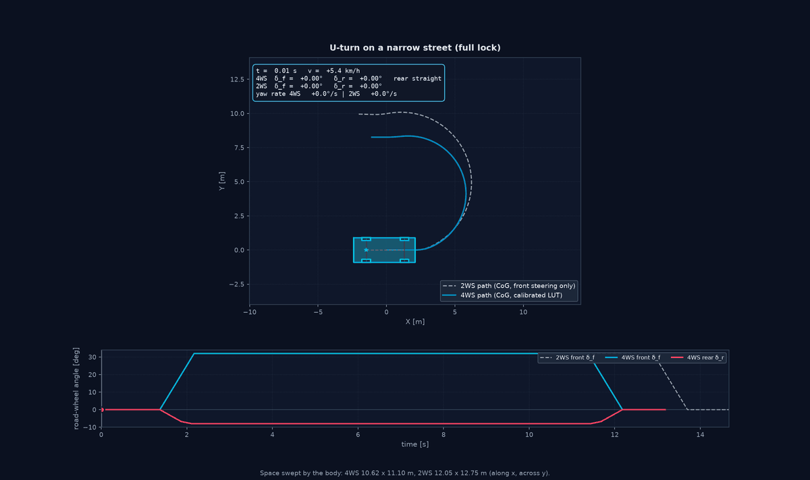
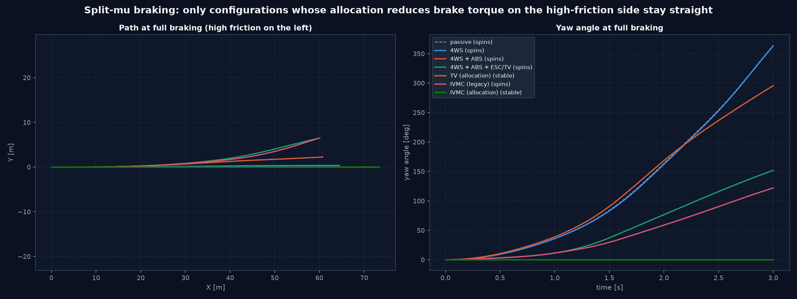
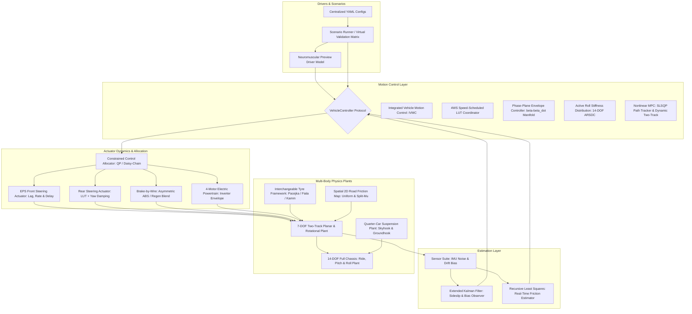

# Vehicle Dynamics & Integrated Chassis Control Development Platform

[](https://www.python.org/)
[](docs/ARCHITECTURE.md)
[](tests/)
[](LICENSE)

A modular, physically consistent Python research and engineering platform for non-linear vehicle dynamics, interchangeable tyre models, physical actuator dynamics, four-wheel steering (4WS), torque vectoring, and integrated vehicle motion control (ABS, TCS, ESC, IVMC).

### Results at a glance

All results are simulations with synthetic parameters, not measurements. Each document under [docs/](docs/) ends with its own result figures; they are refreshed with `python tools/publish_doc_figures.py` after running the example scripts.

| Rear-axle steering at walking pace (U-turn) | Double lane change, four configurations |
| :---: | :---: |
|  |  |
| The rear axle steers −8° against the front; the street width needed drops from 12.75 m to 11.10 m ([details](docs/REAR_WHEEL_STEERING.md)). | Passive, 4WS, IVMC and IVMC + 4WS in a lane change modelled on ISO 3888-2 ([details](docs/VALIDATION_PLATFORM.md)). |



*Split-µ full braking with the steering held straight: only the wheel-force allocation, which reduces brake torque on the high-friction side, keeps the car straight; rear steering and additive ESC cannot ([details](docs/MOTION_CONTROL.md)).*

---

## Architecture & System Overview



---

## 4-Vehicle Benchmark Quartet

All validation maneuvers, animation engines, and telemetry comparisons evaluate a standardized 4-vehicle quartet to provide clean ablation benchmarks across passive and active chassis architectures:

| # | Vehicle Configuration | Steering Architecture | Powertrain & Braking Systems | Active Chassis Systems |
| :-: | :--- | :--- | :--- | :--- |
| **1** | **Passive Baseline** | Front-axle steering (2WS) | Open differential ($T_d/4$), fixed 60:40 brake bias | None (Unregulated baseline) |
| **2** | **Active 4WS Standalone** | Coordinated 4WS (LUT + rear yaw damping) | Open differential ($T_d/4$), fixed 60:40 brake bias | Standalone 4WS (**no ABS, no TCS, $M_z = 0$**) |
| **3** | **IVMC 2WS** | Front-axle steering (2WS) | 4-Motor torque vectoring, brake-by-wire | ESC + TV + ABS + TCS + Phase-Plane Envelope |
| **4** | **Full-Stack IVMC + 4WS** | Coordinated 4WS ($\delta_f, \delta_r$) | 4-Motor torque vectoring, brake-by-wire | Coordinated 4WS + TV + ABS + TCS + ESC + GMR |

> **Physics Note on Standalone 4WS:**  
> The standalone 4WS vehicle demonstrates the physical limitation of pure kinematic rear-wheel steering without integrated slip control. Under high braking torque on low friction ($\mu = 0.20$), wheels lock up ($\kappa \to -1$). By the Kamm friction circle ($F_y \le \sqrt{(\mu F_z)^2 - F_x^2}$), lateral tire force collapses to zero ($F_y \approx 0$), stripping rear steering of control authority and resulting in spinout during combined-slip braking. In contrast, the **Full-Stack IVMC + 4WS** system coordinates rear steering with ABS slip control, torque vectoring, and phase-plane envelope protection to maintain complete stability.

---

## Comprehensive Technical Documentation

All detailed theoretical formulations, mathematical derivations, component guides, and validation specifications are organized inside the [docs/](docs/) folder:

| Chapter | Document | Core Topics & Methodologies |
| :---: | :--- | :--- |
| **Index** | [Documentation Hub](docs/index.md) | Complete documentation index, architectural sitemap, thematic index, and A–Z master index |
| **01** | [System Architecture & ISO 8855](docs/ARCHITECTURE.md) | Intermediate vehicle axis system, coordinate frames, sign conventions, and config schemas |
| **02** | [Multi-Body Vehicle Models](docs/VEHICLE_MODELS.md) | 7-DOF two-track non-linear plant, 14-DOF full chassis, dynamic load transfer, and bicycle models |
| **03** | [Interchangeable Tyre Models](docs/TYRE_MODELS.md) | Mandatory `TyreProvenance`; linear, Fiala brush, simplified combined slip, Magic Formula 5.2 subset (with aligning moment) and first-order relaxation |
| **04** | [Actuator Physics & Braking Systems](docs/ACTUATORS.md) | EPS steering lag/rate limits, 4-motor EV inverter envelope, and BBW regen blending |
| **05** | [Integrated Chassis Control](docs/CHASSIS_CONTROL.md) | IVMC architecture, active torque vectoring, phase-plane envelope control, and ARSDC |
| **06** | [Allradlenkung & Hinterachslenkung (4WS)](docs/REAR_WHEEL_STEERING.md) | Counter-phase, in-phase, analytical zero-sideslip condition ($\beta \to 0$), 2D LUT map |
| **07** | [Non-Linear Model Predictive Control](docs/NMPC_CONTROL.md) & [NMPC Path Tracking](docs/NMPC_PATH_TRACKING.md) | SLSQP single-shooting path tracker and Dynamic Two-Track NMPC with friction-circle penalty |
| **08** | [Neuromuscular Driver Model](docs/DRIVER_MODEL.md) | Closed-loop preview guidance (MacAdam/Salvucci), human delay ($\tau_d$), and workload metrics |
| **09** | [Suspension Dynamics & Ride Comfort](docs/SUSPENSION_DYNAMICS.md) | 2-DOF quarter-car modal analysis, Skyhook/Groundhook damping, and 14-DOF coupled ride |
| **10** | [State Estimation & Optimization](docs/STATE_ESTIMATION.md) | Sensor noise models, EKF sideslip observer, RLS real-time friction, and PSO gain tuning |
| **11** | [Automotive Virtual Validation Platform](docs/VALIDATION_PLATFORM.md) | Automated 10-maneuver validation matrix, standardized KPIs, and acceptance criteria |
| **12** | [Handling Limits & Understeer Dynamics](docs/HANDLING_LIMITS.md) | ISO 4138 steady-state circular test, Understeer Gradient $K_{\text{us}}$, $v_{\text{char}}$, and G-G diagram |
| **13** | [Split-μ Dynamics & Benchmark Suite](docs/SPLIT_MU_DYNAMICS.md) | 5 standardized split-$\mu$ scenarios, multi-$\mu$ matrix ($\mu = 0.2 \dots 1.0$), and 2D surfaces |
| **14** | [Visualization & Animation Guide](docs/VISUALIZATION_GUIDE.md) | 2D Planar vehicle renderer, real-time 20 FPS GIF generator, HUD, and tracking camera |
| **–** | [Scenario Book](docs/SCENARIO_BOOK.md) | Catalogue of runnable scenarios with parameters, runtime and outputs; CLI `python -m vehicle_model.scenario_book` |
| **15** | [Literatur- & Quellenverzeichnis](docs/REFERENCES.md) | Academic textbooks & standards (Küçükay, Mitschke, Heißing, Isermann, Pacejka, Rajamani) |

---

## Platform Highlights

- **Multi-Body Dynamics Plants:** Non-linear 7-DOF two-track chassis with exact vertical load conservation ($\sum F_{z,i} \equiv mg$ to $< 10^{-11}\text{ N}$) and coupled 14-DOF full vehicle ride, pitch, and roll dynamics.
- **Interchangeable Tyre Framework:** Full provenance tracking (`TyreProvenance`) across `LinearTyre`, `FialaTyre`, `SimplifiedCombinedSlipTyre`, `MagicFormulaTyre` (MF 5.2 subset with aligning moment) and the legacy `PacejkaTyre` adapter; optional first-order tyre relaxation (`TransientSevenDOFModel`).
- **Physical Actuator Dynamics:** Models EPS first-order lag ($\tau = 45\text{ ms}$), slew rate limits ($60^\circ/\text{s}$), pure transport delay ($\tau_d = 25\text{ ms}$), 4-motor EV field-weakening envelope, and brake-by-wire asymmetric ABS pressure rates.
- **Active Chassis Control:** Integrated Vehicle Motion Control (IVMC) combining feedforward steady-state steering, feedback PID/LQR yaw damping, 4WS speed scheduling, and constrained torque vectoring.
- **Handling Limits & Understeer Evaluation (ISO 4138):** Full circular steady-state driving test measuring understeer gradient $K_{\text{us}}(a_y)$, Ackermann reference line, characteristic speed $v_{\text{char}}$, critical speed $v_{\text{crit}}$, and combined G-G acceleration envelopes.
- **Advanced Stability Envelopes:** $(\beta, \dot{\beta})$ Phase-Plane Envelope Control for lift-off oversteer recovery and 14-DOF Active Roll Stiffness Distribution Control (ARSDC) for rollover mitigation ($LTR < 0.70$).
- **Nonlinear Model Predictive Control (NMPC):** SLSQP single-shooting kinematic path tracker and Dynamic Two-Track NMPC with a soft friction-circle penalty (no C/GMRES implementation).
- **Closed-Loop Driver-in-the-Loop Dynamics:** MacAdam/Salvucci preview driver with human neural latency ($\tau_d \approx 160\text{ ms}$) and neuromuscular lag ($\tau_n \approx 100\text{ ms}$) for driver workload evaluation.
- **State Estimation Suite:** Extended Kalman Filter (EKF) sideslip observer, Recursive Least Squares (RLS) real-time friction estimator, and Particle Swarm Optimization (PSO) tuning engine.
- **Automated Validation Platform:** Executes 10 standardized ISO and NHTSA maneuvers, compiling interactive HTML dashboards, markdown validation reports, and synchronized 20 FPS real-time 2D planar animations (GIFs).

---

## Directory Structure

```text
Vehicle-Dynamics/
├── README.md                          # Executive overview & documentation hub
├── Plan.md                            # Master engineering roadmap (Milestones M0 to M8)
├── pyproject.toml                     # Package metadata, dependencies & build config
├── LICENSE                            # MIT License
│
├── configs/                           # Centralized YAML configuration repository
│   ├── vehicles/                      # Vehicle mass, geometry, inertia specifications
│   ├── tyres/                         # Tyre parameter YAMLs with strict provenance
│   ├── steering/                      # 4WS, EPS actuators, and 2D rear steering LUT (lut.json)
│   ├── powertrains/                   # 4-motor electric powertrain and inverter parameters
│   ├── braking/                       # Brake-by-wire and ABS/TCS slip controller parameters
│   ├── controllers/                   # IVMC, torque vectoring, driver model, and NMPC YAMLs
│   ├── estimators/                    # EKF observer, sensor noise, and RLS friction configs
│   ├── suspension/                    # Quarter-car and 14-DOF suspension parameters
│   ├── validation/                    # Validation matrix scenarios and regression criteria
│   └── default.yaml                   # Master simulation configuration
│
├── docs/                              # Comprehensive technical documentation suite
│   ├── index.md                       # Master documentation index and sitemap
│   ├── ARCHITECTURE.md                # System architecture, ISO 8855, and coordinate conventions
│   ├── VEHICLE_MODELS.md              # 7-DOF two-track, 14-DOF full vehicle, and bicycle equations
│   ├── TYRE_MODELS.md                 # Tyre models, combined slip, MF 5.2 subset, relaxation
│   ├── ACTUATORS.md                   # EPS steering, 4-motor EV powertrain, and brake-by-wire
│   ├── CHASSIS_CONTROL.md             # IVMC, 4WS speed scheduling, phase-plane envelope & ARSDC
│   ├── REAR_WHEEL_STEERING.md         # Coordinated 4WS, virtual wheelbase, counter/in-phase
│   ├── NMPC_CONTROL.md                # Dynamic Two-Track NMPC with 4-wheel Kamm circle bounds
│   ├── NMPC_PATH_TRACKING.md          # SLSQP NMPC path tracker (formulation & limits)
│   ├── DRIVER_MODEL.md                # Closed-loop neuromuscular preview driver dynamics
│   ├── SUSPENSION_DYNAMICS.md         # Quarter-car modal analysis, Skyhook/Groundhook & 14-DOF ride
│   ├── STATE_ESTIMATION.md            # Sensor models, EKF sideslip observer, RLS friction & PSO
│   ├── VALIDATION_PLATFORM.md         # Virtual validation matrix, KPIs, and pass/fail thresholds
│   ├── HANDLING_LIMITS.md             # ISO 4138 understeer gradient, characteristic speed, G-G diagram
│   ├── SPLIT_MU_DYNAMICS.md           # 5 split-mu handling maneuvers & friction transition maps
│   ├── VISUALIZATION_GUIDE.md         # 2D Planar vehicle rendering engine & 20 FPS GIF generator
│   └── REFERENCES.md                  # Literature citations & academic automotive textbooks
│
├── src/vehicle_model/                 # Consolidated Python source package
│   ├── core/                          # State vectors, parameters, telemetry, and base protocols
│   ├── vehicle_models/                # 7-DOF two-track, single-track dynamic and kinematic models
│   ├── tire_model/                    # Linear, Fiala, Simplified Combined, and Pacejka tyres
│   ├── actuators/                     # EPS steering, electric powertrain, and brake-by-wire
│   ├── steering/                      # 4WS coordinator & calibrated rear-axle steering LUT
│   ├── controllers/                   # IVMC, phase-plane, active roll, driver, and NMPC controllers
│   ├── suspension/                    # Quarter-car, Skyhook, Groundhook, and 14-DOF full vehicle
│   ├── estimation/                    # Sensor noise, EKF sideslip observer, RLS friction, and PSO
│   ├── simulation/                    # ScenarioRunner, validation platform, and report generator
│   └── visualization/                 # Plan-view polygon renderer, animation engine, and HUD
│
├── examples/                          # Flagship engineering demonstrations and benchmarks
│   ├── advanced_chassis_control_demo.py # Phase-plane envelope & 14-DOF active roll stability
│   ├── driver_and_nmpc_dynamics_demo.py # Closed-loop driver model & dynamic two-track NMPC
│   ├── seven_dof_4ws_tv_demo.py       # 7-DOF chassis simulation (4WS + TV + split-mu braking)
│   ├── split_mu_scenarios_demo.py     # 5 split-mu handling maneuvers & friction sweeps
│   ├── integrated_control_benchmark.py # ISO 3888-2 DLC 4-vehicle benchmark comparison
│   ├── four_wheel_steering_benchmark.py # Multi-maneuver 4WS LUT and yaw damping benchmark
│   ├── run_validation_platform.py     # Automated execution of 10 validation matrix scenarios
│   └── generate_maneuver_animations.py# 20 FPS real-time 2D planar animation GIF generator
│
└── tests/vehicle_model/               # Full automated pytest test suite (142 tests)
```

---

## Quickstart Guide

### 1. Installation
Clone the repository and install in editable mode within a Python 3.10+ virtual environment:

```bash
git clone https://github.com/CagriCatik/Vehicle-Dynamics.git
cd Vehicle-Dynamics

# Create and activate virtual environment
python3 -m venv .venv
source .venv/bin/activate

# Install dependencies and vehicle_model package (with pytest for the test suite)
pip install -e ".[test]"
```

### 2. YAML Experiments (vehicle, tyres, road, manoeuvre, controllers)

```bash
python -m vehicle_model.experiments list
python -m vehicle_model.experiments run configs/experiments/sine_with_dwell_comparison.yaml
```

For a catalogue of all runnable scenarios (parking with rear-axle steering, 4WS benchmark manoeuvres, split-µ, YAML experiments, validation matrix) and a command line to start them one by one, see the [Scenario Book](docs/SCENARIO_BOOK.md):

```bash
python -m vehicle_model.scenario_book list
python -m vehicle_model.scenario_book info u_turn
python -m vehicle_model.scenario_book run u_turn --no-gif
python -m vehicle_model.scenario_book run --category parking
```

Each YAML experiment run checks the configured model first (parameter consistency, static loads, tyre symmetry, linear reference, mirror symmetry, determinism) and writes `results.json`, `kpis.csv`, time histories, figures and an engineering report (`report.md`) to `output/experiments/<name>/`. See [docs/EXPERIMENTS.md](docs/EXPERIMENTS.md).

### 3. Running Flagship Demonstrations

#### Automated Virtual Validation Platform (10 Standardized Scenarios)
```bash
python examples/run_validation_platform.py --animations
```
- Executes all 10 standardized ISO and NHTSA virtual testing scenarios across the 4-vehicle quartet.
- Generates collision-free multi-panel engineering telemetry figures (`output/validation_report/figures/`).
- Compiles the traceable markdown validation report (`output/validation_report/validation_report.md`) and modern HTML dashboard (`output/validation_report/index.html`).

#### Real-Time 2D Planar Maneuver Animations (20 FPS GIFs)
```bash
python examples/generate_maneuver_animations.py
```
- Generates high-definition, synchronized animated GIFs featuring live steerable rubber tyres, dynamic telemetry progress cursors, digital HUD readouts, and a 1:1 scale tracking camera.
- Animated GIFs saved to `output/validation_report/animations/` and `output/animations/`.

#### Split-μ Dynamics & Multi-Scenario Benchmark Suite
```bash
python examples/split_mu_scenarios_demo.py
```
- Executes all 5 standardized split-$\mu$ testing scenarios across Passive Baseline, Active 4WS, and Integrated IVMC:
  1. Split-$\mu$ Straight-Line Emergency Braking ($100\,\text{km/h}$ ECE-R13H).
  2. Split-$\mu$ Full-Throttle Launch & Acceleration ($0 \to 60\,\text{km/h}$ TCS/TV).
  3. Split-$\mu$ Braking in a Turn (ISO 7975 Combined Slip & Dynamic Roll Load Transfer).
  4. Diagonal Split-$\mu$ Bridge Transition (Staggered Wheel Entry & Driver Reaction Lag).
  5. Split-$\mu$ Severe Double Lane Change (ISO 3888-2 Obstacle Evasion onto Slick Lane).
- Publication-quality 5-panel dashboards and synchronized animated GIFs saved to `output/split_mu_scenarios/`.

#### Advanced Chassis Control (Phase-Plane Envelope & 14-DOF Active Roll)
```bash
python examples/advanced_chassis_control_demo.py
```
- Evaluates non-linear $(\beta, \dot{\beta})$ phase-plane stability boundaries across variable friction ($\mu$).
- Demonstrates 14-DOF Active Roll Stiffness Distribution Control (ARSDC) suppressing inner wheel lift ($LTR < 0.70$) in 80 km/h dynamic fishhook maneuvers.
- Telemetry plots saved to `output/advanced_control/`.

#### Closed-Loop Driver-in-the-Loop & Dynamic Two-Track NMPC
```bash
python examples/driver_and_nmpc_dynamics_demo.py
```
- Demonstrates closed-loop preview driver tracking across split-$\mu$ surfaces under full throttle.
- Evaluates Dynamic Two-Track NMPC trajectory tracking with 4-wheel Kamm friction circle enforcement.

---

## Standardized ISO Benchmark Results

### ISO 3888-2 Double Lane Change Benchmark (80 km/h on $\mu = 0.75$)

```bash
python examples/integrated_control_benchmark.py
```

| Controller Configuration | Peak Yaw Rate | Max Sideslip | Heading Dev | Max Path Dev | Peak Lat Accel | Max Tyre Util |
| :--- | :---: | :---: | :---: | :---: | :---: | :---: |
| **1. Passive Baseline** | 28.3°/s | 2.10° | 0.39° | 1.27 m | 0.65 g | 105.3 % |
| **2. Active 4WS (speed scheduled)** | 21.2°/s | 1.26° (−40 %) | 0.05° | 0.87 m | 0.59 g | 100.7 % |
| **3. Integrated IVMC (4WS + TV + ESC)** | 21.0°/s | 1.23° (−41 %) | 0.07° | 0.85 m | 0.61 g | 103.2 % |

IVMC acts through the shared wheel-force allocation (default since V3.0; see [MOTION_CONTROL.md](docs/MOTION_CONTROL.md) 1.2). Generated with the default tyre `magic_formula_passenger_synthetic` (since M6; the table before M6 used the legacy Pacejka adapter). Tyre utilisation is relative to the road friction $\mu F_z$; values above 100 % are possible because the MF tyre's peak friction exceeds $\mu$ at light wheel loads (load sensitivity). Synthetic vehicle and tyre parameters: the numbers compare controllers on the virtual vehicle, they are not predictions for a real car.

---

## Automated Test Suite

```bash
pytest -m "not slow"     # quick run (about one minute)
pytest                   # full suite incl. long scenario tests (10-15 minutes)
```

The suite combines analytical reference tests (closed-form handling characteristics, Riccati equation, quarter-car frequency responses, energy balances, Ackermann geometry), invariant tests (force and moment balances, symmetry, convergence order), regression baselines and scenario tests. Continuous integration (`.github/workflows/ci.yml`) runs the quick suite on every push and the full suite weekly. Current status and the per-milestone verification are listed in [docs/AUDIT.md](docs/AUDIT.md).

---

## License

This project is licensed under the MIT License — see the [LICENSE](LICENSE) file for details.
