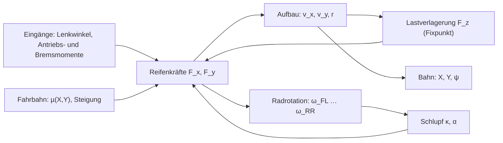
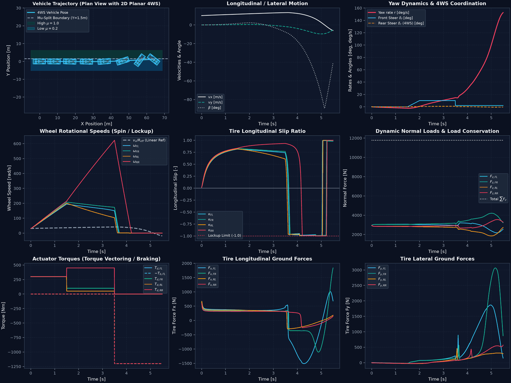

# Multi-Body Vehicle Dynamics Models

This document details the governing differential equations of motion, kinematic transformations, tyre force integrations, and numerical integration schemes for all vehicle models implemented in the platform:

1. **Seven Degree-of-Freedom (7-DOF) Non-Linear Two-Track Model** (`SevenDOFModel`)
2. **Fourteen Degree-of-Freedom (14-DOF) Multi-Body Chassis Model** (`FourteenDOFVehicleModel`)
3. **Dynamic Single-Track (Bicycle) Model** (`DynamicSingleTrackModel`)
4. **Kinematic Single-Track (Bicycle) Model** (`KinematicSingleTrackModel`)

---

## Überblick

## 1. Coordinate Systems & Conventions (ISO 8855)

All models adhere strictly to the **ISO 8855 Intermediate Vehicle Axis System**:
- **$X$-axis:** Forward along the longitudinal chassis centerline.
- **$Y$-axis:** Directed to the driver's left (lateral).
- **$Z$-axis:** Directed upwards (vertical), completing the right-handed Cartesian frame.
- **Yaw ($\psi, r$):** Positive counter-clockwise looking from above (leftward turn yields $r > 0$).
- **Sideslip Angle ($\beta$):** $\beta = \arctan(v_y / v_x)$, positive when drifting towards the left.
- **Steer Angles ($\delta_f, \delta_r$):** Positive counter-clockwise (leftward steer yields $\delta > 0$).
- **Wheel Indexing:**
  - `0`: Front-Left (`FL`)
  - `1`: Front-Right (`FR`)
  - `2`: Rear-Left (`RL`)
  - `3`: Rear-Right (`RR`)

---

## 2. Seven Degree-of-Freedom (7-DOF) Two-Track Vehicle Model

The 7-DOF two-track model is the primary simulation plant for planar handling, electronic stability control, torque vectoring, and active steering. It captures **3 planar chassis degrees of freedom** coupled with **4 independent wheel rotational degrees of freedom**.

### 2.1 State Vector & Equations of Motion

The full simulation state vector $\mathbf{x} \in \mathbb{R}^{10}$ is defined as:
$$\mathbf{x} = \begin{bmatrix} v_x & v_y & r & \omega_{FL} & \omega_{FR} & \omega_{RL} & \omega_{RR} & X & Y & \psi \end{bmatrix}^T$$

Where:
- $v_x, v_y$: Longitudinal and lateral chassis velocities in the vehicle body frame [m/s]
- $r$: Chassis yaw rate around the vertical $Z$-axis [rad/s]
- $\omega_i$: Rotational angular velocity of wheel $i \in \{FL, FR, RL, RR\}$ [rad/s]
- $X, Y$: Global inertial positions [m]
- $\psi$: Global chassis yaw angle (heading) [rad]

#### 2.1.1 Planar Chassis Translational & Yaw Dynamics (3 DOFs)

$$\begin{aligned}
m(\dot{v}_x - r v_y) &= \sum_{i=1}^4 F_{X,i} - F_{\text{aero,drag}} - F_{\text{roll,res}} \\
m(\dot{v}_y + r v_x) &= \sum_{i=1}^4 F_{Y,i} \\
I_z \dot{r} &= (F_{Y,FL} + F_{Y,FR}) l_f - (F_{Y,RL} + F_{Y,RR}) l_r \\
&\quad + (-F_{X,FL} + F_{X,FR}) \frac{w_f}{2} + (-F_{X,RL} + F_{X,RR}) \frac{w_r}{2}
\end{aligned}$$

Where:
- $m$: Vehicle total mass [kg]
- $I_z$: Yaw moment of inertia about the center of gravity (CoG) [$\text{kg}\cdot\text{m}^2$]
- $l_f, l_r$: Longitudinal distances from CoG to front and rear axles [m] ($L = l_f + l_r$)
- $w_f, w_r$: Front and rear axle track widths [m]
- $F_{\text{aero,drag}} = \frac{1}{2} \rho C_d A_f v_x^2$: Aerodynamic drag force [N]
- $F_{\text{roll,res}} = m g f_{\text{roll}} \operatorname{sgn}(v_x)$: Rolling resistance force [N]

#### 2.1.2 Wheel Rotational Dynamics (4 DOFs)

For each wheel $i \in \{FL, FR, RL, RR\}$:
$$I_\omega \dot{\omega}_i = T_{\text{drive},i} - T_{\text{brake},i} \operatorname{sgn}(\omega_i) - F_{x,i} R_{\text{eff}} - d_\omega \omega_i$$

Where:
- $I_\omega$: Polar moment of inertia of the wheel and rotating assembly [$\text{kg}\cdot\text{m}^2$]
- $T_{\text{drive},i}$: Drive torque applied to wheel $i$ from the electric motor or powertrain [Nm]
- $T_{\text{brake},i}$: Friction braking torque applied to wheel $i$ [Nm]
- $F_{x,i}$: Longitudinal tyre contact patch tractive/braking force in the wheel frame [N]
- $R_{\text{eff}}$: Effective rolling radius of the tyre [m]
- $d_\omega$: Viscous wheel bearing damping coefficient [$\text{Nm}\cdot\text{s/rad}$]

---

### 2.2 Wheel Velocity & Slip Kinematics

The local linear velocity of the hub for each wheel in the vehicle frame is derived from rigid body planar kinematics:

$$\begin{aligned}
v_{x,\text{hub},FL} &= v_x - r \frac{w_f}{2}, \quad & v_{y,\text{hub},FL} &= v_y + r l_f \\
v_{x,\text{hub},FR} &= v_x + r \frac{w_f}{2}, \quad & v_{y,\text{hub},FR} &= v_y + r l_f \\
v_{x,\text{hub},RL} &= v_x - r \frac{w_r}{2}, \quad & v_{y,\text{hub},RL} &= v_y - r l_r \\
v_{x,\text{hub},RR} &= v_x + r \frac{w_r}{2}, \quad & v_{y,\text{hub},RR} &= v_y - r l_r
\end{aligned}$$

Transforming hub velocities into the steered wheel coordinate frame with steer angle $\delta_i$:
$$\begin{aligned}
v_{w,x,i} &= v_{x,\text{hub},i} \cos \delta_i + v_{y,\text{hub},i} \sin \delta_i \\
v_{w,y,i} &= -v_{x,\text{hub},i} \sin \delta_i + v_{y,\text{hub},i} \cos \delta_i
\end{aligned}$$

#### 2.2.1 Longitudinal Slip Ratio ($\kappa_i$)
$$\kappa_i = \frac{\omega_i R_{\text{eff}} - v_{w,x,i}}{\max\left(|v_{w,x,i}|, v_{\epsilon}\right)}$$
- $\kappa > 0$: Driving (wheel spinning faster than ground speed)
- $\kappa < 0$: Braking (wheel slowing relative to ground speed; $\kappa = -1.0$ is complete wheel lockup)

#### 2.2.2 Tyre Slip Angle ($\alpha_i$)
$$\alpha_i = -\arctan\left(\frac{v_{w,y,i}}{\max\left(|v_{w,x,i}|, v_{\epsilon}\right)}\right)$$
Where $v_{\epsilon} = 0.2\text{ m/s}$ (`_V_EPS` in `seven_dof.py`) is a regularisation velocity avoiding division by zero at standstill.

---

### 2.3 Dynamic Load Transfer with Exact Normal Force Conservation

Dynamic acceleration causes weight transfer between axles (longitudinally) and between left/right wheels (laterally). The platform computes exact normal loads enforcing both static equilibrium and dynamic force balance:

$$\begin{aligned}
F_{z,FL} &= \frac{1}{2}\left(m g \frac{l_r}{L} - \frac{m a_x h_{\text{cog}}}{L}\right) - \frac{m a_y h_{\text{cog}}}{w_f} k_{\text{roll},f} \\
F_{z,FR} &= \frac{1}{2}\left(m g \frac{l_r}{L} - \frac{m a_x h_{\text{cog}}}{L}\right) + \frac{m a_y h_{\text{cog}}}{w_f} k_{\text{roll},f} \\
F_{z,RL} &= \frac{1}{2}\left(m g \frac{l_f}{L} + \frac{m a_x h_{\text{cog}}}{L}\right) - \frac{m a_y h_{\text{cog}}}{w_r} (1 - k_{\text{roll},f}) \\
F_{z,RR} &= \frac{1}{2}\left(m g \frac{l_f}{L} + \frac{m a_x h_{\text{cog}}}{L}\right) + \frac{m a_y h_{\text{cog}}}{w_r} (1 - k_{\text{roll},f})
\end{aligned}$$

Where:
- $h_{\text{cog}}$: Height of center of gravity above ground [m]
- $k_{\text{roll},f}$: Front axle roll stiffness fraction ($k_{\text{roll},f} \approx 0.55-0.60$)
- $a_x = \dot{v}_x - r v_y$: Longitudinal acceleration [$\text{m/s}^2$]
- $a_y = \dot{v}_y + r v_x$: Lateral acceleration [$\text{m/s}^2$]

The four formulas satisfy three equilibrium conditions: $\sum F_{z,i} = mg$, $\sum x_i F_{z,i} = -m a_x h_{\text{cog}}$ and $\sum y_i F_{z,i} = -m a_y h_{\text{cog}}$. The centre of pressure therefore lies at $(-a_x h_{\text{cog}}/g,\ -a_y h_{\text{cog}}/g)$ relative to the CoG. With four loads and three conditions, one *warp* mode remains, $q = (1/w_f,\ -1/w_f,\ -1/w_r,\ 1/w_r)$. It changes no resultant, and the roll stiffness split $k_{\text{roll},f}$ fixes it.

#### Unilateral Contact (Wheel Lift-Off and Tip-Over)

Contact is unilateral: $F_{z,i} \ge 0$. Treating the warp mode as elastic, the consistent loads are $F = F^* + \text{clip}(0, w_{lo}, w_{hi})\, q$. Here $F^*$ are the formulas above, and $[w_{lo}, w_{hi}]$ is the interval of warp offsets that keeps all four loads non-negative ([normal_loads.py](https://github.com/CagriCatik/Vehicle-Dynamics/blob/main/src/vehicle_model/vehicle_models/normal_loads.py)):

| Case | `support` | Loads | Balances |
|---|---|---|---|
| $F^* \ge 0$ | `four_wheel` | formulas above | force, pitch, roll exact; roll split $= k_{\text{roll},f}$ |
| a wheel would go negative | `three_wheel` | that wheel $= 0$, the other three statically determinate | force, pitch, roll exact; roll split no longer enforced |
| CoP outside the support polygon | `tip_over` | nearest boundary point, shared by two wheels | moment the contacts cannot carry is reported as `moment_residual` |

The lift-off transition is continuous. Once the inner front wheel has lifted, any further roll moment goes to the rear axle, because an anti-roll bar cannot pull a wheel down. In the `tip_over` state the vehicle would roll or pitch over. Results there are outside the model's validity.

Reporting: `WheelTelemetry.in_contact`, `.support` and `.load_transfer_converged`; `SimulationHistory.in_contact`, `.support` and `.contact_events()` (lift-off and touch-down with time and wheel). There is no silent clipping and no rescaling.

Analytical thresholds at $a_x = 0$:
- Inner front wheel lifts at $a_y = \tfrac{1}{2} g \frac{l_r}{L} \frac{w_f}{h_{\text{cog}} k_{\text{roll},f}}$.
- Tip-over at $a_y = g \frac{w_f l_r + w_r l_f}{2 L h_{\text{cog}}}$.

For the reference car, lift-off would require $a_y \approx 13.7$ m/s², beyond the friction limit at µ = 1. The tests therefore use a variant with $h_{\text{cog}} = 0.9$ m and $k_{\text{roll},f} = 0.9$.

Tests: [test_normal_loads.py](https://github.com/CagriCatik/Vehicle-Dynamics/blob/main/tests/vehicle_model/test_normal_loads.py) and [test_seven_dof_balances.py](https://github.com/CagriCatik/Vehicle-Dynamics/blob/main/tests/vehicle_model/test_seven_dof_balances.py).

---

### 2.4 Force Transformation from Wheel Frame to Chassis Frame

Tyre forces $(F_{x,i}, F_{y,i})$ computed in the wheel heading frame are projected into the vehicle body axis system:
$$\begin{aligned}
F_{X,i} &= F_{x,i} \cos \delta_i - F_{y,i} \sin \delta_i \\
F_{Y,i} &= F_{x,i} \sin \delta_i + F_{y,i} \cos \delta_i
\end{aligned}$$

---

## 3. Fourteen Degree-of-Freedom (14-DOF) Multi-Body Model

For ride comfort analysis (ISO 2631), active suspension, anti-dive/anti-squat studies, and severe rollover mitigation (NHTSA Fishhook), the platform incorporates a full 14-DOF multi-body dynamic plant (`FourteenDOFVehicleModel` in [fourteen_dof.py](https://github.com/CagriCatik/Vehicle-Dynamics/blob/main/src/vehicle_model/suspension/fourteen_dof.py)).

### 3.1 Generalized Coordinates & DOFs
- **Sprung Mass (Chassis Body): 6 DOFs**
  - Surge $x_s$, Sway $y_s$, Heave $z_s$
  - Roll $\phi$, Pitch $\theta$, Yaw $\psi$
- **Unsprung Masses (Suspension Corners): 4 DOFs**
  - Independent vertical bounce displacements $z_{u,FL}, z_{u,FR}, z_{u,RL}, z_{u,RR}$
- **Wheel Rotational Spins: 4 DOFs**
  - Rotational speeds $\omega_{FL}, \omega_{FR}, \omega_{RL}, \omega_{RR}$

### 3.2 Suspension Force Formulations

At each corner $i \in \{FL, FR, RL, RR\}$, the net vertical suspension force acting between sprung and unsprung masses is given by:
$$F_{\text{susp},i} = K_{s,i}(z_{u,i} - z_{s,i}) + C_{s,i}(\dot{z}_{u,i} - \dot{z}_{s,i}) + F_{\text{arb},i} + F_{\text{act},i}$$

Where:
- $K_{s,i}$: Coil/air spring linear stiffness [N/m]
- $C_{s,i}$: Shock absorber damping coefficient [$\text{N}\cdot\text{s/m}$]
- $F_{\text{arb},i}$: Anti-roll bar force coupling left and right corners
- $F_{\text{act},i}$: Active/semi-active suspension actuator force (e.g., Skyhook/Groundhook)

#### Anti-Roll Bar Moment Coupling
$$\begin{aligned}
F_{\text{arb},FL} &= -K_{\text{arb},f} \frac{(z_{u,FL} - z_{s,FL}) - (z_{u,FR} - z_{s,FR})}{w_f} \\
F_{\text{arb},FR} &= -F_{\text{arb},FL}
\end{aligned}$$

---

## 4. Single-Track (Bicycle) Models

For computationally lightweight path planning, linear stability analysis, and benchmark comparisons, two single-track models are provided:

### 4.1 Dynamic Single-Track Model (`DynamicSingleTrackModel`)
Combines left and right tyres into single front and rear axles:
$$\begin{aligned}
m v_x (\dot{\beta} + r) &= F_{yf} + F_{yr} \\
I_z \dot{r} &= F_{yf} l_f - F_{yr} l_r
\end{aligned}$$
Where lateral axle forces can be evaluated using linear cornering stiffness ($F_{yf} = -C_{\alpha,f} \alpha_f$) or non-linear tyre functions.

### 4.2 Kinematic Single-Track Model (`KinematicSingleTrack`)
Assumes zero tyre sideslip (pure rolling condition) for low-speed maneuvering ($a_y < 0.3g$):
$$\begin{aligned}
\dot{X} &= v \cos(\psi + \beta_{\text{kin}}) \\
\dot{Y} &= v \sin(\psi + \beta_{\text{kin}}) \\
\dot{\psi} &= \frac{v}{L} \cos \beta_{\text{kin}} (\tan \delta_f - \tan \delta_r) \\
\beta_{\text{kin}} &= \arctan\left(\frac{l_r \tan \delta_f + l_f \tan \delta_r}{L}\right)
\end{aligned}$$
Rear steering is enabled with `KinematicSingleTrack(rear_steer=True)` (third input $\delta_r$); with $\delta_r = 0$ the model reduces to the front-steer case. Verification: [test_kinematic_4ws.py](https://github.com/CagriCatik/Vehicle-Dynamics/blob/main/tests/vehicle_model/test_kinematic_4ws.py), details in [06_handling_analysis.md](06_handling_analysis.md#5-kinematisches-einspurmodell-mit-hinterachslenkung).

The SLSQP NMPC path tracker uses its own small-angle kinematic prediction model (`bicycle_kinematic_model` in `controllers/nmpc.py`), not this class.

---

## 5. Source Code Cross-Reference

| Model | Class Name | Source File | Unit & Physics Tests |
| :--- | :--- | :--- | :--- |
| **7-DOF Two-Track** | `SevenDOFModel` | [seven_dof.py](https://github.com/CagriCatik/Vehicle-Dynamics/blob/main/src/vehicle_model/vehicle_models/seven_dof.py) | [test_seven_dof.py](https://github.com/CagriCatik/Vehicle-Dynamics/blob/main/tests/vehicle_model/test_seven_dof.py) |
| **14-DOF Multi-Body** | `FourteenDOFVehicleModel` | [fourteen_dof.py](https://github.com/CagriCatik/Vehicle-Dynamics/blob/main/src/vehicle_model/suspension/fourteen_dof.py) | [test_suspension.py](https://github.com/CagriCatik/Vehicle-Dynamics/blob/main/tests/vehicle_model/test_suspension.py) |
| **Dynamic Bicycle** | `DynamicSingleTrackModel` | [dynamic_single_track.py](https://github.com/CagriCatik/Vehicle-Dynamics/blob/main/src/vehicle_model/vehicle_models/dynamic_single_track.py) | [test_single_track_models.py](https://github.com/CagriCatik/Vehicle-Dynamics/blob/main/tests/vehicle_model/test_single_track_models.py) |
| **Kinematic Bicycle** | `KinematicSingleTrackModel` | [kinematic_single_track.py](https://github.com/CagriCatik/Vehicle-Dynamics/blob/main/src/vehicle_model/vehicle_models/kinematic_single_track.py) | [test_single_track_models.py](https://github.com/CagriCatik/Vehicle-Dynamics/blob/main/tests/vehicle_model/test_single_track_models.py) |

---

## 6. Literature & Textbooks References

For complete bibliographic details, ISBNs, and full citations, refer to the master [44_references.md](44_references.md):
- **Küçükay, F. (2022):** *Grundlagen der Fahrzeugtechnik: Antriebe, Getriebe, Energieverbrauch, Bremsen, Fahrdynamik, Fahrkomfort*. Springer Vieweg. (Grundlagen Längs-, Quer- und Vertikaldynamik).
- **Mitschke, M.; Wallentowitz, H. (2014):** *Dynamik der Kraftfahrzeuge*. 5. Aufl., Springer Vieweg. (Zweispur- und Einspurmodellierung, dynamische Radlastverteilung).
- **Schramm, D.; Hiller, M.; Bardini, R. (2020):** *Modellbildung und Simulation der Dynamik von Kraftfahrzeugen*. 4. Aufl., Springer Vieweg. (Mehrkörperdynamik räumlicher 14-DOF Fahrzeugsysteme).
- **Gillespie, T. D. (1992):** *Fundamentals of Vehicle Dynamics*. SAE International. (Klassische Grundlagen des Fahrverhaltens und Radlasttransfers).

---

<!-- figures:start -->

## Ergebnisbilder

> Alle Bilder sind Simulationsergebnisse mit synthetischen Parametern, keine Messungen. Neu erzeugen: Quellskript ausführen, dann `python tools/publish_doc_figures.py`.

*7-DOF-Zweispurmodell mit Hinterachslenkung und Torque Vectoring auf Split-µ: Bahn, Längs- und Querbewegung, Gierrate und Lenkwinkel, Raddrehzahlen, Längsschlupf, Radlasten, Antriebs- und Bremsmomente, Reifenkräfte. Quelle: `examples/seven_dof_4ws_tv_demo.py`.*

<!-- figures:end -->
