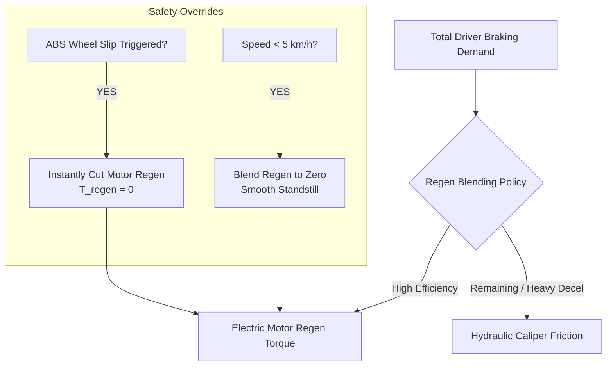

# Actuator Physics & Braking Systems

Real vehicle dynamics cannot be accurately simulated by commanding tyre forces directly. Real vehicle actuators exhibit non-linear physical constraints, including finite bandwidth (lag), rate limits, transport delays, power envelopes, and hydraulic dynamics.

This document details the three core actuator subsystems implemented in `src/vehicle_model/actuators/`:
1. **Electric Power Steering (EPS) Actuator** (`SteeringActuator`)
2. **Four-Motor Electric Powertrain Actuator** (`ElectricPowertrainActuator`)
3. **Brake-by-Wire (BBW) System with Regenerative Blending** (`BrakeByWireActuator`)

---

## 1. Electric Power Steering (EPS) Actuator

The steering actuator models the dynamic response of modern dual-pinion or rack-assist Electric Power Steering systems.

```mermaid
graph LR
    CMD[delta_cmd] --> DELAY[Transport Delay Buffer<br/>tau_d = 25 ms]
    DELAY --> LAG[1st-Order Lag Filter<br/>tau = 45 ms]
    LAG --> SLEW[Slew Rate Limiter<br/>|d(delta)/dt| <= 60 deg/s]
    SLEW --> STROKE[Rack Stroke Limiter<br/>|delta| <= 35 deg]
    STROKE --> FAULT{Injectable Fault Mode}
    FAULT --> OUT[delta_actual]
```

### 1.1 Mathematical Formulation
$$\tau_{\text{eps}} \dot{\delta}_{\text{filt}}(t) + \delta_{\text{filt}}(t) = \delta_{\text{cmd}}(t - \tau_d)$$

Applying the physical rack slew rate and stroke limits:
$$\dot{\delta}(t) = \operatorname{clip}\left(\dot{\delta}_{\text{filt}}(t), -\dot{\delta}_{\max}, \dot{\delta}_{\max}\right)$$
$$\delta(t) = \operatorname{clip}\left(\delta(t - \Delta t) + \dot{\delta}(t) \Delta t, -\delta_{\max}, \delta_{\max}\right)$$

### 1.2 Physical Parameters & Default Bounds
- First-order time constant: $\tau_{\text{eps}} = 0.045\text{ s}$ (45 ms bandwidth)
- Pure transport delay: $\tau_d = 0.025\text{ s}$ (25 ms CAN bus / computation latency)
- Maximum slew rate: $\dot{\delta}_{\max} = 60^\circ/\text{s}$ ($1.047\text{ rad/s}$)
- Maximum rack travel: $\delta_{\max} = 35.0^\circ$ ($0.611\text{ rad}$)

### 1.3 Injectable Fault Modes
For safety-critical ISO 26262 functional safety and fault-injection testing:
- **`nominal`:** Standard healthy steering dynamics.
- **`stuck`:** Actuator locks permanently at the angle of failure $t_{\text{fault}}$.
- **`free`:** Actuator loses electrical assistance; floats freely towards trail-aligning angle.
- **`offset`:** Constant bias angle added to commanded steer (e.g., sensor calibration drift).

---

## 2. Four-Motor Independent Electric Powertrain

The powertrain model simulates four independent permanent-magnet synchronous motors (PMSM) mounted at each wheel or axle, driven by individual silicon-carbide (SiC) inverters.

### 2.1 Inverter Lag & Torque Slew Rate
Electric motors respond rapidly but remain bounded by inverter switching and DC-bus current rise rates:
$$\tau_{\text{inv}} \dot{T}_i(t) + T_i(t) = T_{\text{cmd},i}(t)$$
$$\left|\frac{d T_i}{dt}\right| \le \dot{T}_{\max} = 8000\text{ Nm/s}$$

### 2.2 Speed-Dependent Field Weakening Envelope
At low rotational speeds, the motor operates in the **constant torque region**. Above base speed $\omega_{\text{base}}$, back-EMF limits available voltage, entering the **field weakening region** (constant power):

$$T_{\max}(\omega_i) = \begin{cases}
T_{\text{stall}} & (|\omega_i| \le \omega_{\text{base}}) \\
\min\left(T_{\text{stall}}, \frac{P_{\max}}{|\omega_i|}\right) & (|\omega_i| > \omega_{\text{base}})
\end{cases}$$

Where:
- $T_{\text{stall}} = 550\text{ Nm}$ (per wheel maximum torque)
- $P_{\max} = 120\text{ kW}$ (per motor maximum mechanical power)
- $\omega_{\text{base}} = P_{\max} / T_{\text{stall}} \approx 218\text{ rad/s}$ ($v \approx 72\text{ km/h}$)

### 2.3 Total DC Battery Pack Power Constraint
In aggressive multi-wheel acceleration or simultaneous torque vectoring, the sum of all motor electrical powers must not exceed total battery pack discharge power:
$$\sum_{i=1}^4 P_{\text{elec},i} \le P_{\text{batt},\max} = 400\text{ kW}$$
When the sum exceeds $P_{\text{batt},\max}$, drive torques are proportionally scaled down across all four wheels, preserving the allocated yaw moment ratio $\Delta T_z$ while respecting battery limits.

---

## 3. Brake-by-Wire (BBW) System & Regenerative Blending

The braking system combines electro-hydraulic friction brakes with electric motor regenerative retardation, providing continuous torque modulation for ABS and torque vectoring.

### 3.1 Asymmetric Pressure Dynamics (ABS Build vs. Dump)
In emergency braking, anti-lock braking systems (ABS) must dump caliper hydraulic pressure significantly faster than building pressure to prevent wheel lockup:
$$\begin{aligned}
\text{Pressure Dump Rate (Exhaust):} \quad & \dot{T}_{\text{brake}} = -36000\text{ Nm/s} \\
\text{Pressure Build Rate (Apply):} \quad & \dot{T}_{\text{brake}} = +22000\text{ Nm/s}
\end{aligned}$$
This asymmetry is essential for capturing realistic ABS limit-cycling and stopping distance performance.

### 3.2 Regenerative Braking Blending Strategy

The integrated brake controller coordinates electric motor regeneration and friction calipers:



1. **Energy Recovery Priority:** Up to maximum regen capacity ($T_{\text{regen,max}} = 250\text{ Nm/wheel}$), deceleration is handled purely by electric motor generation.
2. **Hydraulic Caliper Make-Up:** Demands exceeding regen capacity are seamlessly augmented by hydraulic calipers.
3. **Low-Speed Fade-Out ($v_x < 5\text{ km/h}$):** Motor regen torque is smoothly blended down to zero via a cubic hermite polynomial, handing over completely to hydraulic friction to avoid driveline cogging.
4. **Immediate ABS Regeneration Cut:** If any wheel approaches the tyre adhesion limit ($\kappa_i < \kappa_{\text{threshold}} \approx -0.15$), **motor regen torque is immediately dropped to zero** on that axle. This removes motor rotor inertia from the wheel dynamics, granting the hydraulic ABS valve sole, high-bandwidth authority to recover wheel speed.

---

## 4. Source Code Cross-Reference

| Actuator | Class Name | Source File | Configuration YAML | Unit Tests |
| :--- | :--- | :--- | :--- | :--- |
| **EPS Steering** | `SteeringActuator` | [steering.py](https://github.com/CagriCatik/Vehicle-Dynamics/blob/main/src/vehicle_model/actuators/steering.py) | [steering/eps_default.yaml](https://github.com/CagriCatik/Vehicle-Dynamics/blob/main/configs/steering/eps_default.yaml) | [test_actuators.py](https://github.com/CagriCatik/Vehicle-Dynamics/blob/main/tests/vehicle_model/test_actuators.py) |
| **EV Powertrain** | `ElectricPowertrainActuator` | [powertrain.py](https://github.com/CagriCatik/Vehicle-Dynamics/blob/main/src/vehicle_model/actuators/powertrain.py) | [powertrains/four_motor_ev.yaml](https://github.com/CagriCatik/Vehicle-Dynamics/blob/main/configs/powertrains/four_motor_ev.yaml) | [test_actuators.py](https://github.com/CagriCatik/Vehicle-Dynamics/blob/main/tests/vehicle_model/test_actuators.py) |
| **Brake-by-Wire** | `BrakeByWireActuator` | [braking.py](https://github.com/CagriCatik/Vehicle-Dynamics/blob/main/src/vehicle_model/actuators/braking.py) | [braking/brake_by_wire.yaml](https://github.com/CagriCatik/Vehicle-Dynamics/blob/main/configs/braking/brake_by_wire.yaml) | [test_actuators.py](https://github.com/CagriCatik/Vehicle-Dynamics/blob/main/tests/vehicle_model/test_actuators.py) |
