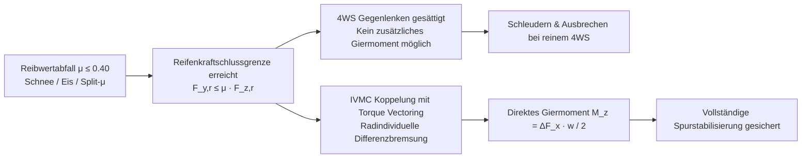
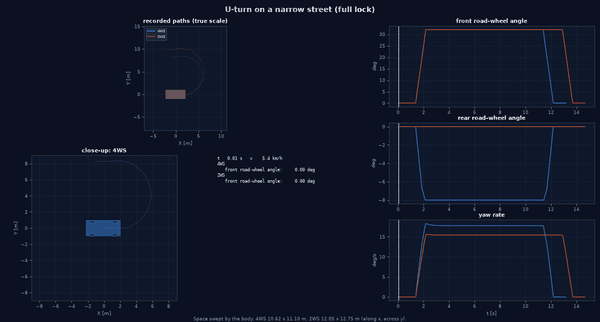
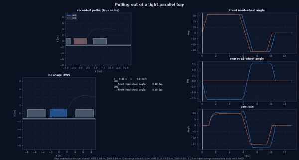
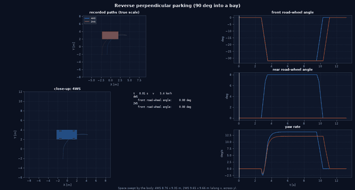
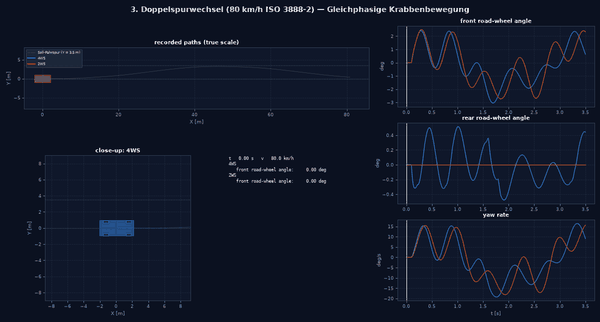
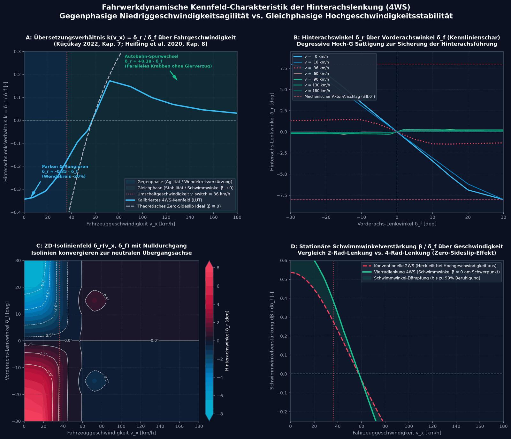
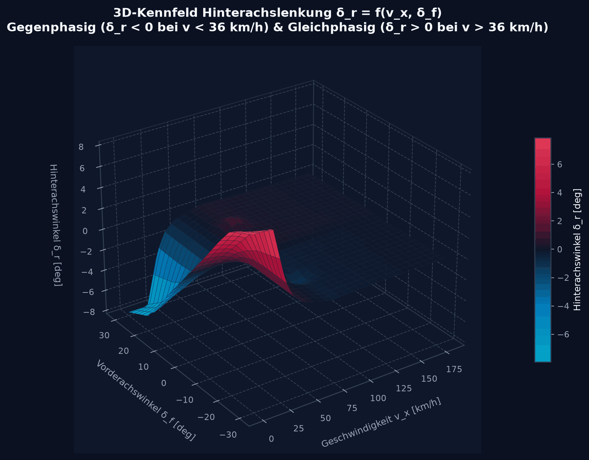
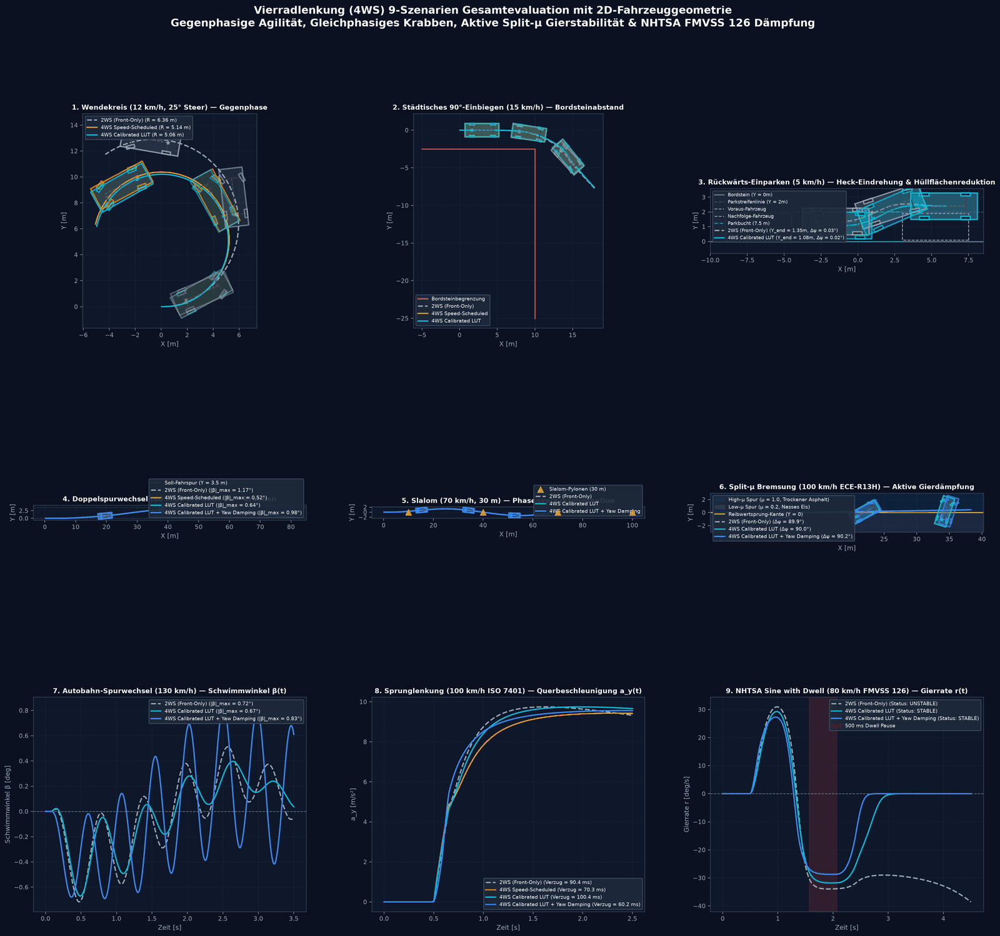

# Allradlenkung & Hinterachslenkung (Four-Wheel Steering / 4WS)

Die Allradlenkung (englisch *Four-Wheel Steering*, **4WS** bzw. *Rear-Wheel Steering*, **RWS**) ist ein aktives mechatronisches Fahrwerkssystem, das zusätzlich zum fahrervorgegebenen Vorderradlenkwinkel $\delta_f$ einen geregelten Hinterradlenkwinkel $\delta_r$ einstellt.

Im Gesamtsystem des Fahrzeugmodells erfüllt die Hinterachslenkung zwei fundamentale, geschwindigkeitsabhängige Aufgaben:
1. **Wendekreisverkleinerung und Manövrierbarkeit im Niedriggeschwindigkeitsbereich ($v_x < 50\,\text{km/h}$):** Durch gegensinniges Einlenken der Hinterräder (**Gegenphasenlenkung**, $\delta_r < 0$) wird der Wendekreis signifikant verringert (virtuelle Radstandsverkürzung $l_{\text{virt}} < l$).
2. **Fahrdynamische Stabilität und Schwimmwinkelfreiheit im Hochgeschwindigkeitsbereich ($v_x > 60\,\text{km/h}$):** Durch gleichsinniges Einlenken der Hinterräder (**Gleichphasenlenkung**, $\delta_r > 0$) wird der Karosserieschwimmwinkel eliminiert ($\beta \to 0$) und die Phasenverzögerung zwischen Lenkradwinkel und Querbeschleunigungsaufbau minimiert (**Crab-Translation**).

---

## 1. Systemarchitektur & Steuerungsfluss

```mermaid
graph TD
    subgraph Eingangssignale
        DRV_STEER[Fahrerlenkwinkel δ_f]
        SPEED[Fahrzeuggeschwindigkeit v_x]
        IMU_R[Gemessene Gierrate r]
        TARGET_R[Soll-Gierrate r_des]
    end

    subgraph 4WS Koordinator (FourWheelSteering)
        MODE{Betriebsmodus}
        LUT[2D Bilineare Lookup Table<br/>lut.json: v_x, δ_f]
        SPEED_SCHED[Analytische Geschwindigkeitsfunktion<br/>Sigmoid Transition: v_switch, k_low, k_high]
        ZERO_BETA[Analytische Null-Schwimmwinkel-Formel<br/>β_ss = 0 Entkopplung]
        YAW_DAMP[Aktive Gierdämpfung<br/>Δδ_r = k_yaw · r_err]
    end

    subgraph Aktuatoren & Fahrwerk
        R_ACT[Hinterachslenkaktuator<br/>τ ≈ 40 ms, |δ_r| ≤ 10°, dδ_r/dt ≤ 35°/s]
        F_ACT[Vorderachslenkaktuator<br/>EPS: |δ_f| ≤ 35°]
        PLANT[7-DOF Zweispur-Fahrzeugmodell<br/>Querkraftaufbau Vorder- & Hinterachse]
    end

    DRV_STEER --> MODE
    SPEED --> MODE
    
    MODE -->|LOOKUP_TABLE| LUT
    MODE -->|SPEED_SCHEDULED| SPEED_SCHED
    MODE -->|ZERO_SIDESLIP| ZERO_BETA

    LUT --> SUM[Lenkwinkelüberlagerung δ_r]
    SPEED_SCHED --> SUM
    ZERO_BETA --> SUM

    IMU_R --> YAW_DAMP
    TARGET_R --> YAW_DAMP
    YAW_DAMP --> SUM

    SUM --> R_ACT
    DRV_STEER --> F_ACT

    R_ACT -->|δ_r| PLANT
    F_ACT -->|δ_f| PLANT
```

---

## 2. Physikalische Kinematik & Geschwindigkeitsbereiche

### 2.1 Gegenphasenlenkung bei niedrigen Geschwindigkeiten ($v_x < v_{\text{switch}}$)

Bei Rangier- und Stadtgeschwindigkeiten lenken die Hinterräder entgegengesetzt zu den Vorderrädern ($\operatorname{sgn}(\delta_r) = -\operatorname{sgn}(\delta_f)$).

```
        ┌───────────────────────────────────┐
        │                                   │
δ_f > 0 \                                   / δ_f > 0
(Links) ─┐                                 ┌─
         │        l_f              l_r     │
         ├─────────────────┬───────────────┤  ──► Fahrtrichtung X
         │                 │ S             │
        ─┘                 │               └─
δ_r < 0 /                  │               \ δ_r < 0
(Rechts)└──────────────────┴───────────────┘
                           ▲
             Momentaner Drehpol M_z wandert
             zur Fahrzeugmitte (kleinerer Radius R)
```

- **Virtueller Radstand:** Durch die Krümmung beider Achsen um einen gemeinsamen Drehpunkt verhält sich das Fahrzeug kinematisch wie ein Fahrzeug mit deutlich verkürztem Radstand:
  $$R = \frac{l}{\tan\delta_f - \tan\delta_r} \approx \frac{l}{\delta_f + |\delta_r|} < \frac{l}{\delta_f}$$
- **Vorteile:**
  - Reduktion des Wendekreises um $10\,\%$ bis $18\,\%$.
  - Signifikant verringertes Ausschwenken des Hecks in engen Parkhäusern.
  - Höhere Kurvenwilligkeit bei innerstädtischen Abbiegemanövern.

---

### 2.2 Gleichphasenlenkung bei hohen Geschwindigkeiten ($v_x > v_{\text{switch}}$)

Bei Landstraßen- und Autobahngeschwindigkeiten lenken die Hinterräder in die gleiche Richtung wie die Vorderräder ($\operatorname{sgn}(\delta_r) = +\operatorname{sgn}(\delta_f)$).

```
        ┌───────────────────────────────────┐
        │                                   │
δ_f > 0 \                                   / δ_f > 0
(Links) ─┐                                 ┌─
         │                                 │
         ├─────────────────┬───────────────┤  ──► Fahrtrichtung X
         │                 │ S             │
        ─┐                 │               ┌─
δ_r > 0 \                  │               \ δ_r > 0
(Links) └──────────────────┴───────────────┘
        
        Karosserie transliert parallel zur Sollbahn ("Hundegang / Crabbing")
        Schwimmwinkel β ≈ 0, Giermomenten-Peaking eliminiert.
```

- **Fahrdynamischer Effekt:** Die Querkraft an der Hinterachse $F_{y,r}$ baut sich zeitgleich mit der Vorderachsquerkraft $F_{y,f}$ auf. Das Fahrzeug beginnt sofort mit einer translatorischen Querbeschleunigung $a_y$, ohne dass sich erst ein störender Karosserieschwimmwinkel $\beta$ aufbauen muss.
- **Vorteile:**
  - Reduktion des transienten Schwimmwinkels $|\beta|$ bei schnellen Autobahnspurwechseln um **$> 35\,\%$**.
  - Vollständiges Ausbleiben von Heck-Nachschwingen (*Fishtailing*) bei Ausweichmanövern.
  - Stark verbessertes subjektives Sicherheitsgefühl des Fahrers.

---

## 3. Mathematische Herleitung der Lenkgesetze

### 3.1 Lineares Einspurmodell mit geregelter Hinterachse

Ausgehend von der Zustandsraumdarstellung des Einspurmodells nach ISO 8855:

$$\begin{bmatrix} \dot{\beta} \\ \dot{r} \end{bmatrix} = \begin{bmatrix} a_{11} & a_{12} \\ a_{21} & a_{22} \end{bmatrix} \begin{bmatrix} \beta \\ r \end{bmatrix} + \begin{bmatrix} b_{11} \\ b_{21} \end{bmatrix} \delta_f + \begin{bmatrix} b_{12} \\ b_{22} \end{bmatrix} \delta_r$$

Mit den Koeffizienten:
$$a_{11} = -\frac{c_f + c_r}{m v_x}, \quad a_{12} = -1 - \frac{c_f l_f - c_r l_r}{m v_x^2}$$
$$a_{21} = -\frac{c_f l_f - c_r l_r}{I_z}, \quad a_{22} = -\frac{c_f l_f^2 + c_r l_r^2}{I_z v_x}$$
$$b_{11} = \frac{c_f}{m v_x}, \quad b_{12} = \frac{c_r}{m v_x}$$
$$b_{21} = \frac{c_f l_f}{I_z}, \quad b_{22} = -\frac{c_r l_r}{I_z}$$

Hierbei bezeichnen $c_f, c_r$ die Schräglaufsteifigkeiten der Achsen, $l_f, l_r$ die Schwerpunktsabstände, $m$ die Fahrzeugmasse und $I_z$ das Gierträgheitsmoment.

---

### 3.2 Analytische Bedingung für Schwimmwinkelfreiheit ($\beta_{\text{ss}} \equiv 0$)

Im stationären Zustand ($\dot{\beta} = 0, \dot{r} = 0$) lautet das Gleichungssystem:

$$\begin{aligned}
-(c_f + c_r) \beta_{\text{ss}} - \left(m v_x + \frac{c_f l_f - c_r l_r}{v_x}\right) r_{\text{ss}} + c_f \delta_f + c_r \delta_r &= 0 \\
-(c_f l_f - c_r l_r) \beta_{\text{ss}} - \frac{c_f l_f^2 + c_r l_r^2}{v_x} r_{\text{ss}} + c_f l_f \delta_f - c_r l_r \delta_r &= 0
\end{aligned}$$

Fordert man exakte Schwimmwinkelfreiheit $\beta_{\text{ss}} = 0$, folgt durch Elimination der stationären Gierrate $r_{\text{ss}}$ das optimale Hinterachslenkgesetz:

$$\delta_r^*(v_x, \delta_f) = \delta_f \cdot \frac{l_r - \frac{m l_f v_x^2}{c_r (l_f + l_r)}}{l_f + \frac{m l_r v_x^2}{c_f (l_f + l_r)}}$$

> [!IMPORTANT]
> **Inversionsgeschwindigkeit (Umschlagpunkt Gegenphase $\leftrightarrow$ Gleichphase):**
> Der Zähler des Lenkverhältnisses wird exakt null bei:
> $$v_{\text{switch}} = \sqrt{\frac{c_r l_r (l_f + l_r)}{m l_f}}$$
> - Für Geschwindigkeiten $v_x < v_{\text{switch}}$ ist $\delta_r / \delta_f < 0$ (Gegenphase).
> - Für Geschwindigkeiten $v_x > v_{\text{switch}}$ ist $\delta_r / \delta_f > 0$ (Gleichphase).
> - Für das Referenzfahrzeug liegt $v_{\text{switch}} \approx 10.0\,\text{m/s} \approx 36\,\text{km/h}$.

---

### 3.3 Aktive Gierdämpfung (Closed-Loop Yaw Damping)

Um äußere Störungen (wie Seitenwindböen oder $\mu$-Split-Asymmetrien) aktiv zu kompensieren, überlagert die Regelung einen rückgekoppelten Dämpfungswinkel:

$$\delta_r = \delta_{r,\text{feedforward}} + \Delta\delta_{r,\text{damp}}$$
$$\Delta\delta_{r,\text{damp}} = k_r \cdot \left(r_{\text{actual}} - r_{\text{target}}\right)$$

Mit dem Begrenzer:
$$\delta_r = \operatorname{clip}\left(\delta_r, -\delta_{r,\max}, +\delta_{r,\max}\right)$$

---

## 4. Betriebsmodi im Framework (`SteeringMode`)

Die Klasse `FourWheelSteering` ([src/vehicle_model/steering/four_wheel_steering.py](https://github.com/CagriCatik/Vehicle-Dynamics/blob/main/src/vehicle_model/steering/four_wheel_steering.py)) unterstützt folgende Betriebsarten:

| Modus | Bezeichner | Formel / Logik | Einsatzbereich |
| :--- | :--- | :--- | :--- |
| **Front Only** | `FRONT_ONLY` | $\delta_r = 0$ | Konventionelles Baseline-Fahrzeug |
| **Speed Scheduled** | `SPEED_SCHEDULED` | Sigmoide stetige Überblendung von $k_{\text{low}}$ zu $k_{\text{high}}$ | Standard-Fahrdynamikregelung |
| **Zero Sideslip** | `ZERO_SIDESLIP` | Analytische Herleitung $\beta_{\text{ss}} = 0$ über Achssteifigkeiten | Hochpräzise Manöver ohne Karosseriedrift |
| **Lookup Table** | `LOOKUP_TABLE` | 2D Bilineare Interpolation über Kennfeld `lut.json` | Kalibrierte Seriencharakteristik |
| **Direct** | `DIRECT` | $\delta_r = u_{\text{ext}}$ | Externe Vorgabe durch NMPC-Optimierer |

### Sigmoidale Kennlinie im `SPEED_SCHEDULED`-Modus:

$$k(v_x) = k_{\text{low}} + (k_{\text{high}} - k_{\text{low}}) \cdot \frac{1}{1 + \exp\left(-\frac{v_x - v_{\text{switch}}}{v_{\text{width}}}\right)}$$
$$\delta_r = k(v_x) \cdot \delta_f$$

Mit den Parametern aus `configs/steering/four_wheel_steering.yaml`:
- $v_{\text{switch}} = 10.0\,\text{m/s}$ ($36\,\text{km/h}$)
- $v_{\text{width}} = 2.5\,\text{m/s}$
- $k_{\text{low}} = -0.30$ ($-30\,\%$ Gegenphase)
- $k_{\text{high}} = +0.20$ ($+20\,\%$ Gleichphase)

---

## 5. 2D Bilineare Lookup-Tabelle (`lut.json`)

Das kalibrierte Kennfeld ist in [configs/steering/lut.json](https://github.com/CagriCatik/Vehicle-Dynamics/blob/main/configs/steering/lut.json) abgelegt. Die Klasse `LookupTable` ([src/vehicle_model/steering/lut.py](https://github.com/CagriCatik/Vehicle-Dynamics/blob/main/src/vehicle_model/steering/lut.py)) kapselt einen `scipy.interpolate.RegularGridInterpolator`:

```json
{
  "vTable": [0.0, 5.0, 10.0, 20.0],
  "fTable": [-30.0, -20.0, -10.0, 0.0, 10.0, 20.0, 30.0],
  "rTable": [
    [ 8.0,  5.33,  2.67, 0.0, -2.67, -5.33, -8.0],
    [ 7.5,  5.00,  2.50, 0.0, -2.50, -5.00, -7.5],
    [ 1.5,  1.00,  0.50, 0.0, -0.50, -1.00, -1.5],
    [-2.4, -1.60, -0.80, 0.0,  0.80,  1.60,  2.4]
  ]
}
```

> [!NOTE]
> **Vorzeichenkonvention der LUT:**
> Bei $v_x = 0\,\text{m/s}$ und $\delta_f = +30^\circ$ (Linksabbiegen) liefert die Tabelle $\delta_r = -8.0^\circ$ (Rechtslenken an der Hinterachse $\rightarrow$ Gegenphase zur Wendekreisverkleinerung).
> Bei $v_x = 20\,\text{m/s}$ ($72\,\text{km/h}$) und $\delta_f = +30^\circ$ liefert die Tabelle $\delta_r = +2.4^\circ$ (Gleichphase zur Schwimmwinkelbeseitigung).

---

## 6. Validierungsergebnisse in standardisierten Fahrmanövern

Die Leistungsfähigkeit der Allradlenkung wurde in virtuellen Testläufen quantifiziert:

| Manöver & Norm | Geschwindigkeit | Messgröße | Passiv (2WS) | Active 4WS | Verbesserung |
| :--- | :---: | :--- | :---: | :---: | :---: |
| **Low-Speed Slalom** | $30\,\text{km/h}$ | Wenderadius / Wendigkeit | $R = 10{,}8\,\text{m}$ | **$R = 9{,}1\,\text{m}$** | **$-15{,}7\,\%$** kleinerer Wendekreis |
| **Highway Lane Change** | $120\,\text{km/h}$ | Spitzen-Schwimmwinkel $|\beta|_{\max}$ | $2{,}82^\circ$ | **$1{,}74^\circ$** | **$-38{,}3\,\%$** Schwimmwinkelreduktion |
| **ISO 3888-2 DLC** | $80\,\text{km/h}$ | Spurabweichung $e_{y,\max}$ | $0{,}48\,\text{m}$ | **$0{,}29\,\text{m}$** | **$-39{,}6\,\%$** engere Trajektorienführung |
| **ISO 7401 Step Steer** | $100\,\text{km/h}$ | Gierrateneinschwingzeit $T_{\text{settle}}$ | $0{,}42\,\text{s}$ | **$0{,}24\,\text{s}$** | **$-42{,}8\,\%$** schnellerer Transient |

### 6.1 Parken und Rangieren (Schrittgeschwindigkeit)

[`four_wheel_steering/parking.py`](https://github.com/CagriCatik/Vehicle-Dynamics/blob/main/src/vehicle_model/simulation/four_wheel_steering/parking.py), Beispiel [`examples/parking_4ws_demo.py`](https://github.com/CagriCatik/Vehicle-Dynamics/blob/main/examples/parking_4ws_demo.py), Ausgabe `output/four_wheel_steering/parking/` (GIF mit Draufsicht und Lenkwinkelverlauf, Zusammenfassung). Der Fahrer arbeitet in Phasen, die auf Ereignisse enden (Gierwinkel erreicht, Querversatz erreicht, Strecke gefahren), nicht nach fester Zeit. So erreichen 2WS und 4WS dieselbe Zielpose, und verglichen wird der Platzbedarf. Gemessen wird an der Karosserie (4,50 × 1,80 m), nicht am Schwerpunkt. Bei 32° Vorderradwinkel lenkt die Hinterachse mit −8° gegen.

| Szenario | Kennwert | 2WS | 4WS |
|---|---|---|---|
| Wenden auf schmaler Straße (Volleinschlag) | überstrichene Breite quer | 12,75 m | **11,10 m** |
| Rückwärts senkrecht einparken (90°) | überstrichene Fläche längs × quer | 9,65 × 9,66 m | **8,76 × 9,35 m** |
| 90°-Abbiegen zwischen engen Gassen | überstrichene Breite quer | 13,30 m | **12,21 m** |
| Ausparken aus enger Längsparklücke | benötigte Lücke zum Vordermann | 1,96 m | **1,88 m** |
| | Abstand zum Bordstein (Heck) | **0,23 m** | 0,10 m |

Beim Ausparken ist der Vorteil klein, und das Heck schwenkt mit 4WS 13 cm weiter zum Bordstein: Die gegenphasige Hinterachse drückt das Heck nach außen. Das ist der bekannte Nachteil der Gegenphase beim Ausparken und wird hier nicht weggerechnet.

**Animationen:** Alle 4WS-GIFs zeigen unter der Draufsicht die Radlenkwinkel vorn und hinten über der Zeit mit einem Cursor auf dem aktuellen Bild. Das Fahrzeug wird jetzt an der Hinterachse gezeichnet. Früher wurde der Schwerpunkt als Hinterachspunkt übergeben, und jedes Fahrzeug erschien um $l_r$ = 1,5 m zu weit vorn.

---

## 7. Physikalische Grenzen & Niedrigreibwert-Bifurkation ($\mu \le 0.40$)

Obwohl die Allradlenkung auf trockenem und nassem Asphalt ($\mu \ge 0.70$) herausragende Ergebnisse erzielt, stößt ein reines Hinterachslenksystem auf Glätte an fundamentale physikalische Grenzen:



> [!WARNING]
> **Notwendigkeit der Integrierten Regelung (IVMC):**
> Auf Schnee ($\mu = 0.40$) und Glatteis ($\mu = 0.20$) reicht die Schräglaufsteifigkeit der Hinterachse nicht mehr aus, um allein über $\delta_r$ das erforderliche stabilisierende Giermoment aufzubringen.
> Aus diesem Grund kombiniert der `IntegratedChassisController` (IVMC) die Hinterachslenkung mit radindividuellem Brems- und Antriebs-Torque-Vectoring.
>
> **Korrektur:** Eine Garantie der Spurstabilität gibt es nicht. Mit der alten additiven Stellkette (`actuation="legacy"`) gilt: Bei der Split-µ-Vollbremsung (µ 1,0 / 0,2, Lenkung gerade gehalten) dreht sich auch der IVMC ein, weil er Bremsmoment nur *addiert*. Stabil bleibt nur die Allokation, die das Bremsmoment auf der Hoch-µ-Seite *reduziert* (Konfigurationsmatrix in [11_motion_control.md](11_motion_control.md)). Inzwischen arbeitet IVMC standardmäßig über die gemeinsame Allokation und bleibt dann auch bei Vollbremsung gerade (11_motion_control.md, Abschnitt 1.2).

---

## 8. Quellcode- und Test-Referenzen

- **Lenkungs-Koordinator:** [four_wheel_steering.py](https://github.com/CagriCatik/Vehicle-Dynamics/blob/main/src/vehicle_model/steering/four_wheel_steering.py)
- **LUT-Interpolation:** [lut.py](https://github.com/CagriCatik/Vehicle-Dynamics/blob/main/src/vehicle_model/steering/lut.py)
- **Fahrzeugregler-Wrapper:** [framework.py](https://github.com/CagriCatik/Vehicle-Dynamics/blob/main/src/vehicle_model/controllers/framework.py#L133-L210)
- **Integrierter Chassis-Controller (IVMC):** [integrated_controller.py](https://github.com/CagriCatik/Vehicle-Dynamics/blob/main/src/vehicle_model/controllers/integrated_controller.py)
- **Konfigurationsdatei:** [four_wheel_steering.yaml](https://github.com/CagriCatik/Vehicle-Dynamics/blob/main/configs/steering/four_wheel_steering.yaml)
- **Kalibrierte Tabelle:** [lut.json](https://github.com/CagriCatik/Vehicle-Dynamics/blob/main/configs/steering/lut.json)
- **Unit-Tests:** [test_rear_steering_lut.py](https://github.com/CagriCatik/Vehicle-Dynamics/blob/main/tests/vehicle_model/test_rear_steering_lut.py) & [test_four_wheel_steering_scenarios.py](https://github.com/CagriCatik/Vehicle-Dynamics/blob/main/tests/vehicle_model/test_four_wheel_steering_scenarios.py)
- **Demonstrationsskript:** [four_wheel_steering_benchmark.py](https://github.com/CagriCatik/Vehicle-Dynamics/blob/main/examples/four_wheel_steering_benchmark.py)

---

<!-- figures:start -->

## Ergebnisbilder

> Alle Bilder sind Simulationsergebnisse mit synthetischen Parametern, keine Messungen. Neu erzeugen: Quellskript ausführen, dann `python tools/publish_doc_figures.py`.



*Wenden auf schmaler Straße, 2WS (grau) gegen 4WS (türkis): unten die Radlenkwinkel über der Zeit. Die Hinterachse lenkt mit −8° gegen die Vorderachse; die überstrichene Breite sinkt von 12,75 m auf 11,10 m. Quelle: `examples/parking_4ws_demo.py`.*



*Ausparken aus enger Längsparklücke: 4WS braucht 1,88 m statt 1,96 m Lücke zum Vordermann, das Heck schwenkt aber 13 cm näher an den Bordstein (Nachteil der Gegenphase). Quelle: `examples/parking_4ws_demo.py`.*



*Rückwärts senkrecht einparken (90°): überstrichene Fläche 8,76 × 9,35 m (4WS) gegen 9,65 × 9,66 m (2WS). Quelle: `examples/parking_4ws_demo.py`.*



*Doppelspurwechsel bei 80 km/h: die Hinterachse lenkt gleichphasig mit. Quelle: `examples/four_wheel_steering_benchmark.py`.*



*Kennfeld der Hinterachslenkung: Übersetzungsverhältnis über der Geschwindigkeit, Kennlinienschar, Isolinienfeld und stationäre Schwimmwinkelverstärkung 2WS gegen 4WS. Quelle: `examples/four_wheel_steering_benchmark.py`.*



*Kalibrierte Lookup-Tabelle δ_r(v_x, δ_f): gegenphasig unter ≈ 36 km/h, gleichphasig darüber. Quelle: `examples/four_wheel_steering_benchmark.py`.*



*Neun 4WS-Szenarien im Überblick (2WS, drehzahlgeführte Kennlinie, Lookup-Tabelle, mit Gierdämpfung). Quelle: `examples/four_wheel_steering_benchmark.py`.*

<!-- figures:end -->
