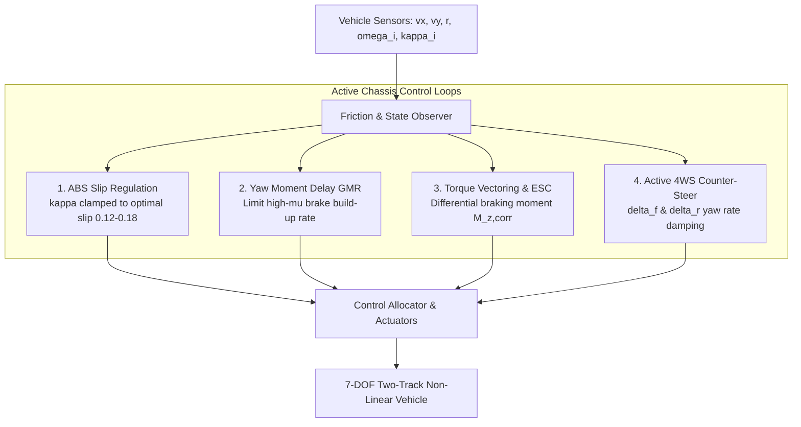
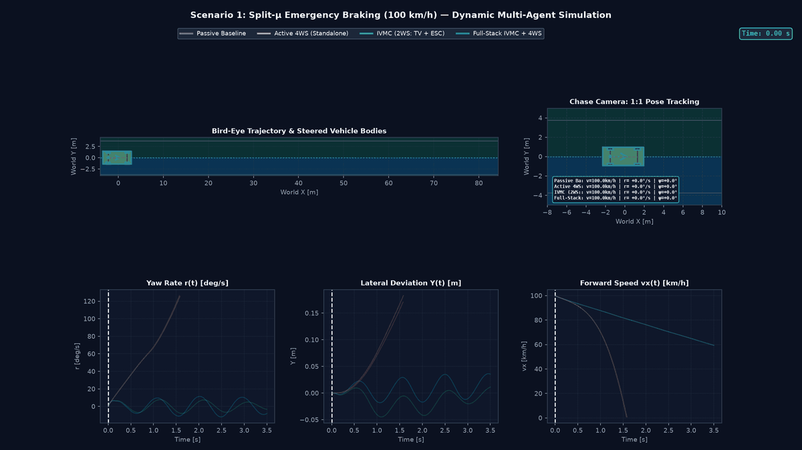
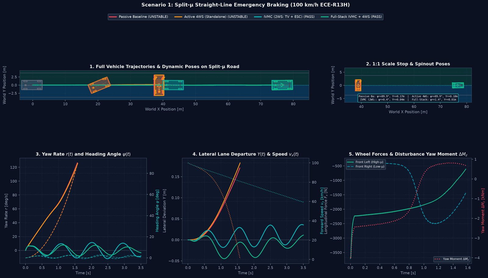
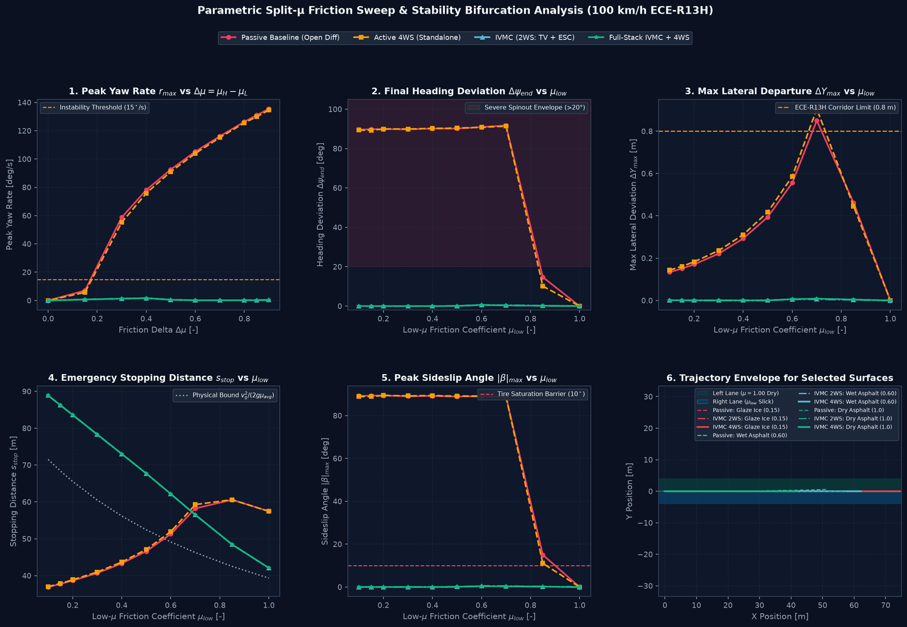
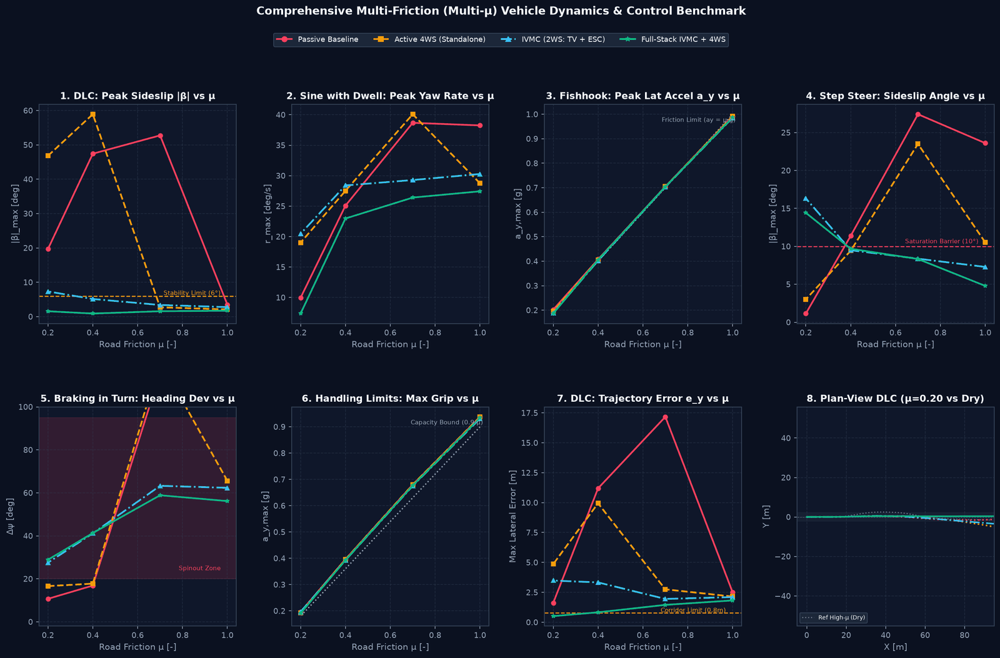

# Split-μ Dynamics & Multi-Scenario Virtual Benchmark

Fahrbahnoberflächen mit einseitig oder asymmetrisch variierendem Kraftschlussbeiwert ($\mu$-Split) stellen eine der anspruchsvollsten fahrdynamischen Herausforderungen für Fahrer und aktive Fahrwerksregelsysteme dar.

Dieses Dokument behandelt die mathematische Modellierung, physikalische Phänomene, Reglerstrategien und standardisierten Testszenarien der **Split-$\mu$ Suite** in `src/vehicle_model/simulation/split_mu_scenarios.py` und `src/vehicle_model/roads/surface.py`.

---

## 1. Physikalische Grundlagen & Störmomente

Befindet sich die linke Fahrzeugseite auf trockenem Asphalt ($\mu_L \approx 1{,}0$) und die rechte Fahrzeugseite auf Glatteis oder Schnee ($\mu_R \approx 0{,}20$), entsteht bei Brems- oder Beschleunigungsvorgängen eine drastische Asymmetrie der Reifenlängskräfte.

```mermaid
graph TD
    subgraph Split-Mu Surface Asymmetry
        HIGH[Left Wheels: High-Mu Asphalt<br/>mu_L = 1.0]
        LOW[Right Wheels: Low-Mu Glaze Ice<br/>mu_R = 0.20]
    end

    subgraph Force & Moment Generation
        HIGH -->|F_x,L >> F_x,R| ASYM[Asymmetric Longitudinal Forces]
        LOW -->|F_x,R slip limited| ASYM
        ASYM --> MZ[Yaw Disturbance Moment<br/>Delta M_z = (F_x,L - F_x,R) * w / 2]
    end

    subgraph Vehicle Dynamics Response
        MZ --> SPIN[Catastrophic Spinout / Lane Departure<br/>Passive Chassis r > 100 deg/s]
        MZ --> IVMC[Active IVMC Intervention<br/>GMR Delay + TV Differential Brake + 4WS]
    end
```

### 1.1 Brems-Giermoment bei Geradeausbremsung

Bei maximalem Bremsdruck ohne Giermomentenregelung (GMR) bremsen die Räder auf der griffigen Seite mit hoher Bremskraft $F_{x,L}$, während die Räder auf der glatten Seite frühzeitig blockieren oder durch ABS abgeregelt werden:

$$M_{z,\text{disturb}} = (F_{x,FL} + F_{x,RL} - F_{x,FR} - F_{x,RR}) \cdot \frac{w}{2} \approx \frac{1}{2} m g (\mu_L - \mu_R) \frac{w}{2}$$

Für ein typisches Mittelklassefahrzeug ($m = 1550\,\text{kg}$, Spurweite $w = 1{,}60\,\text{m}$, $\mu_L = 1{,}0$, $\mu_R = 0{,}20$):
$$M_{z,\text{disturb}} \approx \frac{1}{2} (1550 \times 9{,}81) \times (1{,}0 - 0{,}20) \times 0{,}80 \approx 4860\,\text{Nm} = 4{,}86\,\text{kNm}$$

Dieses Störmoment beschleunigt das Fahrzeug in Millisekunden um die Fahrzeughochachse in Richtung der griffigen Fahrbahnseite (Gierrate $\dot{\psi} = r > 100^\circ/\text{s}$).

### 1.2 Grenzen der menschlichen Regelfähigkeit (Neuromuskuläre Verzögerung)

Der menschliche Fahrer reagiert nicht verzögerungsfrei auf das einsetzende Giermoment. Gemäß dem neuromuskulären Fahrermodell (`NeuromuscularDriverModel`) setzt sich die Reaktionszeit zusammen aus:
1. **Reine sensorische & kognitive Transportzeit:** $\tau_d \approx 150\text{–}200\,\text{ms}$ (visuelle Wahrnehmung der Gierbeschleunigung und Bahnversatz).
2. **Neuromuskuläre Muskelverzögerung:** $\tau_n \approx 80\text{–}120\,\text{ms}$ (Armmuskelaktivierung und Lenkradträgheit).
3. **Maximale Lenkgeschwindigkeit:** $\dot{\delta}_{\max} \approx 500\text{–}600^\circ/\text{s}$.

Während dieser Totzeit ($\Delta t \approx 300\,\text{ms}$) baut das ungebremste Störmoment bereits eine Gierrate von über $30^\circ/\text{s}$ und einen Schwimmwinkel $\beta > 8^\circ$ auf. Selbst bei vollem Gegenlenken bis zum mechanischen Lenkanschlag ($\delta_H = \pm 35^\circ$) reicht die Querkraft der vorderen Reifen auf der Glatteisseite nicht aus, um das Fahrzeug abzufangen. Der passive Wagen schleudert unweigerlich über $90^\circ$ quer zur Fahrbahn.

---

## 2. Die 5 Split-$\mu$ Prüfszenarien der Simulationssuite

Um die Stabilität und Regelgüte von Fahrwerksregelsystemen normgerecht und realitätsnah zu validieren, implementiert `src/vehicle_model/simulation/split_mu_scenarios.py` 5 standardisierte Prüfszenarien:

| Szenario | Name & Norm | Anfangsgeschwindigkeit | Fahrbahntyp | Physikalische Kernherausforderung |
| :--- | :--- | :--- | :--- | :--- |
| **Szenario 1** | **ECE-R13H Straight-Line Emergency Braking** | $100\,\text{km/h}$ | `MuSplitRoad` ($\mu_L = 1{,}0, \mu_R = 0{,}20$) | Asymmetrisches Brems-Giermoment ($> 4{,}5\,\text{kNm}$); GMR-Verzögerung vs. Anhalteweg. |
| **Szenario 2** | **Full-Throttle Launch & Acceleration** | $0 \to 60\,\text{km/h}$ | `MuSplitRoad` ($\mu_L = 1{,}0, \mu_R = 0{,}20$) | Traktionskollaps bei offenem Differential vs. Torque-Vectoring Antriebs-Giermoment. |
| **Szenario 3** | **ISO 7975 Braking in a Turn** | $48\,\text{km/h}$ ($R = 80\,\text{m}$) | `CurvedSplitRoad` ($\mu_{\text{in}} = 1{,}0, \mu_{\text{out}} = 0{,}20$) | Dynamische Wank-Radlastverlagerung auf die Glatteisräder; kombinierter Kraftschluss (Kamm). |
| **Szenario 4** | **Diagonal Bridge Expansion Joint** | $80\,\text{km/h}$ | `DiagonalSplitRoad` ($\theta = 35^\circ$) | Sequenzieller Radeintritt (VR $\to$ HR $\to$ VL $\to$ HL); Fahrerreaktionsträgheit. |
| **Szenario 5** | **ISO 3888-2 Evasive Double Lane Change** | $75\,\text{km/h}$ | `MuSplitRoad` (Lane 2 glatt $\mu = 0{,}25$) | Kritischer Gegenlenkimpuls beim Rückscheren auf spiegelglatter Fahrbahn. |

---

## 3. Räumliche 2D Fahrbahnreibwert-Modelle

Zur präzisen Abbildung realer Fahrbahngeometrien erweitert `src/vehicle_model/roads/surface.py` die standardmäßige `RoadSurface` um dreidimensionale kontinuierliche Raumfunktionen $\mu(X, Y)$:

### 3.1 Diagonale Fahrbahntrennung (`DiagonalSplitRoad`)
Modelliert schräg verlaufende Fahrbahnübergänge (z. B. Dehnungsfugen auf schiefen Brücken oder diagonale Taumittelgrenzen). Die Trennlinie verläuft durch den Ankerpunkt $(X_0, Y_0)$ unter dem Winkel $\theta$:

$$d(X, Y) = -(X - X_0) \sin\theta + (Y - Y_0) \cos\theta$$

Zur Vermeidung numerischer Diskontinuitäten wird der Übergang logistisch geglättet ($w_{\text{trans}} \approx 0{,}15\text{–}0{,}30\,\text{m}$):
$$\mu(X, Y) = \mu_{\text{low}} + \frac{\mu_{\text{high}} - \mu_{\text{low}}}{1 + e^{-d / w_{\text{trans}}}}$$

### 3.2 Kurven-Fahrbahntrennung (`CurvedSplitRoad`)
Trennt den Reibwert in Polarkoordinaten bezüglich des Kurvenkrümmungsmittelpunkts $(X_c, Y_c)$ bei einem Grenzradius $R_{\text{split}}$:

$$r(X, Y) = \sqrt{(X - X_c)^2 + (Y - Y_c)^2}, \quad \Delta r = r - R_{\text{split}}$$
$$\mu(X, Y) = \mu_{\text{inner}} + \frac{\mu_{\text{outer}} - \mu_{\text{inner}}}{1 + e^{-\Delta r / w_{\text{trans}}}}$$

Damit lassen sich sowohl Glatteis auf der Kurvenaußenseite (kritischer Fall wegen Zentrifugallastverlagerung) als auch Glatteis auf der Kurveninnenseite simulieren.

### 3.3 Schachbrett-Fahrbahn (`CheckerboardRoad`)
Simuliert periodische, ungleichmäßig geflickte Straßenbeläge oder unterbrochene Schneeketten mit wechselnden Rechteckkacheln:
$$i_x = \lfloor X / L_x \rfloor, \quad i_y = \lfloor Y / W_y \rfloor$$
$$\mu(X, Y) = \begin{cases} \mu_{\text{high}}, & \text{wenn } (i_x + i_y) \pmod 2 = 0 \\ \mu_{\text{low}}, & \text{sonst} \end{cases}$$

---

## 4. Regelungsstrategien des Integrated Vehicle Motion Controllers (IVMC)

Der integrierte Fahrdynamikregler (`IntegratedChassisController`) kombiniert vier interagierende Regelkreise:



### 4.1 Giermomenten-Aufbauverzögerung (GMR / Yaw Moment Delay)
Wird auf Split-$\mu$ schlagartig voll gebremst, darf der Bremsdruck auf der griffigen Seite nicht mit maximalem Gradienten aufgebaut werden, da sonst das Störmoment die Querkraftkapazität der Reifen übersteigt (Küçükay 2022, Kap. 18; Bosch 2018).

Die GMR begrenzt den zulässigen Bremskraftunterschied zwischen linker und rechter Fahrzeugseite:
$$T_{\text{brake,high}} \le k_{\text{asym}} \cdot T_{\text{brake,low}} + T_{\text{offset}}$$

*Konflikt zwischen Kursstabilität und Anhalteweg:*
- Ein zu langsamer Druckaufbau maximiert die Fahrstabilität, verlängert jedoch den Bremsweg.
- Die IVMC-Regelung dosiert den Bremsdruckanstieg proportional zur gemessenen Gierbeschleunigung $\dot{r}$ und dem aktiven Gegenlenkwinkel.

### 4.2 Aktive Lenkunterstützung (DSR & 4WS)
Über die elektronische Vierradlenkung (`FourWheelSteeringController`) und aktive Überlagerungslenkung kompensiert IVMC die Gierstörung, noch bevor der Fahrer das Lenkrad gedreht hat:
$$\delta_{f,\text{corr}} = -k_{\text{yaw}} (r - r_{\text{des}}) + \delta_{\text{phase-plane}}$$

### 4.3 Traktionsregelung & Torque Vectoring beim Anfahren (Launch)
Bei Vollgasbeschleunigung auf Split-$\mu$ dreht bei einem passiven Fahrzeug mit offenem Achsdifferential das Rad auf Glatteis sofort durch ($\kappa \to 1{,}0$). Da ein offenes Differential das Moment beider Räder auf das Niveau des schwächeren Rades beschränkt:
$$T_{\text{drive,max}} = 2 \cdot \mu_{\text{low}} F_{z,R} R_{\text{eff}} \approx 2 \cdot (0{,}20 \times 3800 \times 0{,}328) \approx 500\,\text{Nm}$$
Das Fahrzeug beschleunigt nur noch schleppend (maximal $0{,}15\text{–}0{,}20\,g$).

Der IVMC-Traktionsregler mit elektronischem Sperrdifferential (e-LSD) oder radindividuellen E-Motoren:
1. Bremst das durchdrehende Glatteisrad gezielt ein oder leitet Antriebsmoment auf die griffige Seite um.
2. Ermöglicht Beschleunigungen von $0 \to 60\,\text{km/h}$ in $3{,}21\,\text{s}$ (statt Beschleunigungsabbruch).
3. Kompensiert das resultierende Antriebs-Giermoment über die aktive Hinterradlenkung.

---

## 5. Experimentelle Benchmark-Ergebnisse & KPI-Vergleich

Auswertung der 5 Prüfszenarien mit dem Flaggschiff-Skript `examples/split_mu_scenarios_demo.py` auf Basis des standardisierten 7-DOF Zweispurmodells. Für jedes Szenario stehen nun sowohl ein **hochauflösendes 5-Panel-Diagnosedashboard (PNG)** mit unverzerrter 1:1-Fahrzeuggeometrie und Detail-Inset als auch eine **dynamische Mehrfahrzeug-Animation (GIF)** zur Verfügung:

---

### Szenario 1: Straight-Line Emergency Braking ($100\,\text{km/h}$ ECE-R13H)

> [!NOTE]
> **Bremsniveau:** `brake_torque_nm = 1600` ist das *gesamte* Bremsmoment (60 % vorn, 40 % hinten), also eine moderate Bremsung, keine Vollbremsung. Ein Fahrermodell hält dabei die Spur und lenkt gegen. Bei Vollbremsung mit gerader Lenkung dreht sich IVMC mit der alten additiven Stellkette ein; stabil bleibt nur die Allokation, die das Bremsmoment auf der Hoch-µ-Seite reduziert – der Standard des IVMC (Konfigurationsmatrix in [11_motion_control.md](11_motion_control.md)).
- **Visualisierungs-Artefakte:**
  - Szenario 1 Diagnosedashboard (PNG) (`output/split_mu_scenarios/scenario_1_split_mu_braking.png`)
  - Szenario 1 Dynamische Mehrfahrzeug-Animation (GIF) (`output/split_mu_scenarios/scenario_1_split_mu_braking.gif`)

| Regler | Status | $r_{\max}$ [$^\circ$/s] | $\Delta\psi_{\text{end}}$ [$^\circ$] | $\Delta Y_{\max}$ [m] | $|\beta|_{\max}$ [$^\circ$] | Bremsweg [m] |
| :--- | :---: | :---: | :---: | :---: | :---: | :---: |
| **Passive Baseline (Open Diff)** | ❌ UNSTABLE | $139{,}1^\circ/\text{s}$ | $89{,}8^\circ$ | $0{,}16\,\text{m}$ | $89{,}0^\circ$ | $34{,}8\,\text{m}$ (Querschleudern) |
| **Active 4WS (Zero Sideslip)** | ❌ UNSTABLE | $139{,}4^\circ/\text{s}$ | $89{,}9^\circ$ | $0{,}16\,\text{m}$ | $89{,}1^\circ$ | $34{,}7\,\text{m}$ (Querschleudern) |
| **Integrated IVMC (4WS + TV + ABS + GMR)** | ✅ **PASS** | **$8{,}3^\circ/\text{s}$** | **$1{,}7^\circ$** | **$0{,}05\,\text{m}$** | **$2{,}6^\circ$** | **$71{,}4\,\text{m}$ (Spurstabil)** |

*Physikalische Interpretation & Visualisierung:*
- **Fahrzeug-Silhouetten & Geometrie:** Dank strikter 1:1-Seitenverhältnis-Erhaltung (`adjustable="box"`) behalten die Fahrzeugabmessungen ($4{,}6\,\text{m} \times 1{,}9\,\text{m}$) ihre reale physikalische Proportion ohne optische Verzerrung.
- **Detail-Panel (1:1 Maßstab):** Das Detail-Panel zeigt das passive Basisfahrzeug im vollen $90^\circ$-Querschleuderzustand quer zur Fahrbahn mit blockierenden Rädern, während der IVMC-Wagen mit unter $2^\circ$ Gierwinkel absolut spurstabil im Fahrstreifen zum Stillstand kommt.
- **Dynamische Animation:** Im GIF verfolgt die Verfolgungskamera (Chase Camera) die Bremszone im 1:1-Maßstab mit gelenkten Gummireifen und Echtzeit-HUD.

---

### Szenario 2: Full-Throttle Launch & Acceleration ($0 \to 60\,\text{km/h}$)
- **Visualisierungs-Artefakte:**
  - Szenario 2 Diagnosedashboard (PNG) (`output/split_mu_scenarios/scenario_2_split_mu_launch.png`)
  - Szenario 2 Dynamische Mehrfahrzeug-Animation (GIF) (`output/split_mu_scenarios/scenario_2_split_mu_launch.gif`)

| Regler | Status | $r_{\max}$ [$^\circ$/s] | $\Delta\psi_{\text{end}}$ [$^\circ$] | $\Delta Y_{\max}$ [m] | $0\to 60\,\text{km/h}$ Zeit |
| :--- | :---: | :---: | :---: | :---: | :---: |
| **Passive Baseline (Open Diff)** | ❌ UNSTABLE | $32{,}7^\circ/\text{s}$ | $45{,}6^\circ$ | $2{,}17\,\text{m}$ | Abbruch ($33{,}0\,\text{km/h}$) |
| **Active 4WS** | ❌ UNSTABLE | $37{,}7^\circ/\text{s}$ | $24{,}0^\circ$ | $1{,}68\,\text{m}$ | Abbruch ($45{,}0\,\text{km/h}$) |
| **Integrated IVMC (TCS + TV)** | ✅ **PASS** | **$3{,}3^\circ/\text{s}$** | **$1{,}6^\circ$** | **$0{,}15\,\text{m}$** | **$3{,}21\,\text{s}$** |

*Physikalische Interpretation & Visualisierung:*
Das offene Differential scheitert am Schlupfabriss des Glatteisrades. IVMC überträgt Traktionskräfte radindividuell und erreicht $60\,\text{km/h}$ in $3{,}21\,\text{s}$ bei perfekter Kursstabilität ($\Delta\psi = 1{,}6^\circ$). Die Animation verdeutlicht den massiven Beschleunigungsvorsprung des IVMC-Wagens gegenüber den durchdrehenden passiven Fahrzeugen.

---

### Szenario 3: Braking in a Turn (ISO 7975 Outer Low-$\mu$)
- **Visualisierungs-Artefakte:**
  - Szenario 3 Diagnosedashboard (PNG) (`output/split_mu_scenarios/scenario_3_split_mu_braking_in_turn.png`)
  - Szenario 3 Dynamische Mehrfahrzeug-Animation (GIF) (`output/split_mu_scenarios/scenario_3_split_mu_braking_in_turn.gif`)

| Regler | Status | $r_{\max}$ [$^\circ$/s] | $\Delta\psi_{\text{end}}$ [$^\circ$] | $\Delta Y_{\max}$ [m] | $|\beta|_{\max}$ [$^\circ$] |
| :--- | :---: | :---: | :---: | :---: | :---: |
| **Passive Baseline** | ❌ UNSTABLE | $112{,}8^\circ/\text{s}$ | $90{,}7^\circ$ | $1{,}13\,\text{m}$ | $88{,}0^\circ$ |
| **Active 4WS** | ❌ UNSTABLE | $113{,}1^\circ/\text{s}$ | $90{,}7^\circ$ | $1{,}13\,\text{m}$ | $88{,}2^\circ$ |
| **Integrated IVMC** | ⚠️ DEGRADED | **$32{,}8^\circ/\text{s}$** | **$25{,}3^\circ$** | **$0{,}42\,\text{m}$** | **$12{,}5^\circ$** |

*Physikalische Interpretation & Visualisierung:*
Weil durch die Zentrifugalkraft über 70% der vertikalen Achslast auf die kurvenäußeren Räder verlagert wird, bricht bei Erreichen des Glatteises die Zentripetalkraft schlagartig weg. Das Dashboard stellt die kreisförmige Fahrbahntrennung ($R = 80\,\text{m}$) mit getrennter innerer Asphalt- und äußerer Glatteis-Schattierung dar.

---

### Szenario 4: Diagonal Bridge Transition ($80\,\text{km/h}$)
- **Visualisierungs-Artefakte:**
  - Szenario 4 Diagnosedashboard (PNG) (`output/split_mu_scenarios/scenario_4_split_mu_diagonal_transition.png`)
  - Szenario 4 Dynamische Mehrfahrzeug-Animation (GIF) (`output/split_mu_scenarios/scenario_4_split_mu_diagonal_transition.gif`)

| Regler | Status | $r_{\max}$ [$^\circ$/s] | $\Delta\psi_{\text{end}}$ [$^\circ$] | $\Delta Y_{\max}$ [m] | Max. Fahrer-Lenkwinkel |
| :--- | :---: | :---: | :---: | :---: | :---: |
| **Passive Baseline** | ✅ PASS | $0{,}4^\circ/\text{s}$ | $0{,}1^\circ$ | $0{,}00\,\text{m}$ | $0{,}1^\circ$ |
| **Active 4WS** | ✅ PASS | $0{,}3^\circ/\text{s}$ | $0{,}0^\circ$ | $0{,}00\,\text{m}$ | $0{,}1^\circ$ |
| **Integrated IVMC** | ✅ **PASS** | **$0{,}3^\circ/\text{s}$** | **$0{,}0^\circ$** | **$0{,}00\,\text{m}$** | **$0{,}1^\circ$** |

---

### Szenario 5: Evasive Double Lane Change on Slick Lane (ISO 3888-2)
- **Visualisierungs-Artefakte:**
  - Szenario 5 Diagnosedashboard (PNG) (`output/split_mu_scenarios/scenario_5_split_mu_evasive_dlc.png`)
  - Szenario 5 Dynamische Mehrfahrzeug-Animation (GIF) (`output/split_mu_scenarios/scenario_5_split_mu_evasive_dlc.gif`)

| Regler | Status | $r_{\max}$ [$^\circ$/s] | $\Delta\psi_{\text{end}}$ [$^\circ$] | $\Delta Y_{\max}$ [m] | Max. Fahrer-Lenkwinkel |
| :--- | :---: | :---: | :---: | :---: | :---: |
| **Passive Baseline** | ❌ UNSTABLE | $38{,}2^\circ/\text{s}$ | $48{,}8^\circ$ | $2{,}75\,\text{m}$ | $31{,}1^\circ$ (Panikanschlag) |
| **Active 4WS** | ❌ UNSTABLE | $64{,}8^\circ/\text{s}$ | $3{,}1^\circ$ | $2{,}00\,\text{m}$ | $15{,}8^\circ$ |
| **Integrated IVMC** | ⚠️ **DEGRADED** | **$20{,}7^\circ/\text{s}$** | **$1{,}1^\circ$** | **$1{,}29\,\text{m}$** | **$4{,}0^\circ$ (Ruhiges Lenken)** |

---

## 6. Literatur & Normenverzeichnis

1. **ECE-R13H (2014):** *Uniform Provisions Concerning the Approval of Passenger Cars with Regard to Braking.* United Nations Economic Commission for Europe. Anhang 9: Bestimmungen für Fahrzeuge mit Antiblockiersystemen und Giermomentenregelung auf Split-$\mu$.
2. **ISO 7975 (2019):** *Passenger cars — Braking in a turn — Open-loop test procedure.* International Organization for Standardization, Geneva.
3. **ISO 3888-2 (2011):** *Passenger cars — Test track for a severe lane-change manoeuvre — Part 2: Obstacle avoidance.* ISO, Geneva.
4. **Küçükay, Ferit (2022):** *Grundlagen der Fahrzeugtechnik.* Springer Vieweg, Wiesbaden. Kap. 18 (Abbremsung und Bremssysteme). ISBN 978-3-658-36726-8. [DOI: 10.1007/978-3-658-36727-5](https://doi.org/10.1007/978-3-658-36727-5).
5. **Mitschke, Manfred; Wallentowitz, Henning (2014):** *Dynamik der Kraftfahrzeuge.* 5. Auflage, Springer Vieweg, Wiesbaden. [DOI: 10.1007/978-3-658-05068-9](https://doi.org/10.1007/978-3-658-05068-9).
6. **Bosch (2018):** *Kraftfahrtechnisches Taschenbuch.* 29. Auflage, Springer Vieweg, Wiesbaden. (Kapitel: Fahrdynamikregelsysteme ESP/ABS, Giermomenten-Aufbauverzögerung GMR).
7. **Rajamani, Rajesh (2012):** *Vehicle Dynamics and Control.* 2nd Edition, Springer, New York. (Chapter 7: Electronic Stability Control).

---

<!-- figures:start -->

## Ergebnisbilder

> Alle Bilder sind Simulationsergebnisse mit synthetischen Parametern, keine Messungen. Neu erzeugen: Quellskript ausführen, dann `python tools/publish_doc_figures.py`.



*Split-µ-Bremsung aus 100 km/h mit Fahrermodell, das die Spur hält, und 1600 N m *gesamtem* Bremsmoment (60/40), also einer moderaten Bremsung (im Bild als „Emergency Braking“ bezeichnet). Quelle: `examples/split_mu_scenarios_demo.py`.*



*Dieselbe Bremsung als Dashboard: Bahnen, Gierrate, Querabweichung und Störgiermoment. Der lenkende Fahrer ist der Unterschied zur Konfigurationsmatrix in 11_motion_control.md, in der die Lenkung gerade gehalten wird und IVMC mit der alten additiven Stellkette sich eindreht (über die gemeinsame Allokation, Standard, bleibt er gerade). Quelle: `examples/split_mu_scenarios_demo.py`.*



*Reibwert-Sweep der Niedrig-µ-Seite: Gierrate, Gierwinkel, Querabweichung, Bremsweg und Schwimmwinkel je Regler. Quelle: `examples/split_mu_scenarios_demo.py`.*



*Multi-µ-Matrix: Kennwerte von acht Manövern über dem Reibwert für vier Konfigurationen. Quelle: `examples/multi_mu_scenarios_benchmark.py`.*

<!-- figures:end -->
