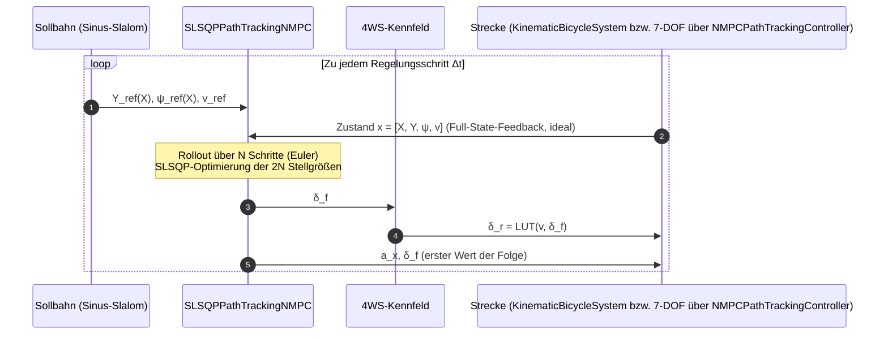
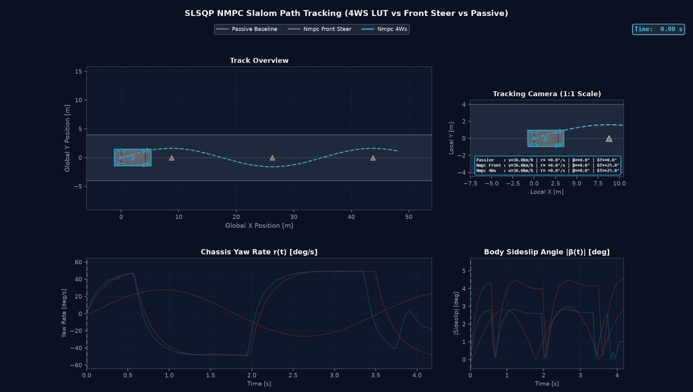
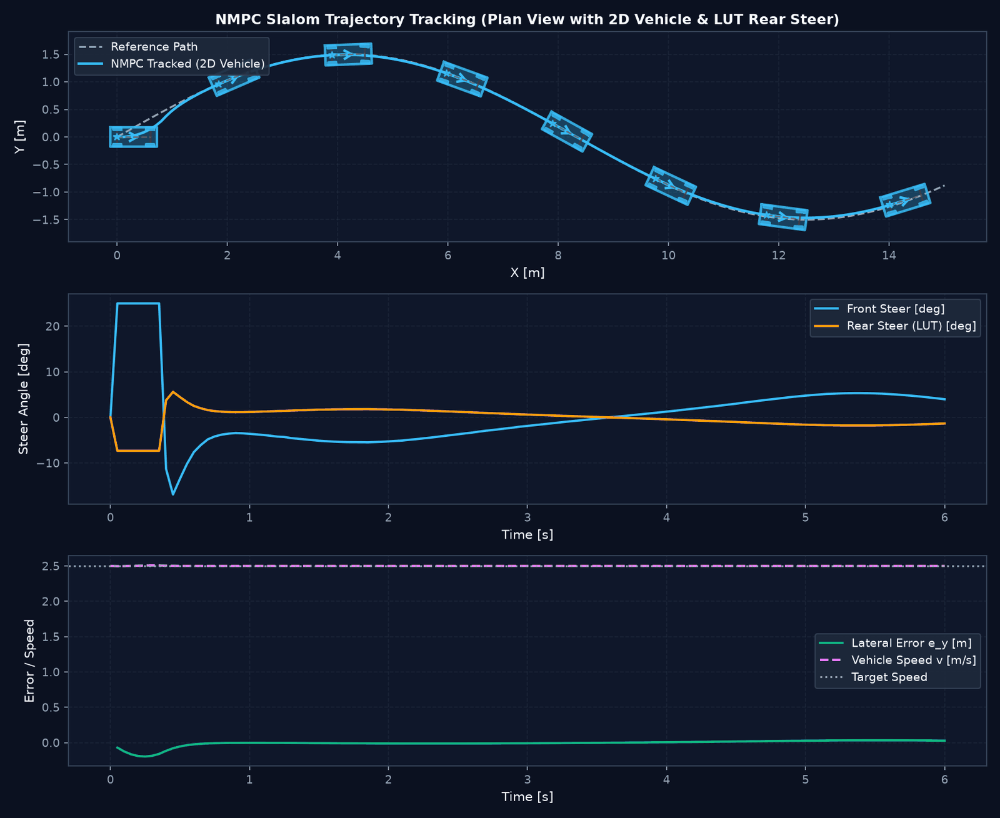

# Nichtlineare Modellprädiktive Pfadverfolgung (SLSQP, Single Shooting)

Die **nichtlineare modellprädiktive Regelung** (*Non-Linear Model Predictive Control*, **NMPC**) optimiert zu jedem Abtasttakt über einen vorausschauenden Zeithorizont $T_f$ eine Stellgrößenfolge unter Berücksichtigung von Systemnichtlinearitäten und Stellgrenzen. Nur der erste Wert der Folge wird angewendet (*Receding Horizon*).

Dieses Dokument beschreibt den Pfadverfolgungsregler `SLSQPPathTrackingNMPC` in [nmpc.py](https://github.com/CagriCatik/Vehicle-Dynamics/blob/main/src/vehicle_model/controllers/nmpc.py).

> [!IMPORTANT]
> **Kein C/GMRES.** Der Regler löst das Optimalsteuerungsproblem als nichtlineares Programm mit `scipy.optimize.minimize(method="SLSQP")`. Eine Fortsetzungsmethode oder ein GMRES-Löser nach Ohtsuka ist **nicht implementiert**. Der frühere Klassenname `NMPCControllerCGMRES` existiert nur noch als veralteter Alias (`DeprecationWarning`). Eine echte C/GMRES-Implementierung ist nach chassis_control_platform_plan.md, Abschnitt 10.1, nur zulässig, wenn die Algorithmik tatsächlich umgesetzt wird.

---

## 1. Regelkreis

Der Regler erhält den wahren Zustand der Strecke. Das ist der in chassis_control_platform_plan.md, Abschnitt 10.2, zulässige, ausdrücklich gekennzeichnete **Full-State-Feedback-Referenzmodus**. Eine Kopplung an Zustandsschätzer ist noch nicht vorhanden.

---

## 2. Optimalsteuerungsproblem

Zustand und Stellgrößen des Prädiktionsmodells:
$$\mathbf{x} = \begin{bmatrix} X & Y & \psi & v \end{bmatrix}^T, \quad \mathbf{u} = \begin{bmatrix} a_x & \delta_f \end{bmatrix}^T$$

Entscheidungsvariablen sind ausschließlich die Stellgrößenfolgen $\mathbf{U} = [a_{x,0..N-1}, \delta_{f,0..N-1}] \in \mathbb{R}^{2N}$ (**Single Shooting**). Die Zustände werden innerhalb der Kostenfunktion durch Vorwärtsintegration berechnet.

### 2.1 Kostenfunktion (diskret, ohne Endkosten)

$$J(\mathbf{U}) = \sum_{k=0}^{N-1} \Big[ q_y (Y_k - Y_{\text{ref}}(X_k))^2 + q_\psi\, \operatorname{wrap}(\psi_k - \psi_{\text{ref}}(X_k))^2 + q_v (v_k - v_{\text{ref}})^2 + B_k \Big] + r_\delta \sum_k \delta_{f,k}^2 + r_a \sum_k a_{x,k}^2$$

Hindernisterm (nur aktiv für $d_j < 4\, r_{\text{safe},j}$):
$$B_k = \sum_j \frac{80 \cdot r_{\text{safe},j}^2}{d_{j,k}^2 + 10^{-6}}, \quad r_{\text{safe}} = r_{\text{obs}} + r_{\text{veh}}$$

Die Gewichtung 80 ist im Code fest kodiert. $q_x$ wird geladen, geht aber nicht in die Kosten ein.

### 2.2 Nebenbedingungen

Nur Box-Schranken: $|a_{x,k}| \le a_{x,\max}$, $|\delta_{f,k}| \le \delta_{f,\max}$. Zustandsbeschränkungen und Stellratenbeschränkungen gibt es nicht.

---

## 3. Prädiktionsmodell: kinematisches Einspurmodell mit gekoppelter Hinterachslenkung

$$\begin{aligned}
X_{k+1} &= X_k + \Delta t \cdot v_k \cos\psi_k \\
Y_{k+1} &= Y_k + \Delta t \cdot v_k \sin\psi_k \\
\psi_{k+1} &= \psi_k + \Delta t \cdot \frac{v_k}{L} \left(\sin\delta_{f,k} - \sin\delta_{r,k}\right) \\
v_{k+1} &= \operatorname{clip}\left(v_k + \Delta t \cdot a_{x,k},\ 0,\ 15\,\text{m/s}\right)
\end{aligned}$$

mit $\delta_{r,k} = \operatorname{LUT}(v_k, \delta_{f,k})$ aus dem synthetischen Kennfeld [lut.json](https://github.com/CagriCatik/Vehicle-Dynamics/blob/main/configs/steering/lut.json).

Die Gierratengleichung ist eine Kleinwinkelnäherung (Schwimmwinkel vernachlässigt). Die exakte 4WS-Kinematik ist Gegenstand von Referenzfahrzeug (kinematisches Einspurmodell).

### 3.1 Horizont-Rampe

$$\Delta t(t) = \max\left(\frac{T_f}{N}\left(1 - e^{-\alpha t}\right),\ 0{,}05\,\text{s}\right)$$

Im eingeschwungenen Zustand gilt $\Delta t = T_f / N$. Die Untergrenze 0,05 s ist fest kodiert.

---

## 4. Warm Start und Lösungsübernahme

- Startschätzung ist die **unverschobene** Lösung des vorherigen Aufrufs.
- Die neue Lösung wird übernommen, wenn SLSQP Erfolg meldet, wenn die Kosten unter dem 1,2-fachen der vorherigen Kosten liegen oder wenn es der erste Aufruf ist. Andernfalls bleibt die vorherige Folge aktiv.
- SLSQP-Fehlschläge werden **nicht** als Fehlerstatus gemeldet: `NMPCPathTrackingController` gibt immer `status="nominal"` zurück. Der Plattformplan (Abschnitt 10.4) verlangt eine explizite Behandlung; vorgesehen in der Reglerbibliothek.

---

## 5. Parameter

Quelle: [configs/controllers/nmpc_path_tracking.yaml](https://github.com/CagriCatik/Vehicle-Dynamics/blob/main/configs/controllers/nmpc_path_tracking.yaml)

| Parameter | Symbol | Wert | Einheit |
| :--- | :---: | :---: | :---: |
| Horizontschritte | $N$ | 8 | – |
| Horizontdauer | $T_f$ | 1,5 | s |
| Rampenrate | $\alpha$ | 0,5 | 1/s |
| Querabweichungsgewicht | $q_y$ | 25,0 | 1/m² |
| Kurswinkelgewicht | $q_\psi$ | 3,0 | 1/rad² |
| Geschwindigkeitsgewicht | $q_v$ | 20,0 | s²/m² |
| Lenkaufwandsgewicht | $r_\delta$ | 0,05 | 1/rad² |
| Beschleunigungsgewicht | $r_a$ | 0,01 | s⁴/m² |
| Radstand (Prädiktionsmodell) | $L$ | 0,60 | m |
| Maximalbeschleunigung | $a_{x,\max}$ | 4,5 | m/s² |
| Maximaler Vorderradlenkwinkel | $\delta_{f,\max}$ | 25 | ° |

Die früheren C/GMRES-Schlüssel (`zeta`, `ht`, `phi_*`) wurden vom Löser nie gelesen und sind entfernt.

---

## 6. Bekannte Grenzen

- Der Standard-Radstand von 0,60 m in der YAML-Datei entspricht dem ursprünglichen Modellfahrzeug-Maßstab, nicht dem Pkw-Referenzfahrzeug aus chassis_control_platform_plan.md, Abschnitt 4. `NMPCPathTrackingController.from_yaml()` regelt damit auch ein 7-DOF-Pkw-Modell mit falschem Radstand. Die Animation `nmpc_slalom` setzt den Radstand dagegen explizit aus den 7-DOF-Parametern. Unabhängig davon bleibt eine Modellfehlanpassung zwischen kinematischem Prädiktionsmodell und dynamischer Strecke.
- Fest kodierte Grenzen: Lenkwinkel ±30° im Modell, Geschwindigkeit 0…15 m/s, LUT-Geschwindigkeit 0…20 m/s, Hindernisgewicht 80, $\Delta t_{\min}$ = 0,05 s.
- Keine Solverdiagnostik, kein Zeitlimit, kein Degraded Mode.
- Quantitative Regelgüte-Kennwerte (Spurfehler, Schwimmwinkel) werden erst mit dem KPI- und Experiment-Framework reproduzierbar erzeugt. Frühere, nicht reproduzierbar belegte Zahlen wurden aus diesem Dokument entfernt.

---

## 7. Verlinkte Module

- Regler: [nmpc.py](https://github.com/CagriCatik/Vehicle-Dynamics/blob/main/src/vehicle_model/controllers/nmpc.py)
- Dynamischer Two-Track-NMPC: [dynamic_two_track_nmpc.py](https://github.com/CagriCatik/Vehicle-Dynamics/blob/main/src/vehicle_model/controllers/dynamic_two_track_nmpc.py)
- Konfiguration: [nmpc_path_tracking.yaml](https://github.com/CagriCatik/Vehicle-Dynamics/blob/main/configs/controllers/nmpc_path_tracking.yaml)
- Demonstration: [nmpc_path_tracking_simulation.py](https://github.com/CagriCatik/Vehicle-Dynamics/blob/main/examples/nmpc_path_tracking_simulation.py) (`--headless` für Offline-Plot, ohne Option Live-Dashboard)
- Tests: [test_nmpc_controller.py](https://github.com/CagriCatik/Vehicle-Dynamics/blob/main/tests/vehicle_model/test_nmpc_controller.py)
- Animation: `output/animations/nmpc_slalom.gif`, erzeugt mit `python examples/generate_maneuver_animations.py nmpc_slalom`

---

<!-- figures:start -->

## Ergebnisbilder

> Alle Bilder sind Simulationsergebnisse mit synthetischen Parametern, keine Messungen. Neu erzeugen: Quellskript ausführen, dann `python tools/publish_doc_figures.py`.

*Kinematisches Pfadfolge-NMPC im Slalom mit Hinterachslenkung aus der Lookup-Tabelle. Quelle: `examples/generate_maneuver_animations.py`.*

*Pfadfolge-NMPC (Maßstabsmodell): Bahn, Lenkwinkel, Querfehler und Geschwindigkeit. Quelle: `python examples/nmpc_path_tracking_simulation.py --headless`.*

<!-- figures:end -->
