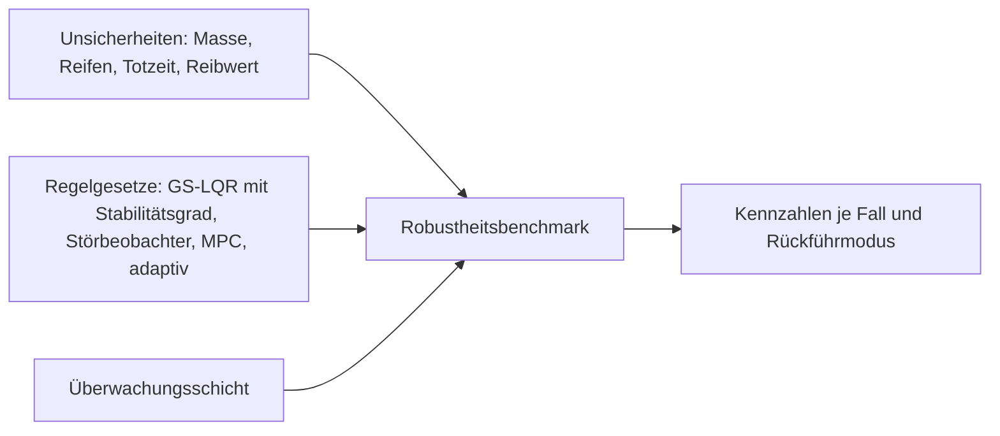
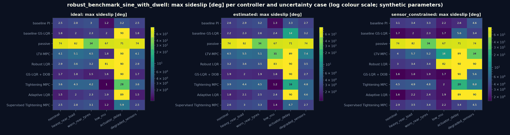
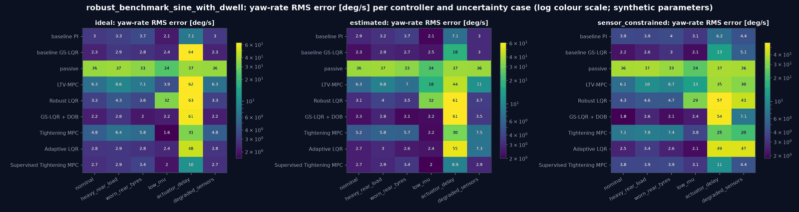
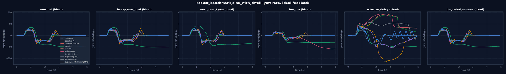
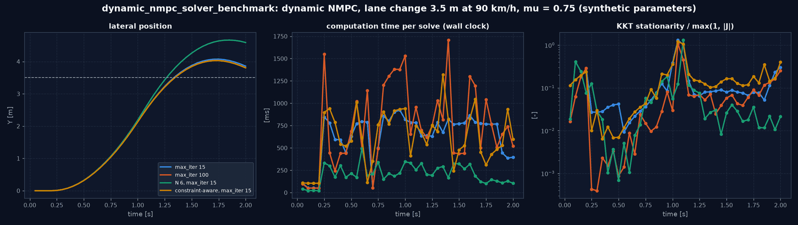
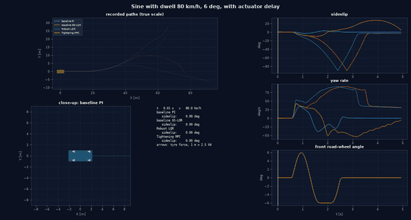

# Robuste und adaptive Fahrdynamikregelung

Regler, die auch bei abweichenden Modellparametern, unbekanntem Reibwert, verzögerten Aktuatoren und gestörten
Sensoren arbeiten sollen, ihr Vergleich mit der festen Baseline und eine Überwachungsschicht. Alle Parameter
sind synthetisch; Ergebnisse beschreiben das virtuelle Fahrzeug, kein reales. Es wird keine funktionale Sicherheit
und keine garantierte Stabilisierung behauptet.

| Teil | Modul |
|---|---|
| Unsicherheitsmodell (7.1) | `simulation/uncertainty.py` |
| Robuste und adaptive Regelgesetze A–D (7.2) | `controllers/robust_laws.py` |
| Constraint-Aware NMPC E (7.2) | `controllers/dynamic_two_track_nmpc.py` (Optionen) |
| Überwachungsschicht (7.3) | `controllers/supervisor.py` |
| Benchmark (7.4) | Experimenttyp `robust_benchmark` (`experiments/robust_benchmark.py`) |

## Überblick

## 1. Unsicherheitsmodell

Alle Regler werden **einmal aus dem nominalen Fahrzeug** entworfen (Fahrzeugdatei, Reifen) und nicht an die
simulierte Strecke angepasst. Ein Fall `UncertaintyCase` beschreibt, wie die simulierte Strecke und ihre Peripherie
vom Entwurf abweichen; er ist reine Daten und steht im Ergebnis (`results.json`, Bericht):

| Bereich | Größen | Wirkung |
|---|---|---|
| Strecke | `mass_factor`, `Iz_factor`, `cog_shift_m`, `cornering_scale_front/rear`, `mu` | eigene `SevenDOFModel`-Instanz; Steifigkeit über `SlipStiffnessScaledTyre` (Reibungsmaximum bleibt) |
| Aktuatoren | `actuator_delay_s`, `actuator_tau_s` | `DelayedActuation`: Totzeit in ganzen Regelschritten, dann Verzögerung 1. Ordnung, auf allen Stellgrößen (Lenkung vorn/hinten, Antriebs- und Bremsmomente) |
| Regelung | `control_latency_s` | zusätzliche Ausgangsverzögerung (Messung → Stellbefehl) |
| Sensorik | `sensor_noise_scale`, `gyro_bias_radps`, `accel_bias_mps2`, `sensor_latency_s` | `SensorConfig` der Modi B und C |

Der Regler bekommt die Parameter der Strecke nie zu sehen: Die Reglerfabrik bekommt das nominale Fahrzeug; der
Parameter der Strecke, den `run_scenario` übergibt, wird verworfen. Bei idealer Rückführung (Mode A) liest der Regler
den wahren Zustand und die Telemetrie (einschließlich des wahren Reibwerts, deklariert); Sensorabweichungen wirken
dort nicht. Aktuatorverzögerung und Latenz wirken in allen Modi.

## 2. Regelgesetze

Gemeinsam: Entwurfsmodell ist das lineare Einspurmodell aus `yaw_laws.py` mit Giermomenteneingang und Integrator
des Gierratenfehlers, Fehlerzustand `e = [v_y − v_y,ss, r − r_ss, z]`, Vorsteuerung aus dem Gleichgewicht
`(x_ss, u_ss)`. Alle wirken über dieselbe Kette (`MotionController`: Referenz, Allokation, ABS/TCS) und sind damit
gegeneinander austauschbar.

### A. LQR mit vorgeschriebenem Stabilitätsgrad (`RobustLQRYawLaw`)

Entwurf auf `(A + αI, B)`. Mit der stabilisierenden Lösung `P` von
`(A + αI)ᵀP + P(A + αI) − P B R⁻¹ Bᵀ P + Q = 0` und `K = R⁻¹ Bᵀ P` gilt für `V = eᵀPe` entlang `ė = (A − BK) e`:

    V̇ = eᵀ((A − BK)ᵀP + P(A − BK)) e = −2α V − eᵀ(Q + KᵀRK) e ≤ −2α V,

also `Re λ ≤ −α` für alle nominalen Eigenwerte. `α` ist Reserve für Modellfehler. Ob die erklärte Parameterbox in
dieser Reserve bleibt, wird **geprüft**: `robust_stability` wertet den geschlossenen Kreis `A(θ) − B(θ)K(v)` auf
einem Gitter über Masse, Gierträgheit und Schräglaufsteifigkeiten (inkl. Ecken) bei jeder Stützgeschwindigkeit aus
(Stichprobe des linearen Entwurfsmodells, kein Beweis, die nichtlineare Strecke ist nicht abgedeckt). Verstärkungen
werden über der Geschwindigkeit interpoliert wie beim GS-LQR.

### B. Störgrößenbeobachter (`DisturbanceObserverLaw`)

Gierkanal mit gesammelter Störung `d` (Modellfehler, Straße, Aktuatoren; rad/s²):

    ṙ = f_nom(v_y, r, δ, M_z) + d,  ḋ = 0,
    f_nom = (l_f F_yv − l_h F_yh + M_z) / I_z,
    F_yv = sat(C_v α_v, µ̂ F_zv),  F_yh = sat(C_h α_h, µ̂ F_zh).

Beobachter auf dem erweiterten Zustand `[r, d]` mit gemessenem `r`:
`r̂˙ = f_nom + d̂ + l₁ (r − r̂)`, `d̂˙ = l₂ (r − r̂)`. Fehlerdynamik `ė_r = e_d − l₁ e_r`, `ė_d = −l₂ e_r`
(konstantes `d`), charakteristisches Polynom `s² + l₁ s + l₂`; mit `l₁ = 2ω_o`, `l₂ = ω_o²` liegen beide Pole bei
`−ω_o` (Standard 12 rad/s). Kompensation: Giermoment des Basisgesetzes plus `−I_z d̂` innerhalb der Stellgrenze. Der
Beobachter bekommt das angewendete (begrenzte) Moment; was die Allokation darüber hinaus nicht liefert, erscheint als
Störung.

**Befund beim Entwurf:** Die erste Fassung nutzte lineare Achskräfte in `f_nom`. Dann liest der Beobachter die
fehlende Kraft einer gesättigten Vorderachse als Störung, und ihre Kompensation erzwingt die Gierantwort eines
ungesättigten Fahrzeugs: Sine with Dwell endete mit 14,9° Schwimmwinkel (GS-LQR allein: 1,2°). Die Sättigung mit dem
geschätzten Reibwert gehört deshalb zum bekannten Modellteil; `d` enthält nur noch Parameterfehler.

### C. Robuste MPC mit Constraint Tightening (`TighteningMPCYawLaw`)

Diskretes Entwurfsmodell `e⁺ = A_d e + B_d u + E w` mit additiver Störung `|w_i| ≤ w_max,i` je Schritt auf
`(v̇_y, ṙ)`. Eingänge mit dem LQR als Hilfsregler: `u_k = u_ss − K e_k + c_k`, Entscheidungsvariablen `c`. Nominale
Prädiktion `e⁺ = A_K e + B_d c`, `A_K = A_d − B_d K`. Der wahre Fehler weicht vom nominalen um `Σ_{j<k} A_K^j E w` ab;
eine Grenze `|y| ≤ y_max` für `y = C e + y_ss` gilt daher für jedes zulässige `w`, wenn die nominale Prädiktion die
verschärfte Grenze einhält:

    |C e_k + y_ss| ≤ y_max − h_k,   h_k = Σ_{j=0}^{k−1} |C A_K^j E| w_max

(Eingänge ebenso mit `C → K`). Begrenzt werden Schwimmwinkel `v_y/v_x` und Gierrate gegen
`constraints.stability_limits`. Das QP (Kosten wie beim LTV-MPC) löst SLSQP mit analytischen Ableitungen auf
skalierten Größen (Entscheidungsvariablen in Einheiten der Stellgrenzen, jede Zeile in Einheiten ihrer Grenze; ohne
Skalierung scheiterte SLSQP an den gemischten Einheiten rad und N·m in 43 % der Schritte).

**Unzulässigkeit.** Liegt das Fahrzeug bereits jenseits einer erklärten Grenze (z. B. Gierrate über `µ g / v`, möglich,
weil die Reifen bei kleiner Last mehr als `µ` übertragen), erfüllt keine Stellgröße die harten Zustandsgrenzen. Dann
wird das relaxierte Problem gelöst:

    min J(c) + w₁ (s_x + s_u) + w₂ (s_x² + s_u²)   u. d. N.  Zustandszeilen ≤ rhs + s_x,  Eingangszeilen ≤ rhs + s_u,  s ≥ 0

(exakte Strafe: Schlupf null, wann immer das verschärfte Problem lösbar ist). Berichtet wird nach der Trennung aus Zustandsschätzung:
Der Solverstatus sagt, wie gut das relaxierte Problem gelöst wurde; die Verletzung der harten Grenzen durch den Plan
steht im Zulässigkeitsbericht (Infeasibility Rate) mit `tightened_problem_feasible = False` und dem Schlupf. Scheitert
auch das relaxierte Problem, wirkt der Hilfsregler (`c = 0`) mit Status `fallback`. Geltungsbereich der Garantie:
Störungen innerhalb `w_max` für das lineare Entwurfsmodell, nicht die nichtlineare Strecke.

### D. Adaptiver LQR (`AdaptiveLQRYawLaw`)

Ein Parameter: gemeinsamer Faktor `θ` auf beide Achs-Schräglaufsteifigkeiten. Querbilanz des Einspurmodells:
`a_y = θ φ` mit `φ = (C_v α_v + C_h α_h)/m` aus Zustand und Eingängen am Anfang des letzten Intervalls und
`a_y = (v_y,k − v_y,k−1)/Δt + r v_x`. Rekursive kleinste Quadrate mit Vergessensfaktor `λ`:

    k = P φ / (λ + φ² P),   θ ← θ + k (a_y − θ φ),   P ← (P − k φ P) / λ,

projiziert auf `[0,3; 1,5]`, mit dem nominalen Entwurf als Vorwissen (`P₀ = 0,05`, Standardabweichung ≈ 0,22 um
`θ = 1`). Aktualisiert wird nur, wo die Modellstruktur gilt:

| Bedingung | Grund |
|---|---|
| `|φ| ≥ 1 m/s²` | Anregung |
| `|a_y| ≤ 0,5 µ̂ g` **und** `|θ φ| ≤ 0,5 µ̂ g` | lineare Reifen; gemessenes `a_y` allein lässt Proben aus Lenkumkehrungen mit gesättigten Reifen durch, in denen `a_y` durch null geht, die lineare Vorhersage aber groß ist |
| `|M_z| ≤ 0,25 M_z,max` im letzten Schritt | bremsbasierte Giermomente nehmen über kombinierten Schlupf Seitenkraft weg, die der Regressor nicht kennt |

**Befund beim Entwurf** (drei Stufen, Sine with Dwell 80 km/h, abgefahrene Hinterreifen):

| Fassung | `θ` am Ende | max. Schwimmwinkel |
|---|---|---|
| ohne Gültigkeitsbedingungen, `P₀ = 10` | 0,30 (untere Grenze) | 89° (Dreher) |
| `|a_y|` begrenzt, Momentengrenze | 0,43 | 5,2° |
| `|a_y|` und `|θ φ|` begrenzt (jetzt) | 0,80 | 2,3° |
| zum Vergleich `θ` fest auf 1 | 1,0 | 2,3° |

Ohne Gültigkeitsbedingungen las die Schätzung Reifensättigung als weiche Reifen, und der für dieses weiche Fahrzeug
ausgelegte Regler destabilisierte das reale (Certainty Equivalence außerhalb des Gültigkeitsbereichs des Modells).
Sine with Dwell regt den linearen Bereich nur kurz an (etwa zehn Aktualisierungen); `θ` bleibt dann nahe dem
Vorwissen. Die Verstärkungen stammen aus einer **vorab**
entworfenen Tabelle über Geschwindigkeit × `θ` (keine Optimierung zur Laufzeit) und folgen einem tiefpassgefilterten
`θ` (Zeitkonstante 0,5 s), die Anpassung ist also langsam gegenüber der Gierdynamik. Nahe der Haftgrenze steht
`θ < 1` für die verringerte wirksame Steifigkeit sättigender Reifen. Prüfung: Auf einer linearen Strecke mit `θ = 0,7`
findet die Schätzung 0,7 ± 0,05 (Test).

### E. Constraint-Aware NMPC (Optionen von `DynamicTwoTrackNMPC`)

- `soft_stability_constraints`: Die bisher nur beratenden Schwimmwinkel- und Gierratengrenzen werden weiche
  Nebenbedingungen mit Schlupfvariablen `s ≥ 0` (exakte Strafe `w₁ Σ s + w₂ Σ s²`). `β_k(u)`, `r_k(u)` werden um den
  verschobenen Warmstart linearisiert (Vorwärtsdifferenzen, eine Simulation je Entscheidungsvariable), sodass SLSQP
  lineare Ungleichungen bekommt; die nichtlineare Prädiktion wird danach wie bisher geprüft, Linearisierungsfehler
  bleiben also sichtbar.
- `project_inputs`: Die angewendete erste Stellgröße wird auf die harte Menge (Amplitude und Lenkrate gegenüber dem
  letzten Befehl) projiziert; nicht endliche Werte werden durch den letzten Befehl ersetzt. Abstand und Anlass stehen
  in `diagnostics["input_projection"]`.

Beide sind standardmäßig aus, damit frühere Ergebnisse reproduzierbar bleiben.

## 3. Überwachungsschicht

`SupervisoryController` umschließt einen primären Regler und einen Rückfallregler. Der primäre Regler wird in jedem
Schritt gerechnet (auch wenn er nicht wirkt), damit sein Zustand beobachtbar bleibt. Entscheidung je Schritt:

| Modus | Kriterium |
|---|---|
| degraded | Ausgabe des Rückfallreglers nicht endlich oder Status `degraded`: Fahrer allein (Lenkwinkel, Pedale, offenes Differential), mindestens 1 s |
| fallback | primärer Regler mit Status `degraded` oder 3 Schritte in Folge ungesund (`fallback`, `infeasible`, nicht endlich, Ausnahme) |
| recovery | in Fallback 0,5 s in Folge gesunder primärer Regler: lineare Überblendung über 0,3 s |
| suboptimal | primärer Regler wirkt, Solverstatus `suboptimal` |
| limited | primärer Regler wirkt, Status `saturated` (Allokation an einer Grenze oder Schlupfregelung aktiv) |
| nominal | primärer Regler wirkt, Status `nominal` |

Unabhängig vom Modus: Eine nicht endliche Ausgabe wird nie weitergegeben (in diesem Schritt Fahrer allein), eine
endliche außerhalb der Fahrzeuggrenzen wird begrenzt; beides zählt als *unterdrückt*. Übergänge werden mit Grund
protokolliert (`transitions`).

## 4. Benchmark

Experimenttyp `robust_benchmark`: Regler × Rückführmodus (ideal / geschätzt / sensorbeschränkt) × Unsicherheitsfall,
jeweils dieselbe nichtlineare Strecke (7-DOF, unabhängig vom linearen Entwurfsmodell), dasselbe Manöver und dieselbe
Referenz. Kennzahlen je Lauf: Gierratenfehler (RMS), Schwimmwinkel, Querabweichung zur aus `r_ref` integrierten Bahn,
Stellsättigung, Stellraten, Reifenausnutzung, Rechenzeit, Infeasibility Rate, Fallback Rate, Degraded-Anteil,
Aktuatoraufwand (`∫|M_z|`, `∫|δ_h|`), Kontrollverlust (`|β| ≥ 30°`). Die Baseline sind die unveränderten Basisgesetze
PI (TV) und GS-LQR (4WS+TV) aus Reglerbibliothek; der Bericht gibt jeden Regler relativ zur ersten Baseline an und zählt die
Vergleiche, in denen er schlechter ist. Die LQR-artigen Gesetze bekommen zusätzlich die lineare Robustheitsanalyse
über die von den Fällen aufgespannte Parameterbox.

Das dynamische NMPC ist ein Bahnfolgeregler; es wird auf seinem Spurwechsel verglichen (`solver_benchmark`,
Variante mit E-Optionen), nicht im Gierratenbenchmark.

## 5. Ergebnisse

`configs/experiments/robust_benchmark_sine_with_dwell.yaml`: Sine with Dwell bei 80 km/h, 6° Amplitude, neun Regler ×
drei Rückführmodi × sechs Fälle = 162 Läufe (196 s auf 7 Prozessen). Vollständiger Bericht mit allen Pflichtkennzahlen:
`output/experiments/robust_benchmark_sine_with_dwell/report.md`.

| Fall | Abweichung der Strecke vom Entwurf |
|---|---|
| nominal | keine |
| heavy_rear_load | Masse × 1,2, Gierträgheit × 1,25, Schwerpunkt 0,1 m nach hinten |
| worn_rear_tyres | Hinterachs-Schräglaufsteifigkeit × 0,7 |
| low_mu | Reibwert 0,5 |
| actuator_delay | 40 ms Totzeit, 30 ms Verzögerung, 10 ms Regellatenz |
| degraded_sensors | doppeltes Rauschen, Gyro-Bias 0,02 rad/s, 20 ms Sensorlatenz (nur Modi B und C) |

**Gierratenfehler RMS [°/s] / max. Schwimmwinkel [°], ideale Rückführung** (V = Kontrollverlust, `|β| ≥ 30°`):

| Regler | nominal | heavy_rear_load | worn_rear_tyres | low_mu | actuator_delay |
|---|---|---|---|---|---|
| baseline PI (Baseline) | 2,97 / 2,5 | 3,26 / 2,8 | 3,69 / 3,0 | 2,10 / 1,2 | 7,07 / 3,2 |
| baseline GS-LQR (Baseline) | 2,32 / 1,8 | 2,94 / 2,0 | 2,76 / 2,3 | 2,42 / 2,0 | V |
| passiv | V | V | V | V | V |
| LTV-MPC | 6,31 / 4,1 | 8,62 / 5,1 | 7,13 / 4,5 | 3,91 / 1,8 | V |
| Robust LQR (α = 3) | 3,25 / 2,9 | 4,34 / 3,6 | 3,59 / 3,2 | V | V |
| GS-LQR + DOB | **2,19 / 1,7** | **2,79 / 1,8** | **2,04 / 1,5** | 2,19 / 1,6 | V |
| Tightening MPC | 4,82 / 3,6 | 6,39 / 4,3 | 5,83 / 4,2 | **1,61 / 1,0** | 31,2 / 27,9 |
| Adaptive LQR | 2,80 / 1,5 | 2,94 / 2,0 | 2,76 / 2,3 | 2,43 / 1,9 | V |
| Supervised Tightening MPC | 2,68 / 2,5 | 2,89 / 2,8 | 3,39 / 3,1 | 1,95 / 1,2 | 10,4 / 5,9 |

**Kontrollverluste über alle 18 Kombinationen je Regler** (drei Modi × sechs Fälle): baseline PI 0, Tightening MPC 0,
Supervised Tightening MPC 0, baseline GS-LQR 1, GS-LQR + DOB 3, Adaptive LQR 4, LTV-MPC 5, Robust LQR 7, passiv 18.

Befunde:

- **Aktuatorverzögerung ist der entscheidende Fall.** 80 ms Gesamtverzögerung destabilisieren jedes Gesetz mit hoher
  Verstärkung und Hinterachslenkung (baseline GS-LQR, LTV-MPC, Robust LQR, DOB, adaptiv bei idealer Rückführung). Der
  PI (nur Giermoment, moderate Verstärkung) bleibt beherrschbar (7,1 °/s); die Tightening MPC verliert die
  Kontrolle nicht, schwingt aber stark (28° Schwimmwinkel). Keines der Gesetze modelliert die Verzögerung; ein
  verzögerungsbewusster Entwurf (Prädiktion über die Totzeit) ist der naheliegende nächste Schritt.
- **Robust LQR mit α = 3 ist schlechter als der GS-LQR, den er verbessern sollte.** Die lineare Analyse über die Box
  (Masse 1,0–1,2, Gierträgheit 1,0–1,25, Hinterachssteifigkeit 0,7–1,0) bestätigt die Reserve: schlechtester Fall
  −5,0 1/s gegen −1,5 1/s beim baseline GS-LQR. Trotzdem verliert er bei µ = 0,5 in allen drei Modi die Kontrolle: Die
  höhere Verstärkung treibt die Stellgrößen in die Sättigung, die das lineare Modell nicht kennt. Der lineare
  Robustheitsnachweis sagt über Sättigung, Reibwert und Verzögerung nichts aus.
- **Störgrößenbeobachter**: bei Parameterabweichungen der beste Regler (worn_rear_tyres 2,04 °/s gegen 3,69 °/s beim
  PI), aber anfällig für Verzögerung und, im Modus C, für Sensorfehler (degraded_sensors 7,1 °/s gegen 4,4 °/s).
- **Tightening MPC**: nie Kontrollverlust, bei niedrigem Reibwert der beste Regler, sonst schlechtere Folgegüte als die
  Baselines. Das verschärfte Problem ist im ungünstigsten Lauf in 40 % der Schritte unzulässig (relaxiert gelöst,
  ausgewiesen), 29 % `degraded`, 12 % `fallback`; Rechenzeit 11 ms im Mittel gegen 2–4 ms der übrigen Gesetze.
- **Überwachung**: Die Supervised Tightening MPC läuft bis zu 46 % der Schritte im Rückfall auf den PI; ihre Ergebnisse
  liegen deshalb nahe am PI, mit weniger Stellaufwand als die Tightening MPC allein. Die Schicht verhindert hier die
  Kontrollverluste der Tightening MPC nicht, weil es keine gibt, sie verschiebt aber den Charakter zum PI hin.
- **Adaptiver LQR**: nach der Korrektur der Gültigkeitsbedingungen (Abschnitt 2 D) ohne Verlust bei Parameterabweichungen
  und niedrigem Reibwert; verliert die Kontrolle bei Verzögerung und im Modus C mit gestörten Sensoren (Gyro-Bias
  verfälscht den Regressor).
- **Gegen die Baseline (PI)** sind 120 von 144 Vergleichen auf mindestens einer Folgekennzahl schlechter. Der
  GS-LQR (selbst die Basisversion) ist in den Fällen ohne Verzögerung besser als der PI; der klare Gewinn eines neuen Verfahrens ist
  auf GS-LQR + DOB bei Parameterabweichungen und die Tightening MPC bei niedrigem Reibwert beschränkt.

**Rückführregionen** ([20_nonlinear_stability.md](20_nonlinear_stability.md) 4.5): Bei 80 km/h, 1°, µ = 0,6
kehren mit den Gesetzen A–D (alle mit Hinterachslenkung) nur 23–44 % der Anfangszustände zurück, weniger als beim
passiven Fahrzeug (74 %). Dieselbe Schwäche hat der unveränderte baseline GS-LQR mit Hinterachslenkung (33 %); mit
Giermoment allein erreichen GS-LQR und Robust LQR 94 %. Die Hinterachslenkung des linearen Entwurfs schadet jenseits des
linearen Bereichs; der Gierratenbenchmark zeigt das nicht, weil der Schwimmwinkel dort klein bleibt.

**Constraint-Aware NMPC (E)** im Spurwechsel (`solver_benchmark`, 90 km/h, µ = 0,75): mit 15 Iterationen 75 %
`nominal`, 0 % `degraded` (Basis: 42 % / 22 %), Querfehler am Ende 0,30 m (0,36 m), Rechenzeit 0,52 s (0,62 s); das
mediane relative KKT-Residuum ist höher (0,13 gegen 0,08).

## 6. Grenzen

- Robustheitsaussagen der Gesetze A und C gelten für das lineare Entwurfsmodell; die Analyse in A ist eine Stichprobe
  der Parameterbox. Für die nichtlineare Strecke gibt es nur die Simulation.
- Der Störgrößenbeobachter beobachtet nur den Gierkanal; die Kompensation ist durch die Stellgrenze begrenzt.
- Die adaptive Regelung schätzt einen gemeinsamen Steifigkeitsfaktor; getrennte Achsfaktoren oder Reibwert sind nicht
  identifizierbar aus dieser einen Gleichung.
- Die Überwachung ist eine Logik mit dokumentierten Schwellen, keine sicherheitsgerichtete Implementierung.

---

<!-- figures:start -->

## Ergebnisbilder

> Alle Bilder sind Simulationsergebnisse mit synthetischen Parametern, keine Messungen. Neu erzeugen: Quellskript ausführen, dann `python tools/publish_doc_figures.py`.

*Maximaler Schwimmwinkel je Regler und Unsicherheitsfall in den drei Rückführmodi (logarithmische Farbskala; ≈ 90° = Kontrollverlust). Die Aktuatorverzögerung destabilisiert alle Gesetze mit hoher Verstärkung; der Basis-PI, die Tightening MPC und die überwachte Variante bleiben beherrschbar. Quelle: `python -m vehicle_model.experiments run configs/experiments/robust_benchmark_sine_with_dwell.yaml`.*

*Gierratenfehler (RMS) gegen die gemeinsame Referenz, gleiche Anordnung. Quelle: wie oben.*

*Gierrate über der Zeit bei idealer Rückführung, ein Feld je Unsicherheitsfall. Quelle: wie oben.*

*Dynamisches NMPC im Spurwechsel mit der constraint-aware Variante (weiche Stabilitätsgrenzen, Projektion der Stellgröße). Quelle: `python -m vehicle_model.experiments run configs/experiments/dynamic_nmpc_solver_benchmark.yaml`.*

*Sine with Dwell mit Aktuatorverzögerung: Basisregler gegen robuste Verfahren.*

<!-- figures:end -->
