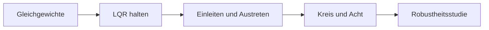
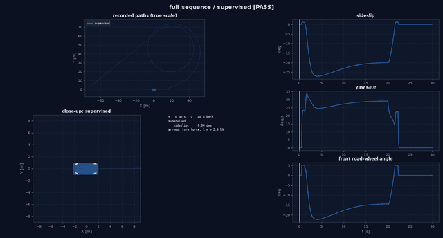
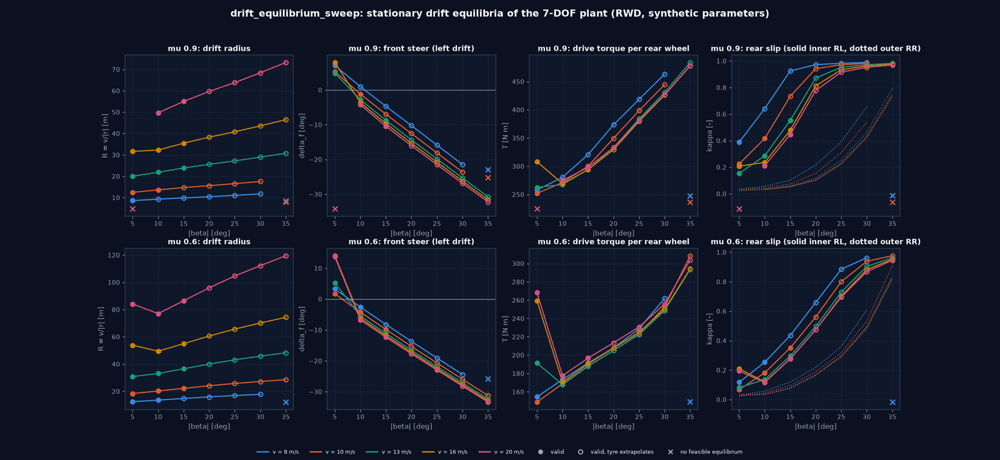
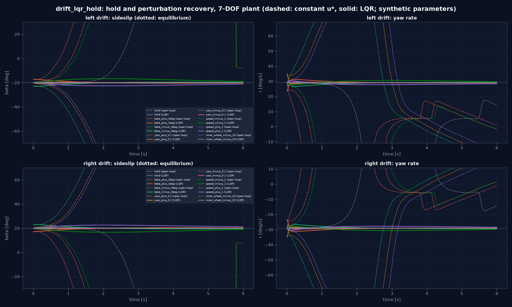
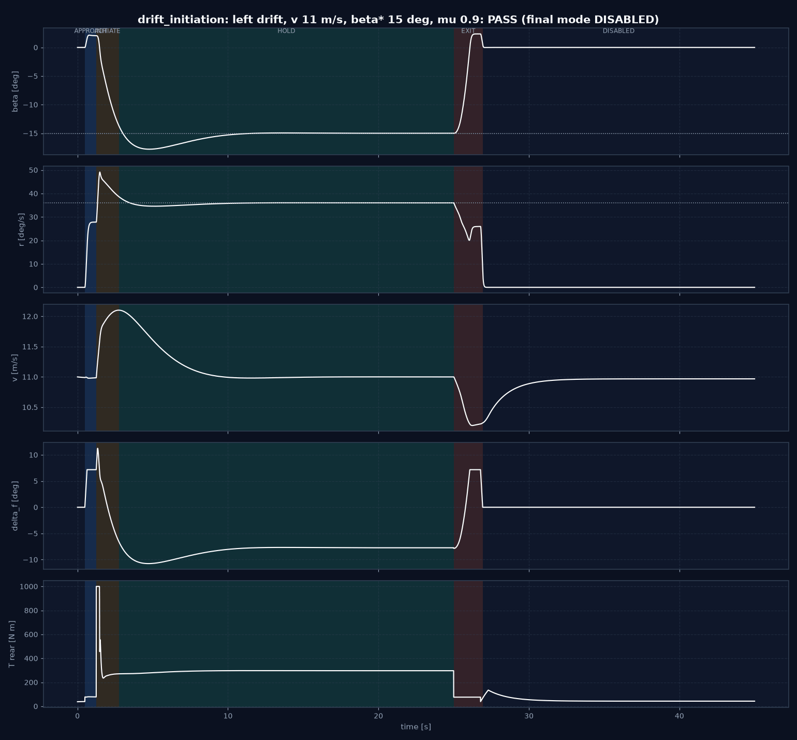
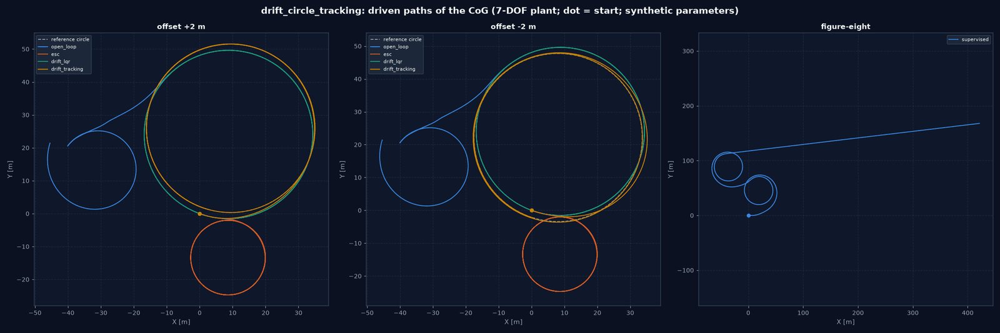

# Drift-Regler: Ergebnisse und Abnahme

Ergebnisse der Pakete Drift-Audit–Drift-Robustheit mit Gate-Bewertung (PASS / FAIL / INFEASIBLE). Verfahren:
[23_drift_controller.md](23_drift_controller.md); Modellgrenzen: [22_drift_model_validity.md](22_drift_model_validity.md). Alle
Parameter synthetisch, nur virtuelle Modellvalidierung.

## Überblick

## Gate-Übersicht

| Gate | Bewertung | Nachweis |
|---|---|---|
| Drift-Audit Audit, Baseline | PASS | Testbasis 607 bestanden, 2 übersprungen bei `9a1dbf4`; Wiederverwendungsstellen im Code geprüft; Referenzbeispiel läuft unverändert ([22_drift_model_validity.md](22_drift_model_validity.md) 1–2) |
| Drift-Auswertung Reifen, deterministische Auswertung | PASS | Audit aller drei Reifen bestanden (mit Extrapolationswarnung jenseits 20°); Rohmodell reihenfolgeabhängig um 1,6e-7, `DeterministicPlant` bitgleich; Nichtkonvergenz gemeldet bzw. im strengen Modus Ausnahme (Tests) |
| Driftgleichgewichte Driftgleichgewichte | PASS (mit Extrapolation) | nichttriviale, physikalisch geprüfte Gleichgewichte in beiden Richtungen; innerhalb der Reifengültigkeit nur bis etwa 15° Schwimmwinkel (`valid`), darüber `valid_extrapolated`; 6 von 140 Punkten ohne Gleichgewicht, 2 als Kurvenfahrt statt Drift erkannt |
| Drift-LQR Halten mit LQR | PASS | Gleichgewicht offen instabil (Eigenwert +3,4 1/s), stabilisierbar (PBH 7/7); LQR hält in beiden Richtungen und regelt alle 14 Störfälle aus, ohne Driftverlust; offen geht jede Störung verloren |
| Drift-Einleitung und -Rückkehr Einleitung, Austritt, Recovery | PASS mit Grenze | End-to-End aus Geradeausfahrt ohne Zustandseingriff: 30 von 36 Läufen erfolgreich (83 %), µ 0,6 18/18, µ 0,9 12/18; nicht erreicht: 25° bei µ 0,9 (Einleitung überschwingt, korrekter Abbruch bei 13 und 15 m/s, Dreher in der Recovery bei 11 m/s → FAILED gemeldet). Überwachter Austritt ohne Überschwingen gegenüber 21–47° bei sofortiger Abschaltung |
| Drift-Bahnführung Kreisführung, Übergang, Acht | Kreis PASS, Übergang PASS, Acht: Ablauf PASS / Geometrie FAIL | Radiale Außenschleife beseitigt ±2 m Startversatz (0,00 / 0,06 m), fester LQR behält 1,4 m; gestufte Einleitung auf 25° bei µ 0,9 erreicht (die drift initiation and recovery-Grenze), mit 8° Überschwingen; Acht: beide Driftkreise erreicht und symmetrisch, aber Mittelpunktabstand 1,34 × (R_l + R_r) statt 1 (Kreise berühren sich nicht) |
| Drift-Animation Animation und Export | PASS | Vier Läufe mit je allen 13 Pflichtdateien; GIF öffnet, 280–420 Bilder, jedes Bild eine aufgezeichnete Probe; Bahn in CSV = Aufzeichnung (Test, 1e-9 m); Etiketten für gescheiterte Läufe und Abschnitte |
| Drift-Robustheit Robustheit | PASS (Bericht), Grenzen benannt | Strukturierter Bericht über 19 Fälle (31 Läufe): ideal 14 held, 2 degraded (Split-µ), 0 lost; geschätzte und sensorbeschränkte Rückführung mit dem allgemeinen Beobachter 15/15 lost mit Ursache; stationäre Abweichungen ohne Integralanteil bis 4,8°; Schrittweitenordnung 1,5; Radlastbilanz exakt. **Nachtrag:** driftfähiger Beobachter (Vorderräder + IMU): Sensormodi 15/15 held; mit Integralanteil alle 16 idealen Fälle held (Split-µ eingeschlossen), Endfehler ≤ 0,33° |

## Driftgleichgewichte: Driftgleichgewichte

`configs/drift/equilibrium_sweep.yaml`: v = 8/10/13/16/20 m/s × |β| = 5…35° × µ = 0,9/0,6 × links/rechts = 140 Punkte
(8 min). Ergebnisse: `output/drift/equilibrium_sweep/` (CSV, JSON, PNG, Bericht).

| Klasse | Punkte |
|---|---|
| `valid` | 50 |
| `valid_extrapolated` | 82 |
| `infeasible`: kein Gleichgewicht (`residual_too_large`) | 6 (|β| = 35° bei 8 m/s für µ 0,9 und 0,6, bei 10 m/s für µ 0,9; je Richtung) |
| `infeasible`: Hinterachse unter dem Seitenkraftmaximum (Kurvenfahrt) | 2 (20 m/s, 5°, µ 0,9) |

Auswahl (Linksdrift; R Radius, δ Vorderachslenkwinkel, T Moment je Hinterrad; * Reifen extrapoliert):

| µ | v [m/s] | 5° | 10° | 20° | 30° |
|---|---|---|---|---|---|
| 0,9 | 8 | R 9 m, δ +7°, T 258 | R 9, δ +1°, 281* | R 10, δ −10°, 374* | R 12, δ −21°, 463* |
| 0,9 | 13 | R 20, δ +5°, 263 | R 22, δ −3°, 268 | R 26, δ −14°, 333* | R 29, δ −25°, 431* |
| 0,9 | 20 | Kurvenfahrt | R 50, δ −4°, 275 | R 60, δ −16°, 333* | R 68, δ −27°, 427* |
| 0,6 | 13 | R 31, δ +5°, 191 | R 33, δ −6°, 168 | R 40, δ −17°, 205* | R 46, δ −27°, 249* |

Befunde:

- Rechtsdrift ist das exakte Spiegelbild der Linksdrift (Test).
- Das offene Differential bestimmt den Driftzustand: Das entlastete kurveninnere Hinterrad dreht mit großem Schlupf
  (κ ≈ 0,9 bei 20°), das äußere bleibt bei κ ≈ 0,1.
- Gegenlenken (δ < 0 bei Linksdrift) tritt erst ab etwa 10° Schwimmwinkel auf; bei 5° wird in die Kurve gelenkt. Das
  Vorzeichen ist Ergebnis, nicht Vorgabe.
- Der Radius wächst mit dem Schwimmwinkel und fällt mit dem Reibwert; das nötige Moment steigt mit dem Schwimmwinkel.
- Ab etwa 20° Schwimmwinkel liegen die Hinterachs-Schräglaufwinkel jenseits der erklärten Gültigkeit des MF-Reifens
  (20°); diese Ergebnisse beruhen auf dem extrapolierten Reifenmodell.

## Drift-LQR: Halten und Störungen (S01–S03)

`configs/drift/drift_lqr.yaml`: 13 m/s, |β| = 20°, µ = 0,9 (R 25,6 m, r 29,1°/s, δ_f −14,4°, T 333 N·m;
`valid_extrapolated`), 6 s, RMS ab 2 s. Ergebnisse: `output/drift/lqr_hold/`.

Linearisierung: instabile Eigenwerte +3,40 und +0,04 1/s (Driftmode aus `v_y`/`r`, Geschwindigkeitsmode),
PBH-Rang 7/7, Steuerbarkeitsrang 3 von 7 (schnelle Radmoden nicht erreichbar, aber stabil), Schritt 1e-6
(konvergiert). Geschlossener Kreis (linear): langsamster Eigenwert −0,46 1/s (Geschwindigkeit).

| Störung (Linksdrift) | offen: Driftverlust | LQR: β-RMSE [°] | LQR: r-RMSE [°/s] | LQR: Fehlernorm Anfang → Ende | LQR: Sättigung |
|---|---|---|---|---|---|
| keine (Halten) | nein (6 s) | 0,00 | 0,00 | 0 → 0 | 0 % |
| β +3° | ja | 0,41 | 0,19 | 1,05 → 0,14 | 1 % |
| β −3° | ja | 0,41 | 0,20 | 1,05 → 0,15 | 1 % |
| r +0,1 rad/s | ja | 0,06 | 0,06 | 1,00 → 0,02 | 1 % |
| r −0,1 rad/s | ja | 0,05 | 0,04 | 1,00 → 0,02 | 0 % |
| v −1 m/s | ja | 2,41 | 1,25 | 1,00 → 0,37 | 0 % |
| v +1 m/s | ja | 2,03 | 1,14 | 1,00 → 0,46 | 0 % |
| inneres Hinterrad −10 rad/s | ja | 0,14 | 0,09 | 0 → 0,02 | 0 % |

Rechtsdrift: identische Werte (gespiegelt). Die vorläufigen Engineering-Ziele des Plans (β-RMSE ≤ 3°, r-RMSE ≤ 5°/s
nach Einregelphase) sind in allen Fällen eingehalten. Geschwindigkeitsstörungen klingen am langsamsten ab (Zeitkonstante
etwa 2 s, die langsame Geschwindigkeitsmode).

Offener Kreis: Aus dem exakten Gleichgewicht bleibt er 6 s auf dem Sollzustand (Residuum nahe null), jede der
Störungen führt dagegen zum Dreher bzw. Austritt innerhalb von 1–4 s; das bestätigt die Instabilität des
Gleichgewichts.

**Entwurfsbefund:** Die Grundform des LQR (Lenkwinkel direkt als Eingang) mit nachträglicher Ratenbegrenzung hielt keine
Störung zuverlässig; die Ursache war die Lenkratengrenze (gefordert bis 4200°/s). Mit der Lenkrate als Eingang im
Entwurf ist die Begrenzung kaum noch aktiv ([23_drift_controller.md](23_drift_controller.md) 3).

## Drift-Einleitung und -Rückkehr: Einleitung, Halten, Austritt (S04, S05)

`configs/drift/initiation.yaml`: Start in Geradeausfahrt bei Driftgeschwindigkeit, Driftanforderung bei 0,5 s,
Austrittsanforderung bei 25 s, 45 s je Lauf; v = 11/13/15 m/s × β* = 15/20/25° × µ = 0,9/0,6 × links/rechts = 36 Läufe
(parallel, etwa 16 min). Ergebnisse: `output/drift/initiation/` (Bericht, `kpi.csv`, `mode_log.json` mit allen
Moduswechseln und Gründen, Zeitverläufe, Ablaufbild).

**Erfolg (HOLD erreicht, kein FAILED, Normalfahrt wiederhergestellt): 30 von 36 (83 %).** Links und rechts identisch.

| µ | β* | 11 m/s | 13 m/s | 15 m/s |
|---|---|---|---|---|
| 0,9 | 15° | PASS (HOLD nach 2,2 s) | PASS (2,2 s) | PASS (2,1 s) |
| 0,9 | 20° | PASS (15,0 s) | PASS (7,6 s) | PASS (2,0 s) |
| 0,9 | 25° | FAIL: Zeitüberschreitung, RECOVER, Dreher → FAILED | FAIL: Zeitüberschreitung, Recovery zur Normalfahrt | FAIL: wie 13 m/s |
| 0,6 | 15/20/25° | PASS (1,9–2,4 s) | PASS | PASS |

Über die erfolgreichen Läufe: Zeit bis HOLD Median 2,2 s (max. 15,0 s), β-RMSE im HOLD ≤ 2,0°, Austritt bis zur
Normalfahrt ≤ 3,5 s, Schwimmwinkelspitze im Austritt höchstens 0,14° über dem Driftwinkel, minimale Geschwindigkeit
im Austritt ≥ 84 % der Driftgeschwindigkeit. Vergleich mit sofortiger Abschaltung (Moment 0, Lenkrampe auf 0) aus
demselben HOLD: kein Dreher in den 30 Fällen, aber Schwimmwinkelspitzen von 21–47°.

**Grenze 25° bei µ 0,9:** Der LQR, aus der Kurvenfahrt gestartet, überschwingt auf etwa −36°, das Moment sättigt und
die Geschwindigkeit steigt bis 25 m/s; der Einfangbereich wird in 15 s nicht erreicht. Der Automat bricht korrekt ab
(INITIATE → RECOVER); bei 11 m/s dreht sich das Fahrzeug in der Recovery, was als FAILED gemeldet wird. Ein gestufter
Weg (zuerst 15°, dann Sollpunktwechsel entlang des Zweigs) gehört zu drift tracking.

**Entwurfsbefunde** (Verfahren und Zahlen in [23_drift_controller.md](23_drift_controller.md) 5): kein stationärer Weg aus
der Geradeausfahrt in den Drift (getrennte Gleichgewichtszweige); Einleitung ohne Momentenstoß, der LQR bricht das
Heck selbst aus; Austritt mit Gegenlenken in Fahrtrichtung (`k_β = 1`), teilweises Gegenlenken (0,5; 0,8) dreht sich;
rampierte Sollgeschwindigkeit nötig (Sollsprung erzeugte einen Dreher bei 3 m/s); Gegenlenken nur des Driftanteils
(bei 11 m/s hat normale Kurvenfahrt β = +4°; vorher blieb der Austritt dort hängen, 26/36 → 30/36).

## Drift-Bahnführung: Kreisführung, Sollpunktwechsel, Acht (S06, S07)

`configs/drift/circle_hold.yaml`: Gleichgewicht 13 m/s, β −20°, R 25,6 m, µ 0,9; Schedule über 6…26°; Kreis mit
Gleichgewichtsradius, radial um 0 / +2 / −2 m versetzt (außen / innen); 25 s. Ergebnisse: `output/drift/circle_tracking/`.

| Startversatz | offen (u*) | ESC | Drift-LQR fest | Drift-LQR + Außenschleife |
|---|---|---|---|---|
| 0 m | Drift verloren (Radialfehler 19 m) | Drift beendet, 13,4 m | 0,00 m | 0,00 m |
| +2 m | verloren, 20,0 m | beendet, 14,9 m | 1,39 m | **0,00 m** |
| −2 m | verloren, 18,1 m | beendet, 12,0 m | 1,41 m | **0,06 m** |

(Radialfehler RMS der letzten 10 s.) Befunde:

- Der offene Kreis fällt auch ohne Störung nach 8,6 s vom instabilen Gleichgewicht ab (in Drift-LQR über 6 s noch nicht sichtbar).
- **ESC und Drift widersprechen sich:** Das ESC regelt die Gierrate auf die Referenz aus dem Fahrerlenkwinkel; der ist im
  Drift ein Gegenlenkwinkel nach rechts. Es beendet den Drift (β-RMSE 15,6°), und das Fahrzeug fährt danach einen
  Rechtskreis. Der Drift braucht deshalb die exklusive Drift-Regelung.
- Der feste LQR hält den Drift, aber auf einem um den Startversatz verschobenen Kreis (Radialfehler pendelt ±1,4 m);
  erst die Außenschleife führt auf den Sollkreis. Sie bewegt dabei β um höchstens etwa ±3°.

**Gestufte Einleitung (Sollpunktwechsel):** aus der Geradeausfahrt auf 15° eingeleitet (HOLD nach 2,7 s), dann
TRANSITION entlang des Zweigs auf 25° mit 1°/s (bis 12,7 s), Halten bis 50 s, Austritt, Normalfahrt bei 52,8 s: PASS.
Damit ist der 25°-Drift bei µ 0,9 erreichbar, den die direkte Einleitung in Drift-Einleitung und -Rückkehr nicht schafft. Schwäche: Nach Erreichen
des Sollpunkts schwingt β auf 33° über (8° über dem Ziel), die Geschwindigkeit steigt bis 16 m/s; β-RMSE im
anschließenden HOLD 3,2° (langsame Geschwindigkeitsmode).

**Acht:** Linksdrift 12 s, Austritt (3,1 s, Spitze 20°, min. 12,5 m/s), Rechtsdrift aus der Normalfahrt eingeleitet,
12 s, Austritt.

| Abschnitt | erreicht | Kreisausgleich R | radiale Streuung um den Ausgleichskreis | β Mittel / Std. |
|---|---|---|---|---|
| links | ja | 26,3 m | 0,52 m | −21,4° / 1,3° |
| rechts | ja | 26,3 m | 0,52 m | +21,4° / 1,3° |

Ablauf: PASS (beide Abschnitte, kein FAILED, exakt gespiegelt). **Geometrie: FAIL** — Mittelpunktabstand 70,2 m statt
52,6 m (Verhältnis 1,34). Ursache: Zwischen den Kreisen verlässt das Fahrzeug den Drift und leitet neu ein; die
Außenschleife kann nur den Radius, nicht den Mittelpunkt verschieben. Eine echte Acht braucht eine Mittelpunkt- bzw.
Querablagenführung oder einen direkten Wechsel links → rechts ohne Austritt (offen).

## Drift-Animation: Animation und Export

`configs/drift/animation.yaml` → `output/drift/runs/` (Beispiel `examples/drift_figure_eight_demo.py`):

| Szenario / Variante | Ergebnis | Inhalt |
|---|---|---|
| `circle_hold/open_loop` | drift lost | Gleichgewicht + 3° Schwimmwinkel, konstante Stellgrößen |
| `circle_hold/drift_tracking` | PASS | dieselbe Störung, Sollkreis 2 m versetzt, Schedule + Außenschleife |
| `circle_hold/comparison.gif` | | beide Läufe auf gemeinsamen Achsen (17,6 MB, nur lokal) |
| `full_sequence/supervised` | PASS | Geradeausfahrt → APPROACH (0,5 s) → INITIATE (1,2 s) → HOLD (8,1 s) → EXIT (20 s) → Normalfahrt (22,4 s) |
| `figure_eight/supervised` | sequence PASS / geometry FAIL | Links 10 s (R 26,5 m), Austritt 3,1 s, rechts 10 s (R 26,5 m); Mittelpunktabstand 1,33 × (R_l + R_r) |

Jeder Ordner enthält die 13 Pflichtdateien. Die GIFs sind 10–18 MB groß; in die Dokumentation übernommen ist nur die
vollständige Sequenz (verkleinert, 4,2 MB).

## Drift-Robustheit: Robustheit

`configs/drift/robustness.yaml`: nominaler Entwurf 13 m/s, β −20°, µ 0,9; Gleichgewicht + 3° Schwimmwinkel, 10 s.
Ergebnisse: `output/drift/robustness/` (`report.md`, `kpi.json`). Die Tabelle ist der Ausgangsbefund mit dem
drift LQR-Entwurf und dem allgemeinen Beobachter (Commit `e1226b8`); die Behebung folgt im Nachtrag unten.

| Fall | Abweichung | Klasse | β-RMSE (2. Hälfte) | Endfehler β |
|---|---|---|---|---|
| nominal | – | held | 0,27° | 0,07° |
| schwer / leicht | Masse 1,2/0,9, I_z 1,25/0,9 | held / held | 0,21° / 0,31° | −0,01° / 0,13° |
| Schwerpunkt hoch | h_S 0,6 m statt 0,5 m | held | 5,07° | 4,78° |
| Schwerpunkt hinten / vorn | ±0,10 m | held / held | 2,01° / 3,08° | −2,27° / 3,02° |
| Hinterreifen / Vorderreifen weicher | Steifigkeit × 0,85 | held / held | 0,35° / 0,60° | −0,55° / 0,37° |
| Reibwert 0,8 / 1,0 | statt 0,9 | held / held | 3,83° / 3,84° | −3,44° / 3,18° |
| Anfangsgeschwindigkeit +10 % | 14,3 m/s | held | 0,81° | −0,21° |
| Reifenrelaxation | `TransientSevenDOFModel` | held | 0,28° | 0,08° |
| Aktuatorverzögerung | 20 ms Totzeit, 30 ms Verzögerung, 10 ms Latenz | held (84 % gesättigt) | 2,27° | −2,21° |
| Aktuatorverzögerung stark | 40 / 30 / 10 ms | held (91 % gesättigt) | 3,16° | −3,58° |
| Split-µ 0,7 / 0,5 | halber Kreis mit niedrigerem Reibwert | degraded / degraded | 8,59° / 16,1° | −8,40° / −16,7° |
| geschätzt (Mode B) | Sensoren nominal, 5 Seeds | lost 5/5 | – | – |
| geschätzt, Sensoren gestört | Rauschen × 2, Gyro-Bias 0,02 rad/s, 20 ms Latenz | lost 5/5 | – | – |
| sensorbeschränkt (Mode C) | 5 Seeds | lost 5/5 | – | – |

Befunde:

- **Ideale Rückführung:** Kein Driftverlust in 16 Fällen. Parameterabweichungen verschieben das Gleichgewicht, und ohne
  Integralanteil bleibt eine stationäre Abweichung (bis 4,8° bei höherem Schwerpunkt, ±3,3° bei Reibwert ±0,1).
- **Aktuatorverzögerung:** Der Drift wird gehalten, aber die Lenkratengrenze ist in 84–91 % der Schritte aktiv; es
  bleibt kaum Stellreserve.
- **Split-µ:** Der Drift wird nicht verloren, aber der Schwimmwinkel weicht um 8° (µ 0,7) bzw. 17° (µ 0,5) ab; ein
  Drift über wechselnde Reibwerte bräuchte einen reibwertabhängigen Sollpunkt.
- **Geschätzte Zustände: nicht driftfähig.** Der vorhandene Beobachter (`BlendedSideslipObserver`) startet mit β = 0
  (Normalfahrt angenommen), das Fahrzeug ist aber im Drift (−20°), und er nimmt die Geschwindigkeit aus den Raddrehzahlen:
  Das kurveninnere Hinterrad dreht im Drift durch (κ ≈ 0,87), die geschätzte Längsgeschwindigkeit steigt auf 24 m/s
  (wahr: 12 m/s). Der LQR regelt dann auf falsche Zustände und verliert den Drift in allen 15 Läufen. Die Seeds ändern
  daran nichts (Endzustand jeweils Stillstand nach Dreher). Ein driftfähiger Schätzer (Geschwindigkeit nur aus den
  frei rollenden Vorderrädern oder aus GNSS, Initialisierung im Drift) fehlt.
- **Numerik:** Radlastbilanz in jedem Lauf auf < 1e-6 relativ erfüllt. Schrittweitenstudie des geschlossenen Kreises:
  Fehler 1,9e-3 / 7,1e-4 / 2,4e-4 bei 10 / 5 / 2,5 ms gegen 1,25 ms, beobachtete Ordnung etwa 1,5 (der Regler hält
  seinen Eingang über einen Schritt; die RK4-Ordnung 4 der Strecke wird im Kreis nicht erreicht). Der Standardschritt
  5 ms liegt damit bei etwa 7e-4 im Endzustand.
- Die bisherigen Tests des gesamten Repositories (Nicht-Drift-Funktionen) laufen unverändert (volle Suite).

## drift robustness-Nachtrag: driftfähiger Beobachter und Integralanteil

Zwei Ursachen aus Drift-Robustheit behoben, ohne Testgrenzen zu ändern:

- **`drift.DriftVelocityObserver`** (nur Sensoren): Kalman-Filter auf `[v_x, v_y]` mit der IMU-Kinematik
  `v̇_x = a_x + r v_y`, `v̇_y = a_y − r v_x` als Prozessmodell (kein Reifenmodell) und den beiden **Vorderrädern** als
  Messung (im Drift ohne Antriebs- und Bremsmoment, also frei rollend): `ω_i R = (v_x ∓ r b/2) cos δ + (v_y + l_v r) sin δ`.
  Ein Rad misst nur die Geschwindigkeit entlang seiner Richtung; beide Komponenten werden über die Drehung (`r ≠ 0`)
  beobachtbar. Start aus der ersten Vorderradmessung mit `v_y = 0` und großer Varianz: keine Annahme über den Schwimmwinkel.
- **Integralanteil** (`design_lqr(..., integral=True)`, `LQRWeights.q_integral`, Standard 10): zusätzlicher Zustand
  `z = ∫(β − β*) dt` im LQR-Entwurf, Anti-Windup durch bedingte Integration (kein Integrieren in gesättigten Schritten).
  Opt-in; Drift-LQR–Drift-Animation bleiben beim bisherigen Entwurf.

Ergebnisse (`output/drift/robustness/` mit dem neuen Beobachter, `output/drift/robustness_integral/` zusätzlich mit
Integralanteil, `configs/drift/robustness_integral.yaml`):

| Fall | ohne Integral: Klasse, Endfehler β | mit Integral: Klasse, Endfehler β | mit Integral: Endfehler v |
|---|---|---|---|
| nominal | held, 0,07° | held, 0,00° | 0,01 m/s |
| Schwerpunkt hoch | held, 4,78° | held, 0,33° | −1,20 m/s |
| Schwerpunkt hinten / vorn | held, −2,27° / 3,02° | held, −0,10° / 0,17° | 0,73 / −0,76 m/s |
| Reibwert 0,8 / 1,0 | held, −3,44° / 3,18° | held, −0,08° / 0,28° | 0,35 / −0,63 m/s |
| Aktuatorverzögerung / stark | held, −2,21° / −3,58° | held, −0,71° / −1,97° (84 / 92 % gesättigt) | 0,39 / 0,44 m/s |
| Split-µ 0,7 | degraded, −8,40° | **held**, −0,07° | 0,04 m/s |
| Split-µ 0,5 | degraded, −16,7° | **held**, 0,18° (β-RMSE 3,7°) | −0,52 m/s |
| geschätzt, Driftbeobachter (5 Seeds) | **held 5/5**, 0,48° (0,40–0,62) | held 5/5, 0,68° (0,57–0,85) | 0,28 m/s |
| geschätzt, Sensoren gestört | **held 5/5**, 1,17° (0,93–1,48) | held 5/5, 2,41° (2,09–2,74) | 0,79 m/s |
| sensorbeschränkt (Mode C), Driftbeobachter | **held 5/5**, 0,48° | held 5/5, 0,68° | 0,28 m/s |
| geschätzt, allgemeiner Beobachter (Referenz) | lost 5/5 | lost 5/5 | – |

Alle übrigen Fälle bleiben held (Endfehler mit Integral ≤ 0,04°).

Befunde:

- Der Driftbeobachter macht die Sensormodi driftfähig; der allgemeine Beobachter bleibt als Referenzfall im Bericht
  und verliert den Drift weiterhin (erwartete Grenze, Test `test_general_blended_observer_is_not_drift_capable`).
- Der Integralanteil beseitigt die stationären Schwimmwinkelabweichungen der idealen Fälle. Preis: Mit zwei Eingängen
  und einer integrierten Größe stellt sich die Geschwindigkeit frei ein (bis −1,2 m/s; langsamer Eigenwert −0,036 1/s).
- Mit Schätzung regelt das Integral den **geschätzten** Schwimmwinkel aus: Der Schätzfehler (nicht geschätzte Sensor-Biasse,
  bei gestörten Sensoren Gyro-Bias 0,02 rad/s) bleibt als Endfehler (0,7° bzw. 2,4°), mit Integral etwas größer als ohne.
- In den Sensormodi ist die Lenkrate in 43–74 % der Schritte begrenzt: Das Sensorrauschen erreicht über die steifen
  LQR-Verstärkungen die Lenkung. Ein Filter oder geringere Gewichte wären der nächste Schritt.
- Numerik mit Integral: Fehler gegen den feinsten Schritt 1,4e-3 / 2,3e-4 / 2,9e-4 (10 / 5 / 2,5 ms); keine saubere
  Ordnung, weil die bedingte Integration mit der Sättigung schaltet. Radlastbilanz weiterhin < 1e-6.

## Offene Punkte nach Drift-Robustheit

- Einfangbereich systematisch bestimmen (größere Störungen, Rasterung wie in nichtlineare Stabilität), statt nur der definierten Störungen.
- 25° bei µ 0,9 direkt nicht einleitbar; gestuft erreicht, mit 8° Überschwingen nach dem Sollpunktwechsel.
- Der Austritt verliert bis 16 % Geschwindigkeit; die Recovery bei 11 m/s nach misslungener Einleitung dreht sich.
- Acht geometrisch nicht erreicht (Mittelpunktführung fehlt).
- GIFs sind groß (10–18 MB); für die Dokumentation wird nur eine verkleinerte Sequenz veröffentlicht.
- Driftbeobachter: Sensor-Biasse nicht geschätzt; in Geradeausfahrt ist `v_y` nicht beobachtbar; Bremsen oder
  Frontantrieb verfälschen die Vorderradmessung. Rauschen sättigt die Lenkrate häufig.
- Integralanteil nur im Halteregler (`DriftLQRController`); Einleitung, geplante Übergänge nutzen ihn nicht.
- Drift-NMPC (NMPC) ist im Plan optional und erst nach bestandenen Basisgates vorgesehen.

---

<!-- figures:start -->

## Ergebnisbilder

> Alle Bilder sind Simulationsergebnisse mit synthetischen Parametern, keine Messungen. Neu erzeugen: Quellskript ausführen, dann `python tools/publish_doc_figures.py`.

*Überwachter Drift aus der Geradeausfahrt (13 m/s, µ 0,9, Ziel β −20°): Annäherung, Einleitung durch den LQR, Halten, Austritt mit Gegenlenken, Normalfahrt. Nur aufgezeichnete Daten der 7-DOF-Strecke; doppelte Wiedergabegeschwindigkeit. Quelle: `python examples/drift_figure_eight_demo.py`.*

*Stationäre Driftgleichgewichte über |β| je Geschwindigkeit und Reibwert: Radius, Lenkwinkel, Moment je Hinterrad, Hinterradschlupf; offene Kreise: Reifen extrapoliert, Kreuze: kein Gleichgewicht. Quelle: `python examples/drift_equilibria_demo.py`.*

*Halten und Störungen links/rechts, offen (gestrichelt) gegen LQR (durchgezogen). Quelle: `python examples/drift_hold_demo.py`.*

*Moduswechsel und Zeitverläufe einer Einleitung bis zum Austritt (11 m/s, 15°, µ 0,9). Quelle: `python examples/drift_initiation_demo.py`.*

*Kreisbahnen bei ±2 m Startversatz (offen, ESC, Drift-LQR fest, mit Außenschleife) und die Acht-Sequenz (Geometrie nicht erreicht). Quelle: `python examples/drift_circle_demo.py`.*

<!-- figures:end -->
