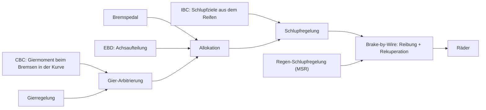
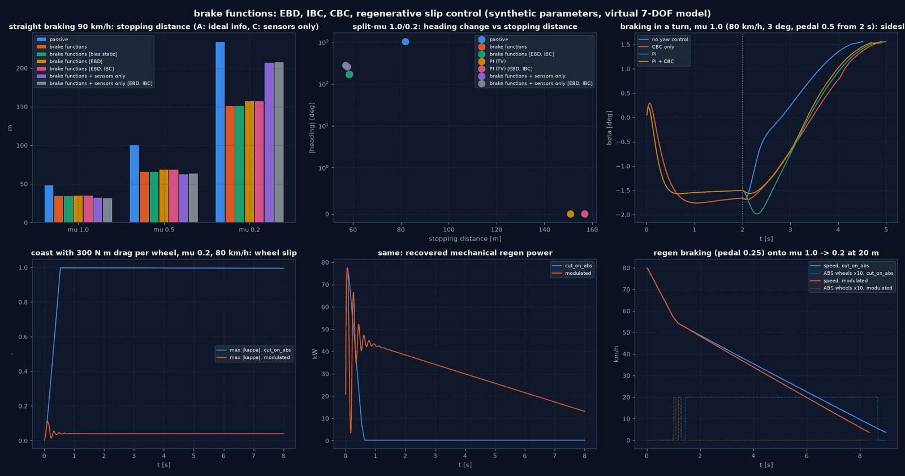
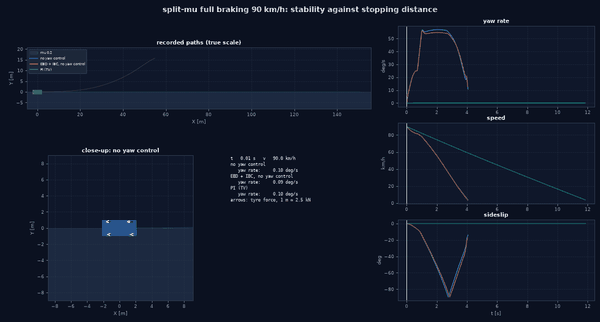
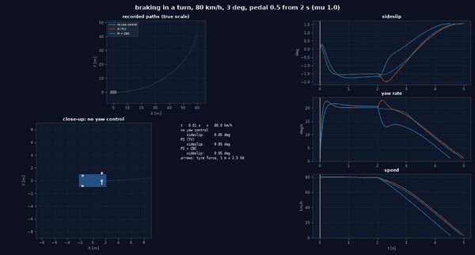
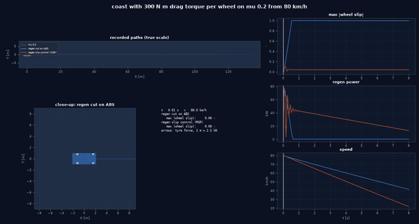

# EBD, CBC, IBC und regenerative Schlupfregelung

Grundlage: [Plan integrierte Bewegungsregelung](plans/integrated_motion_control_plan.md). Vier Bremsfunktionen auf der gemeinsamen Stellkette aus Stellgrößenkette; keine davon setzt
eigene finale Radmomente. Alle Parameter sind synthetisch (`configs/braking/brake_functions.yaml`, mit Einheit,
Bereich und Bedeutung); Szenarien sind an ISO 7975 und Split-µ-Versuche **angelehnt**, keine Normkonformität.

## Überblick



## 1. Einordnung in die Stellkette

```
Fahrer (Pedale, Lenkung) ─► Regelgesetz (PI/LQR/… oder "brakes": keine Gieranforderung)
                            CBC-Anfrage ─► Gier-Arbitrierung (arbitrate_yaw, nie Summe)
                         ─► (F_x, M_z | None) ─► Allokation  ◄─ EBD: Anteile + Hinterachsgrenzen
                         ─► ABS/TCS (WheelSlipController) ◄─ IBC: Sollschlupf aus dem Reifenmodell
                         ─► issued ─► Aktuatorkette: BBW ◄─ MSR: Rekuperationsgrenze, Schleppmoment
                         ─► realised ─► 7-DOF-Strecke
```

| Funktion | Modul | Wirkung | Eigentümer der Radmomente |
|---|---|---|---|
| EBD | `controllers/brake_distribution.py` | Verteilungsanteile und zusätzliche Bremsgrenzen je Rad für die Allokation, nur bei Bremsanforderung | Allokation |
| CBC | `controllers/cornering_brake.py` | Giermomentanfrage beim Bremsen in der Kurve | Allokation, nach Arbitrierung |
| IBC | `controllers/integrated_brake.py` | Sollschlupftabelle des vorhandenen ABS-Reglers aus `Fx(κ)` des Auslegungsreifens; Rekuperationspolitik | ABS-Regler (vorhanden, nicht kopiert) |
| MSR | `controllers/regenerative_slip.py` | Obergrenze des Rekuperationsmoments je Rad, Schleppmoment im Schubbetrieb | Brake-by-Wire-Aktuator (Rekuperation geht genau einmal in die Strecke, Stellgrößenkette) |

Experiment-DSL: Gesetz `brakes` (Stellkette ohne Gierregelung) und je Regler ein Block
`brake: {distribution: grip|static|ebd, ibc: bool, cbc: bool, regen: cut_on_abs|modulated, coast_torque: N·m}`.
Manöver `straight_braking`, `brake_in_turn`, `coast`, Fahrbahn `mu_step`. Ungültige Kombinationen werden mit Erklärung
abgewiesen (Bremsfunktionen am passiven Fahrzeug, Rekuperation ohne Aktuatordynamik, modulierte Rekuperation im
Modus C, unbekannte Schlüssel).

### 1.1 Einzelheiten

- **EBD** (`grip`: bisherige grip-proportionale Verteilung; `static`: 60:40-Referenz; `ebd`): Anteile proportional
  zu `µ̂ F̂_z` (dynamische Lastverlagerung in `F̂_z`), Hinterachsgrenze `rear_margin · µ̂ F̂_z` (Hinterachse soll nicht vor
  der Vorderachse an die Grenze), Druckhalten: Bei Beginn eines ABS-Eingriffs an einem Hinterrad wird dessen Grenze auf
  der zuletzt allokierten Kraft **eingefroren** (nicht schrittweise gesenkt) und mit dem Ende des Eingriffs freigegeben.
  `F̂_z`, `µ̂` sind das, was der Regler erhält: in Modus A/B die Telemetrie, in Modus C die Sensorschätzung.
- **Keine Gieranforderung ≠ Giermoment 0**: `MotionRequest.yaw_moment = None` lässt `M_z` in der Allokation
  frei; beim Antreiben ohne Gieranforderung wird links/rechts je Achse gleich verteilt (offenes Differential).
  Gemessen vor dieser Unterscheidung: Mit `M_z = 0` begrenzte die Gierpriorität die Verzögerung in der Kurve auf
  2,3 m/s²; mit grip-proportionalem Antrieb ohne Gieranforderung entstand ungewolltes Torque Vectoring (−6° Schwimmwinkel
  in stationärer Kurvenfahrt).
- **CBC**: Vorsteuerung `c_ff m a_x h a_y / g` mit der **erreichbaren** Verzögerung `max(a_x,Wunsch, −µ̂ g)` (gemessen: mit
  der Pedalanforderung −13 m/s² forderte CBC 3900 N·m und kostete Bremsweg), dazu Rückführung nur bei Übersteuern.
  Arbitrierung mit dem Gesetz: gleiches Vorzeichen → größerer Betrag, entgegengesetzt → Gesetz (Stabilitätspriorität),
  Ergebnis in `diagnostics["arbitration"]`.
- **IBC**: `κ*(µ) = argmax |F_x(κ, α = 0, F_z,nom, µ)|`, für den mitgelieferten MF-Reifen ≈ 0,107 µ (bisherige
  Handkalibrierung 0,028 bei µ 0,3 und 0,09 bei µ 1,0, aus dem Reifen 0,032 und 0,108); optional unterhalb des Maximums
  (`peak_fraction`).
- **MSR**: `cut_on_abs` (bisheriges BBW-Verhalten: Rekuperation unter ABS auf 0, Schleppmoment ungeregelt) gegen
  `modulated` (Schlupfregelkreis, der vorhandene `WheelSlipController` wiederverwendet, begrenzt die Rekuperation je Rad;
  unter Bremswunsch übernimmt die Reibbremse den Rest, das Schleppmoment wird nur reduziert, nie hydraulisch ersetzt).
  Der Kreis liest den Radschlupf der Telemetrie (idealisierte Schlupfmessung, `wheel_slip_ideal`), daher nicht in Modus C.

## 2. Ergebnisse

Konfigurationen `configs/experiments/brake_functions_*.yaml`, `regen_slip_*.yaml`, Ergebnisse `output/brake_functions/<experiment>/` (Kennzahlen, Verläufe,
`metadata.json`), Abbildung `output/brake_functions/braking_functions.png` (`examples/brake_functions_figures.py`). Gleiche
Strecke, Reifen, Integration und Seed für alle Varianten eines Experiments.

### 2.1 Geradeausbremsung, 90 km/h, Vollbremsung (`brake_functions_straight_braking`)

| µ | passiv 60:40 | Kette, grip | static | EBD | EBD + IBC | Modus C, grip | Modus C, EBD + IBC |
|---|---|---|---|---|---|---|---|
| 1,0 | 48,4 m | 34,1 m | 34,1 m | 35,2 m | 35,2 m | 31,9 m (ABS 2,4 s, 706 Wechsel) | 31,7 m (ABS 0,5 s, 114 Wechsel) |
| 0,5 | 100 m | 65,9 m | 65,9 m | 68,5 m | 68,5 m | 62,5 m (238 Wechsel) | 63,5 m (68 Wechsel) |
| 0,2 | 234 m | 151 m | 151 m | 157 m | 157 m | 207 m | 207 m |

- Mit idealer Information (A) begrenzt die Allokation jedes Rad auf 95 % des bekannten Haftwerts (`grip_margin`): ABS
  greift kaum ein, die Verteilung ist bei Vollbremsung ohne Freiheit (alle Räder an der Grenze), daher `static` = `grip`.
  EBD kostet durch die Hinterachsreserve 3–4 % Bremsweg: ein bewusster Stabilitätsvorhalt, kein Gewinn.
- In Modus C bremst die Kette auf µ 1,0/0,5 kürzer als in A (sie nutzt die volle Reibung, A hält 5 % zurück); EBD + IBC
  senkt die ABS-Wechsel um 70–84 %. Auf µ 0,2 dominiert die bekannte Reibwertüberschätzung des Sensorschätzers:
  207 m, 55 % von µg, durch EBD/IBC nicht behoben.

### 2.2 Split-µ 1,0/0,2 und Reibwertsprung 1,0 → 0,2 (`brake_functions_split_mu`, `brake_functions_mu_step`)

| Variante | Split-µ: Bremsweg / Kurswinkel | µ-Sprung: Bremsweg / ABS-Wechsel |
|---|---|---|
| passiv | 82 m / 1020° (dreht sich) | 160 m / – |
| Kette ohne Gierregelung | 58,5 m / 173° (dreht sich) | 97,7 m / 188 |
| … + EBD + IBC | 58,3 m / 169° | 99,8 m / 88 |
| PI | 151 m / 0,003° | – |
| PI + EBD + IBC | 157 m / 0,003° | – |
| Modus C, grip / EBD + IBC | 57,6 / 56,9 m, dreht sich | 113 / 108 m |

Zielkonflikt Stabilität gegen Verzögerung auf Split-µ: ohne Gierregelung 58 m und Dreher, mit PI gerade und 151 m (beide
Seiten nur bis zur Haftgrenze der Niedrigreibwertseite). EBD/IBC ändern daran nichts Wesentliches; die Gierregelung
entscheidet.

### 2.3 Bremsen in der Kurve, 80 km/h, Pedal 0,5 ab 2 s (`brake_functions_brake_in_turn`, `…_low_mu`)

Vor dem Bremsen etwa 0,8 µg (3° auf µ 1,0, 1,5° auf µ 0,5).

| Variante | µ 1,0: Bremsweg / max. β beim Bremsen | µ 0,5: Bremsweg / max. β |
|---|---|---|
| ohne Gierregelung | 74,5 m / 1,69° | 103,3 m / 0,92° |
| nur CBC | 82,9 m / 1,69° | 109,7 m / 0,93° |
| PI | 83,3 m / 1,99° | 106,4 m / 0,89° |
| PI + CBC | 81,5 m / 1,56° | 106,3 m / 0,84° |
| PI + CBC + EBD + IBC | 81,8 m / 1,56° | 106,4 m / 0,84° |

- Das Referenzfahrzeug bleibt beim Bremsen in der Kurve bei 0,8 µg auch ohne Gierregelung stabil und bremst dann am
  kürzesten. Jeder Giereingriff kostet hier Bremsweg.
- **CBC allein** ändert den Schwimmwinkel nicht und kostet 6–8 m: kein Nutzen in diesem Fahrzeug.
- **CBC mit PI** verbessert beides leicht (µ 1,0: −1,7 m, β 1,99° → 1,56°); bei µ 0,5 nur β (0,89° → 0,84°).
- Fehlversuch dokumentiert: Mit 3° auf µ 0,5 (≈ 1,6 µg) dreht sich das Fahrzeug ohne Gierregelung **schon vor dem
  Bremsen**; das ist Kurvenfahrt über der Grenze, kein Bremsen-in-der-Kurve-Fall, und wurde deshalb ersetzt.

### 2.4 Rekuperation und Schleppmoment auf µ 0,2 (`regen_slip_coast_low_mu`, `regen_slip_braking`)

Schubbetrieb (beide Pedale los) mit 300 N·m Schleppmoment je Rad:

| Start | ohne Schleppmoment | `cut_on_abs` | `modulated` |
|---|---|---|---|
| 80 km/h | 167 m | 134 m, Räder 7,7 s blockiert, 27 kJ | 113 m, nie blockiert, 240 kJ |
| 40 km/h | 82 m | 48,5 m, 7,5 s blockiert, 8,5 kJ | 35,0 m, nie blockiert, 66,6 kJ |
| 10 km/h | 17,4 m | 6,1 m, 1,0 s blockiert, 0,9 kJ | 6,0 m, nie blockiert, 3,1 kJ |

Ohne Bremspedal greift kein ABS ein: Mit `cut_on_abs` blockiert das Schleppmoment die Räder auf Eis über fast den
ganzen Lauf (keine Lenkfähigkeit, kaum Rekuperation). Der Schlupfkreis hält die Räder bei κ ≈ 0,04, die Verzögerung
erreicht µg und die Rekuperation das Neunfache.

Rekuperatives Bremsen (Pedal 0,25) von 80 km/h auf einen Reibwertsprung 1,0 → 0,2:

| | Bremsweg | blockiert | ABS aktiv / Wechsel | Reibbremsanteil | Rekuperation |
|---|---|---|---|---|---|
| `cut_on_abs` | 83,8 m | 0,24 s | 7,4 s / 12 | 29 % | 196 kJ |
| `modulated` | 79,0 m | 0 s | 0,2 s / 8 | 15 % | 237 kJ |

Auf gleichmäßiger Fahrbahn (µ 0,2 oder 1,0) sind beide Politiken identisch, weil ABS in Modus A nicht eingreift
(gemessen). Die energetischen Werte sind mechanische Arbeit am Rad, ohne Batterie-, Wirkungsgrad- und Thermomodell.

## 3. Abnahme Bremsfunktionen

| Kriterium | Bewertung |
|---|---|
| Bremsstrategien messbar und reproduzierbar | erfüllt: sechs Experimente, gleiche Strecke je Vergleich, deterministisch |
| kein Rad über den deklarierten Aktuatorgrenzen | erfüllt: Allokationsgrenzen (2500 N·m), BBW-Grenzen (3000 N·m Reibung, 500 N·m Rekuperation); Schleppmoment nie hydraulisch |
| Split-µ: verständlicher Zielkonflikt | erfüllt: 58 m mit Dreher gegen 151 m gerade (2.2) |
| negativer Motorantrieb nicht doppelt verrechnet | erfüllt (actuation chain-Festlegung, hier mit Schleppmoment getestet) |
| kein ideales µ in Modus C | erfüllt: EBD/IBC nutzen die Werte, die der Regler erhält; modulierte Rekuperation in C abgewiesen |
| CBC-/ESC-Konflikte durch zentrale Arbitrierung erklärt | erfüllt: `arbitrate_yaw`, Gewinner je Schritt in der Diagnose; PI + CBC bei µ 0,5 = PI (PI-Anfrage größer) |

Tests: `tests/vehicle_model/test_brake_functions.py` (14 Tests, 2 davon `slow`).

## 4. Grenzen

- Ohne Gierregelung ist das Referenzfahrzeug beim Bremsen in der Kurve gutmütig; CBC zeigt hier keinen eigenständigen
  Nutzen. Ein übersteuerndes Fahrzeug wäre der Prüfstein (nicht untersucht).
- Modus C auf Eis bleibt durch die Reibwertschätzung begrenzt; EBD/IBC beheben das nicht.
- Kein MPC-Schlupfregler (IBC nutzt den vorhandenen PI); keine Hydraulikmodellierung über die BBW-Zeitkonstanten hinaus.
- Rekuperation ohne Batterie- und Thermomodell; „Rekuperation unter ABS“ (`modulated`) ist ein experimentelles Upgrade.

## Literatur

Küçükay 2022, Kap. 5 (Rad- und Achskräfte) und Kap. 18 (Abbremsung und Bremssysteme); Breuer & Bill 2004. Vollständige Angaben: [Literaturverzeichnis](44_references.md).

---

<!-- figures:start -->

## Ergebnisbilder

> Alle Bilder sind Simulationsergebnisse mit synthetischen Parametern, keine Messungen. Neu erzeugen: Quellskript ausführen, dann `python tools/publish_doc_figures.py`.



*Ergebnisse der Bremsfunktionen. Quelle: `examples/brake_functions_figures.py`.*



*Split-µ-Vollbremsung: Stabilität gegen Bremsweg.*



*Bremsen in der Kurve ohne Gierregelung, mit PI, mit PI + CBC.*



*Schleppmoment auf µ 0,2: Rekuperation abschalten gegen Schlupfregelung.*

<!-- figures:end -->
