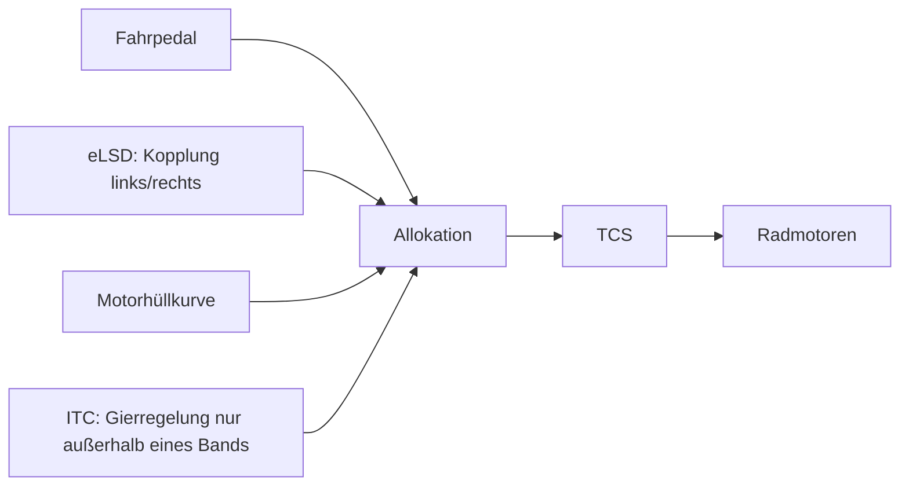

# Virtuelles eLSD und Integrated Traction Control (ITC)

Grundlage: [Plan integrierte Bewegungsregelung](plans/integrated_motion_control_plan.md). Antriebsfunktionen für vier unabhängig angetriebene Räder auf der gemeinsamen
Stellkette; kein zweiter Allokator. Synthetische Parameter, virtuelle 7-DOF-Strecke; alle Benchmarks mit dynamischen
Aktuatoren (Momenten-, Leistungs- und Batteriegrenze der Elektroantriebe, Stellgrößenkette).

## Überblick

## 1. Funktionen

| Funktion | Ort | Wirkung |
|---|---|---|
| Kopplung `free` / `open` / `elsd` | `controllers/traction_distribution.py` | zusätzliche obere Antriebskraftgrenzen je Rad für die Allokation |
| Motorhüllkurve (`envelope`) | dort | Antriebsgrenze `min(T_max, P_max/ω)/R` je Rad bei gemessener Raddrehzahl |
| TCS | vorhandener Antriebsschlupfregler der `ActuationLayer` | jetzt getrennt von ABS schaltbar (`enable_tcs`) |
| TV | vorhandenes Gierratengesetz (PI) | Giermomentanfrage an die Allokation |
| ITC | `controllers/integrated_traction.py` (`YawToleranceLaw`) + obige Bausteine | koordiniert TCS, eLSD, Hüllkurve und TV |

- **Keine mechanische Differentialphysik.** `open` heißt: beide Räder einer Achse höchstens so viel wie das schwächere
  übertragen kann (`F_L, F_R ≤ min(U_L, U_R)`); `elsd`: das stärkere Rad darf das schwächere um höchstens das
  Sperrmoment übersteigen (`F_stark ≤ U_schwach + T_lock/R`; `T_lock = 0` ist `open`, sehr groß ist `free`). Die
  Kopplung senkt nur Grenzen; Kraft, die die Radanforderungen nicht enthalten, entsteht nicht.
- **ITC-Band.** Gemessen: Ein Gierratengesetz mit Gierpriorität verlangt beim geraden Anfahren `M_z ≈ 0`; damit darf
  die Hochreibwertseite nicht mehr ziehen als die Niedrigreibwertseite, und TV allein ist so langsam wie das offene
  Differential. ITC gibt die Anfrage des Gesetzes deshalb erst weiter, wenn der Gierratenfehler eine Toleranz
  überschreitet; darin ist das Giermoment frei (innerhalb der eLSD- und Haftgrenzen). Das Gesetz läuft jeden Schritt mit.
- **Keine Gieranforderung beim Anfahren.** Unter `min_speed` (3 m/s) setzt der Motion Controller beim Antreiben
  jetzt „keine Anfrage“ (`None`) statt `M_z = 0`. Gemessen: Mit `M_z = 0` und zwei ausgefallenen Motoren einer Seite
  konnte die Allokation unter 3 m/s gar nicht antreiben (Verklemmung). Beim Bremsen bis zum Stillstand bleibt
  `M_z = 0`: Ein erster Versuch mit `None` auch beim Bremsen ließ die Split-µ-Bremsungen auf den letzten Metern um
  0,6° eindrehen (asymmetrische, grip-proportionale Bremsung); verworfen, actuation chain/brake functions-Ergebnisse unverändert.

DSL: Gesetz `no_yaw` (ohne Gierregelung; `brakes` als Alias aus Bremsfunktionen), Block
`traction: {distribution, lock_torque, tcs, envelope, driven: awd|fwd|rwd, failed: [FL, …], yaw_tolerance}`, Manöver
`launch` und `corner_exit`; ITC-Band nur mit Gierregelgesetz, Traktionsfunktionen nicht am passiven Fahrzeug.

## 2. Ergebnisse

Konfigurationen `configs/experiments/traction_*.yaml`, Ergebnisse `output/traction_control/<experiment>/`, Abbildung
`output/traction_control/traction_functions.png` (`examples/traction_figures.py`).

### 2.1 Split-µ-Anfahren (links 1,0, rechts 0,2), 5 km/h, Vollgas, 6 s, Lenkung gerade

| Variante | Geschwindigkeitszuwachs | Kurswinkel | seitlich | Durchdrehen | Antriebsarbeit |
|---|---|---|---|---|---|
| passiv (gleiche Momente, kein TCS) | 22,6 km/h | −94° (dreht sich) | 17,5 m | 6,0 s | 2420 kJ (Leistungsgrenze) |
| offene Kopplung + TCS | 34,5 km/h | 0,00° | 0,0 m | 0 | 84 kJ |
| offene Kopplung ohne TCS | 34,5 km/h | 0,00° | 0,0 m | 0 | 84 kJ |
| eLSD 300 N·m | 50,4 km/h | −4,7° | 3,6 m | 0 | 166 kJ |
| frei (4 Motoren) | 51,4 km/h | −6,8° | 7,2 m | 0 | 180 kJ |
| nur TV (PI) | 37,5 km/h | −0,5° | 0,4 m | 0 | 98 kJ |
| ITC, Band 0,5 °/s | 44,7 km/h | −2,4° | 1,5 m | 0 | 156 kJ |
| ITC, Band 2 °/s | 50,3 km/h | −4,6° | 3,5 m | 0 | 166 kJ |
| Modus C, offene Kopplung | 37,9 km/h | −3,0° | 1,9 m | 2,5 s | 155 kJ |
| Modus C, ITC Band 2 °/s | 38,3 km/h | −4,7° | 2,4 m | 2,6 s | 165 kJ |

- **Abnahmepunkt:** ITC gewinnt gegenüber dem passiven Vergleich (dreht sich, 22,6 km/h) und gegenüber der offenen
  Kopplung (34,5 km/h) messbar Geschwindigkeit (+46 % bei Band 2 °/s), mit Gierratenfehler im Band (≤ 2,0 °/s). Das
  Band ist der Regler zwischen Traktion und Kursabweichung (0,5 °/s: 44,7 km/h und 2,4°).
- **Grenze des Szenarios:** Ohne Fahrer bleibt die Lenkung gerade; die asymmetrische Traktion schiebt das Fahrzeug
  seitlich. Nach etwa 3,5 s und 3,5 m stehen bei eLSD/ITC alle vier Räder auf der Eisseite (Allokationsgrenzen alle
  ≈ 560 N); ab dann ist der Vorteil aufgebraucht. Ein bahnfolgender Fahrer wäre der realistische Test.
- **TCS** greift in Modus A mit dynamischen Aktuatoren nicht ein: Die Allokation begrenzt jedes Rad auf den bekannten
  Haftwert, und die Momentverzögerung glättet den Sprung (mit idealen Aktuatoren drehte das Rad ohne TCS nach dem
  Momentsprung über das Kraftmaximum hinaus). In Modus C (geschätzte Reibwerte) drehen die Eisräder 2,5 s durch.
- **Energie:** Die Antriebsarbeit am Rad liegt in jedem Lauf über dem Bewegungsenergiezuwachs (Test); der passive
  Wagen setzt den größten Teil in Schlupf um (Leistungsgrenze des Antriebs aktiv).

### 2.2 Anfahren auf einen Reibwertsprung 1,0 → 0,2 bei 10 m

| Variante | Zuwachs | 0 → +50 km/h | Durchdrehen |
|---|---|---|---|
| passiv | 54,6 km/h | 4,51 s | 5,9 s |
| ohne TCS | 54,1 km/h | 4,68 s | 4,3 s |
| mit TCS | 63,6 km/h | 3,46 s | 0 |
| ITC | 63,6 km/h | 3,46 s | 0 |

Hier wirkt TCS: Nach dem Sprung überschätzt die Allokation den Reibwert nicht (Modus A), aber das Rad hat noch Drehzahl
und Moment vom Hochreibwert; ohne TCS dreht es durch. Gerade und symmetrisch: ITC = TCS.

### 2.3 Antriebsauslegung und Motorausfälle (µ 0,5, ITC Band 2 °/s)

| Konfiguration | Zuwachs in 6 s | Kurswinkel |
|---|---|---|
| Allrad | 89,7 km/h | 0° |
| Front / Heck | 43,6 / 43,8 km/h | 0° |
| Inverter FL ausgefallen | 60,2 km/h | 6,1° |
| FL + RL ausgefallen (eine Seite) | 28,4 km/h | 6,0° |
| … ohne Gierregelung | 43,1 km/h | 12,9° |

Mit einer ausgefallenen Seite hält ITC den Gierratenfehler im Band, gibt aber Traktion ab (28 gegen 43 km/h);
ohne Gierregelung ist das Fahrzeug schneller und dreht doppelt so weit ab.

### 2.4 Kurvenausgang, µ 0,5, 54 km/h, 3° (≈ 0,8 µg), Vollgas ab 2 s

| Variante | Zuwachs | max. β | Kurswinkel |
|---|---|---|---|
| passiv | 7,3 km/h | 65° (dreht sich) | 123° |
| offen | 0,9 km/h | 0,8° | 95° |
| eLSD / frei, ohne Gierregelung | −18,7 km/h | 76° (dreht sich) | 159° |
| nur TV (PI) | 6,1 km/h | 0,3° | 88° |
| ITC (eLSD oder frei) | 0,5 km/h | 0,6° | 99° |

Ein gesättigter Grenzfall: Bei 0,8 µg Querbeschleunigung bleibt wenig Längsreserve. Das offene Differential wird vom
entlasteten Innenrad begrenzt; eLSD und freie Verteilung ohne Gierregelung drehen sich (Leistungsübersteuern). **ITC
ist hier schlechter als TV allein** (0,5 gegen 6,1 km/h): Das Band lässt zunächst asymmetrischen Antrieb zu, danach
muss der PI stärker eingreifen. Eine begründete Nichtverbesserung, nicht als Gewinn ausgewiesen.

## 3. Abnahme Traktionsregelung

| Kriterium | Bewertung |
|---|---|
| µ-Split: messbare Verbesserung gegenüber dem passiven Vergleich oder begründete Nichtverbesserung | erfüllt: +46 % gegenüber offen, passiv dreht sich (2.1); Kurvenausgang als begründete Nichtverbesserung (2.4) |
| niemals falsche Links/Rechts-Vorzeichen | erfüllt: Spiegeltest (Split-µ links/rechts vertauscht: gleicher Zuwachs, entgegengesetzter Kurswinkel) |
| keine zusätzliche Energie | erfüllt: Antriebsarbeit ≥ Bewegungsenergiezuwachs (Test) |
| keine Verletzung von Motor-/Batteriegrenzen | erfüllt: dynamische Aktuatoren in allen Benchmarks; Hüllkurve in der Allokation (Test) |
| Eingriffe nicht falsch zugeordnet | erfüllt: Kopplung, TCS, TV und ITC-Band getrennt schaltbar und in der Bezeichnung jedes Laufs |

Tests: `tests/vehicle_model/test_traction_control.py` (7 Tests, 1 `slow`).

## 4. Grenzen

- Kein Fahrer im Kreis: Kursabweichungen werden nicht ausgeregelt (2.1); Diagonal-µ (FL und RR auf Eis) ist mit einer
  ortsfesten Fahrbahn für ein fahrendes Fahrzeug nicht darstellbar und nicht untersucht.
- Keine Motortemperatur, kein Wirkungsgradkennfeld; „Energie“ ist mechanische Arbeit am Rad.
- Kurvenausgang bei 0,8 µg ist für alle Varianten ein Sättigungsfall; ein moderater Kurvenausgang fehlt noch.
- Neustart des Reglers und lange Sättigung: über Reset-/Replay-Tests der Kette abgedeckt, kein eigenes Szenario.

## Literatur

Küçükay 2022, Kap. 4 (Fahrwiderstände, Zugkraft), Kap. 12 (Achsgetriebe, Sperren und Allradantriebe) und Kap. 29 (Aktive Fahrwerksysteme und Regelsysteme). Vollständige Angaben: [Literaturverzeichnis](44_references.md).
