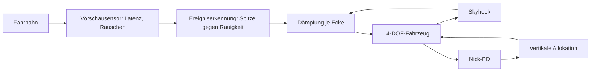
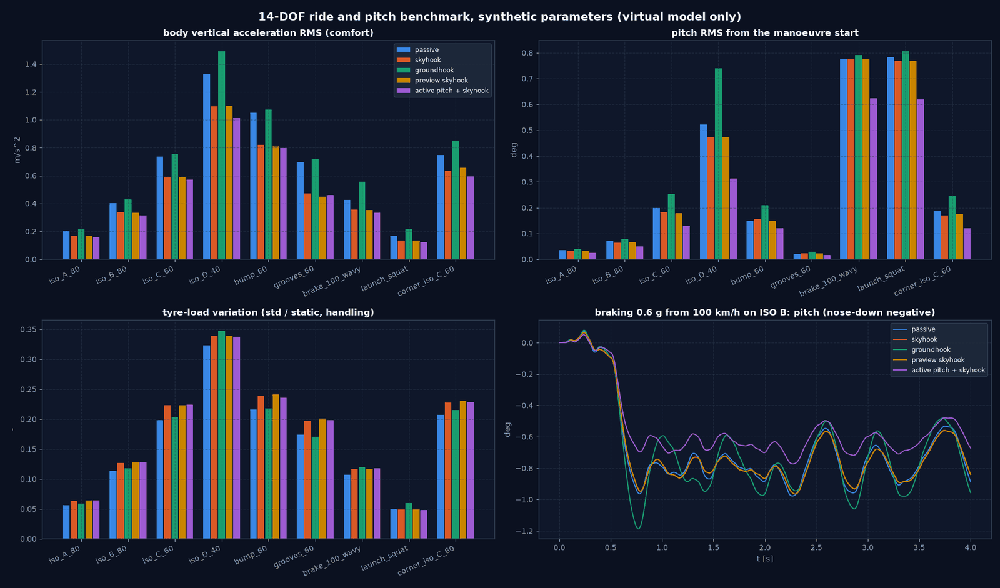
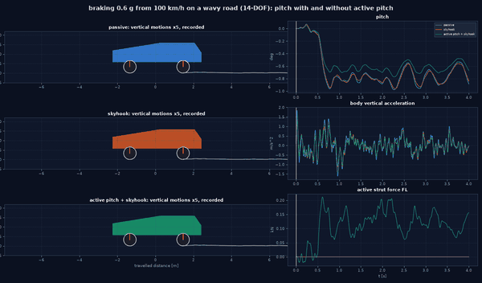
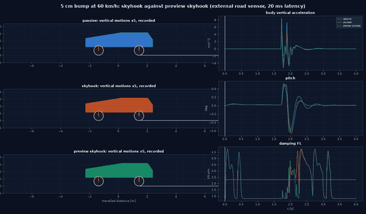
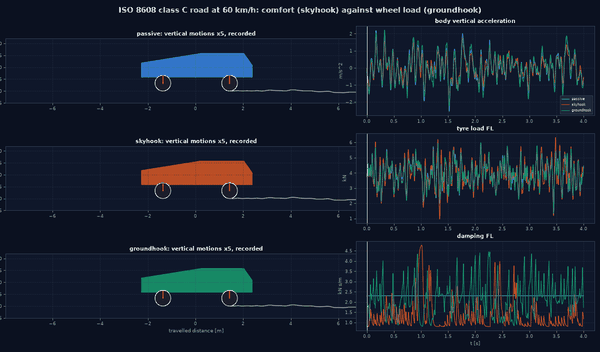

# Prädiktive Dämpfung, aktive Nickregelung, vertikale Kraftallokation

Grundlage: [Plan integrierte Bewegungsregelung](plans/integrated_motion_control_plan.md). Nur im **14-DOF-Modell** (das 7-DOF-Modell hat keine Vertikaldynamik).
Synthetische Parameter, virtuelle Modelle; keine OEM- oder Normkonformitätsaussage.

## Überblick

## 1. Bausteine

| Baustein | Datei | Inhalt |
|---|---|---|
| Straße | `simulation/ride.py` (`build_road`) | zwei Spuren entlang der gefahrenen Strecke: ISO-8608-Klasse (eigener Seed je Spur), Halbsinus-Hindernisse (ein- oder beidseitig), Querrinnenfolge |
| Vorschau | `suspension/preview_control.py` (`RoadPreview`) | **externer Sensor**: tastet die Straße 8 m vor jedem Vorderrad ab, Latenz, Rauschen (Seed), Ausfall; Hinterräder nutzen dieselbe Spur um `L/v` verzögert. Nie ein zukünftiger Streckenzustand |
| Dämpfung | `CornerDamping` | je Ecke `passive`, `skyhook`, `groundhook`, `hybrid` (die vorhandenen Regler), `preview_skyhook`; dissipativ `c_min ≤ c ≤ c_max`; ausgefallener Dämpfer bleibt weich (`c_min`) |
| Aktive Nickregelung | `ActivePitchController` | PD auf Nickwinkel/-rate, Hub- und Wankdämpfung → `(F_heave, M_pitch, M_roll)` |
| Vertikale Allokation | `allocation/vertical_forces.py` | `B = [1; x_i; y_i]`, beschränkte WLS (`solve_box_wls`) auf vier Federbeinkräfte ±3 kN, Gesamtleistung ≤ 4 kW (Skalierung); nur Federbeinkräfte gehen in die Strecke |
| Experiment | `experiments/ride.py` | Typ `ride_benchmark` (Szenarien × Regler, parallel, Kennzahlen, Verläufe, Bericht) |

Vorschau-Skyhook: Die Straßengeschwindigkeit wird aus den über 0,3 m geglätteten Vorschau-Abtastwerten geschätzt
(Steigung über die Basis 0,3 m, mal Fahrgeschwindigkeit). Überschreitet sie im Fenster von 0,12 s vor einer Ecke
`v_soft` = 0,15 m/s **und** das 3-Fache ihres gleitenden Effektivwerts (ein Ereignis, das aus der Fahrbahnrauigkeit
heraussticht), wird diese Ecke weich gestellt, damit die Anregung nicht in den Aufbau übertragen wird; sonst Skyhook.
Hinterräder nutzen die Vorschau ihrer Spur einen Radstand später. Ohne Vorschau (Ausfall) ist der Regler exakt
Skyhook (Test: Kennzahlen gleich).

Informationsmodus A (Aufbau- und Radgeschwindigkeiten aus dem Zustand); die Vorschau ist die einzige vorausschauende
Information und stammt aus der Straße. Streckenschritt 1 ms, Regelung alle 2 ms.

## 2. Benchmark (`configs/experiments/ride_preview_damping_active_pitch.yaml`, 9 Szenarien × 10 Regler = 90 Läufe, ~1 min)

Kennzahlen (Auszug; vollständig in `output/ride_control/benchmark/kpis.csv`, Abbildung `output/ride_control/benchmark.png`):

| Szenario | Regler | Aufbau-RMS [m/s²] | Spitze [m/s²] | Nick-RMS [°] | Radlastschwankung | Aktivenergie [kJ] |
|---|---|---|---|---|---|---|
| ISO C, 60 km/h | passiv | 0,735 | 2,56 | 0,199 | 0,199 | 0 |
| | Skyhook | 0,588 | 2,09 | 0,182 | 0,224 | 0 |
| | Groundhook | 0,757 | 2,26 | 0,252 | 0,203 | 0 |
| | Vorschau-Skyhook | 0,591 | 2,01 | 0,178 | 0,223 | 0 |
| | aktive Nickregelung + Skyhook | 0,571 | 2,06 | 0,128 | 0,224 | 0,168 |
| Hindernis 6 cm, 60 km/h | passiv | 1,05 | 8,44 | 0,150 | 0,216 | 0 |
| | Skyhook | 0,822 | 5,31 | 0,156 | 0,238 | 0 |
| | Vorschau-Skyhook | 0,809 | 5,31 | 0,149 | 0,241 | 0 |
| | aktive Nickregelung + Skyhook | 0,797 | 5,23 | 0,121 | 0,236 | 0,166 |
| Querrinnen, 60 km/h | Skyhook | 0,474 | 2,91 | 0,023 | 0,197 | 0 |
| | Vorschau-Skyhook | 0,451 | 2,00 | 0,025 | 0,201 | 0 |
| Bremsen 0,6 g aus 100 km/h, ISO B | passiv | 0,426 | 1,61 | 0,775 | 0,108 | 0 |
| | Skyhook | 0,356 | 1,13 | 0,774 | 0,117 | 0 |
| | Vorschau-Skyhook | 0,355 | 1,12 | 0,774 | 0,117 | 0 |
| | aktive Nickregelung + Skyhook | 0,334 | 1,09 | 0,623 | 0,118 | 0,179 |
| Anfahren (3000 N m) | Skyhook | 0,134 | 0,364 | 0,768 (Spitze 0,924) | 0,049 | 0 |
| | aktive Nickregelung + Skyhook | 0,124 | 0,323 | 0,619 (Spitze 0,702) | 0,048 | 0,052 |
| Kurve 2°, ISO C | Skyhook | 0,632 | 1,77 | 0,171 | 0,228 | 0 |
| | aktive Nickregelung + Skyhook | 0,595 | 1,66 | 0,120 | 0,229 | 0,157 |
| ISO D, 40 km/h | Skyhook | 1,10 | 3,16 | 0,473 | 0,339 | 0 |
| | aktive Nickregelung + Skyhook | 1,01 | 3,13 | 0,314 | 0,338 | 0,513 |

Befunde:

- **Skyhook** ist die beste rein semiaktive Komfortbasis (Aufbau-RMS −15 bis −32 %), erkauft mit höherer
  Radlastschwankung (ISO C 0,199 → 0,224): der bekannte Zielkonflikt Komfort/Fahrsicherheit. **Groundhook** senkt die
  Radlastschwankung nicht unter passiv und verschlechtert den Komfort; im Modell kein Vorteil.
- **Vorschau-Skyhook** wirkt gezielt auf Einzelereignisse: Querrinnen Spitze 2,91 → 2,00 m/s² (−31 %), RMS
  0,474 → 0,450; Hindernis RMS 0,822 → 0,809, Nick-Spitze 0,655 → 0,591°; ISO C Spitze 2,09 → 2,01. Auf
  Zufallsfahrbahnen ist sie nur 2–7 % der Zeit weich und entspricht Skyhook (ISO A–D, Bremsen auf welliger Straße);
  in der Kurve auf ISO C leicht schlechter (RMS 0,632 → 0,657). Beim Einzelhindernis ist der Gewinn klein, weil Skyhook
  vor dem Hindernis (Aufbau in Ruhe) ohnehin weich steht. Späte und verrauschte Vorschau (100 ms, 3 mm) ist ähnlich:
  8 m Vorausschau überdecken die Latenz, die Glättung das Rauschen. **Ergebnis: kleiner, gezielter Vorteil bei
  diskreten Ereignissen, keine Verschlechterung auf Zufallsfahrbahnen.** Ein voller Vorschauregler (LQ-Preview/MPC)
  ist nicht gebaut und bleibt offen (im Plan optional).
- **Aktive Nickregelung** senkt den Nickwinkel in allen Szenarien (Bremsen −20 %, Anfahrspitze −24 %, Kurve −30 %,
  ISO D −34 %) und zugleich die Aufbaubeschleunigung, bei 0,05–0,51 kJ Aktivenergie in 3–4 s. Stationäres Nicken
  bleibt (reine PD-Steifigkeit 60 kN m/rad, Kraftgrenze ±3 kN).
- Ausgefallener Dämpfer vorn links (weich): leicht schlechter als Skyhook, kein Versagen.
- Federweg: höchstens 6,1 cm, `travel_over_limit_s` (8 cm) überall 0. Das Modell hat keine Anschlagfeder; die
  Kennzahl ist ein Ersatz für das Durchschlagen.

## 3. Plausibilitätsprüfung und Korrekturen

Eine kritische Durchsicht der ersten Ergebnisse fand zwei Fehler in der Vorschau, die die erste Aussage („Vorschau
ohne Mehrwert, verschlechtert Nick- und Aufbau-RMS“) ungültig machten:

1. **Rauschen als Straßenanregung gelesen**: Die Straßengeschwindigkeit war die Differenz benachbarter Abtastwerte
   (3,3 cm Abstand). 0,5 mm Sensorrauschen ergaben so ~0,25 m/s > `v_soft`; alle Dämpfer standen **100 % der Zeit**
   weich, auch auf glatter Fahrbahn (gemessen). Die „späte, verrauschte“ Variante war deshalb identisch.
   Korrektur: Glättung über 0,3 m und Steigung über diese Basis.
2. **Hinterräder ohne Vorschau**: Die Abfrage begann 1 m hinter der Vorderachse, die Hinterräder liegen 2,7 m
   dahinter. Korrektur: explizite Positionsabfrage `[x_von, x_bis]`.
3. **Fester Schwellwert auf rauer Fahrbahn**: Nach Korrektur 1 standen die Dämpfer auf ISO B–D noch 79–88 % der Zeit
   weich (echte Straßengeschwindigkeit > 0,15 m/s) und ISO D wurde schlechter (RMS 1,10 → 1,36). Korrektur: Weich nur
   für Ereignisse über dem 3-Fachen des gleitenden Effektivwerts.

Regressionstest: flache Fahrbahn mit Sensorrauschen → Vorschau-Skyhook identisch zu Skyhook; vor einem Hindernis
wird jede Achse erst kurz vor ihrem Kontakt weich (Weich-Kennzeichen je Ecke im Verlauf).

Weitere Prüfungen ohne Befund: Skyhook erreicht `c_min` wegen der Magnetventil-Verzögerung (15 ms) nur asymptotisch;
ein weich festsitzender Dämpfer ist auf glatter Fahrbahn komfortabler als Skyhook (0,160 vs. 0,169 m/s²), weil ein
weicher Dämpfer hohe Frequenzen weniger überträgt; die aktive Nickregelung braucht für das Bremsnicken (~4,8 kN m bei
0,6 g) mehr als die PD-Steifigkeit liefert (60 kN m/rad × 0,8° ≈ 0,8 kN m) und senkt den Nickwinkel daher nur um
etwa 20 %.

## 4. Animationen

`python examples/chassis_control_animations.py ride_control` (nach dem Benchmark), Seitenansicht mit 5-fach überhöhten Vertikalbewegungen,
nur aufgezeichnete Abtastwerte:

- `output/ride_control/brake_pitch.gif`: Bremsen auf welliger Straße, passiv / Skyhook / aktive Nickregelung;
- `output/ride_control/bump_preview.gif`: Hindernis, passiv / Skyhook / Vorschau-Skyhook (Dämpferkennlinie vorn links);
- `output/ride_control/iso_C_comfort.gif`: ISO C, passiv / Skyhook / Groundhook (Radlast vorn links).

## 5. Abnahme Vorschaudämpfung und aktive Nickregelung

| Kriterium | Bewertung |
|---|---|
| Vorschau kausal, nur externe Straßendaten, Latenz eingehalten | erfüllt (Test: Abtastwert erst nach der Latenz nutzbar, Seed-deterministisch) |
| Vorschauausfall fällt auf Skyhook zurück | erfüllt (Test: Kennzahlen gleich) |
| Dämpfer dissipativ und begrenzt | erfüllt (Test für alle fünf Modi) |
| aktive Kräfte und Leistung begrenzt, Allokation reproduziert zulässige Anforderungen | erfüllt (Tests) |
| Komfort/Handling-Zielkonflikt und Nutzen der aktiven Nickregelung im Benchmark | erfüllt (Slow-Test) |
| Vorschau nur bei messbarem Mehrwert | erfüllt für diskrete Ereignisse (Querrinnen −31 % Spitze), neutral auf Zufallsfahrbahnen; kein MPC |

Tests: `tests/vehicle_model/test_preview_damping_active_pitch.py` (14 Tests, davon einer `slow`).

## 6. Grenzen

- Keine Anschlagfedern, keine Reifenabhebung mit Kontaktverlust im Benchmark (`contact_loss_s` = 0).
- Offene Längsführung (Bremsen mit konstanten Momenten, Anfahren mit konstantem Moment); keine Kopplung an die
  Querdynamikregler aus Stellgrößenkette–G-vectoring.
- Vorschau ohne Kartierung oder Fahrspurschätzung; Sensorgeometrie idealisiert (gleiche Spur wie die Räder).

## Literatur

Küçükay 2022, Kap. 19 (Reduzierung von Bremsnicken und Anfahrnicken), Kap. 32–35 (Fahrbahnanregung, Vertikaldynamik, Sitzkomfort, Aufbaufedern und -dämpfer); Karnopp, Crosby & Harwood 1974. Vollständige Angaben: [Literaturverzeichnis](44_references.md).

---

<!-- figures:start -->

## Ergebnisbilder

> Alle Bilder sind Simulationsergebnisse mit synthetischen Parametern, keine Messungen. Neu erzeugen: Quellskript ausführen, dann `python tools/publish_doc_figures.py`.

*Fahrkomfort und Nicken über alle Szenarien. Quelle: `examples/ride_control_figures.py`.*

*Bremsen auf welliger Straße: Nicken mit und ohne aktive Nickregelung.*

*Hindernis: Skyhook gegen Vorschau-Skyhook.*

*ISO C: Komfort gegen Radlast.*

<!-- figures:end -->
