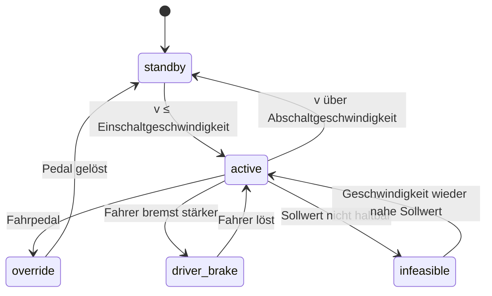
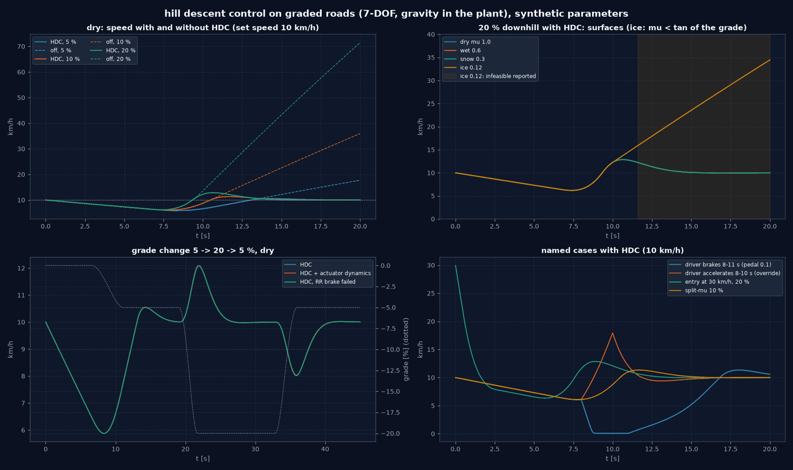
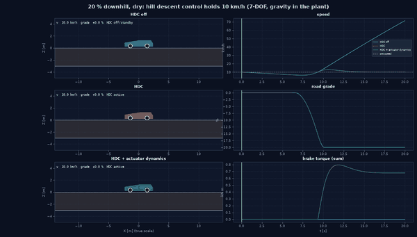
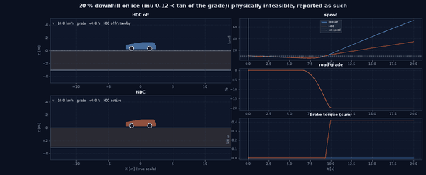
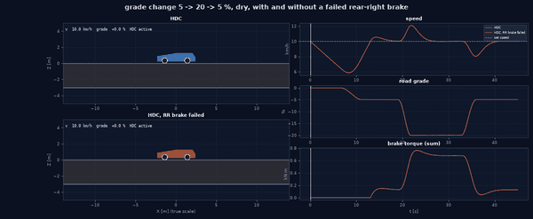

# Straßenneigung und Hill Descent Control

Grundlage: [Plan integrierte Bewegungsregelung](plans/integrated_motion_control_plan.md). 7-DOF-Modell mit Schwerkraft im Plant. Eigene vereinfachte Funktion;
synthetische Parameter und synthetische Prüfmatrix; keine OEM- oder Normkonformitätsaussage.

## Überblick

## 1. Straßenneigung im Plant

`roads/surface.py` (`GradedRoad`): Reibwertfläche plus Längssteigung entlang der Welt-X-Achse, Abschnitte
`(x_start, Steigung)`, glatte Halbkosinus-Übergänge (Steigung und Höhe `Z(X)` stetig), keine Querneigung.
Konvention: Steigung = Anstieg je Meter in +X (−0,10 = 10 % Gefälle in Fahrtrichtung +X).

`vehicle_models/seven_dof.py` liest die Steigung nur von Straßen mit `has_grade`:

- Schwerkraft in Fahrzeugachsen: `g_x = −g sin θ` (Längsneigung entlang des Kurses), `g_y = −g cos θ sin φ`;
- Normallast und Rollwiderstand mit `cos θ cos φ`;
- Lastverlagerung: Die Schwerkraft greift am Schwerpunkt an, die Reifenkräfte am Boden; verlagert wird daher die
  Last der **Reifenkräfte** (`(a − g_körper)` in der quasistatischen Lastverteilung). Ein frei rollendes Fahrzeug am
  Hang behält die statische Achslastverteilung; ein am Hang gebremstes verlagert `m g sin θ h / L` nach vorn (Test);
- Aufbau bleibt parallel zur Fahrbahn (kein Nick-/Hub-Freiheitsgrad im 7-DOF-Modell).

Jede andere Straße ergibt exakt die Gleichungen der ebenen Straße (Test: Ableitungen bitgleich, auch für eine
`GradedRoad` mit Steigung 0).

## 2. Hill Descent Control

`controllers/hill_descent.py` (`HillDescentControl`), im MotionController zur Längskraftanforderung kombiniert:

- PI auf den Geschwindigkeitsfehler, **nur Verzögerungsanforderung** (nie Antrieb), begrenzt auf `max_decel`
  (0,5 g); keine Steigungsinformation (der Integrator lernt die Hangabtriebskraft);
- Kombination mit dem Fahrerpedal: die **stärkere** Bremsung gewinnt, keine Summe; Allokation und ABS/EBD/IBC
  bleiben die letzte radbezogene Instanz;
- Anti-Windup: bedingte Integration (kein weiteres Aufintegrieren bei Anforderung am Limit, aktivem ABS oder einer
  an der Haftgrenze gekappten Allokation), Integrator in `[−max_decel, 0]`;
- Zustände `off`, `standby` (Einschalten bei ≤ 35 km/h, Abschalten > 60 km/h), `active`, `override`
  (Fahrpedal > 5 %), `driver_brake` (Fahrer bremst stärker), `infeasible`;
- **`infeasible`**: Geschwindigkeit länger als 1 s mehr als 1 m/s über dem Sollwert, während die Anforderung am Limit
  liegt oder die Bremsen an der Haftgrenze arbeiten; Ursache `grip` oder `brake authority`.

Experimenttyp `hill_descent_benchmark` (`experiments/hill_descent.py`): Matrix Steigung × Oberfläche plus benannte
Fälle × Regler, gleiche offene Fahrervorgabe (geradeaus, Pedale nur in den benannten Fällen).

## 3. Ergebnisse (`configs/experiments/hill_descent_control.yaml`, 68 Läufe, `output/hill_descent/`)

Start mit 10 km/h auf 15 m ebener Strecke ohne Antrieb (das Fahrzeug rollt auf ~6 km/h aus), dann das Gefälle.

| Fall | Regler | v max [km/h] | v Ende | RMS-Fehler ab 10 s | Überschwingen | max. Schlupf | Bremsenergie Reibung / Rekuperation [kJ] | infeasible [s] |
|---|---|---|---|---|---|---|---|---|
| trocken 5 % | aus | 17,7 | 17,7 | – | – | 0,000 | 0 / 0 | 0 |
| trocken 5 % | HDC | 10,5 | 10,0 | 1,14 | 0,5 | 0,002 | 7,8 / 0 | 0 |
| trocken 10 % | aus | 36,0 | 36,0 | – | – | 0,000 | 0 / 0 | 0 |
| trocken 10 % | HDC | 11,3 | 10,0 | 0,62 | 1,3 | 0,005 | 26,9 / 0 | 0 |
| trocken 20 % | aus | 71,4 | 71,4 | – | – | 0,001 | 0 / 0 | 0 |
| trocken 20 % | HDC | 12,9 | 10,0 | 1,23 | 2,9 | 0,011 | 66,4 / 0 | 0 |
| trocken 20 % | HDC + Aktuatordynamik | 12,9 | 10,0 | 1,24 | 2,9 | 0,011 | 4,0 / 62,4 | 0 |
| nass 0,6 / Schnee 0,3, 20 % | HDC | 12,9 | 10,0 | 1,23 | 2,9 | 0,011 / 0,012 | 66,4 / 0 | 0 |
| Eis 0,12, 10 % | HDC | 11,3 | 10,0 | 0,62 | 1,3 | 0,006 | 26,9 / 0 | 0 |
| **Eis 0,12, 20 %** | HDC | **34,5** | **34,5** | 14,9 | 24,5 | 0,010 | 86,5 / 0 | **8,4** (ab 11,6 s) |
| Gefällewechsel 5 → 20 → 5 % | HDC | 12,1 | 10,0 | 0,95 | 2,1 | 0,010 | 104 / 0 | 0 |
| Einstieg mit 30 km/h, 20 % | HDC | 29,9 | 10,0 | 0,57 | (Start) | 0,025 | 115 / 0 | 0 |

Der RMS-Fehler ab 10 s enthält noch das Einschwingen: Das Fahrzeug erreicht das Gefälle erst nach etwa 9 s (auf der
Ebene rollt es ohne Antrieb von 10 auf ~6 km/h aus, HDC treibt nie an). Bei 5 % stammt der Fehler aus dem langsamen
Wiederbeschleunigen durch die Hangabtriebskraft (Unterschreitung), bei 20 % aus dem Überschwingen; am Laufende liegen
alle haltbaren Fälle bei 10,0 km/h.

Befunde:

- HDC hält 10 km/h auf allen **physikalisch haltbaren** Gefällen (Überschwingen beim Einfahren 0,5–2,9 km/h, PI ohne
  Steigungsvorsteuerung; Endgeschwindigkeit 10,0 km/h).
- **Eis bei 20 %** ist physikalisch nicht haltbar: `µ = 0,12 < tan(11,3°) = 0,20`, die Hangabtriebskraft übersteigt
  die übertragbare Bremskraft. Das Fahrzeug beschleunigt mit und ohne HDC; HDC meldet ab 11,6 s `infeasible`
  (Ursache `grip`) und behauptet keine Regelung. Eis bei 10 % (`0,12 > 0,10`) ist haltbar und wird gehalten.
  Erwartetes physikalisches Versagen, als korrekte Grenzabbildung gewertet.
- Nass und Schnee sind bis 20 % nicht unterscheidbar vom trockenen Fall: Die benötigte Verzögerung (≤ 1,9 m/s²) liegt
  deutlich unter der Haftgrenze (≥ 2,9 m/s²); nur der Schlupf steigt leicht.
- Fahrerbremsung übernimmt (HDC weicht, `driver_brake`), Fahrpedal übersteuert (`override`, danach erneutes Einregeln),
  Split-µ hält die Geschwindigkeit bei 1,8° Kursänderung (ohne Gierregelung im Lauf), ein ausgefallener Bremskreis
  hinten rechts ändert die Geschwindigkeitsführung nicht, erzeugt aber Kursdrift (bis 3,1° beim Einstieg mit 30 km/h in 20 %).
- Mit Aktuatordynamik übernimmt die Rekuperation 94 % der Bremsenergie (62,4 von 66,4 kJ).

## 4. Plausibilitätsprüfung

- **Energiebilanz** (aus den Verläufen): potentielle Energie = kinetische Energie + Reibbremsen + Rekuperation +
  Rollwiderstand + Luftwiderstand mit 1–4 % Rest (Radschlupf, Raddämpfung, Diskretisierung). Beispiel trocken 20 %:
  78,3 kJ = 66,4 + 9,2 + 0,2 + 2,5 Rest.
- **Analytischer Grenzfall** (Test): Ausrollen bei 4 m/s am Gefälle, `a = (m g sin θ − c_rr m g cos θ − F_L) /
  (m + 4 I_w / R²)` auf 3 %, Normallastsumme `m g cos θ` auf 0,1 %.
- **Reifen auf Niedrig-µ**: Das Magic-Formula-Modell skaliert mit dem Fahrbahn-µ den Spitzenwert, nicht die
  Anfangssteifigkeit (wie die Bürstentheorie); bei gleicher Bremskraft steigt der Schlupf auf Schnee daher nur leicht.
  Grenze: Der Spitzenschlupf auf Eis liegt so bei 1,3 % (real eher 5–10 %).

Animationen (`python examples/chassis_control_animations.py hill_descent`, Seitenansicht in wahrem Maßstab, Räder rot bei ABS):
`output/hill_descent/benchmark_20pct_dry.gif`, `hdc_ice_infeasible.gif`, `hdc_grade_change.gif`; Abbildung `output/hill_descent/benchmark.png`.

## 5. Abnahme Hill Descent Control

| Kriterium | Bewertung |
|---|---|
| Hangabtriebskraft reproduziert den analytischen Grenzfall bei geringer Geschwindigkeit | erfüllt (Test, 3 %) |
| HDC greift nur im aktiven Modus ein | erfüllt (`enabled: false` → Anforderung exakt 0, Status `off`; Test) |
| fehlende Bremsautorität wird als `infeasible` gemeldet | erfüllt (Eis 20 %; Test) |
| Fahrerbremswunsch übernimmt, Fahrpedal übersteuert | erfüllt (Benchmark, Test) |
| Kopplung mit 14-DOF | nicht umgesetzt: Steigung nur im 7-DOF-Modell (kein durchgängiger 14-DOF-Pfad) |

Tests: `tests/vehicle_model/test_hill_descent_control.py` (9 Tests, davon einer `slow`).

## 6. Grenzen

- Nur Längssteigung entlang X, keine Querneigung im Benchmark; kein Nicken des Aufbaus am Hang (7-DOF).
- Kein Stillstandshalten (Bremsmoment über `tanh(ω)`), HDC arbeitet ab etwa 2 m/s.
- Keine Fahrerlenkkorrektur (offene Vorgabe): Kursdrift bei Split-µ und Bremsausfall wird berichtet, nicht geregelt.

## Literatur

Küçükay 2022, Kap. 4 (Fahrwiderstände) und Kap. 18 (Abbremsung und Bremssysteme). Vollständige Angaben: [Literaturverzeichnis](44_references.md).

---

<!-- figures:start -->

## Ergebnisbilder

> Alle Bilder sind Simulationsergebnisse mit synthetischen Parametern, keine Messungen. Neu erzeugen: Quellskript ausführen, dann `python tools/publish_doc_figures.py`.

*Hill Descent Control über Gefälle und Oberflächen. Quelle: `examples/hill_descent_figures.py`.*

*20 % Gefälle, trocken: HDC hält 10 km/h.*

*20 % Gefälle auf Eis: physikalisch nicht haltbar, als infeasible gemeldet.*

*Gefällewechsel 5 → 20 → 5 %, mit und ohne ausgefallene Bremse.*

<!-- figures:end -->
