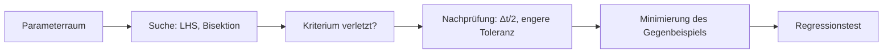
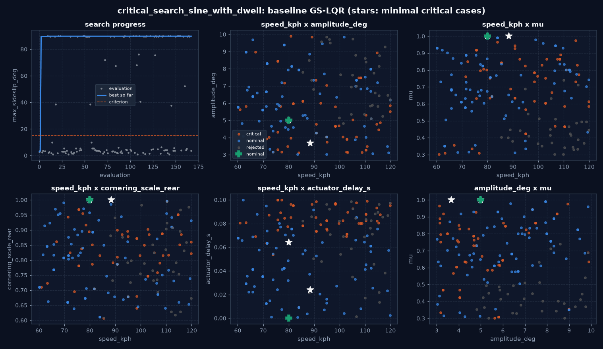
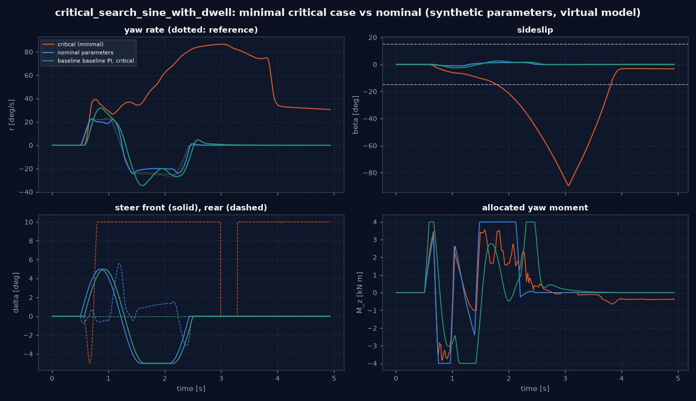
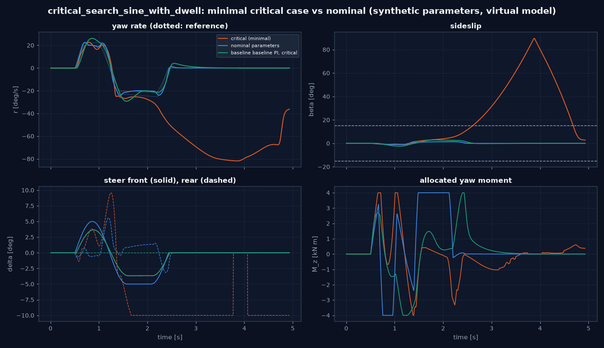
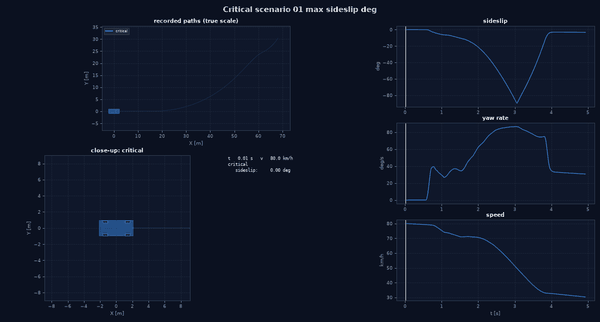

# Adversarial Virtual Testing: kritische Szenarien automatisch finden

Abschnitt 8. Statt nur von Hand entworfener Szenarien sucht ein Offline-Optimierer die Bedingungen,
unter denen ein Regler am schlechtesten abschneidet, prüft jeden Fund numerisch, vereinfacht ihn zu einem minimalen
Referenzszenario und friert ihn als Regressionstest ein. Alle Parameter sind synthetisch; die Ergebnisse sind
Simulationsergebnisse des 7-DOF-Zweispurmodells, keine Aussage über ein reales Fahrzeug.

Code: `experiments/critical_search.py` (Experimenttyp `critical_scenario_search`), Beispiel
`configs/experiments/critical_search_sine_with_dwell.yaml`, Regressionsfälle `configs/critical/*.yaml`, Tests
`tests/vehicle_model/experiments/test_critical_search.py`.

## Überblick



## 1. Szenario-Parameterraum

Jeder gesuchte Parameter hat Grenzen und einen Nominalwert (`{name, low, high, nominal}`); unbekannte Namen und
Parameter, die zum Manöver nicht passen, werden beim Laden abgewiesen.

| Gruppe | Parameter | Planpunkt |
|---|---|---|
| Manöver | `speed_kph`; Sine with Dwell: `amplitude_deg`, `frequency_hz`; Lenkwinkelsprung und Bremsen in der Kurve: `steer_deg`, `steer_rate_degps`; Bremsen in der Kurve: `brake_start_s`, `brake_pedal` | Anfangsgeschwindigkeit, Lenkwinkelamplitude, Lenkwinkelgradient, Bremsbeginn, Bremsmoment |
| Fahrbahn | `mu`; Niedrigreibwertzone über die volle Breite: `zone_start_m` (Lage der Reibwertgrenze), `zone_length_m`, `zone_mu` | Reibwert, Länge der Zone, Lage der Grenze |
| Fahrzeug und Peripherie | alle Felder von `UncertaintyCase`: Masse, Trägheit, `cog_shift_m`, Schräglaufsteifigkeiten, Aktuatortotzeit und -verzögerung, Regellatenz, Sensorrauschen, -bias, `sensor_latency_s` | Schwerpunktlage, Reifensteifigkeit, Sensorverzögerung |
| fest (`fixed`) | `actuator_failure`: `none`, `rear_steer_stuck` (Hinterachslenkung bleibt bei 0), `brake_vectoring_off` (Bremsmomente je Achse gleich: kein Giermoment aus Differenzbremsung) | Aktuatorausfall |

**Physikalisch begründete Kombinationen** (`constraints`): Eine Stichprobe, die eine Bedingung verletzt, wird nicht
simuliert (`rejected`, im Bericht gezählt).

- `linear`: `Σ c_i p_i ≤ b` mit Begründung.
- `lateral_demand`: stationäre Querbeschleunigung der Lenkvorgabe nach dem linearen Einspurmodell,
  `v² δ / (L + K_us v²)` mit `K_us = 0,0009 rad/(m/s²)`, höchstens `max_factor · µ g`. Im Beispiel 5: Der
  Standard-Sine-with-Dwell (6°, 80 km/h, µ 1) verlangt etwa das 1,6-Fache; jenseits des 5-Fachen prüft die Vorgabe nur
  noch die Reifen, nicht den Regler.

## 2. Zielfunktion und Suche

- **Zielfunktion** `objective: {kpi, sense}`: eine Kennzahl des Robustheitsbenchmarks, z. B. maximaler
  Schwimmwinkel, Gierraten-RMS-Fehler, Querabweichung, Sättigungsanteil, Degraded-Anteil, Fallback- und
  Infeasibility-Rate, Reifenausnutzung; maximiert oder minimiert.
- **Kriterium** `criterion: {kpi, threshold, direction}`: wann ein Lauf kritisch ist (im Beispiel max. Schwimmwinkel
  ≥ 15°).
- **Suchverfahren** als Folge von Stufen, alle mit `seed` und offline: `sweep` (volles Gitter), `lhs` (Latin
  Hypercube, `scipy.stats.qmc`), `differential_evolution` (scipy, gestartet mit den besten Stichproben der vorigen
  Stufen). Eine Auswertung hängt nicht von der Zahl der Prozesse ab; gleiche Spezifikation und gleicher Seed liefern
  dieselben Stichproben (Test). Particle Swarm und Bayes'sche Optimierung sind nicht umgesetzt: Die Differential
  Evolution fand die Grenzfälle in der ersten Stufe, eine Begründung für weitere Verfahren fehlt bislang.

## 3. Numerik ist kein physikalisches Versagen

- Ein Lauf, der eine Ausnahme wirft oder nicht endlich endet (Solver, Integration), wird `numerical` klassifiziert und
  **nie** als kritisch gezählt (Test mit erzwungener Ausnahme).
- Jeder kritische Fund wird geprüft: (a) gleicher Seed (KPI bitgleich), (b) halbe Schrittweite, (c) 1000-fach engere
  Toleranz der Radlast-Fixpunktiteration. `confirmed` nur, wenn das Kriterium in (b) und (c) hält und der KPI innerhalb
  `verification_tolerance` (Beispiel 15 %) bleibt, sonst `numerical_artefact`.

## 4. Counterexample Minimization

Für jeden Parameter in `minimise` (in dieser Reihenfolge) sucht eine Bisektion zwischen Nominal- und kritischem Wert
den Wert, der dem Nominalwert am nächsten liegt und noch kritisch ist; die übrigen Parameter bleiben. Wiederholt
(bis drei Durchläufe), bis sich nichts mehr bewegt.

Zwei Befunde beim Aufbau, beide behoben, nicht durch Lockern der Prüfung:

1. **Reihenfolge.** Im ersten Durchlauf wird ein Parameter gegen die noch kritischen Werte der anderen bisektiert;
   sind diese später nominal, liegt seine Grenze woanders. Gemessen: zwei Funde mit derselben Ursache endeten bei 78
   und 69 ms Aktuatortotzeit. Daher die Wiederholung bis zum Stillstand.
2. **Rand der Stabilitätsgrenze.** Ohne weitere Prüfung läuft die Bisektion genau auf die Grenze, wo das Ergebnis von
   der Schrittweite abhängt: Der Minimalfall bei 63 ms war bei Δt = 5 ms kritisch (β 89,6°), bei Δt/2 nicht (6,7°), und
   die Verifikation meldete `numerical_artefact`. Ursache: Die Totzeit wird auf ganze Regelperioden gerundet (63 ms →
   65 ms bei 5 ms, 62,5 ms bei 2,5 ms), und die halbe Schrittweite verdoppelt die Abtastrate des Reglers. Seitdem
   akzeptiert die Minimierung nur **robust kritische** Punkte (kritisch bei Δt und Δt/2, KPI innerhalb der Toleranz);
   die Grenze trägt damit eine Unsicherheit von etwa einer Regelperiode.

Die Bisektion setzt eine Grenze zwischen Nominal- und kritischem Wert voraus; bei nichtmonotonem Verlauf (Fall 02)
findet sie eine der Grenzen, nicht notwendig die nächste.

Doppelte Fälle werden nach der Minimierung erkannt (gleiche Minimalwerte auf 5 % jeder Spanne) und nicht wiederholt.

## 5. Kritische Szenariosammlung

Je Fall `<out>/critical/<id>/`:

| Datei | Inhalt |
|---|---|
| `scenario.yaml` | eigenständige Replay-Spezifikation desselben Typs (`replay: {values}`) |
| `metadata.json` | Seed, Provenienz (Commit, Versionen), Auslösewerte und -stufe, verletztes Kriterium, Verifikation von Fund und Minimalfall, Minimierungsverlauf |
| `comparison.json` | gleicher Regler mit Nominalparametern; Baseline-Regler auf dem Minimalfall |
| `timeseries.csv`, `timeseries.png`, `plan_view.png`, `scenario.gif` | Zeitverläufe, Bahnen, Animation (nur aufgezeichnete Daten) |
| `report.md` | Engineering-Bericht |

Eine Replay-Spezifikation wertet den Fall neu aus, verifiziert ihn und meldet, ob er wie erwartet kritisch bleibt. In
`configs/critical/` abgelegt ist sie ein Regressionstest: `test_regression_case_is_still_critical` (schnell, ein Lauf)
und `test_regression_case_is_confirmed_and_the_baseline_holds` (`slow`: volle Verifikation und Baseline).

## 6. Ergebnis: baseline GS-LQR im Sine with Dwell

`configs/experiments/critical_search_sine_with_dwell.yaml`: baseline GS-LQR (Hinterachslenkung + Giermoment, unverändert
seit Reglerbibliothek), ideale Rückführung; gesucht über Geschwindigkeit 60–120 km/h, Amplitude 3–10°, Reibwert 0,3–1,0,
Hinterachs-Schräglaufsteifigkeit 0,6–1,0 und Aktuatortotzeit 0–100 ms; Baseline baseline PI. Kriterium max. Schwimmwinkel
≥ 15°. Seed 7, 48 LHS-Stichproben und 5 Generationen Differential Evolution (Population 20): 168 Auswertungen; die Suche
selbst dauerte gut 2 min (7 Prozesse), Verifikation und Minimierung laufen danach seriell (gemessen ohne die
Robustheitsprüfung der Minimierung 5 min gesamt, mit ihr länger).

| Ergebnis | Wert |
|---|---|
| Auswertungen | 168: 57 kritisch, 78 nicht kritisch, 33 durch die Querbeschleunigungsbedingung verworfen, 0 numerisch |
| Nominalparameter | max. Schwimmwinkel 1,4° (nicht kritisch) |
| Fall 01 (Differential Evolution) | gefunden bei 120 km/h, 5,9°, µ 0,61, Steifigkeit 0,86, 97 ms → β 89,8°, bestätigt |
| Fall 01 minimal | **80 km/h, 5°, µ 1, Steifigkeit 1, 64 ms Totzeit** → β 89,6°; Δt/2: 89,6° (0,01 %), Toleranz eng: 89,6°: **bestätigt**; baseline PI im selben Fall: 2,6° |
| Fall 02 (LHS) | gefunden bei 110 km/h, 3,3°, µ 0,47, 88 ms → β 89,8°, bestätigt |
| Fall 02 minimal | **88,5 km/h, 3,7°, µ 1, Steifigkeit 1, 24 ms Totzeit** → β 89,6°; Δt/2: 89,6° (0,05 %): **bestätigt**; baseline PI: 2,9° |
| weitere | 3 kritische Stichproben minimierten auf einen der beiden Fälle |

Befunde:

- **Fall 01:** Nur die Aktuatortotzeit weicht ab. Ab etwa 64 ms (eine Regelperiode Unsicherheit) dreht sich das Fahrzeug
  mit dem GS-LQR im Standardmanöver; der PI bleibt stabil. Das bestätigt und beziffert den robust control-Befund (alle Gesetze
  hoher Verstärkung bei 80 ms instabil, 21_robust_control.md).
- **Fall 02:** Eine **kleinere** Lenkamplitude als nominal (3,7° statt 5°) bei etwas höherer Geschwindigkeit genügt
  schon mit 24 ms Totzeit (nachgerechnet mit sonst gleichen Werten: 3,0° und 3,66° kritisch, β ≈ 90°; 4,3° und 5° nicht,
  3,3° bzw. 2,6°). Die Hinterachslenkung des GS-LQR schwingt bis +9,6° und bleibt danach an der Grenze −10°;
  das Fahrzeug dreht sich. Bei 5° (nominal) und sonst gleichen Werten ist der Fall nicht kritisch: Die Gefährdung ist
  nicht monoton in der Amplitude, eine Handauswahl größerer Amplituden hätte sie nicht gefunden. Zusammenhang mit
  20_nonlinear_stability.md 4.5: Hinterachslenkung aus dem linearen Entwurf ohne Begrenzung außerhalb des linearen Bereichs.
- Beide Fälle sind als Regressionstests eingefroren (`configs/critical/gs_lqr_actuator_delay_64ms.yaml`,
  `gs_lqr_small_steer_delay_24ms.yaml`).

## 7. Grenzen

- Ein Regler und ein Rückführmodus je Suche; Vergleich mit einer Baseline nur auf den gefundenen Fällen.
- Die Minimierung ist koordinatenweise (je Parameter eine Bisektion); sie findet einen lokal minimalen, nicht den
  global kleinsten Fall. Nichtmonotone Zusammenhänge (Fall 02) können mehrere Grenzen haben.
- Die Grenze der Totzeit ist auf eine Regelperiode genau (Rundung der Totzeit auf ganze Perioden).
- Kennzahlen „minimale Stabilitätsreserve“ und „minimale Aktuatorreserve“ aus dem Plan fehlen als eigene KPIs; die
  Sättigungs- und Ausnutzungskennzahlen decken sie näherungsweise ab.

## 8. Reproduktion

```bash
python -m vehicle_model.experiments run configs/experiments/critical_search_sine_with_dwell.yaml   # einige Minuten
python -m vehicle_model.experiments run configs/critical/gs_lqr_actuator_delay_64ms.yaml           # Replay, ~25 s
python -m pytest tests/vehicle_model/experiments/test_critical_search.py -q
```

---

<!-- figures:start -->

## Ergebnisbilder

> Alle Bilder sind Simulationsergebnisse mit synthetischen Parametern, keine Messungen. Neu erzeugen: Quellskript ausführen, dann `python tools/publish_doc_figures.py`.



*Suche nach kritischen Sine-with-Dwell-Bedingungen für den baseline GS-LQR: Verlauf (links oben, gestrichelt: Kriterium) und Stichproben je Parameterpaar (rot kritisch, blau nicht kritisch, grau verworfen; Stern: minimale Fälle, Kreuz: nominal). Quelle: `python -m vehicle_model.experiments run configs/experiments/critical_search_sine_with_dwell.yaml`.*



*Fall 01, minimal: nur 64 ms Aktuatortotzeit, sonst nominal (80 km/h, 5°, µ 1). GS-LQR (rot) dreht sich, gleicher Regler ohne Totzeit (blau) und baseline PI im selben Fall (grün) bleiben stabil. Quelle: wie oben.*



*Fall 02, minimal: 88,5 km/h, 3,7° Amplitude (kleiner als nominal), 24 ms Totzeit. Die Hinterachslenkung schwingt auf +9,6° und bleibt an der Grenze −10°. Quelle: wie oben.*



*Fall 01 als Animation aus den aufgezeichneten Daten: kritischer Lauf (rot) gegen Nominalparameter (blau). Quelle: wie oben.*

<!-- figures:end -->
