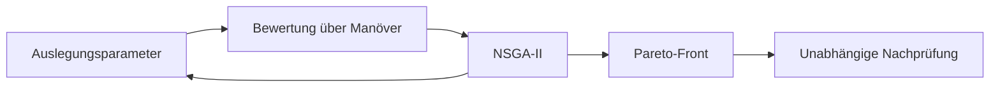
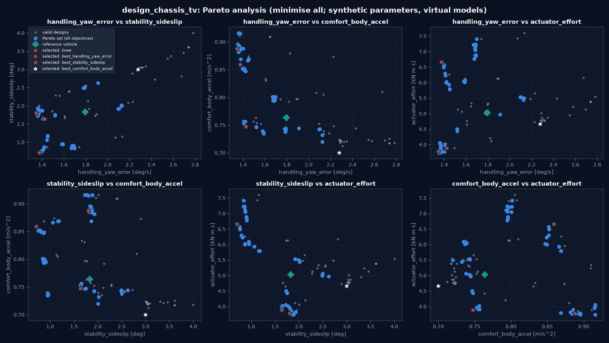
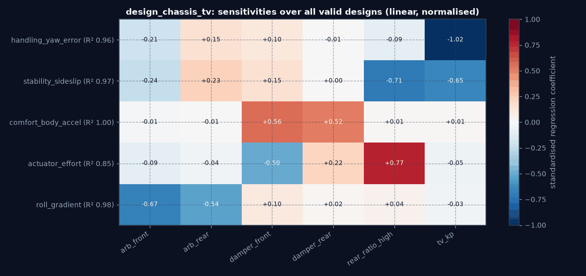
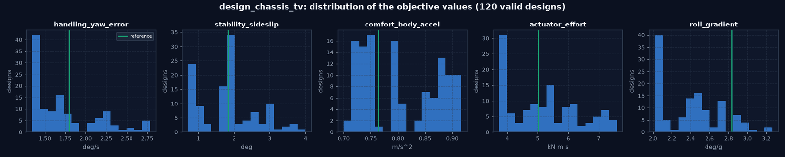

# Fahrzeugauslegung und Mehrzieloptimierung

Abschnitt 9. Das virtuelle Referenzfahrzeug wird nicht nur geregelt, sondern ausgelegt: Ein
Mehrzielverfahren (NSGA-II) durchsucht deklarierte Auslegungsparameter, die Pareto-Front wird ausgewertet, und die
ausgewählten Entwürfe werden auf einem getrennten Satz von Prüfszenarien nachgeprüft. Alle Parameter sind
synthetisch; Aussagen gelten für die virtuellen Modelle, nicht für ein reales Fahrzeug.

Code: `experiments/design_optimization.py` (Experimenttyp `design_optimization`), Beispiel
`configs/experiments/design_chassis_tv.yaml`, Tests `tests/vehicle_model/experiments/test_design_optimization.py`.

## Überblick



## 1. Modelle und Kopplung

Bestehende Modelle, unverändert:

- **7-DOF-Zweispurmodell** (`SevenDOFModel`) mit dem gemeinsamen Motion Controller: Handling, Stabilität,
  Aktuatoraufwand, Robustheit.
- **14-DOF-Modell** (`FourteenDOFModel`: Aufbau mit Hub, Nick, Wank, Radhub, Federn, Dämpfer, Stabilisatoren) auf
  einer ISO-8608-Fahrbahn: Komfort und Wankverhalten.

Kopplung über die Wanksteifigkeitsverteilung: Die Fahrwerksparameter setzen das 14-DOF-Modell und liefern dem
7-DOF-Modell `k_roll_f = K_φ,v / (K_φ,v + K_φ,h)` mit `K_φ = k_Feder · s² / 2 + k_Stab · 180/π` (Stabilisator in
N·m/°). Die Formel folgt dem Kraftgesetz des 14-DOF-Modells (Test: Rückstellmoment einer reinen Wankauslenkung auf
3 % gleich `(K_φ,v + K_φ,h) φ`). Die beiden Modelle beschreiben unterschiedliche Fahrzeuge (7-DOF 1200 kg, 14-DOF
1500 kg); jede Kennzahl wird im Modell bewertet, das sie abbilden kann, die Kopplung betrifft nur die Verteilung.

## 2. Auslegungsparameter

| Gruppe | Parameter | wirkt auf |
|---|---|---|
| Fahrwerk | `spring_front/rear` [N/m], `damper_front/rear` [N·s/m], `arb_front/rear` [N·m/°] | 14-DOF; Wankverteilung → 7-DOF |
| Lenkung | `rear_ratio_low`, `rear_ratio_high` (Vorsteuerung der Hinterachslenkung `δ_h = k(v) δ_v`, gegenphasig/gleichphasig), `rear_transition_speed_mps`, `max_rear_steer_deg`, `rear_steer_rate_degps`, `actuator_delay_s` | 7-DOF |
| Torque Vectoring | `tv_kp`, `tv_ki` (PI-Gesetz) oder `lqr_q_r`, `lqr_r_yaw_moment` (LQR), `max_yaw_moment` | 7-DOF |
| Regelung | `control_period_s` (Abtasten und Halten des gesamten Reglers) | 7-DOF |

Nicht abgebildet: Spur- und Sturzparameter, K&C-Kennfelder, Aktuatorprioritäten und MPC-Gewichte (die Modelle bieten
sie, ein Auslegungspfad ist noch nicht verdrahtet).

## 3. Ziele

Alle minimiert; 2–4 werden optimiert (`objectives`), weitere nur berechnet (`report`).

| Ziel | Plan | Modell | Kennzahl |
|---|---|---|---|
| `handling_yaw_error` | Handling, Spurtreue | 7-DOF | mittlerer Gierraten-RMS-Fehler über die Manöver [°/s] |
| `stability_sideslip` | Stabilität | 7-DOF | max. Schwimmwinkel über Manöver × Streckenfälle [°] |
| `agility_response_time` | Agilität | 7-DOF | 90-%-Zeit der Gierrate im Lenkwinkelsprung [s] |
| `comfort_body_accel` | Komfort | 14-DOF | RMS der Hubbeschleunigung auf ISO-8608-Straße [m/s²] |
| `roll_gradient` | Handling (Wanken) | 14-DOF | Wankwinkel je Querbeschleunigung in stationärer Kurve [°/g] |
| `actuator_effort`, `rear_steer_effort` | Energie, Aktuatoraufwand | 7-DOF | ∫\|M_z\| dt [kN·m·s], ∫\|δ_h\| dt [°·s] |
| `robustness_yaw_error` | Robustheit | 7-DOF | schlechtester Streckenfall des Gierratenfehlers [°/s] |
| `control_rate_hz` | Rechenaufwand | – | Reglerauswertungen je Sekunde (deterministischer Ersatz) |

Die Wanduhrzeit ist nicht reproduzierbar und daher kein Optimierungsziel. Komfort wird nur im 14-DOF-Modell bewertet;
das 7-DOF-Modell hat keine Vertikaldynamik.

## 4. Gültigkeit, Pareto-Dominanz, Suche

- **Ungültige Konfigurationen** werden nicht simuliert und gelangen nie in eine Front (Constrained Domination: jede
  gültige vor jeder ungültigen). Standardgrenzen: Aufbaueigenfrequenz je Achse 0,9–2,0 Hz, Dämpfungsmaß 0,15–0,7,
  vorderer Wanksteifigkeitsanteil 0,35–0,75, `rear_ratio_low ≤ rear_ratio_high`; ein scheiternder Reglerentwurf oder
  ein nicht endlicher Lauf macht den Entwurf mit Grund ungültig.
- **Dominanz** (Minimierung): `a` dominiert `b`, wenn `a` in keinem Ziel schlechter und in mindestens einem besser ist.
  Schnelle nicht-dominierte Sortierung (Deb et al. 2002) mit Crowding Distance; gegen eine Brute-Force-Definition der
  Ränge auf einem Datensatz mit Gleichständen getestet.
- **NSGA-II** mit Latin-Hypercube-Start, Turnierauswahl nach Rang und Crowding, SBX-Kreuzung und polynomieller
  Mutation, alles mit `seed`; gleiche Spezifikation ergibt dieselben Entwürfe (Test). An einem analytischen Problem
  liegt die Front nach 20 Generationen auf der wahren Front und ist dichter als eine Zufallssuche gleichen Budgets.
- **Pareto-Menge**: alle nicht dominierten gültigen Auswertungen aller Generationen.
- **Auswahl**: Kniepunkt (kleinster Abstand zum Utopiepunkt in der normierten Front) und der beste Entwurf je Ziel.
- **Sensitivitäten**: standardisierte Regressionskoeffizienten jedes Ziels auf die normierten Parameter über alle
  gültigen Entwürfe, mit Bestimmtheitsmaß R².

## 5. Robuste Auslegung

`optimisation` und `evaluation` sind getrennte Szenariosätze (Gleichheit wird beim Laden abgewiesen): andere Manöver
und Geschwindigkeiten, eine andere Straße (Seed, Geschwindigkeit) und andere Streckenabweichungen. Die ausgewählten
Entwürfe und das Referenzfahrzeug werden auf dem Evaluationssatz gerechnet. Ein Entwurf **besteht**, wenn er dort
nicht die Kontrolle verliert (Schwimmwinkel < 15°) und jede Verbesserung, die er in der Optimierung gegenüber der
Referenz zeigt, im Evaluationssatz nicht mehr als 5 % schlechter als die Referenz ist.

## 6. Ergebnis: Fahrwerk, Hinterachslenkung und Torque Vectoring

`configs/experiments/design_chassis_tv.yaml`: Stabilisatoren vorn/hinten, Dämpfer vorn/hinten, Hinterachs-
Lenkverhältnis bei Geschwindigkeit (`rear_ratio_high`) und P-Anteil des Gierraten-PI; Ziele Handling, Stabilität,
Komfort (Klasse-C-Straße, 20 m/s) und Aktuatoraufwand, Wankgradient berichtet. Optimierung: Sine with Dwell 80 km/h
5° und Lenkwinkelsprung 72 km/h, Streckenfälle nominal und µ 0,6. Evaluation: 100 km/h (4° bzw. 1,5°), andere Straße
(Seed 11, 25 m/s), Streckenfälle nominal, schwer mit Schwerpunkt hinten, abgefahrene Hinterreifen, nass (µ 0,7).
NSGA-II mit 20 Entwürfen über 6 Generationen (Seed 3): 120 Auswertungen, keine ungültig (die gewählten Grenzen liegen
alle im zulässigen Bereich; der Ausschluss ist durch die Tests belegt).

| Entwurf | Stab. v/h [N·m/°] | Dämpfer v/h [N·s/m] | k_h | PI k_p | Wankanteil v |
|---|---|---|---|---|---|
| Referenz | 450 / 220 | 2300 / 2100 | 0,20 | 15000 | 0,57 |
| Knie | 891 / 146 | 2515 / 1517 | 0,04 | 24969 | 0,66 |
| bestes Handling | 1144 / 745 | 3884 / 3392 | 0,10 | 30000 | 0,57 |
| beste Stabilität | 490 / 72 | 3128 / 3351 | 0,36 | 29093 | 0,61 |
| bester Komfort | 487 / 487 | 1349 / 1488 | 0,05 | 9730 | 0,51 |

| Entwurf | Gierfehler [°/s] opt / eval | max. Schwimmwinkel [°] | Hubbeschl. [m/s²] | Aufwand [kN·m·s] | Nachprüfung |
|---|---|---|---|---|---|
| Referenz | 1,80 / 1,76 | 1,83 / 2,80 | 0,764 / 1,049 | 5,03 / 3,98 | – |
| Knie | 1,43 / 1,41 | 1,64 / 2,65 | 0,748 / 1,025 | 3,88 / 3,80 | **bestanden** |
| bestes Handling | 1,35 / 1,32 | 1,81 / 2,64 | 0,888 / 1,114 | 3,78 / 3,71 | **bestanden** |
| beste Stabilität | 1,38 / 1,29 | 0,71 / 1,76 | 0,859 / 1,117 | 6,67 / 4,83 | **bestanden** |
| bester Komfort | 2,28 / 2,32 | 3,00 / 3,85 | 0,700 / 1,106 | 4,67 / 4,81 | **nicht bestanden** |

Befunde:

- **Pareto-Menge:** 62 Entwürfe, 7 davon dominieren die Referenz in allen vier Zielen.
- **Kniepunkt:** gegenüber der Referenz Gierfehler −21 %, Schwimmwinkel −10 %, Hubbeschleunigung −2 %, Aufwand −23 %;
  in der Evaluation bestätigt (−20 %, −5 %, −2 %, −4 %). Mittel: steiferer vorderer Stabilisator (Wankanteil vorn
  0,66), kaum Hinterachslenkung bei Geschwindigkeit (0,04), höherer PI-Anteil.
- **Zielkonflikte**, quantitativ:
  - Komfort gegen Handling: Der bessere Komfort (−8 %, weiche Dämpfer, Dämpfungsmaß 0,19) kostet +27 % Gierfehler und
    +64 % Schwimmwinkel; der beste Handlingsentwurf (−25 %) hat +16 % Hubbeschleunigung (harte Dämpfer).
  - Stabilität gegen Aufwand: der kleinste Schwimmwinkel (−61 %, `k_h` 0,36) braucht +33 % Giermomentaufwand.
- **Überanpassung erkannt:** Der Komfort-Bestwert ist **nicht** übertragbar. Auf der anderen Straße und
  Geschwindigkeit ist seine Hubbeschleunigung 5 % schlechter als die der Referenz (1,106 gegen 1,049 m/s²), statt 8 %
  besser; die Nachprüfung weist ihn ab. Getrennte Optimierungs- und Evaluationsszenarien sind damit nicht formal,
  sondern wirksam.
- **Sensitivitäten** (R² 0,85–1,00): Gierfehler fast nur über den PI-Anteil (−1,02); Schwimmwinkel über das
  Hinterachs-Lenkverhältnis (−0,71) und den PI-Anteil (−0,65); Hubbeschleunigung über die Dämpfer (+0,56/+0,52),
  Stabilisatoren ohne Einfluss (die Kennzahl ist der Hub des Aufbaus, nicht seine Wankbeschleunigung); Aufwand über das
  Hinterachs-Lenkverhältnis (+0,77); Wankgradient über die Stabilisatoren (−0,67/−0,54).
- Jeder ausgewählte Entwurf liegt als YAML vor (`design_<label>.yaml`: 14-DOF-Fahrwerk, `k_roll_f` des 7-DOF-Modells,
  Lenk- und Regelparameter, Ziele in beiden Sätzen, Ergebnis der Nachprüfung).

## 7. Grenzen

- Kleines Budget (120 Auswertungen in sechs Dimensionen); die gefundene Front ist eine Näherung. Mehr Generationen
  ändern das Verfahren nicht, nur die Laufzeit (etwa 12 s je Auswertung, parallelisiert).
- Komfort nur als ungewichtete Hubbeschleunigung (keine ISO-2631-Frequenzbewertung, keine Wank- und
  Nickbeschleunigung, kein Sitzmodell); deshalb wirken Stabilisatoren nicht auf den Komfort.
- Zwei Modelle mit unterschiedlichen Fahrzeugdaten; die Kopplung beschränkt sich auf die Wankverteilung.
- Linearer Sensitivitätsansatz; Wechselwirkungen werden nicht erfasst (R² zeigt, wie viel er erklärt).

## 8. Reproduktion

```bash
python -m vehicle_model.experiments run configs/experiments/design_chassis_tv.yaml     # einige Minuten, parallel
python -m pytest tests/vehicle_model/experiments/test_design_optimization.py -q
```

---

<!-- figures:start -->

## Ergebnisbilder

> Alle Bilder sind Simulationsergebnisse mit synthetischen Parametern, keine Messungen. Neu erzeugen: Quellskript ausführen, dann `python tools/publish_doc_figures.py`.



*Pareto-Analyse der Fahrwerks-, Lenk- und TV-Auslegung: alle Zielpaare (grau gültige Entwürfe, blau die Pareto-Menge über alle vier Ziele, Kreuz Referenzfahrzeug, Sterne ausgewählte Entwürfe). Quelle: `python -m vehicle_model.experiments run configs/experiments/design_chassis_tv.yaml`.*



*Standardisierte Regressionskoeffizienten jedes Ziels auf die normierten Auslegungsparameter (R² je Zeile). Quelle: wie oben.*



*Verteilung der Zielwerte über alle gültigen Entwürfe, Referenz grün. Quelle: wie oben.*

<!-- figures:end -->
