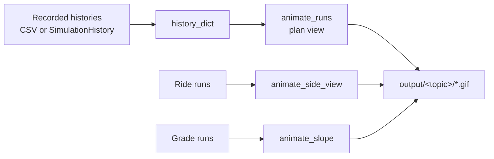
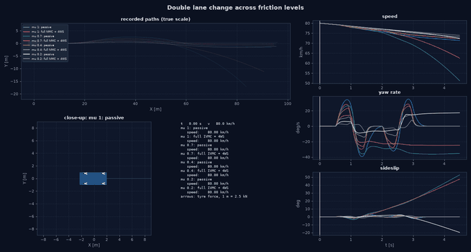
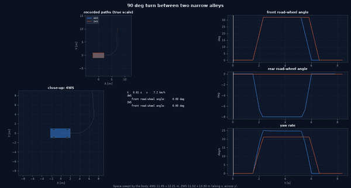

# Visualization & Real-Time Animation Guide

Visualizing vehicle trajectories and wheel-ground kinematics is essential for validating handling dynamics, evaluating active chassis controllers, and debugging stability control interventions.

This document details the visualization engine implemented in `src/vehicle_model/visualization/`:
1. **2D Planar Vehicle Footprint Renderer** (`draw_vehicle`, `VehicleParams`)
2. **One Animation Renderer** (`animate_runs`, `animate_side_view`, `animate_slope`)
3. **NMPC Real-Time Telemetry Dashboard** (`RealTimeDashboard`)

---

## 1. 2D Planar Vehicle Footprint Renderer (`plan_view.py`)

The planar footprint renderer ([plan_view.py](https://github.com/CagriCatik/Vehicle-Dynamics/blob/main/src/vehicle_model/visualization/plan_view.py)) converts vehicle state coordinates $(X, Y, \psi, \delta_f, \delta_r)$ into geometrically accurate 2D planar polygons:

```
                  ┌───────────────────────┐  ▲
                  │                       │  │ Front Overhang
             ┌───┐│   ═══════╤═══════    │┌───┐
  Front-Left │   ││    Front │ Axle      ││   │ Front-Right Wheel
  Wheel      └───┘│          │           │└───┘ (Steered delta_f)
  (Steered)       │          │ l_f       │
                  │          ▼           │
                  │         (x) CoG      │  Chassis Body Outline
                  │          ▲           │
                  │          │ l_r       │
             ┌───┐│    Rear  │ Axle      │┌───┐
  Rear-Left  │   ││   ═══════╧═══════    ││   │ Rear-Right Wheel
  Wheel      └───┘│                       │└───┘ (Steered delta_r in 4WS)
                  │                       │  │
                  └───────────────────────┘  ▼ Rear Overhang
                             w_f, w_r
```

### 1.1 Physical Dimensions: `VehicleParams`
Standard passenger car dimensions are extracted directly from the 7-DOF model parameters:
```python
v_params = VehicleParams.from_seven_dof_params(model.params)
```
- Wheelbase ($L = l_f + l_r$): $2.70\text{ m}$
- Front/Rear Track Width ($w_f, w_r$): $1.60\text{ m}$
- Overall Chassis Width ($W$): $1.80\text{ m}$
- Front / Rear Overhangs: $0.90\text{ m} / 1.00\text{ m}$
- Tyre Dimensions: Radius $R = 0.33\text{ m}$, Width $w_t = 0.225\text{ m}$

### 1.2 Kinematic Transformations & Polygon Geometry
For any component vertex $(x_{\text{local}}, y_{\text{local}})$ defined in the vehicle CoG frame:
$$\begin{bmatrix} X_{\text{global}} \\ Y_{\text{global}} \end{bmatrix} = \begin{bmatrix} X \\ Y \end{bmatrix} + \begin{bmatrix} \cos \psi & -\sin \psi \\ \sin \psi & \cos \psi \end{bmatrix} \begin{bmatrix} x_{\text{local}} \\ y_{\text{local}} \end{bmatrix}$$

For steered wheels (front angle $\delta_f$, rear angle $\delta_r$):
$$\begin{bmatrix} x_{\text{wheel,rot}} \\ y_{\text{wheel,rot}} \end{bmatrix} = \begin{bmatrix} \cos \delta_i & -\sin \delta_i \\ \sin \delta_i & \cos \delta_i \end{bmatrix} \begin{bmatrix} x_{\text{wheel,patch}} \\ y_{\text{wheel,patch}} \end{bmatrix}$$
The wheel vertices are first rotated by steer angle $\delta_i$, translated to the hub mounting point, and finally transformed into global inertial space by vehicle heading $\psi$.

---

## 2. One Renderer for All Animations (`run_animation.py`)

Every GIF of the platform comes from [run_animation.py](https://github.com/CagriCatik/Vehicle-Dynamics/blob/main/src/vehicle_model/visualization/run_animation.py): the same vehicle, layout and colours, so results can be compared at a glance. Older entry points (`animate_maneuver`, `animate_drift`, the split-µ and 4WS animators, the experiment and critical-scenario GIFs) keep their signatures and only prepare their data for this renderer.



| View | Function | Used for |
| :--- | :--- | :--- |
| Plan view | `animate_runs` | All manoeuvres: overview path, close-up with tyre forces, HUD, up to three time traces with a cursor; 14-DOF runs add a rear view with lifted wheels in red |
| Side view, road | `animate_side_view` | Heave and pitch over the road profile (vertical motions magnified, stated in the panel) |
| Side view, grade | `animate_slope` | True-scale car on the road height, with speed, grade and HDC status |

Plan view uses `vehicle_polygons`; both side views share one side-view vehicle (`_side_vehicle`). Side views exist because pitch and grade cannot be seen from above. Only recorded samples are drawn; runs that end early hold their last sample and are marked "(ended)".

---

## 3. Generating Animations

Regenerate everything with `python tools/run_all_results.py`. Individually:

```bash
python examples/chassis_control_animations.py brake_functions hill_descent   # comparison GIFs by topic
python examples/stage_animations.py                                          # one GIF for every experiment and demo still without one
```

Analyses without a vehicle run get a representative closed-loop simulation of their own operating point, not an illustration: recovery runs for stability maps, settling runs for equilibria, the extreme Pareto designs for the design optimisation.

Generate all 9 standardized automotive maneuver animations:
```bash
python examples/generate_maneuver_animations.py
```

To re-generate a specific maneuver while preserving the caches of all other animations:
```bash
python examples/generate_maneuver_animations.py nmpc_slalom
```

Generated animation files are saved to `output/validation_report/animations/` and `output/animations/`:
1. `iso_3888_dlc.gif`: ISO 3888-2 Double Lane Change (Passive vs 4WS vs IVMC)
2. `mu_split_braking.gif`: Split-$\mu$ Emergency Braking from 100 km/h
3. `sine_with_dwell.gif`: FMVSS 126 Sine with Dwell (Passive Spinout vs IVMC Stabilization)
4. `step_steer_iso_7401.gif`: ISO 7401 Step Steer Response at 100 km/h
5. `braking_in_a_turn.gif`: ISO 7975 Braking in a Turn (Lift-off Oversteer vs CBC)
6. `fishhook_ncap.gif`: NHTSA Dynamic Fishhook at 80 km/h (Rollover Prevention)
7. `low_speed_slalom_4ws.gif`: Low-Speed Slalom at 30 km/h (Counter-Phase Agility)
8. `high_speed_lane_change.gif`: High-Speed Highway Lane Change at 120 km/h (In-Phase Crab)
9. `nmpc_slalom.gif`: SLSQP NMPC Slalom Path Tracking (4WS LUT vs FWS vs Passive)

---

## 4. Source Code Cross-Reference

| Component | Source File | Unit Tests |
| :--- | :--- | :--- |
| **Plan-View Renderer** | [plan_view.py](https://github.com/CagriCatik/Vehicle-Dynamics/blob/main/src/vehicle_model/visualization/plan_view.py) | [test_plan_view.py](https://github.com/CagriCatik/Vehicle-Dynamics/blob/main/tests/vehicle_model/test_plan_view.py) |
| **Animation Renderer** | [run_animation.py](https://github.com/CagriCatik/Vehicle-Dynamics/blob/main/src/vehicle_model/visualization/run_animation.py) | [test_animation.py](https://github.com/CagriCatik/Vehicle-Dynamics/blob/main/tests/vehicle_model/test_animation.py) |
| **NMPC Dashboard** | [dashboard.py](https://github.com/CagriCatik/Vehicle-Dynamics/blob/main/src/vehicle_model/visualization/dashboard.py) | N/A |

---

<!-- figures:start -->

## Ergebnisbilder

> Alle Bilder sind Simulationsergebnisse mit synthetischen Parametern, keine Messungen. Neu erzeugen: Quellskript ausführen, dann `python tools/publish_doc_figures.py`.



*Spurwechsel auf mehreren Reibwerten mit Nahkamera-Panel und HUD. Quelle: `examples/multi_mu_scenarios_benchmark.py`.*



*4WS-Animation mit Lenkwinkel-Panel: unten Vorder- und Hinterachswinkel mit Cursor auf dem aktuellen Bild. Fahrzeuge werden an der Hinterachse gezeichnet, aus dem Schwerpunkt über l_r berechnet (`VehicleParams.cog_to_rear_axle`). Quelle: `examples/parking_4ws_demo.py`.*

<!-- figures:end -->
