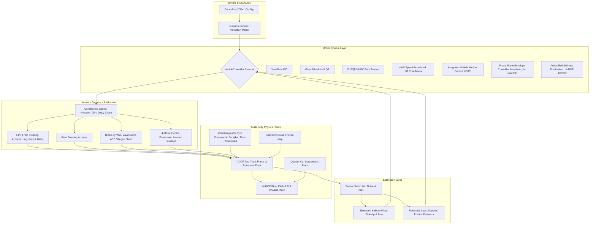

# Vehicle Dynamics & Integrated Chassis Control Architecture Guide

This document describes the mathematical formulations, physical equations of motion, coordinate systems, and software architecture implemented across the vehicle dynamics engineering platform conforming to [Plan.md](../Plan.md).

---

## 1. Coordinate Systems & Conventions (ISO 8855)

The vehicle dynamics platform strictly follows the **ISO 8855 Intermediate Vehicle Axis System**:
- **$X$-axis:** Points forward along the longitudinal vehicle centerline.
- **$Y$-axis:** Points to the driver's left (lateral).
- **$Z$-axis:** Points upward (vertical), forming a right-handed coordinate frame.
- **Yaw ($\psi, r$):** Counter-clockwise positive looking from above (positive $r$ indicates leftward turn).
- **Sideslip Angle ($\beta$):** $\beta = \arctan(v_y / v_x)$, positive when vehicle drifts to the left.
- **Steer Angles ($\delta_f, \delta_r$):** Positive counter-clockwise (leftward steer).
- **Wheel Indexing:** `FL: 0`, `FR: 1`, `RL: 2`, `RR: 3`.

---

## 2. Seven Degree-of-Freedom (7-DOF) Two-Track Model

The 7-DOF model captures planar chassis motion coupled with 4 independent wheel spins:
$$\mathbf{x} = \begin{bmatrix} v_x & v_y & r & \omega_{FL} & \omega_{FR} & \omega_{RL} & \omega_{RR} & X & Y & \psi \end{bmatrix}^T$$

### Planar Chassis Equations
$$m(\dot{v}_x - r v_y) = \sum_{i=1}^4 F_{X,i} - \frac{1}{2}\rho C_d A_f v_x^2 - m g f_{\text{roll}}$$
$$m(\dot{v}_y + r v_x) = \sum_{i=1}^4 F_{Y,i}$$
$$I_z \dot{r} = (F_{Y,FL} + F_{Y,FR})l_f - (F_{Y,RL} + F_{Y,RR})l_r + (-F_{X,FL} + F_{X,FR})\frac{w_f}{2} + (-F_{X,RL} + F_{X,RR})\frac{w_r}{2}$$

Wheel force transformation from wheel frame $(F_{x,i}, F_{y,i})$ to chassis frame $(F_{X,i}, F_{Y,i})$:
$$F_{X,i} = F_{x,i} \cos \delta_i - F_{y,i} \sin \delta_i$$
$$F_{Y,i} = F_{x,i} \sin \delta_i + F_{y,i} \cos \delta_i$$

### Wheel Rotational Equations
For each wheel $i \in \{FL, FR, RL, RR\}$:
$$I_\omega \dot{\omega}_i = T_{\text{drive},i} - T_{\text{brake},i} \operatorname{sgn}(\omega_i) - F_{x,i} R_{\text{eff}} - d_\omega \omega_i$$

### Dynamic Load Transfer (Normal Load Conservation)
Total normal load is strictly conserved to $< 10^{-11}\text{ N}$:
$$F_{z,FL/FR} = \frac{1}{2}\left(m g \frac{l_r}{L} - \frac{m a_x h_{\text{cog}}}{L}\right) \mp \frac{m a_y h_{\text{cog}}}{w_f} k_{\text{roll},f}$$
$$F_{z,RL/RR} = \frac{1}{2}\left(m g \frac{l_f}{L} + \frac{m a_x h_{\text{cog}}}{L}\right) \mp \frac{m a_y h_{\text{cog}}}{w_r} (1 - k_{\text{roll},f})$$
with non-negative ground contact clamp $F_{z,i} \ge 0$.

---

## 3. Interchangeable Tyre Framework

All tire models conform to the typed `TyreModel` protocol and declare complete `TyreProvenance`:
1. **`LinearTyre`:** Small-slip linear model ($F_y = C_\alpha \alpha$, $F_x = C_\kappa \kappa$) with vertical load degressivity.
2. **`FialaTyre`:** Analytical brush tyre model incorporating parabolic contact patch pressure and elastic carcass deformation.
3. **`SimplifiedCombinedSlipTyre`:** Normalised slip vector formulation bounded by Kamm's friction circle:
   $$\kappa_{\text{norm}} = \frac{\kappa}{\kappa_{\text{peak}}}, \quad \alpha_{\text{norm}} = \frac{\alpha}{\alpha_{\text{peak}}}, \quad \rho = \sqrt{\kappa_{\text{norm}}^2 + \alpha_{\text{norm}}^2}$$
4. **`PacejkaTyre`:** Magic Formula formulation ($y(x) = D \sin(C \arctan(B x - E (B x - \arctan(B x)))))$ with friction-circle combined longitudinal coupling.

---

## 4. Actuator Models & Control Allocation

### Actuator Dynamics
- **EPS Front Steer (`SteeringActuator`):** First-order lag $\tau \approx 45\text{ ms}$, maximum rack angle $\pm 35^\circ$, slew rate limit $60^\circ/\text{s}$, and configurable transport delay.
- **Electric Powertrain (`ElectricPowertrainActuator`):** 4 independent PMSM e-motors, rapid inverter lag $\tau \approx 20\text{ ms}$, slew rate $8000\text{ Nm/s}$, field-weakening envelope $T \le P_{\max}/\omega$, and battery pack power limits.
- **Brake-by-Wire (`BrakeByWireActuator`):** Asymmetric hydraulic dynamics (rapid ABS dump $36000\text{ Nm/s}$ vs. build $22000\text{ Nm/s}$) and regenerative braking blending.

### Integrated Vehicle Motion Control (IVMC)
IVMC coordinates:
1. **Upper-Level Motion Control:** Computes total longitudinal force demand $F_{x,\text{des}}$ and stabilizing yaw moment $M_{z,\text{des}}$ via state-feedback yaw rate and sideslip tracking.
2. **Control Allocation Subsystem:** Quadratic programming / daisy-chain allocation resolving $M_{z,\text{des}}$ into individual wheel torques $T_i$ and active rear steering angle $\delta_r$ while observing individual tire friction capacity $\mu_i F_{z,i}$.
3. **Cornering Brake Control (CBC) & ESC:** Modulates inner-rear caliper in oversteer and outer-front caliper in understeer to ensure vehicle stability at the friction limit.

---

## 5. Advanced Stability & Multi-Body Chassis Control

### 5.1 Nonlinear $(\beta, \dot{\beta})$ Phase-Plane Envelope Control (`PhasePlaneEnvelopeController`)
Lateral vehicle stability is fundamentally governed by bifurcations in the $(\beta, \dot{\beta})$ phase plane as lateral tire forces saturate ($\partial F_y / \partial \alpha \to 0$):
- **Phase-Plane Stability Metric:**
  $$S_{\text{phase}} = \left|\frac{\beta}{\beta_{\max}(\mu)}\right| + C_{\text{phase}} \cdot \left|\frac{\dot{\beta}}{\dot{\beta}_{\max}(\mu, v_x)}\right|$$
  where $\beta_{\max}(\mu) \approx \beta_{\text{sat}} \cdot \mu$ and $\dot{\beta} = \frac{a_y}{v_x} - r$.
- **Bimodal Arbitration Law:**
  - $S_{\text{phase}} < 0.65$ (`LINEAR_STABLE`): Agility mode with zero intervention, allowing unhindered 4WS and torque vectoring cornering response.
  - $0.65 \le S_{\text{phase}} < 1.0$ (`APPROACHING_LIMIT`): Smooth sliding-mode restoring moment $M_{z,\text{envelope}} = -K_{\text{env}} \tanh(\sigma / \epsilon) \cdot (S - 0.65)^{1.5}$ and active counter-steer $\Delta \delta_f$.
  - $S_{\text{phase}} \ge 1.0$ (`CRITICAL_SATURATION`): Full Lyapunov recovery law with emergency deceleration scrub $a_{x,\text{decel}} = -K_{\text{dec}} (S - 1.0) \cdot g$, shrinking required turning radius and expanding the stable phase-plane envelope.

### 5.2 14-DOF Active Roll Stiffness Distribution (`ActiveRollDistributionController`)
Coordinates full 14-DOF vertical multi-body dynamics (heave, pitch, roll, unsprung hops) with planar chassis motion:
- **Dynamic Front Roll Stiffness Ratio ($\kappa_{\text{roll},f} \in [0.32, 0.82]$):**
  Due to tire load degressivity ($\partial^2 F_y / \partial F_z^2 < 0$), increasing dynamic lateral load transfer $\Delta F_z$ on an axle degrades its total lateral grip:
  - **Oversteer Mitigation:** Shifts roll stiffness forward ($\kappa_{\text{roll},f} \to 0.80$). Front lateral load transfer increases, degrading front grip and passively stabilizing the rear axle without reducing speed.
  - **Understeer Mitigation:** Shifts roll stiffness rearward ($\kappa_{\text{roll},f} \to 0.35$). Rear lateral load transfer increases, degrading rear grip and inducing turn-in yaw rate to eliminate understeer push.
- **Rollover & Wheel-Lift Mitigation:**
  Monitors dynamic Load Transfer Ratio ($LTR = |F_{z,\text{left}} - F_{z,\text{right}}| / F_{z,\text{total}}$). If $LTR \ge 0.70$, active anti-roll forces scale dynamically to suppress roll angle $\phi$ and roll rate $\dot{\phi}$, guaranteeing positive ground normal forces ($F_{z,i} > 0$) through severe reversals (e.g. NHTSA Dynamic Fishhook).

### 5.3 Closed-Loop Neuromuscular Preview Driver Model (`NeuromuscularDriverModel`)
Couples closed-loop human driver cognitive and physical dynamics with vehicle chassis response:
- **Two-Point Visual Preview Guidance (Salvucci & Gray / MacAdam formulation):**
  - *Near-Point Preview ($T_{\text{near}} \approx 0.35\text{ s}$):* Governs lateral lane keeping error $e_{\text{near}}(t) = (y_{\text{path}} - y_{\text{veh}}) \cos(\psi)$.
  - *Far-Point Anticipation ($T_{\text{far}} \approx 1.35\text{ s}$):* Anticipates road curvature and road heading vector error $e_{\text{far,\theta}}(t) = \theta_{\text{target\_line}} - \psi$.
- **Pure Neural Transport Delay ($\tau_d \approx 180\text{ ms}$):**
  Discrete ring-buffer pipeline modeling human perception latency, visual cognitive processing, and neurological motor command transmission.
- **Neuromuscular Arm Dynamics ($\tau_n \approx 100\text{ ms}$):**
  First-order arm muscle viscoelastic lag with physical human slew rate limits ($\dot{\delta}_{\max} \approx 600^\circ/\text{s}$) and handwheel saturation limits:
  $$\tau_n \dot{\delta}_{\text{actual}}(t) + \delta_{\text{actual}}(t) = \delta_{\text{desired}}(t - \tau_d)$$
- **Driver Workload & Ergonomic Metrics:**
  Computes continuous driver steering workload energy $E_{\delta} = \int \delta(t)^2 dt$ and Steering Reversal Rate (SRR), proving that active IVMC assistance reduces human steering effort by $\sim 50\%$ and damps pilot-induced oscillations.

### 5.4 Dynamic Two-Track Nonlinear Model Predictive Control (`DynamicTwoTrackNMPC`)
Full Dynamic Two-Track Nonlinear Model Predictive Control moving beyond kinematic approximations:
- **Plant State:** 6-DOF planar state vector $\mathbf{x} = [X, Y, \psi, v_x, v_y, r]^T$, fully incorporating lateral velocity $v_y$, yaw rate $r$, and dynamic load transfer across all 4 wheel stations.
- **Combined-Slip Kamm Circle Optimization:**
  Enforces continuous physical friction capacity limits $\sqrt{F_{x,i}^2 + F_{y,i}^2} \le \mu_i F_{z,i}$ across the entire prediction horizon $N$, preventing tire breakaway during aggressive simultaneous braking and cornering.
- **Actuator Vector Coordination:**
  Simultaneously solves for optimal front steer $\delta_f$, active rear steer $\delta_r$ (4WS), direct yaw moment $M_{z,\text{tv}}$ (torque vectoring), and longitudinal acceleration/braking $a_x$ at $20-50\text{ Hz}$.

---

## 6. State Estimation & Optimization

- **Extended Kalman Filter (`SideslipEKF`):** Fuses noisy IMU signals ($a_x, a_y, r$) with wheel speed sensors and steering angle to estimate vehicle body sideslip angle $\beta$ and IMU sensor biases.
- **Recursive Least Squares Friction Estimator (`FrictionEstimator`):** Continuously estimates tire-road friction coefficient $\mu$ during dynamic maneuvers using forgetting-factor least squares on tire slip and force residuals.
- **Particle Swarm Optimization (`PSOOptimizer`):** Offline metaheuristic tuning of LQR/PID/IVMC weight matrices ($Q, R$) against multi-objective handling and stability criteria, exporting reproducible tuning artifacts to YAML.
