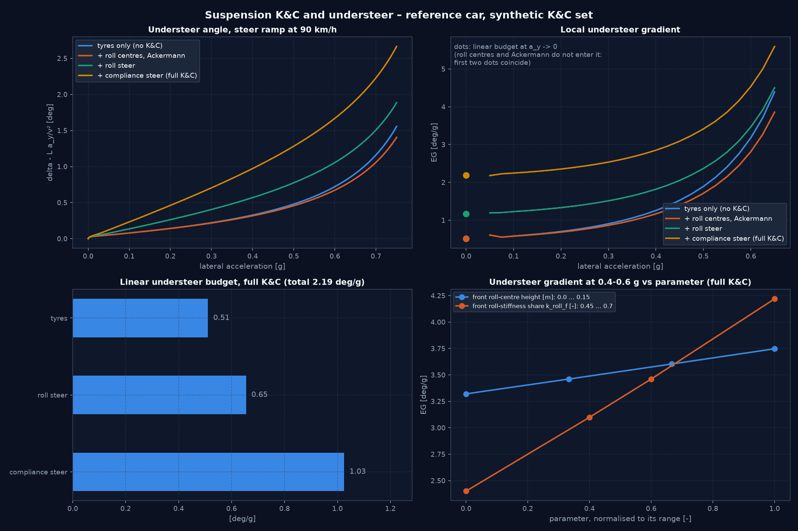

# Lenkgeometrie, Fahrwerkskinematik und Radlastverteilung

Module:
- [`steering/geometry.py`](../src/vehicle_model/steering/geometry.py): Einzelradlenkwinkel mit Ackermann-Anteil.
- [`suspension/kinematics.py`](../src/vehicle_model/suspension/kinematics.py): quasistatische K&C, Rollzentren und Aufbaulage.
- [`handling_analysis/understeer_budget.py`](../src/vehicle_model/handling_analysis/understeer_budget.py): lineares Eigenlenkbudget.

Alles ist **optional**. Ohne K&C-Satz ist das 7-DOF-Modell unverändert; das erfüllt die chassis kinematics-Abnahme „deaktivierte Zusatzeffekte reproduzieren das Basismodell“.

```python
model = SevenDOFModel.from_yaml("configs/vehicles/reference_passenger_car.yaml",
                                kc_config="configs/suspension/kc_reference_passenger_car.yaml")
```

Der K&C-Satz benötigt den Abschnitt `chassis_extended` der Fahrzeug-YAML: Massen, Wanksteifigkeiten und Radraten. `TransientSevenDOFModel` übernimmt K&C ebenfalls.

---

## 1. Lenkgeometrie

Die Achslenkwinkel $\delta_f, \delta_r$ legen eine Starrkörperbewegung fest. Deren Quergeschwindigkeit wächst linear mit $x$. Der schlupffreie Radwinkel an der Position $(x_i, y_i)$ ist deshalb

$$\tan\delta_{i,\text{ideal}} = \frac{\tan\delta(x_i)}{1 - \kappa\,y_i}, \qquad \tan\delta(x) = \tan\delta_r + \frac{x + l_r}{L}(\tan\delta_f - \tan\delta_r), \qquad \kappa = \frac{\tan\delta_f - \tan\delta_r}{L}.$$

Bei reiner Vorderachslenkung ergibt das die klassische Ackermann-Bedingung $\cot\delta_o - \cot\delta_i = w/L$. Anders als die Konstruktion über den Momentanpol ist die Form bei gleichphasiger 4WS ($\delta_f = \delta_r$, also $\kappa = 0$) nicht singulär. Der Ackermann-Anteil $A$ je Achse interpoliert linear:

$$\delta_i = \delta_\text{Achse} + A\,(\delta_{i,\text{ideal}} - \delta_\text{Achse}).$$

$A = 0$ bedeutet parallel (Basismodell), $A = 1$ volles Ackermann; $A > 1$ und $A < 0$ sind zulässig.

Weitere Punkte aus chassis_control_platform_plan.md, Abschnitt 8 („Steering Geometry“) liegen bereits vor: 4WS-Strategien (`steering/four_wheel_steering.py`) sowie Verzögerung, Stellrate und Totzeit (`actuators/steering_actuator.py`). Es fehlt noch eine Lenkübersetzung (Lenkradwinkel zu Radwinkel); alle Modelle arbeiten mit Radwinkeln. Das gehört zu den Aktuatoren in slip control and allocation.

## 2. Rollzentren und laterale Radlastverlagerung

Annahmen: ungefederte Masse $m_u$ je Rad in Höhe $h_u = R_\text{eff}$; gefederte Masse $m_s$ in Höhe $h_s = (m h - 4 m_u h_u)/m_s$. Die Rollachse liegt am gefederten Schwerpunkt in Höhe $h_{ra} = (m_{sf} h_{rf} + m_{sr} h_{rr})/m_s$; daraus folgt der Rollhebel $d = h_s - h_{ra}$. Für die elastische Aufteilung gilt $k = K_f/(K_f + K_r)$. Querlastverlagerung je Achse nach Milliken & Milliken (1995), Kap. 18:

$$w_f\,\Delta F_f = a_y\,[\,m_s d\,k + m_{sf} h_{rf} + 2 m_u h_u\,], \qquad w_r\,\Delta F_r = a_y\,[\,m_s d\,(1-k) + m_{sr} h_{rr} + 2 m_u h_u\,]$$

Die erste Klammer enthält den elastischen, geometrischen und ungefederten Anteil.

Die Summe ist **exakt** $m a_y h$. Die Wankmomentenbilanz ändert sich also nicht, nur der Vorderachsanteil. Dieser geht als effektives `k_roll_f` in die einseitige Lastverteilung aus 7-DOF-Modell ein ([`normal_loads.py`](../src/vehicle_model/vehicle_models/normal_loads.py)); Abheben und Kippen werden weiter gemeldet. Bei $h_{rf} = h_{rr} = 0$ und $m_u = 0$ ist der Anteil genau $k$.

Aufbaulage (kleine Winkel, starr):

$$\varphi = \frac{m_s a_y d}{K_f + K_r}, \qquad \theta = -\frac{m_s a_x h_s}{K_\theta}, \qquad K_\theta = 2 c_f l_f^2 + 2 c_r l_r^2$$

Die Nickachse liegt am Boden (kein Anti-Dive). Daraus folgt der Einfederweg je Rad: $z_i = -y_i\varphi + x_i\theta$.

## 3. Kinematik und Elastokinematik

Vorzeichen: Ein positiver Lenkwinkel bedeutet nach links (ISO).

| Effekt | Modell | Vorzeichen |
|---|---|---|
| Bump Steer | Vorspur $\text{toe}(z)$ je Achse als Kennfeld (Stützstellen, linear interpoliert, konstant außerhalb) oder als konstanter Gradient | Vorspur dreht das linke Rad nach rechts: $\Delta\delta_\text{links} = -\text{toe}$, $\Delta\delta_\text{rechts} = +\text{toe}$ |
| Roll Steer | folgt aus Bump Steer und Wankwinkel: $\varepsilon = \text{toe}'(0)\,w/2$ [rad/rad]; `roll_steer_coefficients()` | $\varepsilon > 0$: Achse lenkt zur Kurve hin |
| Compliance Steer | je Achse proportional zur Achsseitenkraft im Radsystem: vorn $\Delta\delta = -c_f F_{y,f}$, hinten $\Delta\delta = +c_r F_{y,r}$ | $c > 0$ fördert an beiden Achsen das Untersteuern |

Die Lenkwinkeländerungen hängen von $a_x$, $a_y$ und den Reifenkräften ab. Sie sind deshalb Teil der vorhandenen Fixpunktiteration im 7-DOF-Modell; Konvergenz meldet `load_transfer_converged`.

**K&C-Satz** [`kc_reference_passenger_car.yaml`](../configs/suspension/kc_reference_passenger_car.yaml), synthetisch, mit Provenienz:

| Größe | Wert | abgeleitet |
|---|---|---|
| Rollzentren v/h | 0,05 / 0,10 m | Querlastanteil vorn 0,576 statt 0,600 |
| Bump Steer vorn | −0,10 rad/m (Nachspur beim Einfedern) | $\varepsilon_f$ = −0,077 rad/rad |
| Bump Steer hinten | Kennfeld, progressiv, 0,05 rad/m bei $z = 0$ | $\varepsilon_r$ = +0,038 rad/rad |
| Compliance Steer v/h | 0,10 / 0,03 °/kN | |
| Ackermann vorn/hinten | 0,6 / 0 | |
| Wankgradient | | 5,7 °/g |
| Nickgradient (Bremsen) | | 2,0 °/g |

**Nicht modelliert und nicht behauptet:**
- Sturzänderung: Die Reifenmodelle kennen keinen Sturz.
- Nachlauf, Spreizung und Lenkrollradius: Es gibt kein Lenkmoment.
- Der destabilisierende Schwerkraftterm $m_s g d\varphi$: etwa 8 % des elastischen Wankmoments beim Referenzfahrzeug.
- Schwerpunktverschiebung durch Wanken.
- Anti-Dive und Anti-Squat.
- Längselastizität.
- Dynamik von Lagern und Aufbau: Compliance wirkt verzögerungsfrei; für Aufbaudynamik siehe das 14-DOF-Modell.

## 4. Einfluss auf das Eigenlenkverhalten

**Lineares Budget** (Gillespie 1992, Kap. 6):

$$EG = \underbrace{\frac{m}{L}\Big(\frac{l_r}{C_f} - \frac{l_f}{C_r}\Big)}_\text{Reifen} + \underbrace{(\varepsilon_r - \varepsilon_f)\,\frac{d\varphi}{da_y}}_\text{Roll Steer} + \underbrace{c_f\,m\frac{l_r}{L} + c_r\,m\frac{l_f}{L}}_\text{Compliance Steer}$$

Für das Referenzfahrzeug mit K&C ergibt das 0,51 + 0,65 + 1,03 = **2,19 °/g**. Das liegt im üblichen Pkw-Bereich, während die Reifen allein (0,51 °/g, Referenzfahrzeug) dafür zu wenig Untersteuern liefern. Nicht im linearen Budget enthalten sind Radlastverlagerung mit lastabhängigen Reifen (bei $a_y \to 0$ ohne Steigung), Rollzentren, Ackermann (zweite Ordnung im Lenkwinkel) und das Rückstellmoment.

**Simulation:** [`examples/kc_understeer_analysis.py`](../examples/kc_understeer_analysis.py) fährt eine quasistationäre Lenkrampe nach ISO 4138 (konstante Geschwindigkeit, 90 km/h, 0,25 °/s). Bei 0,1 °/s ergeben sich dieselben Werte; bei 1 °/s verfälscht der Einschwingvorgang den Bereich unter 0,15 g.

| Variante | lineares Budget | EG 0,05–0,15 g | EG 0,3–0,5 g |
|---|---|---|---|
| nur Reifen | 0,51 | 0,58 | 1,28 |
| + Rollzentren, Ackermann | 0,51 | 0,58 | 1,19 |
| + Roll Steer | 1,17 | 1,23 | 1,84 |
| + Compliance Steer (voller K&C-Satz) | 2,19 | 2,25 | 2,87 |

Alle Werte in °/g.

- Im kleinen $a_y$-Bereich liegen alle Varianten 0,06–0,07 °/g über ihrem Budget. Das ist der beginnende nichtlineare Anteil der Lastverlagerung; er ist auch ohne K&C gleich groß.
- Die Rollzentren des Satzes verringern den Querlastanteil vorn und damit das Untersteuern bei höherem $a_y$.

Empfindlichkeit bei 0,4–0,6 g (voller K&C-Satz):

| Parameter | Bereich | EG |
|---|---|---|
| Rollzentrum vorn | 0 … 0,15 m | 3,32 … 3,75 °/g |
| Wanksteifigkeitsanteil vorn `k_roll_f` | 0,45 … 0,70 | 2,40 … 4,22 °/g |

Die Wanksteifigkeitsverteilung ist bei hohem $a_y$ der stärkste Hebel. Im linearen Bereich wirkt sie nicht.

## 5. Verifikation

[test_suspension_kinematics.py](../tests/vehicle_model/test_suspension_kinematics.py), 26 Tests:

| Prüfung | Ergebnis |
|---|---|
| Ideale Radwinkel = Geschwindigkeitsrichtung der Starrkörperbewegung (auch 4WS) | 1e-13 |
| Ackermann-Bedingung $\cot\delta_o - \cot\delta_i = w/L$ | rel. 1e-12 |
| Parallele 4WS ohne Singularität; Spiegelsymmetrie; $A$-Interpolation | exakt |
| Querlastverlagerung summiert sich zu $m h$ (vier Rollzentrum-Kombinationen) | rel. 1e-12 |
| Ohne Rollzentren und ungefederte Masse: Anteil = `k_roll_f` | rel. 1e-12 |
| Deaktivierte K&C reproduzieren Ableitung und Telemetrie des Basismodells | 1e-6 (Fixpunkt-Toleranz) |
| Vorzeichen von Wankwinkel, Einfederweg, Roll Steer und Compliance Steer | erfüllt |
| Momenten- und Kraftbilanz, Fixpunkt-Konvergenz mit K&C; verwendete Radwinkel = Geometrie + K&C am Fixpunkt | erfüllt |
| Stationäre Gierrate 7-DOF mit K&C gegen $v\delta/(L + EG\,v^2)$ bei 36, 72 und 108 km/h, $a_y$ = 0,3 m/s² | Abweichung ≤ 0,28 % (Toleranz 1 %) |

## 6. Grenzen

- Quasistatisch: kein Wank- oder Nick-Freiheitsgrad im 7-DOF-Modell. Die Aufbaulage folgt verzögerungsfrei aus $a_x$ und $a_y$.
- Die K&C-Werte sind synthetisch und nicht an einem Prüfstand gemessen.
- Rechenzeit: Mit K&C liegen die Lenkwinkel in der Fixpunktiteration, das Modell rechnet etwa 3- bis 4-mal langsamer.

---

<!-- figures:start -->

## Ergebnisbilder

> Alle Bilder sind Simulationsergebnisse mit synthetischen Parametern, keine Messungen. Neu erzeugen: Quellskript ausführen, dann `python tools/publish_doc_figures.py`.



*Eigenlenken mit K&C: Untersteuerwinkel und lokaler Eigenlenkgradient mit schrittweise zugeschalteten Rollzentren/Ackermann, Rolllenken und Elastokinematik; lineares Budget 2,19 °/g; Parameterempfindlichkeit. Quelle: `examples/kc_understeer_analysis.py`.*

<!-- figures:end -->
