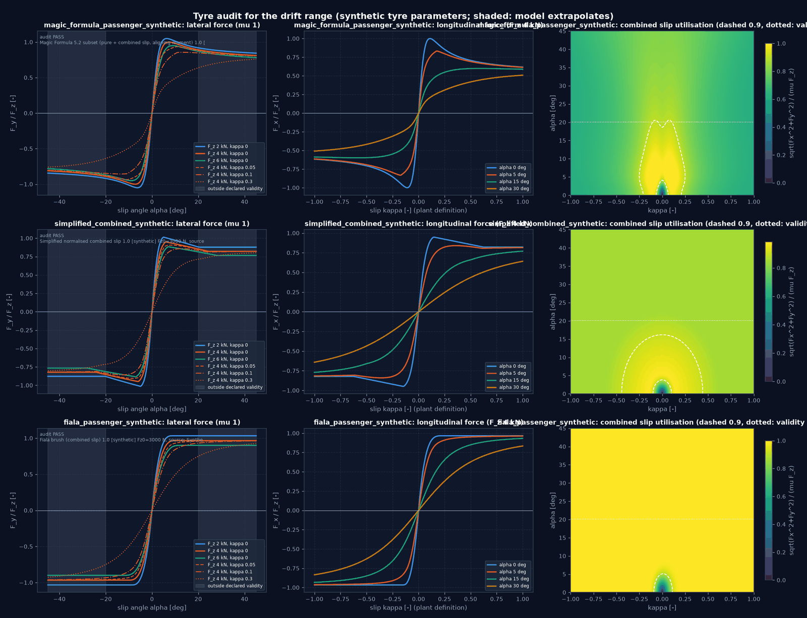

# Drift: Modellgültigkeit, Konventionen und Ausgangslage (Drift-Plan D0/D1)

Grundlage für den Drift-Regler nach `Plan_v3.md` (Drift Controller Implementierungsplan V1.0). Dieses Dokument hält fest,
auf welchem Stand, mit welchen Konventionen und innerhalb welcher Modellgrenzen gearbeitet wird. Alle Parameter sind
synthetisch; es gibt keine Aussage über ein reales Fahrzeug und keine Homologation.

## 1. Stand (D0)

| Punkt | Wert |
|---|---|
| Branch / Commit beim Start | `main`, `9a1dbf4` (lokal, nicht gepusht) |
| Planbasis | `992cc39` (29.10.2026); seither sechs lokale Commits: Split-µ-Klärung, IVMC über die gemeinsame Allokation, Mode C, Solverdiagnostik und Experimenttypen (M10), nichtlineare Stabilität (M11), robuste Regelung (M12) |
| Arbeitsbaum | uncommittete Änderungen des Nutzers an `.gitignore`, `docs/index.md`, unversioniert `Plan_v2.md`, `Plan_v3.md`, `output/`: nicht angefasst |
| Testbasis | volle Suite inkl. `slow` bei `9a1dbf4`: **607 bestanden, 2 übersprungen** (16 min) |
| Referenzlauf | `examples/seven_dof_4ws_tv_demo.py` unverändert lauffähig; Radlastsumme auf 3,6e-12 N erhalten |

Für den Drift relevante Änderungen seit der Planbasis: `SevenDOFModel.load_transfer_tol` / `load_transfer_max_iter` als
Modellattribute (M11, Standard unverändert 1e-6 m/s², 25 Iterationen); `handling_analysis/equilibrium.py` (M11:
Gleichgewichte bei gehaltener Geschwindigkeit, Jacobi-Matrix mit Schrittweitenstudie, Abgleich linear/nichtlinear);
`SlipStiffnessScaledTyre` (M11); Überwachungsschicht und Unsicherheitsmodell (M12).

## 2. Wiederverwendung (im Code geprüft)

| Teil | Ort | Schnittstelle, wie vorgefunden |
|---|---|---|
| Strecke | `vehicle_models/seven_dof.py` | `evaluate_dynamics(state, u, road) -> (dzdt, telemetry, ax, ay)`; `step(state, u, dt, road)` klemmt `u` auf die Grenzen und integriert mit RK4 und automatischer Unterteilung |
| Zustand / Eingang | `core/types.py` | `SevenDOFState(vx, vy, r, omega[4], X, Y, psi)`, Array-Reihenfolge `[vx, vy, r, ω_FL, ω_FR, ω_RL, ω_RR, X, Y, psi]`; `SevenDOFControlInput(steer_f, steer_r, T_drive[4], T_brake[4])` |
| Regler-Port | `controllers/framework.py` | `compute_control(state, target, telemetry, dt) -> ControlOutput`; `ControlTarget` hat kein Drift-Feld (Drift-Referenz bleibt eigener Typ) |
| Szenariolauf | `simulation/scenario_runner.py` | `ScenarioRunner(model, road).run(callback(t, state, telemetry) -> SevenDOFControlInput, init_state, duration, dt) -> SimulationHistory`; zeichnet den Zustand **vor** dem Schritt und die geklemmte Stellgröße auf |
| Animation | `visualization/animation.py`, `plan_view.py` | `animate_maneuver(histories, path, fps=20, ...)`; `draw_vehicle(x, y, yaw, steer_front, params, steer_rear=0, ax=...)` |
| Gleichgewicht, Linearisierung | `handling_analysis/equilibrium.py` | Grundlage für D2/D3 (Unbekannte und Nebenbedingungen dort anders: Drift hält `v` und `β`, frei sind Lenkwinkel und Hinterachsmoment) |
| Aktuatoren | `actuators/steering_actuator.py`, `powertrain_actuator.py` | Verzögerung, Raten- und Leistungsgrenzen, opt-in (D7) |
| Fahrzeug | `configs/vehicles/seven_dof_passenger.yaml` | 1200 kg, l_v 1,30 m, l_h 1,50 m, Spur 1,60 m, h_S 0,50 m; Grenzen: Lenkwinkel vorn 35°, Lenkrate 50°/s, Antrieb 1000 N·m je Rad, Bremse 3000 N·m je Rad |

## 3. Konventionen

- Achsen nach ISO 8855: x nach vorn, y nach links, z nach oben; positive Gierrate linksherum.
- `β = atan2(v_y, v_x)`, Bahnrichtung `χ = ψ + β`, `χ̇ = r + β̇`; nur stationär gilt `χ̇ = r` und `R = v/|r|`.
- Schräglaufwinkel der Strecke: `α = −atan2(v_y,w, max(|v_x,w|, 0,2 m/s))` im Radkoordinatensystem; Reifen nach ISO:
  `α > 0 → F_y > 0`.
- Längsschlupf der Strecke: `κ = (ω R − v_x,w) / max(|v_x,w|, |ω R|, 0,2 m/s)`, **auf [−1, 1] begrenzt**
  (`κ = 1`: Rad dreht, Radmitte steht relativ zur Straße). Das ist nicht der SAE-Schlupf `(ωR − v)/|v|`, der beim
  durchdrehenden Rad unbeschränkt wächst; Kennfelder und Berichte verwenden durchgehend die Streckendefinition.
- Radreihenfolge FL, FR, RL, RR; Antriebsmoment positiv vorwärts, Bremsmoment ≥ 0 gegen die Drehrichtung
  (`tanh(ω/0,5)`-geglättet).

## 4. Modellgrenzen für den Drift

- Ebene Bewegung, quasistatische Radlastverlagerung (Fixpunkt), keine Feder-/Dämpferdynamik; 14-DOF erst zur
  Plausibilisierung.
- Reifen stationär (Relaxation nur im `TransientSevenDOFModel`); Parameter synthetisch.
- Erklärte Gültigkeit des MF-Reifens: `|α| ≤ 0,35 rad` (20°), `|κ| ≤ 1`. Driftwinkel von 15–25° führen an der
  Hinterachse an oder über diese Grenze: Dort **extrapoliert** das Modell (D1-Audit, Abschnitt 6). Ergebnisse jenseits
  davon werden gekennzeichnet (`drift.extrapolating`).
- Der MF-Reifen überträgt bei kleiner Last bis 1,05 µF_z (Lastempfindlichkeit), bei großer Last weniger als µF_z.
- Keine Motordrehzahl- oder Leistungsgrenze in der Strecke selbst (nur das Moment je Rad); der Antriebsaktuator mit
  Leistungsgrenze ist opt-in.
- Regularisierung bei kleiner Geschwindigkeit (0,2 m/s) und der Bremsglättung: Drift unterhalb weniger m/s ist nicht
  aussagekräftig.

## 5. Deterministische Auswertung (D1, Plan 1.2)

`SevenDOFModel.evaluate_dynamics` startet die Lastverlagerungsiteration mit `_accel_guess` und überschreibt ihn. Gemessen:
Dieselbe Ableitung (Driftzustand `v_x` 15 m/s, `v_y` −4 m/s, `r` 0,6 rad/s, Hinterachsmoment 600 N·m) unterscheidet
sich um **1,6e-7** je nachdem, welcher Zustand vorher ausgewertet wurde. Für Nullstellensuche und Differenzen ist das
eine Reihenfolgeabhängigkeit.

`drift.DeterministicPlant` wertet dieselbe Strecke ohne diese Nebenwirkung aus: eigene flache Kopie des Modells (das
Modell des Aufrufers bleibt unverändert), Startwert vor jeder Auswertung fest zurückgesetzt, Toleranz 1e-12 m/s² (bis
500 Iterationen). Ergebnis: gleiche Eingaben liefern **bitgleiche** Ableitungen in jeder Reihenfolge (Test).
Nichtkonvergenz der Lastverlagerung steht in jedem Ergebnis (`load_transfer_converged`), wird gezählt und im strengen
Modus als Ausnahme gemeldet. Kräfte entstehen ausschließlich in `evaluate_dynamics`.

## 6. Reifenaudit (D1, Plan 4.4)

`drift.audit_tyre` wertet jeden Reifen bis ±45° Schräglauf und `|κ| ≤ 1` aus (Plots: `output/drift/tyre_audit/`,
`python examples/drift_tyre_audit.py`). Ergebnis für die mitgelieferten Reifen:

| Prüfung | MF (synthetisch) | Simplified Combined | Fiala |
|---|---|---|---|
| endlich (auch µ = 0, F_z = 0, ±89°) | ja | ja | ja |
| Vorzeichen F_y(α), F_x(κ) | ja | ja | ja |
| Symmetrie F_y | ja | ja | ja |
| Symmetrie F_x | ja | ja | nein (0,074 µF_z): Bürstenmodell mit theoretischem Schlupf κ/(1+κ), gewollt |
| Stetigkeit (Stufenverhältnis feines/grobes Gitter, stetig ≈ 0,1) | 0,10 | 0,10 | 0,11 |
| max. Ausnutzung √(F_x²+F_y²)/(µF_z), F_z 2/4/6 kN | 1,05 / 1,00 / 0,96 | 1,02 / 0,95 / 0,88 | 1,03 / 0,97 / 0,90 |
| Seitenkraftmaximum bei F_z 2/4/6 kN | 6,5° / 7,5° / 9,0° | 5,0° / 6,0° / 7,0° | 9,0° / 10,5° / 34,5° |
| Seitenkraft bei 45° / Maximum | 0,80–0,82 | 0,87 | 1,0 (kein Abfall) |
| Anteil des Prüfgitters außerhalb der erklärten Gültigkeit | 55 % von α | 55 % | 55 % |

Folgerungen für den Drift:

- Der MF-Reifen hat nach dem Maximum einen moderaten Seitenkraftabfall (auf 80 % bei 45°): Das ist die Eigenschaft, auf
  der ein stationärer Drift mit gesättigter Hinterachse beruht. Fiala hat keinen Abfall; ein Drift mit Fiala ist eine
  Sensitivitätsvariante, kein Beleg.
- Kombinierter Schlupf schwächt stark: Bei α = 30° erreicht F_x des MF-Reifens selbst bei κ = 1 nur etwa 0,5 F_z.
  Das begrenzt das Hinterachsmoment, das ein Drift in Längskraft umsetzen kann.
- Die Reifen wurden **nicht** verändert, um einen Drift zu ermöglichen.

## 7. Reproduktion

```bash
python -m pytest tests/vehicle_model/drift -q          # D1-Tests
python examples/drift_tyre_audit.py                     # Kennfelder und Audit (PNG, JSON)
python -m pytest -q                                      # volle Suite (Testbasis)
```

---

<!-- figures:start -->

## Ergebnisbilder

> Alle Bilder sind Simulationsergebnisse mit synthetischen Parametern, keine Messungen. Neu erzeugen: Quellskript ausführen, dann `python tools/publish_doc_figures.py`.



*Reifenaudit bis ±45° Schräglauf: Seitenkraft (grau: außerhalb der erklärten Gültigkeit), Längskraft und Ausnutzung im kombinierten Schlupf für MF, Simplified Combined und Fiala. Quelle: `python examples/drift_tyre_audit.py`.*

<!-- figures:end -->
