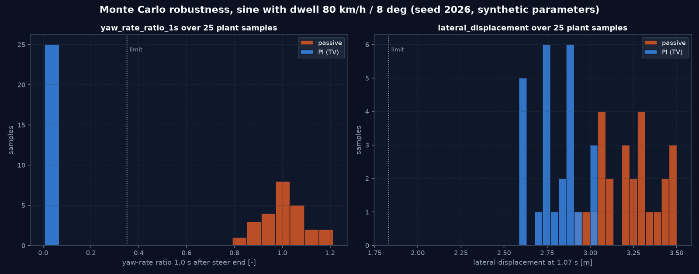

# Virtuelle Sensorik, Zustandsschätzung und Robustheit

Module:
- [`estimation/sensors.py`](../src/vehicle_model/estimation/sensors.py), [`estimation/blended_sideslip.py`](../src/vehicle_model/estimation/blended_sideslip.py)
- [`simulation/estimation_study.py`](../src/vehicle_model/simulation/estimation_study.py), [`controllers/estimated_feedback.py`](../src/vehicle_model/controllers/estimated_feedback.py), [`simulation/robustness.py`](../src/vehicle_model/simulation/robustness.py)

Die bestehenden Bausteine sind beschrieben in [STATE_ESTIMATION.md](STATE_ESTIMATION.md): EKF, RLS-Reibwertschätzer und PSO.

**estimation robustness-Abnahme:** Beobachter besitzen keinen unerlaubten Ground-Truth-Zugriff; Robustheitsversuche sind wiederholbar und dokumentieren ihre Streuungen sowie Grenzverletzungen.

---

## 1. Virtuelle Sensoren

Signalkette je Aufruf:

1. **Abtastung:** Halteglied mit Sensorrate (`sample_period`).
2. **Verfälschung:** Bias mit Random Walk, weißes Rauschen, Quantisierung von Raddrehzahl und Lenkwinkel, Verzögerung erster Ordnung des Lenkwinkelsensors (`steer_lag_tau`).
3. **Latenz:** FIFO-Totzeit (`latency`).
4. **Ausfall:** je Kanal geplant (`outages`) oder zufällig (`dropout_probability`). Der letzte gültige Wert wird gehalten und in `valid` als ungültig markiert.

Alle Zufallsgrößen kommen aus einem geseedeten Generator. Mit den Standardwerten entspricht das Modell exakt dem bisherigen, einschließlich der Zufallsfolge.

*Befund:* Das Modul behauptete eine Latenz und die YAML ein `lag_tau`, beides war nicht implementiert. Das ist behoben.

## 2. Informationszugriff

Jeder Beobachter deklariert `information`:

| Beobachter | Zugriff |
|---|---|
| `EKFSideslipObserver` | `sensors_only` |
| `KinematicSideslipObserver` (neu) | `sensors_only` |
| `BlendedSideslipObserver` (neu) | `sensors_only` |
| `RoadFrictionEstimator` | `ground_truth_tyre_forces`: liest Reifenkräfte, Schlüpfe und Radlasten aus der Telemetrie. Kein Fahrzeugsensor liefert diese Größen; der Schätzer ist deshalb eine Referenz mit idealer Information, kein realisierbarer Schätzer. |

`run_estimation_study` übergibt Beobachtern ausschließlich `SensorMeasurements` (ohne Positionen, Schwimmwinkel, Schlüpfe oder Kräfte) und weist Beobachter ohne `sensors_only` ab. Die Wahrheit nutzt nur die Fehlermetrik. `EstimatedStateFeedback` speist einen beliebigen Regler mit $v_x$ und $v_y$ aus dem Beobachter und der gemessenen Gierrate.

### 2.1 Betriebsarten A, B, C

| Mode | Umsetzung | Regler erhält | `information` |
|---|---|---|---|
| A – Ideal Feedback | Regler ohne Hülle | wahrer Zustand und Telemetrie der Strecke | `full_state_ideal` |
| B – Estimated Motion State | `EstimatedStateFeedback(..., mode="B")` | $v_x$, $v_y$ aus dem Beobachter, gemessene Gierrate; Allokation und Schlupfregelung weiter mit Telemetrie | `estimated_motion_state; …` |
| C – Sensor-Constrained | `EstimatedStateFeedback(..., mode="C")` | wie B; statt der Telemetrie eine **Sensor-Telemetrie** aus `SensorFrictionEstimator.as_telemetry`: Radlasten quasi-statisch aus gemessenen Beschleunigungen, Längskräfte aus Raddynamik und den *eigenen* Momentenbefehlen, Seitenkräfte aus der Einspurbilanz nach Last aufgeteilt, Schlüpfe aus Geschwindigkeitsreferenz und Schwimmwinkelschätzung, Reibwert geschätzt | `sensor_constrained; …` |

In Mode C erreicht nichts von der Strecke den Regler außer über das Sensormodell; ein Test mit einem aufzeichnenden Regler prüft, dass das Telemetrieobjekt der Strecke nie durchgereicht wird. Beobachter und Reibwertschätzer starten in Mode B und C mit der Geschwindigkeit aus der ersten Raddrehzahlmessung (mittlere zwei Räder), nicht mit der wahren Geschwindigkeit; bis zur state estimation-Abnahme erhielten EKF und Reibwertschätzer hier den wahren Wert (behoben, Test). Vor der Initialisierung der Geschwindigkeitsreferenz erhält der Regler `None` und rechnet mit Nennlasten und `target.mu_estimated`. In YAML-Experimenten: `feedback: ideal | estimated | sensor_constrained` (`estimated_state: true` bleibt als Kurzform für `estimated` gültig).

**Gemessene Kosten** (synthetisches Fahrzeug, Sensorrauschen und Gyro-Offset nach den Standardwerten von `SensorConfig`, Seed 3):

| Regler | Szenario | Kennwert | A | B | C |
|---|---|---|---|---|---|
| PI (TV) | Sine with Dwell 80 km/h | Gierratenverhältnis 1 s / Querversatz | 0,008 / 3,12 m | 0,007 / 3,04 m | 0,007 / 3,25 m |
| PI (TV) | Vollbremsung Eis (µ 0,2) aus 90 km/h | Bremsweg / Gierwinkel / max. Schlupf | 151 m / 0,0° / 0,03 | 175 m / −5,2° / 0,03 | 192 m / −6,0° / 0,21 |
| PI (TV) | Split-µ-Vollbremsung 90 km/h | Bremsweg / Gierwinkel / Querversatz | 151 m / 0,0° / 0,01 m | 172 m / −5,1° / 5,6 m | 233 m / −6,2° / 9,9 m |
| IVMC | Sine with Dwell 80 km/h | Gierratenverhältnis 1 s / Querversatz | 0,000 / 3,43 m | 0,006 / 3,38 m | 0,006 / 3,37 m |
| IVMC | Vollbremsung Eis | Bremsweg / Gierwinkel / max. Schlupf | 151 m / 0,0° / 0,03 | 230 m / −2,5° / 0,03 | 190 m / −2,3° / 0,97 |
| IVMC | Split-µ-Vollbremsung 90 km/h | Bremsweg / Gierwinkel / Querversatz | 132 m / 6,6° / 0,61 m | 158 m / −1,8° / 2,1 m | 177 m / 0,1° / 2,3 m |

Befunde:

1. **Gyro-Offset (Mode B und C).** Der Drehratensensor hat 0,45°/s Offset. Der Gierregler regelt diese scheinbare Gierrate mit einem echten Giermoment aus: Bei der Eisbremsung dreht das Fahrzeug um −5°. Ohne Offset 0,35°, ohne Offset und Rauschen 0,0° und 151 m. Das Rauschen kostet weitere 15 m Bremsweg, weil das Gesetz es in Giermomentwünsche umsetzt und die Allokation dafür Bremskraft abgibt. Offset-Kompensation (Stillstand, Geradeausfahrt) und Totzone fehlen; das ist ein Schätz- und Robustheitsthema für robust control.
2. **Reibwert auf Eis überschätzt (Mode C).** Der Schätzer liefert 0,30–0,47 auf µ = 0,2. Die Schlupfregelung wählt danach einen zu großen Sollschlupf und bremst bei ≈ 0,11 statt 0,03 Schlupf, jenseits des Kraftmaximums: weniger Verzögerung.
3. **Geschwindigkeitsreferenz** (Mode C): bei Dauerbremsung aller Räder nur über die integrierte Längsbeschleunigung gestützt; im PI-Fall bis zu 2,7 m/s über der wahren Geschwindigkeit (die bekannte Beobachtbarkeitsgrenze, Abschnitt 3a).
4. **Blockieren unter ≈ 14 km/h** (IVMC, Mode C): Schlupf bis 0,97 bei 2–4 m/s, darüber 0,07–0,12. Die Schlupfnormierung und die Referenz werden bei kleiner Geschwindigkeit ungenau.

Mode C ist damit strukturell erfüllt (keine undeklarierten Ground-Truth-Zugriffe) und stabil im Sine with Dwell, aber merklich schwächer beim Bremsen. Diese Fälle sind dokumentiert und nicht weggerechnet.

## 3. Schwimmwinkelschätzung

Sine with Dwell, 80 km/h, Referenzfahrzeug mit MF-Reifen, Standard-Sensorrauschen. Schätzfehler als RMS / Maximum in Grad:

| Fall | EKF (lineare Reifen) | kinematisch | gemischt |
|---|---|---|---|
| 4°, µ 1,0 (linear) | **0,23** / 0,71 | 1,08 / 1,95 | 0,46 / 0,70 |
| 6°, µ 1,0 | 1,31 / 4,0 | 1,13 / 2,03 | **0,63** / 0,99 |
| 4°, µ 0,5 (rutscht, β bis 52°) | 24,8 / 51 | **0,96** / 1,85 | 1,18 / 2,16 |
| 8°, µ 1,0 (dreht sich ein) | 29,7 / 53 | 1,26 / 4,69 | **1,19** / 4,38 |

- **Modellbasiert** (EKF): im linearen Bereich am besten; im Grenzbereich falsch, weil seine linearen Reifenkräfte weiter wachsen.
- **Kinematisch** ($\dot v_y = a_y - r v_x$): funktioniert im Grenzbereich, driftet aber mit dem Sensor-Bias.
- **Gemischt:** integriert kinematisch und zieht zur EKF-Schätzung, solange ein Linearitätsgewicht $w$ aus $|a_y|$ und der Abweichung der Gierrate von der linearen Gierantwort das zulässt. Mit dem gewählten $K$ = 2 s⁻¹ bleibt der Fehler in allen vier Fällen unter 1,2° RMS. Größere $K$ verbessern den linearen Fall ($K$ = 10: 0,27°), lassen aber im Grenzbereich das falsche Modell durch ($K$ = 10: 1,81° bei µ 0,5).

*Befund:* Die fest eingestellten EKF-Steifigkeiten (85/95 kN/rad) schätzen besser als die aus dem Reifen linearisierten (149/116 kN/rad; 0,23° gegen 0,54°). Die lineare Reifenkennlinie überschätzt die Kraft bei größerem Schlupf, eine kleinere Sekantensteifigkeit passt deshalb besser.

**Geschlossener Kreis mit Beobachter** (Sine with Dwell 8°, Fahrzeug mit K&C): Gierratenverhältnis 1,0 s nach Lenkende.

| Regler | ideale Rückführung | Sensoren und gemischter Beobachter |
|---|---|---|
| PI | 0,006 | 0,010 |
| GS-LQR (4WS+TV) | 0,002 | 0,021 |

Beide halten den Grenzwert 0,35 weiterhin deutlich ein.

## 3a. Sensorbasierte Reibwertschätzung

[`estimation/sensor_friction.py`](../src/vehicle_model/estimation/sensor_friction.py), `information = "sensors_only"`. Eingänge: Sensormessungen, die vom Regler **kommandierten** Radmomente, eine Schwimmwinkelschätzung (optional) und nominelle Fahrzeugdaten. Keine Reifenkräfte, Schlüpfe, Radlasten oder Reibwerte aus der Simulation.

1. **Fahrzeuggeschwindigkeit:** integriertes $a_x$, einseitig an die Raddrehzahlen gebunden.
   - Ohne Antrieb ist das Fahrzeug mindestens so schnell wie das schnellste Rad.
   - Mit Antrieb ist es höchstens so schnell wie das langsamste Rad.
   - Initialisierung über frei rollende Räder (`reset(init_vx)`).
2. **Radlängskraft** aus der Raddrehdynamik: $F_x = (T_\text{an} - T_\text{br} - I_w\dot\omega - d\,\omega)/R$, mit gefilterter Ableitung der gemessenen Raddrehzahl.
3. **Radlasten** quasistatisch aus gemessenem $a_x$ und $a_y$; **Achsseitenkräfte** aus $m a_y$ und $I_z \dot r$.
4. **µ** durch Inversion eines nominellen Bürstenmodells (Fiala, nicht der Streckenreifen). Gewichtet wird mit der normierten Empfindlichkeit $(\mu/F_z)\,\partial F/\partial\mu$. Verwendet werden Abtastwerte nur oberhalb von Schwellen für Empfindlichkeit, Ausnutzung und theoretischen Schlupf. Der Schätzwert fällt nie unter die beobachtete Ausnutzung.

**Ergebnisse** (MF-Strecke, Standard-Sensorrauschen, ABS-Bremsung aus 90 km/h):

| Straße | µ̂ vorn | µ̂ hinten | Konfidenz | Fehler $v_\text{ref}$ |
|---|---|---|---|---|
| µ 1,0 | 0,99 / 0,98 | 1,15 / 1,11 | 1,0 | 0,15 m/s |
| µ 0,6 | 0,61 / 0,60 | 0,69 / 0,68 | 1,0 | 0,16 m/s |
| µ 0,3 | 0,32 / 0,32 | 0,37 / 0,37 | 1,0 | 0,16 m/s |
| µ 0,3, Konstantfahrt (keine Anregung) | Prior 1,0 | Prior 1,0 | **0,0** | – |

Hinten liegt der Schätzwert höher. Das ist teilweise physikalisch: Die Spitzenreibung des MF-Reifens liegt bei der geringen Hinterachslast unter Bremsung über µ.

Auf Split-µ (1,0/0,3 und 0,6/0,2, mit der Stabilitätsregelung aus Schlupfregelung und Allokation) ergeben die konfidenzgewichteten Seitenwerte 0,87/0,33 bzw. 0,61/0,25; Split-µ wird erkannt.

**Grenzen der Identifizierbarkeit:**
- **Linearer Reifenbereich:** Die Kraft hängt nicht von µ ab, es gibt keine Aussage (Konfidenz 0).
- **Kaum genutztes Rad:** Das Rad vorn auf der griffigen Seite bei Split-µ erhält nur wenige, durch Drehzahlrauschen verzerrte Abtastwerte. Sein Einzelwert ist falsch niedrig (0,14), aber mit niedriger Konfidenz (0,2–0,4). Abnehmer müssen die Konfidenz verwenden.
- **Dauerhafte Bremsung aller Räder:** Kein Rad rollt frei, $v_\text{ref}$ beruht nur auf dem integrierten $a_x$ (physikalische Beobachtbarkeitsgrenze).
- **Start mit schlupfenden Rädern:** Wird ohne Initialisierung schon im ersten Schritt gebremst, startet $v_\text{ref}$ nicht. Ein erster Ansatz begann sonst 3 m/s zu niedrig.

Tests: [test_sensor_friction.py](../tests/vehicle_model/test_sensor_friction.py) mit 10 Fällen: Deklaration, Bürstenformel = `FialaTyre`, Inversion, keine Aussage ohne Anregung, ABS-Bremsung bei drei Reibwerten, Split-µ, kein Start aus schlupfenden Rädern.

## 4. Robustheitsstudien (Monte Carlo)

`run_monte_carlo` zieht n Parameterstichproben mit einem geseedeten Generator, baut je Stichprobe eine frische Strecke, fährt ein Szenario und liefert:
- die Stichprobentabelle,
- Statistiken je Kennzahl: Mittelwert, Standardabweichung, Minimum, 5/50/95-%-Perzentil, Maximum,
- Grenzverletzungen mit Anzahl, Quote und den verletzenden Stichproben.

Gleicher Seed, gleiche Ergebnisse; ausgenommen sind die gemessenen Rechenzeiten (Wanduhr).

**Beispiel** (`examples/monte_carlo_robustness.py`, Seed 2026, 25 Stichproben): Sine with Dwell 8°.

Variationen:
- Masse N(1; 0,05), Gierträgheit gleich skaliert
- Schwerpunktlage N(0; 3 cm)
- Schräglaufsteifigkeit vorn und hinten je N(1; 0,08)
- Reibwert U(0,8; 1,0)

| | Verletzungen Verhältnis 1,0 s ≤ 0,35 | Verletzungen 1,75 s ≤ 0,20 | Querversatz ≥ 1,83 m | Verhältnis 1,0 s (p5 / p50 / p95) | max. Schwimmwinkel (p5 / p95) |
|---|---|---|---|---|---|
| passiv | 25/25 | 25/25 | 0/25 | 0,89 / 0,99 / 1,18 | 57° / 75° |
| PI | **0/25** | **0/25** | 0/25 | 0,007 / 0,009 / 0,010 | 1,8° / 2,8° |

Offline-PSO zur Parameterabstimmung bestand bereits (`estimation/pso_optimizer.py`, mit Test und Demo).

## 5. Verifikation

| Test | Prüfung |
|---|---|
| [test_sensor_timing.py](../tests/vehicle_model/test_sensor_timing.py) | Standardwerte reichen die Wahrheit durch; Latenz verzögert alle Kanäle exakt; Abtast-Halte-Verhalten; Lenkwinkelverzögerung erster Ordnung; geplanter Ausfall hält und markiert; Zufallsausfall wiederholbar mit konfigurierter Quote; Messcontainer ohne Ground-Truth-Felder |
| [test_estimation_and_robustness.py](../tests/vehicle_model/test_estimation_and_robustness.py) | Informationsdeklarationen und Signatur `update(meas, dt)`; Studie und Rückführung weisen Ground-Truth-Beobachter ab; EKF linear besser, im Grenzbereich > 10° Fehler; gemischter Beobachter < 1,3° RMS in allen vier Fällen; Wiederholbarkeit; Monte-Carlo-Wiederholbarkeit, Seed-Abhängigkeit und Verletzungszählung; Regler mit Beobachter hält die Grenzwerte |

## 6. Grenzen

- Das Linearitätsgewicht nutzt feste Schwellen, keine Reibwertschätzung.
- Der Reibwertschätzer bleibt eine Ideal-Referenz. Ein sensorbasierter Ersatz würde Radkräfte aus der Raddrehdynamik und die Radlasten aus den Beschleunigungen schätzen; das ist offen.
- In der Rückführung nutzen Allokation und ABS/TCS weiter die Telemetrie (Radlasten, Reibwert).
- Kein UKF (laut Plan optional).
- Die Monte-Carlo-Studie variiert Streckenparameter; Aktuatorverzögerungen und Sensorfehler sind noch keine Variationsgrößen.

---

<!-- figures:start -->

## Ergebnisbilder

> Alle Bilder sind Simulationsergebnisse mit synthetischen Parametern, keine Messungen. Neu erzeugen: Quellskript ausführen, dann `python tools/publish_doc_figures.py`.

*Monte Carlo über 25 Streckenstichproben (Seed 2026), Sine with Dwell 80 km/h: Gierratenverhältnis 1 s nach Lenkende und Querversatz, passiv gegen PI (TV), mit den nach FMVSS 126 nachgebildeten Grenzen. Quelle: `examples/monte_carlo_robustness.py`.*

<!-- figures:end -->
