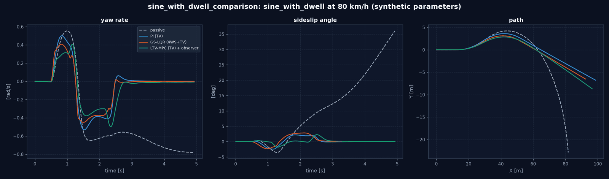
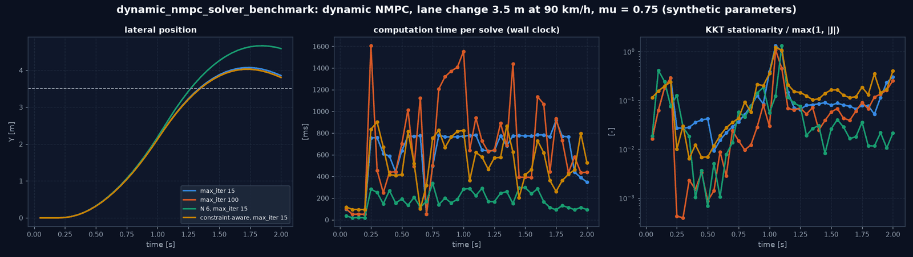

# Virtuelles Versuchslabor: YAML-Experimente, Verifikation, Berichte und CI (M9)

Paket: [`src/vehicle_model/experiments/`](../src/vehicle_model/experiments/). Beispiele: [`configs/experiments/`](../configs/experiments/).

**M9-Abnahme:** Ein Anwender wählt über YAML Fahrzeug, Reifenmodell, Fahrmanöver, Regler und Fahrbahnmodell, führt die Simulation reproduzierbar aus und erhält ein vollständiges Vergleichs- und Verifikationsergebnis.

---

## 1. Nutzung

```bash
python -m vehicle_model.experiments list                       # vorhandene Experimente
python -m vehicle_model.experiments validate configs/experiments/*.yaml
python -m vehicle_model.experiments run configs/experiments/sine_with_dwell_comparison.yaml
python -m vehicle_model.experiments run <spec.yaml> --out <Verzeichnis> [--no-verification]
```

Rückgabecode: 0 bei Erfolg, 1 bei ungültiger Spezifikation (`validate`), 2 bei fehlgeschlagener Modellverifikation (`run`).

## 2. Spezifikation

### 2.0 Experimenttypen (V3.0 §12)

Der Schlüssel `type` wählt den Experimenttyp; ohne ihn gilt `controller_comparison` (das M9-Format, alle vorhandenen Spezifikationen bleiben gültig). Jeder Typ prüft sein eigenes Schema und führt sich selbst aus; gemeinsam sind Herkunftsangaben, Ausgabeverzeichnis, `results.json` und die CLI ([`types.py`](../src/vehicle_model/experiments/types.py)).

| Typ | Modul | Inhalt |
|---|---|---|
| `controller_comparison` | [`spec.py`](../src/vehicle_model/experiments/spec.py), [`runner.py`](../src/vehicle_model/experiments/runner.py) | Regler auf einem Manöver, optional Sweep (Abschnitte 2–3) |
| `solver_benchmark` | [`solver_benchmark.py`](../src/vehicle_model/experiments/solver_benchmark.py) | Varianten des dynamischen NMPC auf einem Spurwechsel: Statusanteile, KKT-Residuen, Verbesserung ggü. Warmstart, Iterationen, Rechenzeit, Planzulässigkeit, Folgegüte (Abschnitt 2.1) |
| `equilibrium_analysis` | [`equilibrium_analysis.py`](../src/vehicle_model/experiments/equilibrium_analysis.py) | Nichtlineare Gleichgewichte über einem Sweep (optional Kurvenschar): Residuen, Jacobi-Matrix mit Schrittweitenstudie, Eigenwerte, Moden, Vergleich linear/nichtlinear (Abschnitt 2.3, [NONLINEAR_STABILITY.md](NONLINEAR_STABILITY.md)) |
| `stability_map` | [`stability_map.py`](../src/vehicle_model/experiments/stability_map.py) | Rückführregionen je Regler im (β, r)-Raum mit Klassifikationssicherheit, Gitter-, Schrittweiten- und Dauerstudie, Phasenporträts, Grenzfälle, heuristische Phase-Plane-Grenze als Vergleich (Abschnitt 2.4) |

Schnittstelle eines Typs: `parse(data, source) -> spec` (unveränderlich, `spec.kind` = Typname), `run(spec, out_dir, verify) -> summary` (mindestens `experiment`, `source`, `provenance`, `verification`, `results`), `describe(spec)` für `list`. Ein unbekannter Typ ist ein Fehler. Die übrigen Typen aus §12 (`monte_carlo`, …) kommen mit ihren Meilensteinen.

### 2.1 `solver_benchmark`

```yaml
type: solver_benchmark
name: dynamic_nmpc_solver_benchmark
vehicle: configs/vehicles/seven_dof_passenger.yaml
road: {type: uniform, mu: 0.75}
manoeuvre: {type: lane_change, speed_kph: 90, offset_m: 3.5, start_s: 0.2, duration_s: 2.0}
control_dt: 0.05
base: {N: 10, max_iter: 15, max_steer_rear_deg: 8, max_yaw_moment_nm: 3500, w_kamm_circle: 80}
variants:
  - {name: "max_iter 15"}
  - {name: "max_iter 100", max_iter: 100}
  - {name: "N 6, max_iter 15", N: 6}
```

Schlüssel in `base` und `variants` sind Felder von `DynamicNMPCConfig`; Winkel auch in Grad (`_deg`, `_degps`). Unbekannte Felder, falsche Typen und doppelte Angaben (Grad und Bogenmaß) werden abgewiesen. Ausgaben: `results.json`, `kpis.csv`, `histories/<variante>.csv` (je Schritt Status, Iterationen, Rechenzeit, KKT, Verbesserung, Zulässigkeit), `solver_benchmark.png`, `report.md`.

Ergebnis des Beispiels (Spurwechsel 3,5 m, 90 km/h, µ = 0,75, 40 Schritte):

| Variante | nominal / suboptimal / degraded | KKT relativ Median / Max | Rechenzeit Mittel / Max | Querfehler Ende | Überschwingen |
|---|---|---|---|---|---|
| `max_iter` 15 | 42 / 35 / 22 % | 0,08 / 1,3 | 0,62 / 0,80 s | 0,36 m | 0,57 m |
| `max_iter` 100 | 100 / 0 / 0 % | 0,05 / 1,1 | 0,70 / 1,6 s | 0,31 m | 0,53 m |
| N 6, `max_iter` 15 | 80 / 20 / 0 % | 0,03 / 1,3 | 0,18 / 0,33 s | 1,09 m | 1,16 m |

Lesart: Mehr Iterationen machen alle Lösungen `nominal`, ändern aber Folgegüte und KKT-Residuen kaum (Abbruch über die relative Kostenänderung, MOTION_CONTROL.md 3.2). Der kürzere Horizont rechnet 3,5-mal schneller und ist ebenso „gut gelöst“, regelt aber deutlich schlechter (1,2 m Überschwingen): Lösungsgüte des Optimierers und Güte der Regelung sind getrennte Aussagen. Alle Varianten überschwingen um mindestens 0,5 m. Rechenzeiten sind Wanduhrzeiten dieses Rechners; alles andere ist reproduzierbar (Test).

### 2.2 `controller_comparison`

```yaml
name: sine_with_dwell_comparison
vehicle: configs/vehicles/reference_passenger_car.yaml
tyres: {front: magic_formula_passenger_synthetic, rear: magic_formula_passenger_synthetic}   # optional
kc: configs/suspension/kc_reference_passenger_car.yaml                                       # optional
road: {type: uniform, mu: 1.0}               # oder {type: split_mu, mu_left: 1.0, mu_right: 0.2}
manoeuvre: {type: sine_with_dwell, speed_kph: 80, amplitude_deg: 8}
controllers:
  - {law: passive}
  - {law: pi}                                 # Giermoment (TV)
  - {law: gs_lqr, inputs: 4ws_tv}             # Hinterachslenkung + Giermoment
  - {law: ltv_mpc, inputs: tv, estimated_state: true}   # Rückführung über Sensoren und Beobachter
sweep: {parameter: manoeuvre.speed_kph, values: [60, 80, 100]}   # optional
dt: 0.005
seed: 0
verification: true
outputs: {directory: output/experiments/x, formats: [csv, json, png, md]}   # gif optional
```

| Abschnitt | Werte |
|---|---|
| `road.type` | `uniform` (`mu`), `split_mu` (`mu_left`, `mu_right`) |
| `manoeuvre.type` | `step_steer` (`speed_kph`, `steer_deg`, `duration_s`), `sine_with_dwell` (`speed_kph`, `amplitude_deg`), `split_mu_braking` (`speed_kph`) |
| `controllers[].law` | `passive`, `pi`, `lqr`, `gs_lqr`, `ltv_mpc` |
| `controllers[].inputs` | `tv`, `4ws_tv` (nicht für `pi`) |
| `controllers[].feedback` | `ideal` (Mode A, Standard), `estimated` (Mode B: Bewegung aus Sensoren und Beobachter), `sensor_constrained` (Mode C: zusätzlich Radlasten, Kräfte, Schlüpfe und Reibwert aus Sensoren); siehe ESTIMATION_ROBUSTNESS.md 2.1 |
| `controllers[].estimated_state` | Kurzform: `true` = `feedback: estimated` |
| `sweep.parameter` | `manoeuvre.<Schlüssel>` oder `road.<Schlüssel>`; jeder Punkt wird einzeln validiert |

Die Validierung ist streng: Unbekannte Schlüssel, unbekannte Werte, fehlende Dateien und Werte außerhalb der Grenzen führen zu einem `ValueError` mit dem betroffenen Pfad. Ein Tippfehler fällt so nie still auf einen Standardwert zurück.

### 2.3 `equilibrium_analysis`

```yaml
type: equilibrium_analysis
name: equilibrium_steer_sweep
vehicle: configs/vehicles/seven_dof_passenger.yaml
road: {type: uniform, mu: 1.0}
operating_point: {speed_kph: 90}             # auch steer_deg, rear_steer_ratio, tv_yaw_moment_nm, drive_split, brake_torque_nm
sweep: {parameter: steer_deg, values: [0, 0.5, 1, 1.5, 2, 2.5, 3, 4, 5]}
series: {parameter: mu, values: [1.0, 0.6]}  # optional: eine Kurve je Wert
search_all: true                             # alle Gleichgewichte aus einem Startraster, sonst nur der Hauptast
linear_check: main                           # main | all | none
```

Variierbar in `sweep` und `series`: `speed_kph`, `steer_deg`, `rear_steer_ratio`, `tv_yaw_moment_nm`, `mu`,
`cornering_scale_front`, `cornering_scale_rear` (Schräglaufsteifigkeit, Reibungsmaximum bleibt) und `cog_shift_m`
(Schwerpunkt nach vorn). `model: transient` analysiert das Modell mit Reifenrelaxation, `kc` die K&C-Achsen (nicht
zusammen mit `cog_shift_m`). Ausgaben: `results.json`, `equilibria.csv`, `equilibria.png`, `eigenvalues.png`,
`report.md` mit den Prüfungen der Analyse (Residuen, Konvergenz der Jacobi-Matrix, Übereinstimmung linear/nichtlinear;
Punkte ohne Gleichgewicht als Information mit dem erreichten Residuum).

### 2.4 `stability_map`

```yaml
type: stability_map
name: stability_map_cornering
vehicle: configs/vehicles/seven_dof_passenger.yaml
road: {type: uniform, mu: 0.6}
operating_point: {speed_kph: 80, steer_deg: 1.0}
grid: {beta_deg: [-20, 20, 15], r_degps: [-45, 45, 15]}      # [min, max, Punkte]
simulation: {dt: 0.01, duration_s: 6.0}
controllers: [passive, esc, 4ws, tv, ivmc, ivmc_no_phase_plane]
portraits: {controllers: [passive, tv, ivmc], points: 5}
```

Optional: `criteria` (Zielbereich, Haltezeit, Verlustkriterium, Einschwinggrenzen), `uncertainty` (`dt_factor`,
`duration_factor`, `refine`), `workers` (ohne Angabe: Kernzahl − 1, höchstens 8). Ausgaben: `results.json`,
`map.csv` (je Regler und Anfangszustand Klasse, Sicherheit, Endzustand, heuristischer Index), `stability_maps.png`,
`region_comparison.png`, `phase_portraits.png`, `limit_cases.png`, `report.md`. Klassen und Unsicherheitsmaße:
[NONLINEAR_STABILITY.md](NONLINEAR_STABILITY.md), Abschnitt 3.

## 3. Ablauf und Ergebnisse

1. **Modellverifikation** am konfigurierten Fahrzeug, mit seinen Reifen und K&C ([`verification.py`](../src/vehicle_model/experiments/verification.py)):
   - Parameterkonsistenz,
   - statische Radlasten,
   - Reifensymmetrie (keine Seitenkraft bei α = 0),
   - stationäre Gierrate gegen das lineare Eigenlenkbudget (≤ 1 %),
   - Spiegelsymmetrie,
   - Determinismus.
2. **Vergleich:** je Sweep-Punkt jeder Regler auf einer frischen Strecke, über den Benchmark aus M6.
3. **Ausgaben:**

| Datei | Inhalt |
|---|---|
| `results.json` | Spezifikation, Verifikation, Kennzahlen je Punkt und Regler, Herkunft (Git-Commit, Python-, numpy- und scipy-Version, Zeitstempel) |
| `kpis.csv` | eine Zeile je Punkt und Regler |
| `histories/*.csv` | Zeitverläufe: t, X, Y, ψ, $v_x$, r, $r_\text{ref}$, β, Lenkwinkel, Giermoment angefordert und erzeugt |
| `<punkt>.png` | Gierrate, Schwimmwinkel, Bahn je Regler |
| `<punkt>.gif` | Draufsicht-Animation aller Regler (Format `gif`, optional) |
| `report.md` | Engineering-Bericht: Aufbau, Verifikationstabelle mit PASS/FAIL, Kennzahltabellen, Informationszugriff und Grenzen |

**Reproduzierbarkeit:** Gleiche Spezifikation und gleicher Code ergeben identische Verläufe und Kennzahlen; ausgenommen sind die gemessenen Rechenzeiten. Der Bericht nennt den Git-Commit.

## 4. Beispiele

| Spezifikation | Inhalt |
|---|---|
| `sine_with_dwell_comparison.yaml` | passiv, PI, GS-LQR (4WS+TV), LTV-MPC mit Beobachter; Fahrzeug mit K&C |
| `split_mu_braking.yaml` | Vollbremsung auf Split-µ, passiv gegen PI und LQR |
| `step_steer_speed_sweep.yaml` | Lenkwinkelsprung bei 50/80/110 km/h, TV gegen 4WS+TV |
| `dynamic_nmpc_solver_benchmark.yaml` | Typ `solver_benchmark`: dynamisches NMPC, Iterationsgrenze und Horizont (Abschnitt 2.1) |
| `equilibrium_steer_sweep.yaml` | Typ `equilibrium_analysis`: Gleichgewichte über dem Lenkwinkel, µ = 1,0 und 0,6, alle Äste |
| `equilibrium_speed_stiffness.yaml` | Typ `equilibrium_analysis`: Geschwindigkeit und Hinterachs-Schräglaufsteifigkeit, kritische Geschwindigkeit |
| `equilibrium_tv_4ws.yaml` | Typ `equilibrium_analysis`: TV-Giermoment und Hinterachslenkverhältnis, Faltung des Hauptastes |
| `stability_map_cornering.yaml` | Typ `stability_map`: sechs Reglerkonfigurationen bei 80 km/h, 1°, µ = 0,6 |

Ergebnis des ersten Beispiels: Verifikation **PASS** (6/6, lineare Referenz 0,05 %). Gierratenverhältnis nach 1,0 s: passiv 0,98 (dreht sich ein), PI 0,006, GS-LQR (4WS+TV) 0,002, LTV-MPC mit Beobachter 0,027.

## 5. Continuous Integration

[`.github/workflows/ci.yml`](../.github/workflows/ci.yml):

| Auslöser | Umfang |
|---|---|
| Push auf `main`, Pull Request | Schnelllauf `pytest -m "not slow"` auf Python 3.10 und 3.13; Validierung aller Experimentspezifikationen |
| wöchentlich, manuell | volle Testsuite inklusive `slow`; ein Beispielexperiment mit Modellverifikation |

Installation in der CI: `pip install -e ".[test]"`; pytest ist das optionale Extra `test`. Lokal geprüft wurde nur die Syntax unter Python 3.11 (`compileall`); ein Lauf unter 3.10 erfolgt erst in der CI.

## 6. Grenzen und offene Punkte

- Manöver und Regler sind auf die Gierstabilisierung beschränkt (Lenkwinkelsprung, Sine with Dwell, Split-µ-Bremsung). Die Bestandsszenarien in `simulation/` (4WS, Split-µ-Varianten, Validierungsmatrix) sind nicht über YAML erreichbar (aber über das Szenariobuch, `SCENARIO_BOOK.md`); das dynamische NMPC nur über `solver_benchmark`, das kinematische NMPC gar nicht.
- Die großen Szenariomodule sind seit V3.0 aufgeteilt in die Pakete `simulation/split_mu/`, `simulation/four_wheel_steering/` und `simulation/validation/` (Teilmodule nach Verantwortung: Ergebnisse, Szenariogruppen, Sweep, Grafiken, Animation; Basisklasse plus Szenario-Mixins), größtes Teilmodul 836 Zeilen; die alten Module sind Kompatibilitätsfassaden. Offen: Trennung von Manöver, Fahrer, Ausführung und Kennzahlen innerhalb der Szenariofunktionen.
- Monte-Carlo-Studien (M7) laufen über Python (`simulation/robustness.py`), noch nicht über die YAML-Spezifikation.
- Die GIF-Ausgabe zeigt eine schematische Draufsicht (Rechteck je Fahrzeug), nicht die detaillierte Fahrzeuggrafik von `visualization/plan_view.py`.

---

<!-- figures:start -->

## Ergebnisbilder

> Alle Bilder sind Simulationsergebnisse mit synthetischen Parametern, keine Messungen. Neu erzeugen: Quellskript ausführen, dann `python tools/publish_doc_figures.py`.



*Ausgabe des YAML-Experiments `sine_with_dwell_comparison`: Gierrate, Schwimmwinkel und Bahn für passiv, PI, GS-LQR (4WS+TV) und LTV-MPC mit Beobachter. Quelle: `python -m vehicle_model.experiments run configs/experiments/sine_with_dwell_comparison.yaml`.*



*Experimenttyp `solver_benchmark`: dynamisches NMPC im Spurwechsel (90 km/h, 3,5 m, µ = 0,75) mit drei Varianten. Links Querposition (alle überschwingen, N = 6 um 1,2 m), Mitte Rechenzeit je Lösung (Wanduhr), rechts KKT-Stationarität relativ zu den Kosten (logarithmisch): auch als `nominal` gemeldete Lösungen erreichen teils Werte um 1. Quelle: `python -m vehicle_model.experiments run configs/experiments/dynamic_nmpc_solver_benchmark.yaml`.*

<!-- figures:end -->
