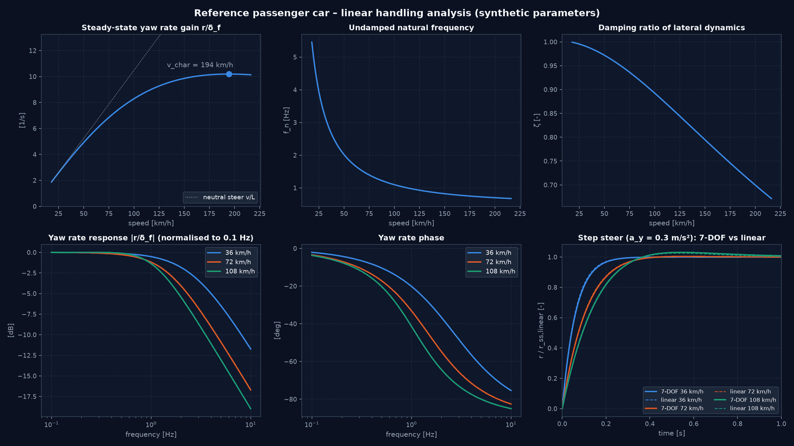

# Handling-Analyse und analytische Referenz (M1)

Paket: [`src/vehicle_model/handling_analysis/`](../src/vehicle_model/handling_analysis/)

Das Paket stellt die **analytische Referenz** für das Eigenlenkverhalten bereit (Plan.md, Abschnitt 6): ein lineares Einspurmodell mit Vorder- und Hinterachslenkung, geschlossene Kennwerte, Eigenwert- und Frequenzganganalyse sowie Kennwerte für Sprungantworten. Es hat keine Plot-Abhängigkeiten.

Die empirische ISO-4138-Auswertung simulierter Kreisfahrten (Kreisfahrt-Simulation, Untersteuergradient aus Daten, g-g-Diagramm) bleibt in [`simulation/handling_limits.py`](../src/vehicle_model/simulation/handling_limits.py). Die Ergebnisse dieses Pakets dienen als Referenz für jene Auswertung.

---

## 1. Lineares Einspurmodell (Modellklasse V2, linearisiert)

Koordinaten nach ISO 8855 (x vorwärts, y links, z oben; Winkel positiv gegen den Uhrzeigersinn).

| | Größen | Einheit |
|---|---|---|
| Zustand $x$ | $v_y$, $r$ | m/s, rad/s |
| Eingang $u$ | $\delta_f$, $\delta_r$ (gleiches Vorzeichen = gleichphasig) | rad |
| Ausgang $y$ | $r$, $a_y$, $\beta = v_y/v_x$ | rad/s, m/s², rad |

$$\alpha_f = \delta_f - \frac{v_y + l_f r}{v_x}, \qquad \alpha_r = \delta_r - \frac{v_y - l_r r}{v_x}$$
$$m(\dot v_y + v_x r) = C_f \alpha_f + C_r \alpha_r, \qquad I_z \dot r = l_f C_f \alpha_f - l_r C_r \alpha_r$$

$C_f$ und $C_r$ sind **Achs**-Schräglaufsteifigkeiten (beide Räder).

### Geschlossene Kennwerte

| Kennwert | Formel |
|---|---|
| Eigenlenkgradient | $EG = \frac{m}{L}\left(\frac{l_r}{C_f} - \frac{l_f}{C_r}\right)$ [rad/(m/s²)] |
| Gierverstärkung | $\frac{r}{\delta_f} = \frac{v_x}{L + EG\, v_x^2}$ |
| Querbeschleunigungsverstärkung | $\frac{a_y}{\delta_f} = v_x \frac{r}{\delta_f}$ |
| Schwimmwinkelverstärkung | $\frac{\beta}{\delta_f} = \frac{l_r - m l_f v_x^2/(L C_r)}{L + EG\, v_x^2}$ |
| Charakteristische Geschwindigkeit | $v_{char} = \sqrt{L/EG}$ für $EG > 0$ (Maximum der Gierverstärkung) |
| Kritische Geschwindigkeit | $v_{crit} = \sqrt{-L/EG}$ für $EG < 0$ ($\det A = 0$) |
| Lenkwinkelbedarf Kreisfahrt | $\delta_f = L/R + EG\, v_x^2/R$ |
| Eigenfrequenz, Dämpfung | $\omega_n = \sqrt{\det A}$, $\zeta = -\operatorname{tr}A / (2\omega_n)$ |

Zusätzlich: Zustandsraummodell `state_space(vx)`, stationäre Verstärkungsmatrix `dc_gain()`, Frequenzgang `frequency_response(omega)` und exakte Sprungantwort `step_response(t, u)` über die Matrixexponentialfunktion.

### Gültigkeitsgrenzen

Lineare Reifenkennlinie (typisch $a_y \lesssim 0{,}4\,g$), konstante Geschwindigkeit, keine Radlastverlagerung, keine Längskräfte, ebene Fahrbahn, starre Lenkung, $v_x > 0$. Unter etwa 5 m/s ist das Modell physikalisch nicht aussagekräftig (kinematischer Bereich).

---

## 2. Ableitung aus dem 7-DOF-Modell

`linear_params_from_seven_dof(params, tyre_front, tyre_rear)` reduziert ein Zweispur-Parameterset:

- statische Achslasten, links/rechts gleich verteilt
- $C_{f,r} = 2 \cdot \partial F_y/\partial\alpha$ bei $\alpha = \kappa = 0$, per zentraler Differenz für jedes `TyreModel`
- Spurweite, Aerodynamik, Rollwiderstand und Raddynamik werden vernachlässigt

---

## 3. Sprungantwort-Kennwerte

`step_response_metrics(t, y)` funktioniert für beliebige Signale, linear oder nichtlinear:

| Kennwert | Definition |
|---|---|
| `steady_state` | Mittelwert über das letzte Zeitfenster |
| `overshoot` | (Spitze − stationär) / \|stationär\| |
| `peak_time` | Zeitpunkt der Spitze |
| `response_time` | erstes Erreichen von 90 % (ISO 7401 „response time“) |
| `rise_time` | 10 % bis 90 % |
| `settling_time` | letztes Verlassen des ±2-%-Bandes |

Nicht definiert für Signale ohne stationäre Änderung (ValueError), oszillierende oder divergierende Antworten.

---

## 4. Virtuelles Referenzfahrzeug

[`configs/vehicles/reference_passenger_car.yaml`](../configs/vehicles/reference_passenger_car.yaml), Provenienz `derived_from_assumptions`, keine realen Fahrzeugdaten.

| Größe | Wert | Größe | Wert |
|---|---|---|---|
| Masse | 1450 kg | Radstand | 2,65 m (60 % Vorderachslast) |
| $I_z$ | 2321 kg m² (dyn. Index 0,95) | Spurweite v/h | 1,54 / 1,52 m |
| Schwerpunkthöhe | 0,55 m | Reifen | `fiala_passenger_synthetic` |

Abgeleitete Größen und Plausibilitätsbänder prüft [`vehicle_models/consistency.py`](../src/vehicle_model/vehicle_models/consistency.py). Geprüft werden: Achslastsumme, dynamischer Index, statischer Stabilitätsfaktor, Achslastanteil, Massenaufteilung gefedert/ungefedert sowie Wanksteifigkeitsverteilung gegen `k_roll_f`. Die Bänder sind allgemeine Literaturbereiche, keine physikalischen Grenzen.

Ergebnisse (linearisiert):

| | 36 km/h | 72 km/h | 108 km/h |
|---|---|---|---|
| $f_n$ [Hz] | 2,76 | 1,45 | 1,04 |
| $\zeta$ [–] | 0,99 | 0,94 | 0,88 |

$EG$ = +0,51 °/g, $v_{char}$ = 194 km/h. Der Eigenlenkgradient entsteht nur aus Reifen und Achslastverteilung; Elastokinematik ist nicht modelliert (M4). Für reale Pkw typische Werte liegen deshalb höher.

---

## 5. Kinematisches Einspurmodell mit Hinterachslenkung (Modellklasse V1)

`KinematicSingleTrack(rear_steer=True)` erweitert den Eingang auf $[a_x, \dot\delta_f, \delta_r]$:

$$\beta = \arctan\frac{l_f \tan\delta_r + l_r \tan\delta_f}{L}, \qquad \dot\psi = \frac{v \cos\beta\,(\tan\delta_f - \tan\delta_r)}{L}$$

Grenzfälle: $\delta_r = 0$ ergibt das bisherige Modell (numerisch identisch, Regressionsbaseline unverändert); $\delta_r = \delta_f$ ergibt reine Translation; $v < 0$ ergibt Rückwärtsfahrt auf derselben Bahn. `turning_radius(delta_f, delta_r)` liefert den Bahnradius des Schwerpunkts.

---

## 6. Verifikationsstrategie

| Test | Art (Plan.md, Abschnitt 1) | Ergebnis |
|---|---|---|
| [test_linear_single_track.py](../tests/vehicle_model/test_linear_single_track.py) | mathematische Verifikation | DC-Verstärkung = geschlossene Form (rel. 1e-12); neutral: $r/\delta = v/L$; $v_{char}$ maximiert die Gierverstärkung; $\det A = 0$ bei $v_{crit}$; gleichphasig gleiche Winkel ⇒ reine Translation; Formeln für Antworten 1. und 2. Ordnung |
| [test_kinematic_4ws.py](../tests/vehicle_model/test_kinematic_4ws.py) | mathematische und numerische Verifikation | Kreisbahn analytisch (1e-9), Vorzeichen inkl. Rückwärtsfahrt, $\delta_f = \delta_r$, RK4-Konvergenzordnung 3,7…4,3 |
| [test_linear_vs_seven_dof.py](../tests/vehicle_model/test_linear_vs_seven_dof.py) | Modellvergleich | bei $a_y$ = 0,3 m/s²: stationäre Gierrate ≤ 0,32 %, Verlauf ≤ 1,6 % Abweichung (Toleranzen 1 % bzw. 3 %) |
| [test_config_provenance.py](../tests/vehicle_model/test_config_provenance.py) | Parameterkonsistenz | alle Fahrzeug-YAMLs bestehen die Konsistenzprüfung |
| [test_single_track_models.py](../tests/vehicle_model/test_single_track_models.py) | physikalische Konsistenz | Geradeausfahrt bei Lenkwinkel null |

Abweichungen zwischen 7-DOF- und Linearmodell, je Geschwindigkeit:

| v [km/h] | stationäre Gierrate | max. Abweichung $r(t)$ | $t_{90}$ 7-DOF / linear [s] |
|---|---|---|---|
| 36 | −0,10 % | 1,60 % | 0,137 / 0,133 |
| 72 | −0,03 % | 0,75 % | 0,222 / 0,218 |
| 108 | +0,32 % | 0,66 % | 0,252 / 0,247 |

Das 7-DOF-Modell antwortet etwa 4 ms langsamer, passend zu der zusätzlichen Rad- und Lastverlagerungsdynamik.

**Stationäre Kreisfahrt (ISO 4138, R = 40 m, 7-DOF):** Bei $a_y$ = 0,5…1,0 m/s² trifft der simulierte Lenkwinkel die lineare Vorhersage $L/R + EG\,a_y$ auf 2 % (Test `test_steady_state_circle_matches_linear_reference_at_small_ay`, Marker `slow`). Der Eigenlenkgradient des 7-DOF-Modells wächst mit $a_y$. Das lineare $EG$ = 0,51 °/g ist der Grenzwert für $a_y \to 0$. Eine quasistationäre Lenkrampe bei konstanter Geschwindigkeit (90 km/h, 0,25 °/s, M4) ergibt 0,58 °/g bei 0,05–0,15 g, 0,75 °/g bei 0,15–0,3 g und 1,28 °/g bei 0,3–0,5 g. Ursache sind Radlastverlagerung und lastabhängige Reifen bei 60 % Wanksteifigkeit vorn.

*Korrektur (M4):* Hier stand zuvor „etwa 0,42 °/g bei 0,05–0,15 g“ aus der Kreisfahrt. Dieser Wert liegt unter dem Grenzwert für $a_y \to 0$ und widerspricht damit dem Anstieg. Er war ein Artefakt der Radiusdrift der Kreisfahrt-Regelung bei kleinem $a_y$ (siehe Hinweis unten). Siehe `docs/CHASSIS_KINEMATICS.md`.

> [!NOTE]
> `evaluate_understeer_gradient` fittet standardmäßig über 0,05…0,4 g und mischt damit diesen nichtlinearen Anstieg in einen Einzelwert (für das Referenzfahrzeug 0,66 °/g statt 0,51 °/g). Zusätzlich hält die Kreisfahrt-Regelung den Radius bei kleinen $a_y$ nur auf etwa 1,3 m genau. Für Vergleiche mit der linearen Referenz deshalb einen kleinen Fitbereich wählen und den tatsächlichen Radius verwenden.

---

## 7. Demonstration

```bash
python examples/handling_analysis_reference_vehicle.py
```

Ausgaben in `output/handling_analysis/` (nicht versioniert): `reference_vehicle_handling.png` (Gierverstärkung, $f_n$, $\zeta$, Bode-Diagramm, Sprungantwort 7-DOF gegen linear), `reference_vehicle_kpis.json` und `reference_vehicle_vs_speed.csv`.

---

## 8. Bekannte Grenzen

- Nur lineare Querdynamik; Grenzbereich und Combined Slip sind Gegenstand von `handling_limits.py` und M3.
- Die Reduktion vernachlässigt Radlastverlagerung; bei größeren $a_y$ weicht das 7-DOF-Modell erwartungsgemäß ab.
- Transiente Reifendynamik (Relaxationslänge) fehlt in beiden Modellen (M3).
- Die Hinterachslenkung im V1-Modell ist ein kinematischer Eingang ohne Aktuatordynamik (M4/M5).

---

<!-- figures:start -->

## Ergebnisbilder

> Alle Bilder sind Simulationsergebnisse mit synthetischen Parametern, keine Messungen. Neu erzeugen: Quellskript ausführen, dann `python tools/publish_doc_figures.py`.



*Lineare Fahrdynamik des Referenzfahrzeugs: stationäre Gierverstärkung (charakteristische Geschwindigkeit ≈ 194 km/h), Eigenfrequenz, Dämpfung, Frequenzgang der Gierrate und Lenkwinkelsprung 7-DOF gegen linear. Quelle: `examples/handling_analysis_reference_vehicle.py`.*

<!-- figures:end -->
