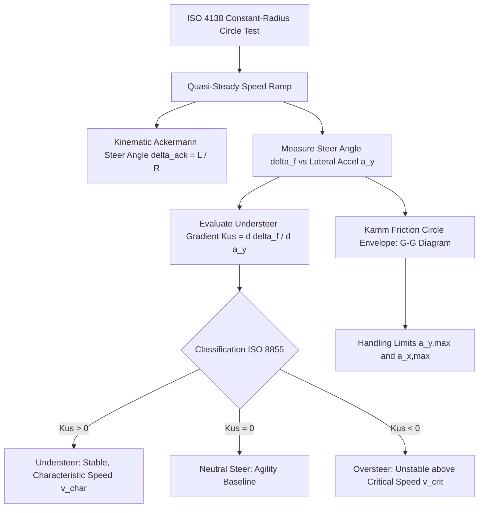

# Vehicle Handling Limits & Understeer/Oversteer Characteristics
*Fahrgrenzen, Eigenlenkverhalten und Querdynamische Grenzwertanalyse*

This document provides the theoretical foundations, governing equations, standardized testing methodologies, and virtual validation tools for vehicle handling limits (*Fahrgrenzen*) and steady-state steering characteristics (*Eigenlenkverhalten*).

Implemented in:
- `src/vehicle_model/simulation/handling_limits.py`
- `examples/handling_limits_and_understeer_demo.py`
- Scenario 10 in `configs/validation/matrix.yaml` (`iso_4138_circle`)

---

## 1. Overview and Engineering Significance

The steady-state cornering characteristics and handling limits of a road vehicle determine both its everyday drivability and its active safety margin during emergency maneuvers. Under steady-state cornering, the vehicle's directional response is classified according to **ISO 8855** into:
- **Understeer (*Untersteuern*)**: Steer angle must increase faster than the Ackermann angle as lateral acceleration increases ($K_{\text{us}} > 0$).
- **Neutral Steer (*Neutrales Eigenlenkverhalten*)**: Steer angle equals the kinematic Ackermann angle across all lateral accelerations ($K_{\text{us}} = 0$).
- **Oversteer (*Übersteuern*)**: Steer angle decreases with increasing lateral acceleration ($K_{\text{us}} < 0$), culminating in open-loop directional instability beyond the critical speed $v_{\text{crit}}$.



---

## 2. ISO 4138 Steady-State Circular Driving Behaviour

Conforming to **ISO 4138:2012** (*Passenger cars — Steady-state circular driving behaviour*), steady-state characteristics are evaluated on a circular test track of constant radius $R$ (standard: $R = 40.0\text{ m}$ or $R = 100.0\text{ m}$).

### 2.1 Test Methodology (Constant Radius Speed Ramp)
The vehicle enters the circular path at a low initial speed ($v_0 \approx 15-20\text{ km/h}$), where tyre slip angles are virtually zero ($\alpha_i \approx 0$). Speed is then ramped up quasi-stationarily:
$$\dot{v}_x \le 0.1\text{ m/s}^2 \quad (\approx 0.36\text{ km/h per second})$$
This ensures dynamic longitudinal inertial effects ($m \dot{v}_x$) and damper forces do not distort the steady-state tyre load transfer.

### 2.2 Kinematic Ackermann Angle
At near-zero lateral acceleration ($a_y \to 0$), the required front steer angle is governed purely by kinematics (Ferit Küçükay 2022, Kap. 6):
$$\delta_{\text{ack}} = \arctan\left(\frac{L}{R}\right) \approx \frac{L}{R}$$
Where:
- $L = l_f + l_r$ is the vehicle wheelbase [m]
- $R$ is the turn radius [m]

---

## 3. Mathematical Foundations of the Understeer Gradient $K_{\text{us}}$

### 3.1 Linear Single-Track Model Formulation
From the linear two-wheel bicycle model (Mitschke & Wallentowitz 2014, Kap. 12; Gillespie 1992, Ch. 6), the steady-state steer angle is:
$$\delta_f = \frac{L}{R} + \left(\frac{m_f}{C_{\alpha,f}} - \frac{m_r}{C_{\alpha,r}}\right) a_y$$

Defining the **Understeer Gradient** $K_{\text{us}}$:
$$K_{\text{us}} = \frac{d\delta_f}{da_y} = \frac{m_f}{C_{\alpha,f}} - \frac{m_r}{C_{\alpha,r}} = \frac{m}{L}\left(\frac{l_r}{C_{\alpha,f}} - \frac{l_f}{C_{\alpha,r}}\right)$$

Where:
- $m_f = m \frac{l_r}{L}$, $m_r = m \frac{l_f}{L}$ are front and rear axle static masses [kg]
- $C_{\alpha,f}, C_{\alpha,r}$ are front and rear total cornering stiffnesses [N/rad]
- $a_y = v_x \cdot r$ is lateral acceleration [$\text{m/s}^2$]

| Unit | Conversion Formula |
| :--- | :--- |
| $[\text{rad}/(\text{m/s}^2)]$ | Fundamental SI unit |
| $[\text{deg}/g]$ | $K_{\text{us}}[\text{deg}/g] = K_{\text{us}}[\text{rad}/(\text{m/s}^2)] \cdot \frac{180}{\pi} \cdot 9.81$ |

### 3.2 Physical Root of Understeer in Two-Track Vehicles
In real passenger cars, understeer is engineered into the chassis through several interacting mechanisms (Heißing, Ersoy & Gies 2020, Kap. 3; Schramm et al. 2020):
1. **Axle Load Bias**: $l_f < l_r \implies m_f > m_r$ (front axle carries greater mass).
2. **Tyre Cornering Stiffness Degressivity**: The tyre cornering stiffness $C_\alpha(F_z)$ exhibits sub-linear degressivity with normal load:
   $$\frac{\partial C_\alpha}{\partial F_z} > 0, \quad \frac{\partial^2 C_\alpha}{\partial F_z^2} < 0$$
3. **Lateral Load Transfer**: During cornering, lateral body roll transfers wheel load from inner to outer wheels:
   $$\Delta F_{z,f} = \frac{m a_y h_{\text{cog}}}{w_f} \cdot k_{\text{roll},f}, \quad \Delta F_{z,r} = \frac{m a_y h_{\text{cog}}}{w_r} \cdot (1 - k_{\text{roll},f})$$
   Because front anti-roll stiffness is tuned higher ($k_{\text{roll},f} \approx 0.55-0.65$), the front axle loses more total cornering stiffness than the rear, ensuring safe progressive understeer at the limit.

### 3.3 Nonlinear Local Understeer Gradient $K_{\text{us}}(a_y)$
At elevated lateral acceleration ($a_y > 0.4g$), tyre saturation violates the linear assumption. The **local dynamic understeer gradient** is defined by:
$$K_{\text{us}}(a_y) = \frac{\partial \delta_f}{\partial a_y}\Bigg|_{R=\text{const}}$$
- In an understeering vehicle, $K_{\text{us}}(a_y)$ increases sharply as $a_y \to a_{y,\max}$, producing the characteristic steering "washout" that prevents rear-end spin.
- In an oversteering vehicle, $K_{\text{us}}(a_y)$ decreases and can cross zero into negative values, indicating impending limit spinout (*Übersteuerungsabriss*).

### 3.4 Four-Wheel Steering (4WS) in ISO 4138: Front-Steer Illusion vs. Effective Steering Angle
In conventional front-wheel steered vehicles (2WS), measuring front wheel angle $\delta_f$ directly yields the understeer gradient. However, applying naive ISO 4138 front-angle regression to an active **Four-Wheel Steering (4WS)** vehicle creates a severe **methodological measurement artifact**:
- At low speed ($v \approx 20\text{ km/h}$), active 4WS operates in **counter-phase** ($\delta_r < 0$, e.g. $\delta_r \approx -0.80^\circ$). Because the rear axle aids yaw rotation, the required front steer angle $\delta_f$ is significantly smaller than the kinematic Ackermann angle ($\delta_f \approx 3.5^\circ < \delta_{\text{ack}} = 3.86^\circ$).
- At highway speed ($v \ge 60\text{ km/h}$), 4WS transitions into **in-phase** steering ($\delta_r > 0$, e.g. $\delta_r \approx +1.50^\circ$) to eliminate vehicle sideslip ($\beta \to 0$). Because the rear tyres oppose yawing, the driver must apply a larger front steering angle ($\delta_f \approx 7.9^\circ$).

A naive linear fit of $\delta_f$ vs $a_y$ suggests an enormous understeer gradient ($K_{\text{us},\text{front}} = +2.43^\circ/g$). In reality, the vehicle has become **vastly more agile**.

According to **ISO 8855**, the true chassis steering angle for a four-wheel steered vehicle is the **effective steering angle** (*effektiver Radlenkwinkel*):
$$\delta_{\text{eff}} = \delta_f - \delta_r$$

Evaluating the **Effective Understeer Gradient** $K_{\text{us},\text{eff}}$:
$$K_{\text{us},\text{eff}} = \frac{d\delta_{\text{eff}}}{da_y} = \frac{d(\delta_f - \delta_r)}{da_y} = -1.24^\circ/g$$
This negative effective gradient proves that 4WS increases cornering responsiveness and reduces the net chassis angle required to negotiate the curve.

### 3.5 Baseline Symmetric Tyres vs. OEM Passenger Car Calibration
The uncalibrated physical baseline with identical front and rear tyres yields:
$$K_{\text{us}} = \frac{m}{L}\left(\frac{l_r}{C_{\alpha,f}} - \frac{l_f}{C_{\alpha,r}}\right) = +0.152^\circ/g \quad (\text{measured: } +0.20^\circ/g)$$
While statically stable, this value ($v_{\text{char}} \approx 317\text{ km/h}$) feels nervous to typical drivers.

In automotive series production (Ferit Küçükay 2022, Kap. 6; Heißing et al. 2020), D-segment passenger vehicles are calibrated for $K_{\text{us}} \in [+1.0, +2.0]^\circ/g$ via:
1. **Suspension Elastokinematics**: Bushing compliance produces front axle lateral toe-out and rear axle lateral toe-in under lateral forces ($+0.8^\circ/g \dots +1.2^\circ/g$).
2. **Staggered Tyre Characteristics**: Calibrating a softer front peak slip angle ($\alpha_{\text{peak},f} = 5.8^\circ$) relative to the rear axle ($\alpha_{\text{peak},r} = 3.8^\circ$) generates an authentic OEM understeer gradient:
   $$K_{\text{us},\text{OEM}} = +1.34^\circ/g \implies v_{\text{char}} = 123.3\text{ km/h}$$
This characteristic speed matches the target highway cruising velocity of production road vehicles.

---

## 4. Characteristic Speed and Critical Speed

From the single-track yaw velocity gain equation:
$$\frac{r}{\delta_f} = \frac{v_x}{L + K_{\text{us}} v_x^2}$$

### 4.1 Understeering Vehicle ($K_{\text{us}} > 0$): Characteristic Speed $v_{\text{char}}$
The yaw velocity gain $\frac{r}{\delta_f}$ exhibits a local maximum with respect to velocity. Setting $\frac{d}{dv_x}\left(\frac{r}{\delta_f}\right) = 0$ yields the **Characteristic Speed** (*Charakteristische Geschwindigkeit*):
$$v_{\text{char}} = \sqrt{\frac{L}{K_{\text{us}}}}$$
At $v_x = v_{\text{char}}$:
- The steer angle required for a given turn radius is exactly twice the Ackermann angle: $\delta_f = 2 \cdot \delta_{\text{ack}}$.
- The yaw rate gain reaches its peak: $\left(\frac{r}{\delta_f}\right)_{\max} = \frac{1}{2 \sqrt{L K_{\text{us}}}}$.

### 4.2 Oversteering Vehicle ($K_{\text{us}} < 0$): Critical Speed $v_{\text{crit}}$
If $K_{\text{us}} < 0$, the denominator $L + K_{\text{us}} v_x^2$ approaches zero at a finite velocity, known as the **Critical Speed** (*Kritische Geschwindigkeit*):
$$v_{\text{crit}} = \sqrt{-\frac{L}{K_{\text{us}}}}$$
- For speeds $v_x \ge v_{\text{crit}}$, the open-loop vehicle becomes statically unstable (eigenvalues migrate into the right-half s-plane).
- The driver or active ESC must apply continuous closed-loop counter-steering to prevent uncontrolled spinning.

---

## 5. Body Sideslip Angle Gradient $d\beta / da_y$ and Kinematic Offset

The vehicle sideslip angle at the center of gravity is:
$$\beta = \arctan\left(\frac{v_y}{v_x}\right) \approx \frac{v_y}{v_x}$$

### 5.1 Kinematic Offset Removal ($\beta_{\text{kin}} = -l_r/R$)
On a circular test track of radius $R$, the vehicle's geometric orientation forces a kinematic standstill offset:
$$\beta_{\text{kin}} = -\arctan\left(\frac{l_r}{R}\right) \approx -\frac{l_r}{R}$$
For $l_r = 1.50\text{ m}$ and $R = 40.0\text{ m}$, $\beta_{\text{kin}} = -2.15^\circ$.

Under steady-state cornering, the raw sideslip angle is:
$$\beta = \beta_{\text{kin}} + \alpha_r = -\frac{l_r}{R} + \frac{m_r}{C_{\alpha,r}} a_y$$

Plotting raw $|\beta|$ causes an artificial V-shape as $\beta$ transitions through zero. The true **Dynamic Sideslip Angle** isolates tyre slip:
$$\Delta \beta = \beta - \beta_{\text{kin}} = \alpha_r \ge 0$$

The **Sideslip Angle Gradient** (*Schwimmwinkelgradient*):
$$\frac{d\Delta\beta}{da_y} = \frac{d\beta}{da_y} = \frac{m}{L}\left(\frac{l_f}{C_{\alpha,r}}\right)$$
- Active Four-Wheel Steering (4WS) alters this relationship by steering the rear wheels in-phase at highway speeds, suppressing $\Delta\beta$ by over 16% to 20% compared to passive vehicles.

---

## 6. G-G Acceleration Envelopes (Kamm's Friction Circle)

The absolute vehicle handling limit is dictated by the tyre-road friction coefficient $\mu$ and normal load according to **Kamm's Circle** (*Kamm'scher Reibungskreis*):
$$\sqrt{F_{x,i}^2 + F_{y,i}^2} \le \mu_i F_{z,i}$$

### 6.1 Acceleration Envelope Boundaries
The G-G acceleration diagram depicts the achievable boundary of simultaneous longitudinal acceleration $a_x$ and lateral acceleration $a_y$:

$$\left(\frac{a_x}{a_{x,\max}}\right)^2 + \left(\frac{a_y}{a_{y,\max}}\right)^2 \le 1$$

Where:
- **Lateral Grip Limit**: $a_{y,\max} \approx \mu \cdot g \cdot \eta_{\text{susp}}$, where $\eta_{\text{susp}} \approx 0.90-0.95$ accounts for tyre load transfer degressivity.
- **Braking Limit**: $a_{x,\text{brake}} \approx -\mu \cdot g$ (all 4 wheels can utilize full friction under optimized EBD/ABS).
- **Traction Limit**: $a_{x,\text{accel}} = \min\left(\mu g \frac{F_{z,\text{driven}}}{m g}, \frac{P_{\text{engine}}}{m v_x}\right)$, restricted by axle drive configuration (FWD, RWD, or AWD) and powertrain power limits.

---

## 7. Comparative Benchmark: Passive vs OEM vs 4WS vs IVMC

Below are results obtained on a $R = 40.0\text{ m}$ circular track on dry asphalt ($\mu = 1.0$) with the 7-DOF vehicle model:

| Vehicle Configuration | Front $K_{\text{us}}$ [°/g] | Effective $K_{\text{us},\text{eff}}$ [°/g] | ISO 8855 Class | $v_{\text{char}}$ [km/h] | $a_{y,\max}$ [g] | Max $\Delta\beta$ [°] |
| :--- | :---: | :---: | :---: | :---: | :---: | :---: |
| **Passive Baseline (Symmetric Tyres)** | $+0.20$ | $+0.20$ | Mild Understeer | $317.1$ | $0.90$ | $4.12^\circ$ |
| **Passive OEM (Staggered Tyres)** | $+1.34$ | $+1.34$ | Realistic Understeer | $123.3$ | $0.89$ | $4.13^\circ$ |
| **Active 4WS (Zero Sideslip)** | $+2.43$ | $-1.24$ | Agile / Understeer | $91.6$ | $0.89$ | $3.44^\circ$ |
| **Integrated IVMC (4WS + TV)** | $+2.62$ | $-0.98$ | Stable Understeer | $88.2$ | $0.90$ | $3.44^\circ$ |

### Physical Interpretation:
1. **Passive Symmetric Baseline**: Inherent mild understeer solely due to static weight distribution (52.5% front). High characteristic speed ($317.1\text{ km/h}$).
2. **Passive OEM Calibrated**: Replicates realistic production car suspension compliance and rear tyre grip advantage ($\alpha_{\text{peak},r} = 3.8^\circ$), achieving $K_{\text{us}} = +1.34^\circ/g$ and $v_{\text{char}} = 123.3\text{ km/h}$, aligning with German automotive standards (Küçükay 2022).
3. **Four-Wheel Steering (4WS)**: In-phase rear steering suppresses dynamic sideslip by **-16.5%** ($4.12^\circ \to 3.44^\circ$) while achieving an agile effective chassis gradient $K_{\text{us},\text{eff}} = -1.24^\circ/g$.
4. **Integrated Chassis Control (IVMC)**: Couples active 4WS with active torque vectoring, stabilizing the vehicle envelope and capping sideslip while maintaining steady understeer stability margin ($K_{\text{us},\text{eff}} = -0.98^\circ/g$).

---

## 8. Usage in Code and Validation Matrix

### 8.1 Standalone Demonstration
Run the flagship handling limits script:
```bash
python examples/handling_limits_and_understeer_demo.py
```
This generates the 4-panel diagnostic plot:
- Panel 1: Steer Angle $\delta_f$ vs Lateral Acceleration $a_y$ with Ackermann line
- Panel 2: Local Understeer Gradient $K_{\text{us}}(a_y) = d\delta_f / da_y$
- Panel 3: Chassis Sideslip Angle $\beta$ vs Lateral Acceleration $a_y$
- Panel 4: Combined G-G Acceleration Diagram with simulated operating points

### 8.2 Virtual Validation Matrix Integration
Scenario 10 (`iso_4138_circle`) in `configs/validation/matrix.yaml`:
```yaml
iso_4138_circle:
  name: "ISO 4138 Steady-State Circular Driving (Understeer Gradient & Handling Limits)"
  radius_m: 40.0
  initial_speed_kph: 18.0
  final_speed_kph: 80.0
  road_mu: 1.0
  controllers: ["passive", "four_wheel_steering", "integrated_ivmc"]
  thresholds:
    understeer_gradient_min_deg_per_g: 0.10
    max_steady_state_lat_accel_g: 0.85
    max_sideslip_deg: 6.0
```

Execute as part of the full validation platform:
```bash
python examples/run_validation_platform.py
```

---

## 9. Academic References & Standards

1. **ISO 4138:2012**: *Passenger cars — Steady-state circular driving behaviour — Open-loop test methods*. International Organization for Standardization, Geneva.
2. **ISO 8855:2011**: *Road vehicles — Vehicle dynamics and road-holding ability — Vocabulary*. International Organization for Standardization, Geneva.
3. **Küçükay, Ferit (2022)**: *Grundlagen der Fahrzeugtechnik*. Springer Vieweg, Wiesbaden. Kap. 6: Querdynamik und Eigenlenkverhalten, S. 185–240. [DOI: 10.1007/978-3-658-36916-3](https://doi.org/10.1007/978-3-658-36916-3).
4. **Mitschke, Manfred; Wallentowitz, Henning (2014)**: *Dynamik der Kraftfahrzeuge*. 5. Aufl., Springer Vieweg, Wiesbaden. Kap. 12: Querdynamik, S. 320–415. [DOI: 10.1007/978-3-658-05068-9](https://doi.org/10.1007/978-3-658-05068-9).
5. **Gillespie, Thomas D. (1992)**: *Fundamentals of Vehicle Dynamics*. Society of Automotive Engineers (SAE), Warrendale, PA. Chapter 6: Steady-State Cornering, pp. 195–236.
6. **Heißing, Bernd; Ersoy, Metin; Gies, Stefan (2020)**: *Fahrwerkhandbuch: Grundlagen, Fahrdynamik, Komponenten, Systeme, Mechatronik, Perspektiven*. 5. Aufl., Springer Vieweg, Wiesbaden. [DOI: 10.1007/978-3-658-28688-0](https://doi.org/10.1007/978-3-658-28688-0).
7. **Pacejka, Hans B. (2012)**: *Tire and Vehicle Dynamics*. 3rd ed., Butterworth-Heinemann / Elsevier, Oxford. Chapter 7: Vehicle Handling and Stability, pp. 315–380.
