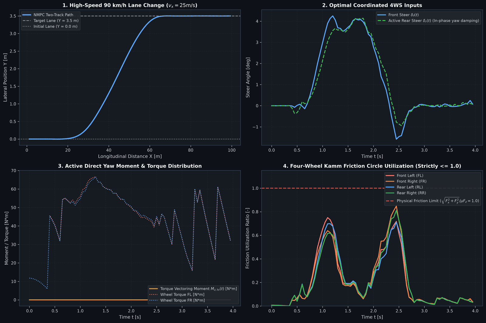
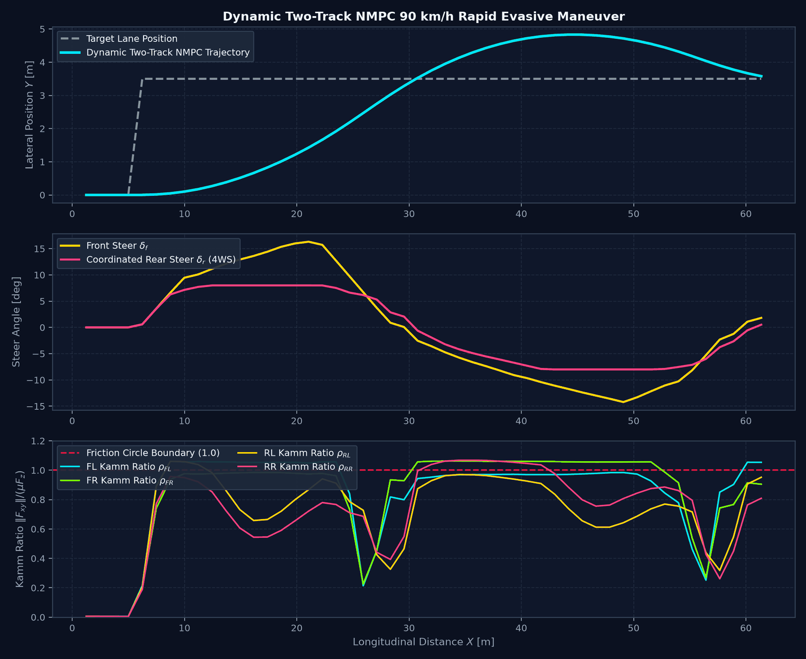

# Non-Linear Model Predictive Control (NMPC) Suite

Model Predictive Control (MPC) solves an optimal control problem repeatedly over a future finite prediction horizon, computing the optimal sequence of control inputs and applying only the first step before updating the state estimate.

The platform implements two NMPC controllers. Both are solved with `scipy.optimize.minimize(method="SLSQP")` using **single shooting** (only the input sequence is optimised, the states are rolled out inside the cost function):
1. **Kinematic NMPC path tracker** (`SLSQPPathTrackingNMPC` & `NMPCPathTrackingController`)
2. **Dynamic two-track NMPC with friction-circle penalty** (`DynamicTwoTrackNMPC`)

> [!IMPORTANT]
> Neither controller implements C/GMRES (Ohtsuka's continuation/GMRES method). The old class name `NMPCControllerCGMRES` is a deprecated alias of `SLSQPPathTrackingNMPC`.

---

## 1. Kinematic NMPC Path Tracker

Prediction model: kinematic bicycle `[X, Y, psi, v]` with inputs `[a_x, delta_f]`, forward-Euler rollout, rear steer slaved to the front steer through a synthetic LUT, $\delta_r = \operatorname{LUT}(v, \delta_f)$.

Cost (no terminal cost):
$$J = \sum_{k=0}^{N-1} \left[ q_y (y_k - y_{\text{ref}})^2 + q_{\psi} (\psi_k - \psi_{\text{ref}})^2 + q_v (v_k - v_{\text{ref}})^2 \right] + r_{\delta} \sum_k u_{\delta,k}^2 + r_a \sum_k u_{a,k}^2$$

Only box bounds on the inputs are enforced. Full formulation, parameters and known limitations: [NMPC_PATH_TRACKING.md](NMPC_PATH_TRACKING.md).

---

## 2. Dynamic Two-Track NMPC with 4-Wheel Kamm Friction Bounds

While kinematic models suffice at low lateral acceleration ($a_y < 0.3g$), high-speed obstacle avoidance and split-$\mu$ maneuvers demand an NMPC controller that explicitly accounts for dynamic tyre slip, dynamic load transfer, and friction circle limits.

The `DynamicTwoTrackNMPC` controller ([dynamic_two_track_nmpc.py](../src/vehicle_model/controllers/dynamic_two_track_nmpc.py)) implements predictive control directly over the non-linear two-track chassis.

### 2.1 State & Control Vectors
- **Plant State ($n_x = 6$):**
  $$\mathbf{x} = \begin{bmatrix} X & Y & \psi & v_x & v_y & r \end{bmatrix}^T$$
- **Control Input ($n_u = 4$):**
  $$\mathbf{u} = \begin{bmatrix} \delta_f & \delta_r & M_{z,\text{tv}} & a_{x,\text{req}} \end{bmatrix}^T$$

Where:
- $\delta_f, \delta_r$: Front and rear steer angles [rad]
- $M_{z,\text{tv}}$: Direct yaw moment from active torque vectoring [Nm]
- $a_{x,\text{req}}$: Longitudinal chassis acceleration demand [$\text{m/s}^2$]

### 2.2 Discrete Integration & Runge-Kutta 4th-Order (RK4)
$$\mathbf{x}_{k+1} = \mathbf{x}_k + \frac{\Delta t}{6}(k_1 + 2 k_2 + 2 k_3 + k_4)$$
Where each stage evaluates the non-linear continuous dynamics with individual wheel slips $\alpha_i, \kappa_i$ and load transfer $F_{z,i}$.

### 2.3 Friction-Circle Penalty (soft, not a hard constraint)
At every prediction step $k$ and wheel $i$ the friction-circle utilisation is evaluated:

$$\rho_{i,k} = \frac{\sqrt{F_{x,i,k}^2 + F_{y,i,k}^2}}{\mu_i F_{z,i,k}}$$

Utilisation above 0.90 is penalised in the cost; it is **not** enforced as a constraint:
$$J_{\text{kamm}} = w_{\text{kamm}} \sum_{k=0}^{N-1} \sum_{i=1}^4 \max\left(0, \rho_{i,k} - 0.90\right)^2$$

### 2.4 Multi-Objective Horizon Cost
The total objective function over prediction horizon $N$ is:
$$J = \sum_{k=1}^N \left[ \|\mathbf{x}_k - \mathbf{x}_{\text{target}}\|_{\mathbf{Q}}^2 + \|\mathbf{u}_{k-1}\|_{\mathbf{R}}^2 + \|\Delta \mathbf{u}_{k-1}\|_{\mathbf{S}}^2 \right] + J_{\text{kamm}}$$

Where:
- $\mathbf{Q} = \operatorname{diag}(0, q_y, q_\psi, q_v, q_\beta, q_r)$: State tracking weights
- $\mathbf{R} = \operatorname{diag}(r_{\delta f}, r_{\delta r}, r_{Mz}, r_{ax})$: Control effort weights
- $\mathbf{S}$: Slew-rate penalty weights ensuring smooth actuator demands

---

## 3. Slalom Benchmark

The animation scenario `nmpc_slalom` (`python examples/generate_maneuver_animations.py nmpc_slalom`) compares a passive baseline, NMPC with front steer only, and NMPC with the slaved 4WS LUT on the 7-DOF plant.

Quantitative results (tracking error, sideslip) will be produced reproducibly by the KPI and experiment framework (milestones M6/M9). Earlier figures in this section could not be traced to a documented run and were removed.

---

## 4. Source Code Cross-Reference

| Module | Class Name | Source File | Unit Tests |
| :--- | :--- | :--- | :--- |
| **Kinematic NMPC (SLSQP)** | `SLSQPPathTrackingNMPC` | [nmpc.py](../src/vehicle_model/controllers/nmpc.py) | [test_nmpc_controller.py](../tests/vehicle_model/test_nmpc_controller.py) |
| **NMPC Vehicle Controller** | `NMPCPathTrackingController` | [nmpc.py](../src/vehicle_model/controllers/nmpc.py) | [test_nmpc_controller.py](../tests/vehicle_model/test_nmpc_controller.py) |
| **Dynamic Two-Track NMPC** | `DynamicTwoTrackNMPC` | [dynamic_two_track_nmpc.py](../src/vehicle_model/controllers/dynamic_two_track_nmpc.py) | [test_dynamic_two_track_nmpc.py](../tests/vehicle_model/test_dynamic_two_track_nmpc.py) |

---

<!-- figures:start -->

## Ergebnisbilder

> Alle Bilder sind Simulationsergebnisse mit synthetischen Parametern, keine Messungen. Neu erzeugen: Quellskript ausführen, dann `python tools/publish_doc_figures.py`.

*Dynamisches Zweispur-NMPC, Ausweichen bei 90 km/h: Bahn, Lenkwinkel vorn/hinten, Reibkreisausnutzung bezogen auf µF_z. Die Bahn schießt auf 4,8 m über (Ziel 3,5 m). Werte knapp über 1 sind keine Verletzung: Die Spitzenreibung des MF-Reifens liegt bei geringer Radlast über µ. Quelle: `examples/driver_and_nmpc_dynamics_demo.py`.*

*NMPC-Spurwechsel 90 km/h (E2E-Test): Bahn, koordinierte Lenkwinkel, Radmomente und Reibkreisausnutzung. Quelle: `examples/e2e_deep_analysis_and_benchmarking.py`.*

<!-- figures:end -->
