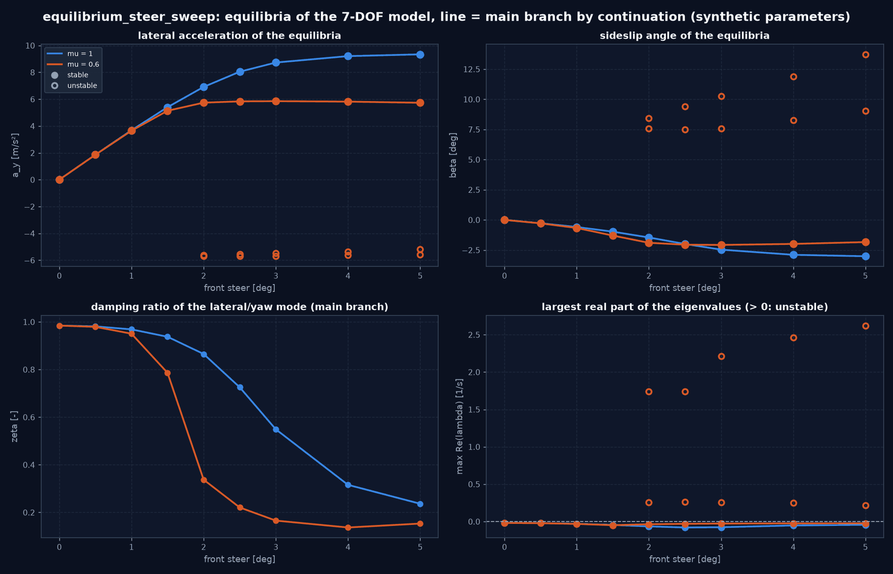
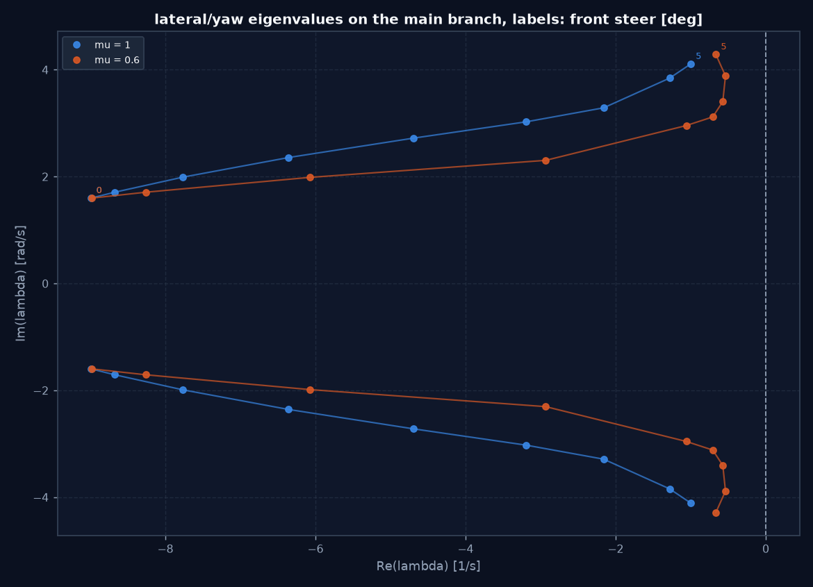
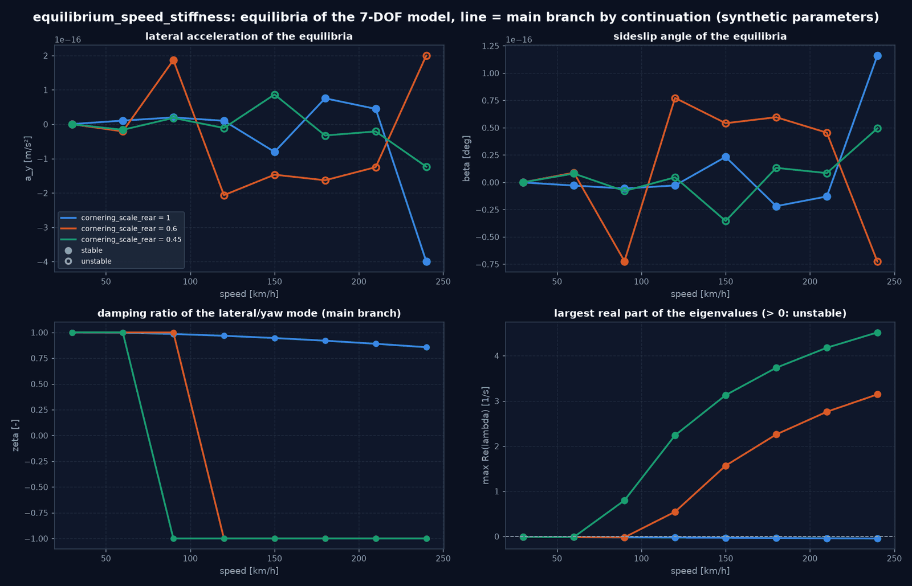
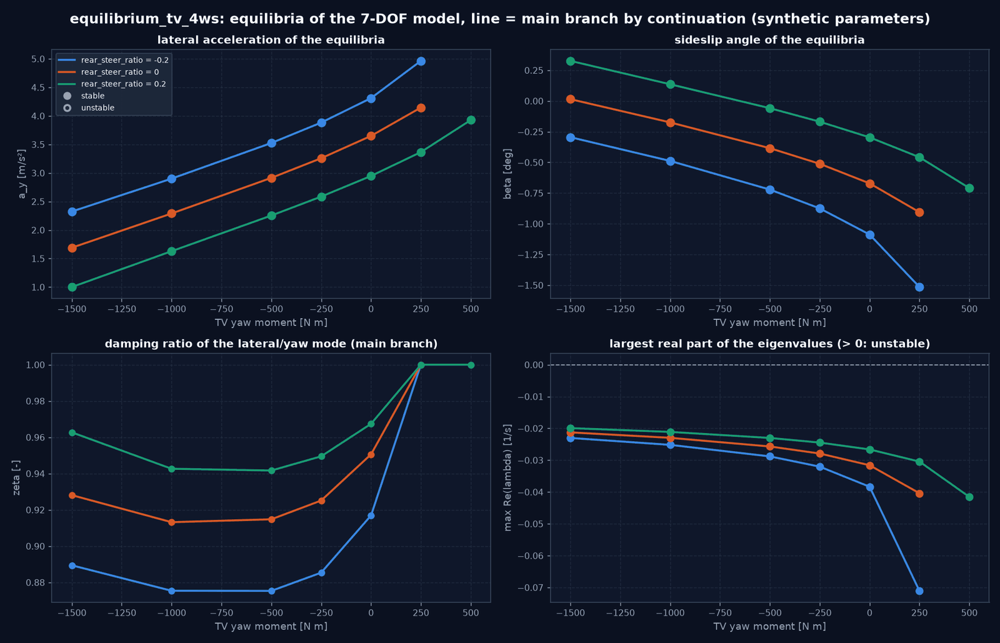
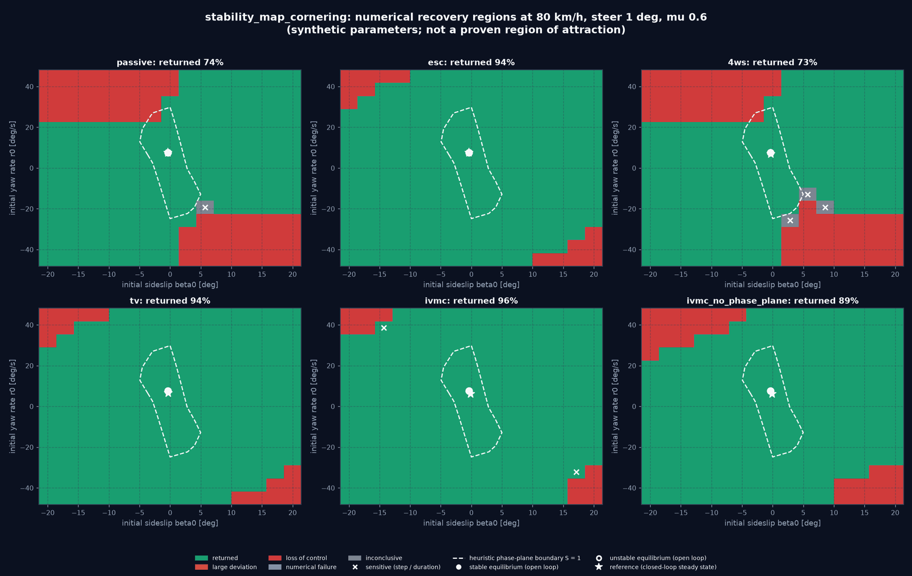
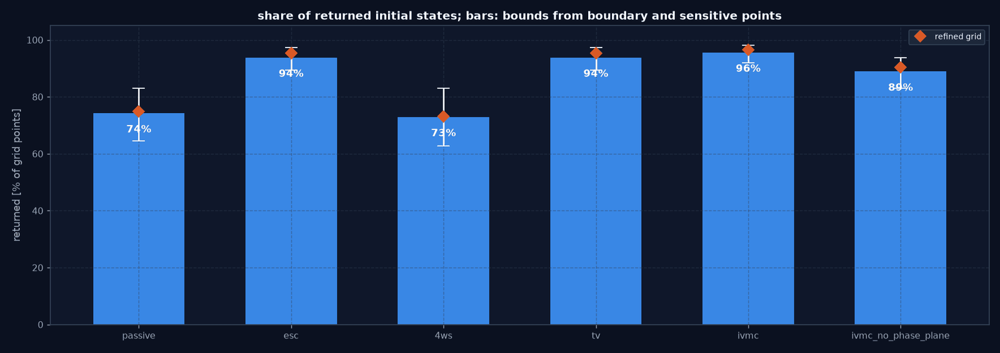
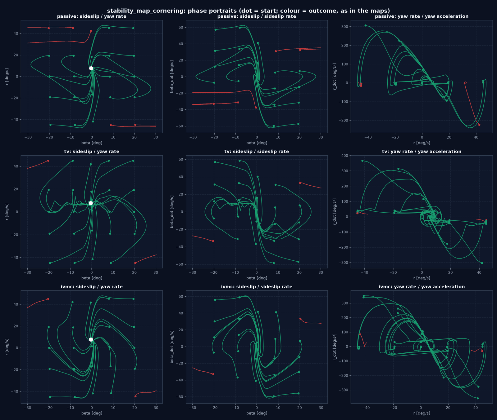

# Nichtlineare Fahrzeugstabilität und Grenzbereich (Plan V3.0, M11)

Dieses Dokument beschreibt die Gleichgewichts- und Stabilitätsanalyse des 7-DOF-Zweispurmodells und die numerisch
bestimmten Rückführregionen der Regler. Alle Parameter sind synthetisch; die Ergebnisse beschreiben das virtuelle
Fahrzeug, kein reales.

| Teil | Modul | Experimenttyp |
|---|---|---|
| Gleichgewichte (6.1), lokale Stabilität (6.2) | `handling_analysis/equilibrium.py` | `equilibrium_analysis` |
| Phasenporträts (6.3), Rückführregionen (6.4) | `simulation/stability_region.py` | `stability_map` |
| Reifensteifigkeit als Parameter | `tire_model/scaling.py` (`SlipStiffnessScaledTyre`) | – |

## 1. Gleichgewichtszustände (6.1)

**Zustände.** Analysiert werden die fahrzeugfesten Zustände `vx, vy, r`, die vier Raddrehzahlen und beim
`TransientSevenDOFModel` die acht Relaxationszustände der Reifen (7 bzw. 15 Zustände). Die Navigationszustände
`X, Y, psi` sind ausgenommen: Sie wachsen in stationärer Kurvenfahrt mit der Zeit und wirken auf gleichmäßiger
Fahrbahn nicht auf die Dynamik zurück. Eine Fahrbahn mit ortsabhängigem Reibwert wird deshalb abgewiesen.

**Betriebspunkt** (`OperatingPoint`): Längsgeschwindigkeit (gehalten), Vorderachslenkwinkel, Hinterachslenkung als
Verhältnis zum Vorderachswinkel, Bremsmomente je Rad, Aufteilung des Antriebsmoments auf die Räder und ein
Torque-Vectoring-Giermoment (Differenzmoment an der Hinterachse, `dT = Mz R / b_r`). Reibwert, Schwerpunktlage und
Reifen gehören zum Modell; jedes Modell der `SevenDOFModel`-Familie mit jedem `TyreModel` ist analysierbar.

**Gleichungen.** Unbekannt sind alle Zustände außer `vx` und das Gesamtantriebsmoment, das die Geschwindigkeit hält;
Gleichungen sind „alle Zustandsableitungen null". Gelöst wird mit Levenberg-Marquardt auf skalierten Größen
(Startwert: stationäre Lösung des linearen Einspurmodells, Gierrate auf `0,95 µ g / v` begrenzt, Räder frei rollend).

**Annahme eines Gleichgewichts**, alle Bedingungen zugleich:

| Bedingung | Grenze |
|---|---|
| `|v̇x|, |v̇y|` | 1e-6 m/s² |
| `|ṙ|` | 1e-6 rad/s² |
| `|ω̇|` | 1e-5 rad/s² (entspricht 5e-5 N Reifenkraft) |
| Relaxationszustände | 1e-6 1/s |
| Lastverlagerung (Fixpunkt) | konvergiert, Toleranz 1e-12 m/s² |
| Kontakt | kein Kippen; Drei-Rad-Kontakt wird gemeldet |

Damit die Ableitung bis auf Rundungsfehler reproduzierbar ist, rechnet die Analyse auf einer Kopie des Modells mit
Fixpunkttoleranz 1e-12 (Standard der Simulation: 1e-6, `SevenDOFModel.load_transfer_tol`). Erreicht werden
Residuen um 1e-14 m/s² und 1e-12 rad/s².

**Mehrere Gleichgewichte.** `EquilibriumAnalysis.find_all` startet zusätzlich von einem Raster aus Schwimmwinkel
(−20° … 20°) und Gierrate (−1 … 1 × µ g / v) und entfernt Duplikate. Das Ergebnis ist „alle gefundenen
Gleichgewichte", kein Beweis der Vollständigkeit. Lösungen mit `|κ| > 0,2` werden verworfen: Dort dreht das
geschwindigkeitshaltende Antriebsmoment bei großem Schwimmwinkel die Räder auf ein Vielfaches der Fahrgeschwindigkeit
hoch (gefunden wurden z. B. Lösungen bei β = ±37° mit 1400 rad/s Raddrehzahl); das ist ein Artefakt der Formulierung,
kein Fahrzustand.

**Kein Gleichgewicht.** Jenseits einer Faltung des Hauptastes existiert kein stationärer Zustand. Der Löser bleibt
dann bei einem endlichen Residuum stehen, und der Punkt wird nicht angenommen. Der Bericht führt solche Punkte mit dem
erreichten Residuum auf, als Grenze zur Prüfung, nicht als Fehler und nicht als Beweis der Nichtexistenz (ein
Löserversagen sähe gleich aus).

## 2. Lokale Stabilität (6.2)

**Jacobi-Matrix** durch zentrale Differenzen mit Schritt `h_i = s · max(|x_i|, x_typ,i)`. Die Schrittweite wird
nicht festgelegt, sondern aus einer Schrittweitenstudie gewählt (`JACOBIAN_STEPS` = 1e-2 … 1e-7): Für benachbarte
Schritte wird die größte relative Änderung der Eigenwerte (Paarung nach minimalem Abstand) bestimmt; zu große
Schritte zeigen Abbruchfehler, zu kleine Rundungsfehler. Verwendet wird der Schritt nach der kleinsten Änderung;
konvergiert heißt diese Änderung ≤ 1e-4. Typisch: 2e-2 beim größten Schritt, 1e-8 auf dem Plateau.

**Moden.** Eigenwerte, Partizipationsfaktoren `|v_ik w_ki|` (skaleninvariant) je Zustandsgruppe (Längs, Quer/Gier,
Räder, Relaxation), Dämpfungsgrad `−Re/|λ|`, Eigenfrequenz `|λ|/2π`. Stabil heißt größter Realteil
< −1e-3 1/s, instabil > 1e-3 1/s, dazwischen grenzstabil. Der langsamste Mode ist meist der Geschwindigkeitsmode
(nur Luftwiderstand, etwa −0,02 1/s).

**Prüfung gegen die Dynamik** (`linear_check`): Das nichtlineare Modell wird aus dem Gleichgewicht mit einer kleinen
Störung (`Δvy = 0,02 m/s`, `Δr = 0,002 rad/s`) simuliert und mit `expm(A t) Δx0` verglichen. Gemeldet werden die
größte Abweichung von `vy` und `r` relativ zur linearen Auslenkung und ob beide abklingen oder wachsen. Bei
instabilen Gleichgewichten wird der Horizont auf eine Zeitkonstante des schnellsten Anwachsens verkürzt, damit die
Störung klein bleibt. Die Simulation nutzt eine Modellkopie mit Fixpunkttoleranz 1e-9 (fünf Größenordnungen unter
der Störungsdynamik).

**Unabhängige Referenzen.** Die Quer-/Giermoden bei Geradeausfahrt stimmen mit dem linearen Einspurmodell
(`linear_params_from_seven_dof`) auf 1–3 % überein (Unterschied: Raddynamik, Luftwiderstand). Mit auf 60 % reduzierter
Hinterachs-Schräglaufsteifigkeit (übersteuernd) liefert das lineare Einspurmodell `v_krit = 30,08 m/s`; das
nichtlineare Modell ist bei 30 m/s stabil und bei 40 m/s instabil, der kritische Mode ist der Quer-/Giermode.

**Was „Dämpfung" hier nicht leistet.** Der Dämpfungsgrad ist kein monotones Maß für die Stabilitätsreserve: Mit
weicheren Hinterreifen werden die Quermoden reell (ζ = 1), klingen aber langsamer ab (Realteil −1,6 statt −6,1 1/s
bei 90 km/h, 1° Lenkwinkel, µ = 0,6). Für die Reserve ist der größte Realteil maßgeblich.

## 3. Phasenporträts und Rückführregionen (6.3, 6.4)

**Problem** (`RecoveryProblem`): Fahrzeug, Reifen, Reibwert, Betriebspunkt (Geschwindigkeit, vom Fahrer gehaltener
Vorderachslenkwinkel) und Regler. Von jedem Anfangszustand `(β0, r0)` bei Betriebsgeschwindigkeit (Räder frei
rollend) wird der geschlossene Kreis simuliert; der Fahrer hält Lenkwinkel und ein geschwindigkeitshaltendes Pedal
(Gleichgewichtspedal + 0,05 je m/s Abweichung).

**Klassifikation** (`classify`), genau eine Klasse je Lauf:

| Klasse | Kriterium (Standardwerte) |
|---|---|
| zurückgekehrt | `|β − β_ref| < 1°` und `|r − r_ref| < 2°/s` ununterbrochen für 0,5 s |
| Verlust der Beherrschbarkeit | `|β| ≥ 30°`, mit `β = atan2(vy, vx)`, ein Dreher zählt also |
| anhaltend große Abweichung | eingeschwungen (`|β̇| < 0,5°/s`, `|ṙ| < 1°/s²` über 0,5 s), aber außerhalb des Zielbereichs |
| numerisches Versagen | nicht endlicher Zustand oder Ausnahme in Modell oder Regler |
| unzureichende Dauer | keine der obigen Klassen am Ende der Simulationszeit |

**Referenz** des Zielbereichs ist der Endzustand desselben geschlossenen Kreises, gestartet im Gleichgewicht des
Betriebspunkts. Jeder Regler wird also an seinem eigenen stationären Zustand für dieselbe Fahrervorgabe gemessen
(4WS und IVMC fahren mit kleinerer Gierrate als das passive Fahrzeug).

**Regler** (`CONTROLLERS`):

| Name | Inhalt |
|---|---|
| `passive` | Fahrerlenkung, offenes Differential |
| `esc` | Fahrerlenkung, Gierraten-PI über die Radkraftallokation, Totband 2°/s (Annahme dieses Projekts) |
| `4ws` | Hinterachslenkung (Kennfeld) mit Gierdämpfung |
| `tv` | Torque Vectoring: Gierraten-PI über die Allokation, ohne Totband |
| `ivmc` | integrierte Regelung (4WS, TV, ABS/TCS, heuristische Phase-Plane-Hülle) |
| `ivmc_no_phase_plane` | dieselbe ohne Phase-Plane-Hülle |

Robuste Regler aus M12 werden nach ihrer Umsetzung ergänzt.

**Unsicherheit**, getrennt vom Ergebnis ausgewiesen:

- *Klassifikationssicherheit:* Punkte mit einem Nachbarn anderer Klasse heißen Randpunkte. Randpunkte und
  unentschiedene Punkte werden mit halbem Zeitschritt, unentschiedene und eingeschwungene zusätzlich mit doppelter
  Dauer neu simuliert. Ändert sich die Klasse, heißt der Punkt *empfindlich*.
- *Schranken des Anteils:* untere Schranke = zurückgekehrt und weder Rand- noch empfindlicher Punkt; obere Schranke =
  zurückgekehrt oder Rand-/empfindlicher Punkt.
- *Gitter:* Eine Verfeinerungsstufe; Mittelpunkte zwischen Nachbarn verschiedener Klasse werden simuliert, die übrigen
  erben die Klasse ihrer Nachbarn (Annahme, im Ergebnis ausgewiesen). Gemeldet werden der Anteil auf grobem und
  verfeinertem Gitter.

Eine so bestimmte Region ist eine **numerisch ermittelte Rückführregion** für Gitter, Zeitschritt und Dauer, kein
bewiesener Attraktionsbereich.

**Heuristische Phase-Plane-Grenze als Vergleichsbasis.** Der Stabilitätsindex `S` von
`controllers/phase_plane.py` (`|β|/β_max + C |β̇|/β_max`) wird an jedem Anfangszustand ausgewertet, mit
`β̇ = a_y/v − r` aus dem Modell beim Fahrerlenkwinkel, also mit derselben Information, die der Monitor im Kreis hat.
Verglichen wird „innen" (`S < 1`) mit „zurückgekehrt". Die heuristische Regelung bleibt unverändert und ist in
`ivmc` aktiv; `ivmc_no_phase_plane` zeigt ihren Beitrag.

**Rechenaufwand.** Ein Lauf von 6 s kostet etwa 1–2 s. Die Läufe sind unabhängig und deterministisch; ein
Prozess-Pool liefert dasselbe Ergebnis wie ein serieller Lauf (getestet).

## 4. Ergebnisse

Alle Werte aus den mitgelieferten Experimenten (`configs/experiments/equilibrium_*.yaml`,
`stability_map_cornering.yaml`); Berichte unter `output/experiments/<name>/report.md`.

### 4.1 Prüfungen der Analyse

| Experiment | Punkte ohne Gleichgewicht | größtes Residuum / Toleranz | Schrittweitenstudie (Eigenwertänderung) | linear vs. nichtlinear (größte Abweichung) |
|---|---|---|---|---|
| `equilibrium_steer_sweep` | 0 von 18 | 7,5e-7 | 1,8e-7 | 4,6 % |
| `equilibrium_speed_stiffness` | 0 von 24 | 2,6e-7 | 5,4e-9 | 0,08 % |
| `equilibrium_tv_4ws` | 8 von 27 (Faltung, 4.3) | 4,9e-7 | 3,0e-8 | 0,9 % |

Die Abweichung linear/nichtlinear wächst zur Haftgrenze: Im Lenkwinkel-Sweep ist sie bis 4° unter 2,3 % und erreicht
4,6 % bei µ = 1,0 und 5° (a_y = 9,34 m/s², 95 % des Reibwerts), wo die Störung von 0,02 m/s bereits in den
gekrümmten Teil der Reifenkennlinie reicht. Auf- oder Abklingen stimmen überall überein.

### 4.2 Lenkwinkel und Reibwert (90 km/h)

| | µ = 1,0 | µ = 0,6 |
|---|---|---|
| a_y bei 1° / 2° / 5° [m/s²] | 3,68 / 6,91 / 9,34 | 3,65 / 5,74 / 5,73 |
| Dämpfung Quer-/Giermode bei 0° / 2° / 4° | 0,98 / 0,87 / 0,32 | 0,98 / 0,34 / 0,14 |
| weitere Gleichgewichte | keine gefunden | ab 2°: Sattel (β 7,5° … 9,0°, reeller Eigenwert +1,7 bis +2,6 1/s) und instabiler Fokus (β 8,4° → 13,7°), beide mit Gierrate entgegen dem Lenkwinkel |

Der Hauptast bleibt in beiden Fällen stabil (begrenzendes Untersteuern: die Vorderachse sättigt zuerst), seine
Reserve schrumpft aber: Bei µ = 0,6 liegen die Quer-/Gier-Eigenwerte ab 2° bei Realteil −0,5 … −1,1 1/s statt −9 1/s
geradeaus. Bei 0,5° und 1° wurde auf der Schleuderseite kein Gleichgewicht gefunden; Startwerte dort enden bei einem
endlichen Residuum (Giergleichung um 3e-2 … 7e-2 rad/s² bei 25 m/s). Das ist mit der Physik verträglich: Sind beide Achsen gesättigt, ist das Giermoment
bei statischen Lasten exakt `µ (F_zv l_v − F_zh l_h) = 0`, die Existenz hängt also an Effekten zweiter Ordnung.
Zwischen 1° und 2° entsteht das Paar in einer Sattel-Knoten-Verzweigung.

### 4.3 Geschwindigkeit, Reifensteifigkeit, TV und 4WS

- **Kritische Geschwindigkeit.** Mit Hinterachs-Schräglaufsteifigkeit × 0,6 wechselt das Vorzeichen des größten
  Realteils zwischen 90 und 120 km/h (linear: 108 km/h), mit × 0,45 zwischen 60 und 90 km/h (linear: 79 km/h). Mit der
  Serienabstimmung bleibt das Fahrzeug bis 240 km/h stabil; die Dämpfung sinkt von 0,98 (90 km/h) auf 0,86.
- **TV-Giermoment** (1°, µ = 0,6): Negatives Moment senkt Gierrate und a_y und erhöht die Reserve
  (−1500 Nm: Eigenwerte −8,0 ± 3,2j statt −6,1 ± 2,0j). Positives Moment erhöht a_y immer steiler bis zu einer
  **Faltung**: Ohne Hinterachslenkung existiert ab etwa 450 Nm kein Gleichgewicht mehr (Löser bleibt bei a_y ≈ 5,1 m/s²
  mit Residuum ≥ 0,8 stehen). Ursache: Das Differenzmoment beansprucht den Reibkreis der Hinterräder, die Hinterachse
  sättigt. Gegensinnige Hinterachslenkung (−0,2) verschiebt die Faltung unter 500 Nm, gleichsinnige (+0,2) über 500 Nm.
  Diese Punkte sind korrekt abgebildete Grenzen und werden im Bericht als „kein Gleichgewicht" mit Residuum geführt.
- **Hinterachslenkverhältnis** ohne TV: gleichsinnig (+0,2) senkt Gierrate (6,75 statt 8,36°/s) und Schwimmwinkel
  (−0,30° statt −0,67°) und erhöht die Dämpfung (0,97 statt 0,95); gegensinnig (−0,2) umgekehrt.

### 4.4 Rückführregionen (80 km/h, 1° gehalten, µ = 0,6)

| Regler | zurückgekehrt | Schranken | verfeinertes Gitter | Verlust | unentschieden | empfindlich |
|---|---|---|---|---|---|---|
| passiv | 74 % | 64–83 % | 75 % | 57 | 1 | 1 |
| ESC | 94 % | 89–97 % | 95 % | 14 | 0 | 0 |
| 4WS | 73 % | 63–83 % | 73 % | 58 | 3 | 3 |
| TV | 94 % | 89–97 % | 95 % | 14 | 0 | 0 |
| IVMC | 96 % | 92–98 % | 97 % | 10 | 0 | 2 |
| IVMC ohne Phase-Plane-Hülle | 89 % | 83–94 % | 90 % | 25 | 0 | 0 |

225 Anfangszustände je Regler (β0 ±20°, r0 ±45°/s); Rechenzeit 400 s auf 7 Prozessen.

- Verloren gehen Anfangszustände, bei denen Schwimmwinkel und Gierrate in dieselbe Drehrichtung weisen (β < 0 mit
  großer positiver Gierrate und umgekehrt). Alle Giermomentenregler verkleinern diese Ecken stark.
- **ESC und TV** haben Punkt für Punkt dieselbe Klassifikation; nur die Rückkehrzeit unterscheidet sich (Median 1,12 s
  gegen 1,25 s). Weit vom Ziel sättigen beide das Giermoment, das Totband von 2°/s spielt dort keine Rolle.
- **4WS mit Kennfeld** vergrößert die Region nicht (73 % gegen 74 %); an der Grenze entstehen unentschiedene Punkte, die
  mit doppelter Dauer verloren gehen.
- **Heuristische Phase-Plane-Hülle**: IVMC mit Hülle 96 %, ohne 89 %; sie leistet also einen messbaren Beitrag.
- **Unsicherheit**: Halber Zeitschritt ändert nur bei IVMC 2 von 14 nachgerechneten Punkten; alle unentschiedenen
  Punkte (passiv 1, 4WS 3) ändern sich mit doppelter Dauer (6 s reichen dort nicht). Das verfeinerte Gitter verschiebt
  die Anteile um höchstens 1,6 Prozentpunkte (ESC, TV).

**Heuristische Grenze als Vergleichsbasis.** Innerhalb von `S < 1` liegen 15 der 225 Anfangszustände. Davon kehrt das
passive Fahrzeug bei 14 zurück; ein Punkt (β0 = −2,9°, r0 = 25,7°/s) liegt innerhalb und geht verloren, dort ist die
Heuristik also zu optimistisch. Außerhalb kehren 153 Zustände zurück (passiv), mit IVMC 200: Als Grenze der
Rückführbarkeit ist die Heuristik stark konservativ (Übereinstimmung 32 % passiv, 11 % IVMC). Sie bewertet den Abstand
zur Haftgrenze, nicht die Rückführbarkeit, und taugt in dieser Form nicht als Schätzung der Region.

## 5. Grenzen

- Gleichgewichte nur auf gleichmäßiger Fahrbahn; Geschwindigkeit gehalten durch das Antriebsmoment (kein
  Gleichgewicht mit freier Geschwindigkeit).
- Lokale Aussagen der Linearisierung gelten nur nahe dem Gleichgewicht. Wirkungen von 4WS und TV auf die lokale
  Stabilität sind als feste Stellgrößen (Lenkverhältnis, Giermoment) analysiert; die Wirkung der Regelkreise zeigen die
  Rückführregionen.
- Rückführregionen gelten für die Gitterpunkte; zwischen Nachbarn gleicher Klasse wird nicht simuliert. Initial
  rollen die Räder frei; andere Anfangsschlupfe ändern die Region.
- `SlipStiffnessScaledTyre` streckt die Schlupfachsen eines Reifens (Steifigkeit × s, Reibungsmaximum unverändert); er
  ist ein Sensitivitätswerkzeug, kein an Messungen angepasster Reifen.

---

<!-- figures:start -->

## Ergebnisbilder

> Alle Bilder sind Simulationsergebnisse mit synthetischen Parametern, keine Messungen. Neu erzeugen: Quellskript ausführen, dann `python tools/publish_doc_figures.py`.

*Gleichgewichte über dem Vorderachslenkwinkel bei 90 km/h, µ = 1,0 und 0,6 (Linie: Hauptast, gefüllt: stabil, offen: instabil). Bei µ = 0,6 sättigt a_y bei 5,85 m/s², die Dämpfung des Quer-/Giermodes fällt von 0,98 auf 0,14; ab 2° erscheinen auf der Schleuderseite ein Sattel und ein instabiler Fokus. Quelle: `python -m vehicle_model.experiments run configs/experiments/equilibrium_steer_sweep.yaml`.*

*Quer-/Gier-Eigenwerte entlang des Hauptastes (Beschriftung: Lenkwinkel in Grad): Mit dem Lenkwinkel wandern sie zur imaginären Achse, bei µ = 0,6 deutlich schneller. Quelle: wie oben.*

*Geradeausfahrt über der Geschwindigkeit mit Hinterachs-Schräglaufsteifigkeit × 1,0 / 0,6 / 0,45: rechts unten der größte Realteil, der bei der kritischen Geschwindigkeit (linear 108 bzw. 79 km/h) das Vorzeichen wechselt. Quelle: `python -m vehicle_model.experiments run configs/experiments/equilibrium_speed_stiffness.yaml`.*

*Konstantes TV-Giermoment und festes Hinterachslenkverhältnis bei 90 km/h, 1°, µ = 0,6: Mit positivem Moment steigt a_y immer steiler bis zu einer Faltung (ab etwa 450 Nm ohne Hinterachslenkung kein Gleichgewicht, Reibkreis der Hinterräder ausgeschöpft); gleichsinnige Hinterachslenkung verschiebt sie. Quelle: `python -m vehicle_model.experiments run configs/experiments/equilibrium_tv_4ws.yaml`.*

*Numerische Rückführregionen bei 80 km/h, 1° gehaltenem Lenkwinkel, µ = 0,6, 15 × 15 Anfangszustände je Regler. Kreuze: empfindliche Punkte (Klasse ändert sich mit halbem Zeitschritt oder doppelter Dauer); gestrichelt: heuristische Phase-Plane-Grenze S = 1. Quelle: `python -m vehicle_model.experiments run configs/experiments/stability_map_cornering.yaml`.*

*Anteil zurückgekehrter Anfangszustände je Regler mit Schranken aus Rand- und empfindlichen Punkten und dem Anteil auf dem verfeinerten Gitter (Raute). Quelle: wie oben.*

*Phasenporträts (β–r, β–β̇, r–ṙ) für passiv, TV und IVMC; Farbe = Klasse, Punkt = Start. Quelle: wie oben.*

<!-- figures:end -->
