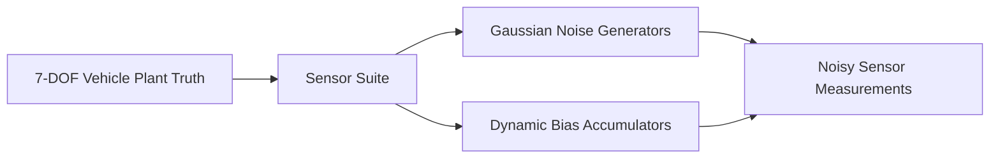

# State Estimation & Parameter Identification Suite

Control algorithms rely on accurate, real-time knowledge of vehicle states. However, critical handling variables—most notably **vehicle body sideslip angle ($\beta$)** and **tyre-road friction coefficient ($\mu$)**—cannot be measured directly on production vehicles due to sensor cost and physical constraints.

This document details the state estimation and optimization suite implemented in `src/vehicle_model/estimation/`:
1. **Realistic Sensor Suite with Noise & Bias** (`SensorSuite`)
2. **Extended Kalman Filter (EKF) Sideslip & Bias Observer** (`EKFSideslipEstimator`)
3. **Recursive Least Squares (RLS) Road Friction Estimator** (`RLSFrictionEstimator`)
4. **Particle Swarm Optimization (PSO) Parameter Tuning Engine** (`ParticleSwarmOptimizer`)

---

## 1. Automotive Sensor Suite & Noise Models

In production vehicles, sensors suffer from measurement noise, digitization quantization, temperature drift, and constant or slowly drifting biases:

### 1.1 Sensor Noise Characteristics
$$\begin{aligned}
a_{x,\text{meas}} &= a_{x,\text{true}} + b_{ax} + \mathcal{N}(0, \sigma_{ax}^2) \\
a_{y,\text{meas}} &= a_{y,\text{true}} + b_{ay} + \mathcal{N}(0, \sigma_{ay}^2) \\
r_{\text{meas}} &= r_{\text{true}} + b_r + \mathcal{N}(0, \sigma_r^2) \\
v_{x,\text{meas}} &= v_{x,\text{true}} + \mathcal{N}(0, \sigma_{vx}^2)
\end{aligned}$$

Default noise statistics matching automotive-grade MEMS IMUs:
- Accelerometer noise: $\sigma_a = 0.08\text{ m/s}^2$, Bias: $b_a = 0.15\text{ m/s}^2$
- Gyroscope noise: $\sigma_r = 0.005\text{ rad/s}$ ($0.29^\circ/\text{s}$), Bias: $b_r = 0.015\text{ rad/s}$ ($0.86^\circ/\text{s}$)
- Wheel speed sensors: $\sigma_{\text{wss}} = 0.12\text{ m/s}$

---

## 2. Extended Kalman Filter (EKF) Sideslip & IMU Bias Observer

Optical ground-speed sensors (such as Correvit sensors) cost upwards of $50,000 and are restricted to prototype test vehicles. The `EKFSideslipEstimator` ([ekf.py](../src/vehicle_model/estimation/ekf.py)) continuously reconstructs lateral velocity $v_y$, body sideslip angle $\beta$, and sensor biases using production-available sensors.

### 2.1 State & Measurement Vectors
- **Estimated State ($n = 4$):**
  $$\hat{\mathbf{x}} = \begin{bmatrix} v_y & r & b_r & b_{ay} \end{bmatrix}^T$$
- **Measurement Vector ($m = 2$):**
  $$\mathbf{z} = \begin{bmatrix} r_{\text{meas}} & a_{y,\text{meas}} \end{bmatrix}^T$$

### 2.2 System Dynamic Model
$$\dot{\hat{\mathbf{x}}} = f(\hat{\mathbf{x}}, \mathbf{u}) = \begin{bmatrix}
a_y - r v_x - b_{ay} \\
\frac{F_{yf} l_f - F_{yr} l_r}{I_z} \\
0 \\
0
\end{bmatrix}$$

### 2.3 Prediction & Update Steps
1. **State Prediction:**
   $$\hat{\mathbf{x}}_{k|k-1} = \hat{\mathbf{x}}_{k-1|k-1} + f(\hat{\mathbf{x}}_{k-1|k-1}, \mathbf{u}_{k-1}) \Delta t$$
2. **Error Covariance Prediction:**
   $$\mathbf{P}_{k|k-1} = \mathbf{F}_k \mathbf{P}_{k-1|k-1} \mathbf{F}_k^T + \mathbf{Q}$$
   Where $\mathbf{F}_k = \left.\frac{\partial f}{\partial \mathbf{x}}\right|_{\hat{\mathbf{x}}}$ is the analytical Jacobian matrix.
3. **Kalman Gain Computation:**
   $$\mathbf{K}_k = \mathbf{P}_{k|k-1} \mathbf{H}_k^T \left(\mathbf{H}_k \mathbf{P}_{k|k-1} \mathbf{H}_k^T + \mathbf{R}\right)^{-1}$$
4. **State & Covariance Correction:**
   $$\hat{\mathbf{x}}_{k|k} = \hat{\mathbf{x}}_{k|k-1} + \mathbf{K}_k \left(\mathbf{z}_k - h(\hat{\mathbf{x}}_{k|k-1})\right)$$
   $$\mathbf{P}_{k|k} = (\mathbf{I} - \mathbf{K}_k \mathbf{H}_k) \mathbf{P}_{k|k-1}$$

The estimated sideslip angle is then computed as $\hat{\beta} = \arctan(\hat{v}_y / v_x)$.

---

## 3. Recursive Least Squares (RLS) Road Friction Estimator

The available friction coefficient $\mu$ dictates the boundary of the tyre friction circle. The `RLSFrictionEstimator` ([friction_estimator.py](../src/vehicle_model/estimation/friction_estimator.py)) estimates $\mu$ in real-time from tyre slip and acceleration signals using linear parameter estimation with an **exponential forgetting factor**.

### 3.1 Linear Regression Model
Under small-to-moderate slip, lateral and longitudinal accelerations scale linearly with available road grip:
$$y_k = \boldsymbol{\phi}_k^T \boldsymbol{\theta}_k + e_k$$
Where:
- Regressor vector $\boldsymbol{\phi}_k$: Normalized slip demand $\sqrt{\bar{\kappa}^2 + \bar{\alpha}^2}$
- Output $y_k$: Measured total normalized acceleration $\sqrt{a_x^2 + a_y^2} / g$
- Parameter $\boldsymbol{\theta}_k$: Estimated friction coefficient $\hat{\mu}$

### 3.2 RLS Update Equations with Forgetting Factor ($\lambda$)
$$\begin{aligned}
\mathbf{K}_k &= \frac{\mathbf{P}_{k-1} \boldsymbol{\phi}_k}{\lambda + \boldsymbol{\phi}_k^T \mathbf{P}_{k-1} \boldsymbol{\phi}_k} \\
\hat{\boldsymbol{\theta}}_k &= \hat{\boldsymbol{\theta}}_{k-1} + \mathbf{K}_k \left(y_k - \boldsymbol{\phi}_k^T \hat{\boldsymbol{\theta}}_{k-1}\right) \\
\mathbf{P}_k &= \frac{1}{\lambda} \left(\mathbf{I} - \mathbf{K}_k \boldsymbol{\phi}_k^T\right) \mathbf{P}_{k-1}
\end{aligned}$$

- **Forgetting factor $\lambda = 0.98$:** Allows the estimator to rapidly identify road transitions (e.g., encountering a split-$\mu$ icy patch within $150\text{ ms}$).
- **Covariance Bounding:** Prevents covariance windup during long straight-line cruising where excitation is near zero.

---

## 4. Particle Swarm Optimization (PSO) Engine

The `ParticleSwarmOptimizer` ([pso.py](../src/vehicle_model/estimation/pso.py)) provides automated derivative-free calibration of control gains (IVMC, LQR, Phase-Plane) and non-linear tyre parameter fitting.

### 4.1 Swarm Velocity & Position Updates
Each particle $i$ in a swarm of size $S$ updates its velocity and position across iterations $k$:

$$\mathbf{v}_i^{(k+1)} = w \mathbf{v}_i^{(k)} + c_1 r_1 \left(\mathbf{p}_{\text{best},i} - \mathbf{x}_i^{(k)}\right) + c_2 r_2 \left(\mathbf{g}_{\text{best}} - \mathbf{x}_i^{(k)}\right)$$
$$\mathbf{x}_i^{(k+1)} = \mathbf{x}_i^{(k)} + \mathbf{v}_i^{(k+1)}$$

Where:
- $w = 0.72$: Inertia weight
- $c_1 = 1.49$: Cognitive acceleration parameter (personal best pull)
- $c_2 = 1.49$: Social acceleration parameter (global best pull)
- $r_1, r_2 \sim \mathcal{U}(0, 1)$: Stochastic exploration vectors

---

## 5. Source Code Cross-Reference

| Component | Class Name | Source File | Unit Tests |
| :--- | :--- | :--- | :--- |
| **Sensor Suite** | `SensorSuite` | [sensors.py](../src/vehicle_model/estimation/sensors.py) | [test_estimation.py](../tests/vehicle_model/test_estimation.py) |
| **EKF Sideslip Observer** | `EKFSideslipEstimator` | [ekf.py](../src/vehicle_model/estimation/ekf.py) | [test_estimation.py](../tests/vehicle_model/test_estimation.py) |
| **RLS Friction Estimator** | `RLSFrictionEstimator` | [friction_estimator.py](../src/vehicle_model/estimation/friction_estimator.py) | [test_estimation.py](../tests/vehicle_model/test_estimation.py) |
| **PSO Calibration Engine** | `ParticleSwarmOptimizer` | [pso.py](../src/vehicle_model/estimation/pso.py) | [test_estimation.py](../tests/vehicle_model/test_estimation.py) |
