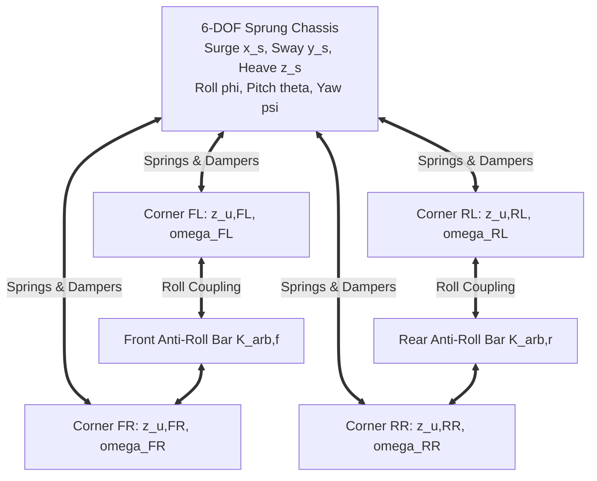

# Suspension Dynamics & Ride Comfort

The vehicle suspension system governs two competing performance objectives:
1. **Ride Comfort (ISO 2631):** Isolating vehicle passengers from high-frequency road vibrations and vertical body acceleration ($\ddot{z}_s$).
2. **Road Holding & Handling:** Maintaining consistent vertical tyre contact force ($F_z$) across rough roads to ensure traction and cornering grip.

This document details the quarter-car and 14-DOF suspension models and semi-active damping policies implemented in `src/vehicle_model/suspension/`.

---

## 1. 2-DOF Quarter-Car Model & Modal Analysis

The quarter-car model captures the fundamental vertical dynamics of a single suspension corner:

```
      ┌─────────────────────────┐
      │   Sprung Mass (m_s)     │ ◄─── Chassis body quarter mass
      └────────────┬────────────┘
                   │
            ┌──────┴──────┐
         k_s│             │c_s, F_act
      Spring│             │Damper / Actuator
            └──────┬──────┘
                   │
      ┌────────────┴────────────┐
      │   Unsprung Mass (m_u)   │ ◄─── Wheel, tyre, knuckle, hub
      └────────────┬────────────┘
                   │
            ┌──────┴──────┐
         k_t│ Tyre Spring │
            └──────┬──────┘
                   │
             Road Profile z_r
```

### 1.1 Equations of Motion
$$\begin{aligned}
m_s \ddot{z}_s &= -k_s(z_s - z_u) - c_s(\dot{z}_s - \dot{z}_u) + F_{\text{act}} \\
m_u \ddot{z}_u &= k_s(z_s - z_u) + c_s(\dot{z}_s - \dot{z}_u) - k_t(z_u - z_r) - F_{\text{act}}
\end{aligned}$$

Where:
- $m_s$: Sprung quarter mass [kg] (typically $350-450\text{ kg}$)
- $m_u$: Unsprung wheel assembly mass [kg] (typically $40-55\text{ kg}$)
- $k_s$: Suspension spring stiffness [N/m]
- $c_s$: Passive shock absorber damping coefficient [$\text{N}\cdot\text{s/m}$]
- $k_t$: Radial tyre carcass stiffness [N/m] (typically $180-220\text{ kN/m}$)
- $z_r$: Road surface elevation profile [m]

### 1.2 Natural Frequencies & Mode Shapes
The quarter-car system exhibits two distinct uncoupled natural modes:
1. **Sprung Mass Body Bounce Mode:**
   $$f_s \approx \frac{1}{2\pi} \sqrt{\frac{k_s}{m_s}} \approx 1.1 - 1.4\text{ Hz}$$
   Human sensitivity to motion sickness and vibration discomfort peaks in this frequency band ($1.0 - 2.0\text{ Hz}$).
2. **Unsprung Wheel Hop Mode:**
   $$f_u \approx \frac{1}{2\pi} \sqrt{\frac{k_t}{m_u}} \approx 10.0 - 12.0\text{ Hz}$$
   Wheel hop induces rapid oscillations in tyre normal force $\Delta F_z$, degrading traction and ABS braking.

---

## 2. Semi-Active Suspension Control Policies

Passive shock absorbers require compromising between soft damping (good ride comfort, poor wheel control) and stiff damping (firm handling, harsh ride). Semi-active dampers resolve this by continuously modulating damping force $F_{\text{act}}$ via magnetorheological (MR) fluid or solenoid valves.

### 2.1 Skyhook Damping (Karnopp Formulation)
The Skyhook policy acts as a virtual damper connected between the sprung mass and an imaginary stationary ceiling in the inertial frame:

$$F_{\text{sky}} = -C_{\text{sky}} \dot{z}_s$$

#### Semi-Active Realizability Condition
Because a semi-active damper cannot inject active mechanical energy, it can only generate force dissipative to relative suspension velocity $(\dot{z}_s - \dot{z}_u)$:

$$F_{\text{act}} = \begin{cases}
-C_{\text{sky}} \dot{z}_s & \text{if } \dot{z}_s (\dot{z}_s - \dot{z}_u) \ge 0 \\
0 & \text{otherwise}
\end{cases}$$

**Performance Result:** Reduces passenger vertical acceleration RMS ($\text{RMS}(\ddot{z}_s)$) by **$>20\%$** across ISO 2631 bump traversals compared to passive dampers.

### 2.2 Groundhook Damping
Groundhook ties the virtual damper to the stationary road frame to minimize tyre deflection:
$$F_{\text{ground}} = C_{\text{ground}} \dot{z}_u$$
$$\text{Condition: } \dot{z}_u (\dot{z}_s - \dot{z}_u) \le 0$$
Stabilizes dynamic tyre normal load fluctuations $\Delta F_z$, maximizing braking grip and contact patch adhesion over washboard roads.

---

## 3. Fourteen Degree-of-Freedom (14-DOF) Full Vehicle Dynamics

The `FourteenDOFVehicleModel` ([fourteen_dof.py](../src/vehicle_model/suspension/fourteen_dof.py)) provides complete multi-body coupled chassis simulation:



### 3.1 Braking Pitch & Cornering Roll Dynamics
- **Braking Pitch ($\theta$):** Inertial deceleration moment $m a_x h_{\text{cog}}$ compresses front suspension and extends rear suspension (pitch dive).
- **Cornering Roll ($\phi$):** Lateral centrifugal moment $m a_y h_{\text{cog}}$ rolls the sprung mass towards the outside corners, transferring vertical load through suspension linkages and anti-roll bars.

---

## 4. Source Code Cross-Reference

| Component | Class Name | Source File | Unit Tests |
| :--- | :--- | :--- | :--- |
| **Quarter-Car Plant** | `QuarterCarModel` | [quarter_car.py](../src/vehicle_model/suspension/quarter_car.py) | [test_suspension.py](../tests/vehicle_model/test_suspension.py) |
| **Skyhook Controller** | `SkyhookController` | [quarter_car.py](../src/vehicle_model/suspension/quarter_car.py) | [test_suspension.py](../tests/vehicle_model/test_suspension.py) |
| **14-DOF Vehicle Plant** | `FourteenDOFVehicleModel` | [fourteen_dof.py](../src/vehicle_model/suspension/fourteen_dof.py) | [test_suspension.py](../tests/vehicle_model/test_suspension.py) |
