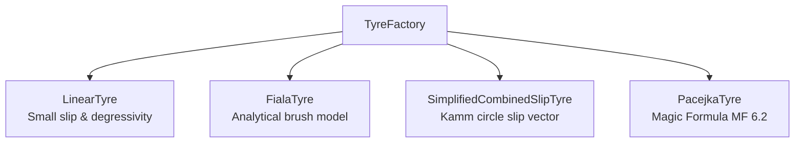

# Interchangeable Tyre Models & Provenance Framework

Tyre forces represent the primary control forces governing ground vehicle stability, acceleration, and cornering. This document details the mathematical formulations, combined-slip coupling mechanisms, load sensitivity, and strict **Tyre Provenance Standard** implemented in the platform.

---

## 1. Tyre Slip Kinematics & Conventions

Tyre forces are calculated in the wheel heading coordinate frame adhering to **ISO 8855**:
- Longitudinal wheel axis $x_w$: Points forward along the wheel plane.
- Lateral wheel axis $y_w$: Points to the left of the wheel plane.
- Vertical wheel axis $z_w$: Points upwards from the contact patch.

### 1.1 Longitudinal Slip Ratio ($\kappa$)
$$\kappa = \frac{\omega R_{\text{eff}} - v_{w,x}}{\max\left(|v_{w,x}|, v_{\epsilon}\right)}$$
- Pure rolling: $\kappa = 0$
- Full acceleration slip: $\kappa > 0$
- Full braking lockup: $\kappa = -1.0$ (when $\omega = 0$ and $v_{w,x} > 0$)

### 1.2 Lateral Slip Angle ($\alpha$)
$$\alpha = -\arctan\left(\frac{v_{w,y}}{\max\left(|v_{w,x}|, v_{\epsilon}\right)}\right)$$
- Rightward steer / leftward cornering produces negative lateral velocity $v_{w,y} < 0 \implies \alpha > 0$, generating positive restoring lateral force $F_y > 0$.

---

## 2. Mandatory Tyre Provenance Standard

To prevent unphysical extrapolation or mixing incompatible parameters, every tyre instance implements the `TyreModel` protocol and must expose a valid `TyreProvenance` metadata object:

```python
@dataclass(frozen=True)
class TyreProvenance:
    model_name: str           # e.g., "Pacejka Magic Formula 6.2 Passenger"
    formulation: str          # "linear", "fiala", "simplified_combined", "pacejka"
    data_classification: str  # "synthetic", "fitted", or "measured"
    source_reference: str     # Origin paper, dataset, or laboratory test rig ID
    nominal_load_N: float     # Reference vertical load F_z0 [N]
    valid_slip_range: tuple[float, float]    # [kappa_min, kappa_max] (e.g., [-1.0, 1.0])
    valid_alpha_range_deg: tuple[float, float] # [alpha_min, alpha_max] (e.g., [-25.0, 25.0])
    valid_fz_range_N: tuple[float, float]    # [Fz_min, Fz_max] (e.g., [200.0, 10000.0])
```

---

## 3. Mathematical Formulations of Supported Tyre Models

The platform provides four interchangeable tyre models:



---

### 3.1 Linear Tyre Model (`LinearTyre`)

Applicable for small slip angles ($|\alpha| \le 3^\circ$) and modest longitudinal slip ($|\kappa| \le 0.05$):

$$\begin{aligned}
F_{x0} &= C_\kappa \kappa \\
F_{y0} &= C_\alpha \alpha
\end{aligned}$$

#### 3.1.1 Normal Load Degressivity
In real pneumatic tyres, cornering stiffness exhibits load degressivity ($\partial^2 C_\alpha / \partial F_z^2 < 0$):
$$C_\alpha(F_z) = C_{\alpha 0} \left(\frac{F_z}{F_{z0}}\right) \left[1 - c_{\text{deg}} \left(\frac{F_z}{F_{z0}} - 1\right)\right]$$
Where $c_{\text{deg}} \in [0.10, 0.25]$ is the load degressivity coefficient.

#### 3.1.2 Friction Circle Bounding
Forces are hard-bounded by Kamm's friction circle:
$$\sqrt{F_x^2 + F_y^2} \le \mu F_z$$

---

### 3.2 Fiala Analytical Brush Tyre Model (`FialaTyre`)

The Fiala model is a physically rigorous analytical brush model with parabolic normal pressure distribution over a rectangular contact patch. It explicitly computes the boundary between the **elastic adhesion zone** and the **sliding zone**.

#### 3.2.1 Critical Slip Angle ($\alpha_{\text{crit}}$)
$$\alpha_{\text{crit}} = \arctan\left(\frac{3 \mu F_z}{C_\alpha}\right)$$

#### 3.2.2 Pure Lateral Force ($F_y$)
$$\begin{aligned}
F_y &= -C_\alpha \tan \alpha + \frac{C_\alpha^2}{3 \mu F_z} |\tan \alpha| \tan \alpha - \frac{C_\alpha^3}{27 \mu^2 F_z^2} \tan^3 \alpha \quad & (|\alpha| < \alpha_{\text{crit}}) \\
F_y &= -\mu F_z \operatorname{sgn}(\alpha) \quad & (|\alpha| \ge \alpha_{\text{crit}})
\end{aligned}$$

#### 3.2.3 Self-Aligning Torque ($M_z$)
$$M_z = \begin{cases}
C_m \tan \alpha \left(1 - \frac{C_\alpha |\tan \alpha|}{3 \mu F_z}\right)^3 & (|\alpha| < \alpha_{\text{crit}}) \\
0 & (|\alpha| \ge \alpha_{\text{crit}})
\end{cases}$$

---

### 3.3 Simplified Combined Slip Tyre (`SimplifiedCombinedSlipTyre`)

This model normalizes longitudinal slip ratio $\kappa$ and lateral slip angle $\alpha$ into a unified 2D slip vector $\mathbf{s}$:

$$s = \sqrt{\left(\frac{\kappa}{\kappa_{\text{peak}}}\right)^2 + \left(\frac{\alpha}{\alpha_{\text{peak}}}\right)^2}$$

The total normalized force magnitude $F_{\text{total}}$ is evaluated via a modified hyperbolic saturation curve:
$$F_{\text{total}} = \mu F_z \frac{2}{\pi} \arctan\left(\frac{\pi}{2} s\right)$$

Decomposing along the longitudinal and lateral slip directions:
$$\begin{aligned}
F_x &= F_{\text{total}} \frac{\kappa / \kappa_{\text{peak}}}{s} \\
F_y &= F_{\text{total}} \frac{\alpha / \alpha_{\text{peak}}}{s}
\end{aligned}$$

By construction, this formulation **strictly satisfies Kamm's friction circle** $\sqrt{F_x^2 + F_y^2} \le \mu F_z$ everywhere in the operating envelope.

---

### 3.4 Pacejka Magic Formula 6.2 Tyre (`PacejkaTyre`)

The flagship high-fidelity model implements the industry-standard Pacejka Magic Formula trigonometric function:

$$y(x) = D \sin\left(C \arctan\left(B x - E(B x - \arctan(Bx))\right)\right)$$

Where:
- $B$: Stiffness factor
- $C$: Shape factor ($C \approx 1.30-1.65$)
- $D = \mu F_z$: Peak force factor
- $E$: Curvature factor ($E \le 1.0$)

#### 3.4.1 Load-Dependent Lateral Parameters
$$\begin{aligned}
D_y &= \mu_y F_z \\
C_y &= p_{Cy1} \\
B_y &= \frac{K_{y0}}{C_y D_y} = \frac{p_{Ky1} F_{z0} \sin\left(2 \arctan(F_z / (p_{Ky2} F_{z0}))\right)}{C_y D_y} \\
E_y &= \left(p_{Ey1} + p_{Ey2} df_z\right) \left[1 - p_{Ey3} \operatorname{sgn}(\alpha)\right]
\end{aligned}$$
Where $df_z = (F_z - F_{z0}) / F_{z0}$ is normalized load deflection.

#### 3.4.2 Combined Slip Longitudinal Reduction
When braking or driving while cornering, available lateral grip degrades according to the friction ellipse:
$$F_y = F_{y0} \sqrt{\max\left(0.0, 1.0 - \left(\frac{F_x}{\mu F_z}\right)^2\right)}$$

---

## 4. Automated Diagnostic Plotting Suite

Generate the full 8-panel diagnostic characterization suite across variable vertical loads ($F_z \in [2\text{ kN}, 8\text{ kN}]$) and friction surfaces ($\mu \in [0.2, 1.0]$):

```bash
python -m vehicle_model.tire_model.plots --all
```

Outputs high-definition publication-quality curves to `output/tyres/`:
1. `fy_vs_alpha.png`: Lateral force saturation curves
2. `fx_vs_kappa.png`: Longitudinal traction/braking curves
3. `kamm_friction_circle.png`: Combined slip coupling envelopes
4. `self_aligning_torque.png`: Pneumatic trail and aligning torque curves
5. `load_sensitivity.png`: Vertical load degressivity demonstration

---

## 5. Source Code Cross-Reference

| Model | Class Name | Source File | Configuration YAML |
| :--- | :--- | :--- | :--- |
| **Linear Tyre** | `LinearTyre` | [linear_tire.py](../src/vehicle_model/tire_model/linear_tire.py) | [linear_passenger_synthetic.yaml](../configs/tyres/linear_passenger_synthetic.yaml) |
| **Fiala Brush Tyre** | `FialaTyre` | [fiala_tire.py](../src/vehicle_model/tire_model/fiala_tire.py) | [fiala_passenger_synthetic.yaml](../configs/tyres/fiala_passenger_synthetic.yaml) |
| **Simplified Combined** | `SimplifiedCombinedSlipTyre` | [simplified_combined.py](../src/vehicle_model/tire_model/simplified_combined.py) | [simplified_combined_synthetic.yaml](../configs/tyres/simplified_combined_synthetic.yaml) |
| **Pacejka MF 6.2** | `PacejkaTyre` | [pacejka_tire.py](../src/vehicle_model/tire_model/pacejka_tire.py) | [pacejka_front_synthetic.yaml](../configs/tyres/pacejka_front_synthetic.yaml) |
