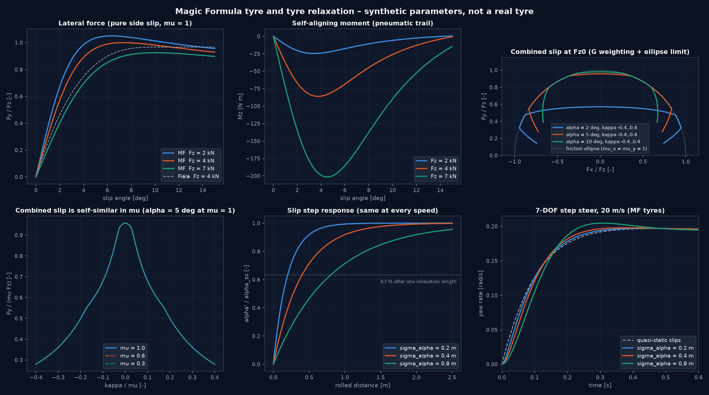

# Tyre Models, Relaxation and Provenance

Package: [`src/vehicle_model/tire_model/`](../src/vehicle_model/tire_model/)

All tyre models implement one interface, `TyreModel`. That interface lets you swap the tyre without changing the vehicle models (Plan.md, section 7). This document states what each model computes and what it does **not** compute. A model claims only the effects its formulation contains. All parameter sets are synthetic and do not represent any real tyre.

---

## 1. Conventions

Forces are computed in the wheel frame (ISO 8855: $x_w$ forward in the wheel plane, $y_w$ to the left, $z_w$ up).

| Quantity | Definition (vehicle models, `seven_dof.py`) | Sign |
|---|---|---|
| Longitudinal slip | $\kappa = \dfrac{\omega R_{\text{eff}} - v_{w,x}}{\max(\lvert v_{w,x}\rvert, \lvert\omega R_{\text{eff}}\rvert, v_\epsilon)}$ | $\kappa > 0$ (driving) gives $F_x > 0$; $\kappa = -1$ means a locked wheel |
| Slip angle | $\alpha = -\arctan\dfrac{v_{w,y}}{\max(\lvert v_{w,x}\rvert, v_\epsilon)}$ | $\alpha > 0$ gives $F_y > 0$ |
| Aligning moment | about $+z_w$ | $M_z < 0$ for $\alpha > 0$ at small slip (turns the wheel towards its velocity) |

$v_\epsilon = 0.2$ m/s. Every model returns zero force for $F_z \le 0$ (contact loss) or $\mu \le 0$. The road friction $\mu$ is a scaling factor relative to a dry road ($\mu = 1$). The tyre's own peak friction may additionally depend on load.

## 2. Interface and provenance

```python
class TyreModel(Protocol):
    provenance: TyreProvenance
    def forces(self, kappa, alpha, Fz, mu) -> tuple[Fx, Fy]: ...   # vectorised, wheel frame [N]
    def slip_stiffness(self, Fz, mu) -> dFx/dkappa at kappa = 0: ...  # used for integrator step control
```

`TyreProvenance` (all parameter sets in [`configs/tyres/`](../configs/tyres/) must carry it; the loader rejects sets without the first five fields):

| Field | Meaning |
|---|---|
| `formulation`, `version` | model and its revision |
| `source` | where the values come from |
| `data_class` | `measured` · `fitted` · `synthetic` (all bundled sets are `synthetic`) |
| `reference_load` | $F_{z0}$ [N] |
| `valid_kappa`, `valid_alpha` | validity range |
| `limitations` | effects the model does **not** represent |

Optional capabilities beyond the interface: only `MagicFormulaTyre` provides `forces_and_moment` / `aligning_moment` ($M_z$), `cornering_stiffness` and `peak_friction`.

---

## 3. Models

### Overview

| Model (YAML `model:`) | Class | Pure slip | Combined slip | Peak and friction drop | Load sensitivity | $M_z$ | Bundled sets |
|---|---|---|---|---|---|---|---|
| `linear` | `LinearTyre` | linear | none (optional circle clip) | no | $C_\alpha/F_z$ | no | `linear_passenger_synthetic` |
| `fiala` | `FialaTyre` | brush, cubic | isotropic brush | peak = sliding, no drop | $C_\alpha/F_z$, $\mu$ | no | `fiala_passenger_synthetic` |
| `simplified_combined` | `SimplifiedCombinedSlipTyre` | single envelope | normalised slip vector | yes | $\alpha_{\text{peak}}$, $\mu$ | no | `simplified_combined_synthetic`, `simplified_combined_staggered_{front,rear}` |
| `magic_formula` | `MagicFormulaTyre` | MF 5.2 subset | MF 5.2 weighting (normalised) + ellipse limit | yes | $K$, $\mu$, $E$ | yes | `magic_formula_passenger_synthetic` |
| `pacejka` | `PacejkaTyre` (legacy) | lateral MF, linear $F_x$ | friction circle | **hard clip, no peak** | via MF data | no | `pacejka_{front,rear}_synthetic` |

Which vehicle uses which tyre: `seven_dof_passenger` (the default vehicle) and the 14-DOF model use `magic_formula_passenger_synthetic` (since M6; before: `pacejka_*_synthetic`). `reference_passenger_car` uses `fiala_passenger_synthetic`.

### 3.1 Linear (`LinearTyre`, [brush_models.py](../src/vehicle_model/tire_model/brush_models.py))

$$F_x = c_\kappa F_z\,\kappa, \qquad F_y = c_\alpha(F_z)\,F_z\,\alpha, \qquad c_\alpha(F_z) = \max\!\big(c_\alpha(1 - s\,df_z),\ 0.1\,c_\alpha\big),\ df_z = \tfrac{F_z - F_{z0}}{F_{z0}}$$

Valid for small slips only (set: $|\kappa| \le 0.03$, $|\alpha| \le 0.04$ rad). With `saturate=True`, the force vector is clipped to $\mu F_z$. This is a crude limit, not a combined-slip model.

### 3.2 Fiala brush (`FialaTyre`, [brush_models.py](../src/vehicle_model/tire_model/brush_models.py))

Isotropic brush model with a parabolic pressure distribution (Pacejka 2012, ch. 3), using the theoretical slips $s_x = \kappa/(1+\kappa)$ and $s_y = \tan\alpha/(1+\kappa)$:

$$\psi = \sqrt{(C_\kappa s_x)^2 + (C_\alpha s_y)^2}, \qquad F = \begin{cases}\psi - \dfrac{\psi^2}{3\mu_{\text{eff}} F_z} + \dfrac{\psi^3}{27\mu_{\text{eff}}^2 F_z^2} & \psi < 3\mu_{\text{eff}} F_z\\ \mu_{\text{eff}} F_z & \text{otherwise}\end{cases}, \qquad (F_x, F_y) = F\,\frac{(C_\kappa s_x,\ C_\alpha s_y)}{\psi}$$

The model uses $C_\alpha = c_\alpha(F_z) F_z$ (load-sensitive as in 3.1), $C_\kappa = c_\kappa F_z$ and $\mu_{\text{eff}} = \mu\,(1 - s_\mu df_z)$. The resultant never exceeds $\mu_{\text{eff}} F_z$. Not modelled: friction drop after the peak, aligning moment, camber.

### 3.3 Simplified combined slip (`SimplifiedCombinedSlipTyre`, [combined_slip.py](../src/vehicle_model/tire_model/combined_slip.py))

This is **not** a Pacejka model. It normalises the slip vector and applies one envelope to both directions:

$$\sigma = \sqrt{(\kappa/\kappa_p)^2 + (\tan\alpha/\tan\alpha_p)^2}, \qquad F = \mu_{\text{eff}} F_z\, g(\sigma), \qquad (F_x, F_y) = F\,\frac{(\kappa/\kappa_p,\ \tan\alpha/\tan\alpha_p)}{\sigma}$$

$g(\sigma) = \sin(1.5\arctan(1.1\sigma))$ up to $\sigma = 1.2$. After that, $g$ falls linearly to the sliding ratio over $\Delta\sigma = 4$. $\tan\alpha_p$ grows with load ($s_p\,df_z$), and $\mu_{\text{eff}}$ falls with load. The resultant stays inside $\mu_{\text{eff}} F_z$. Not modelled: separate $F_x$ and $F_y$ shapes, aligning moment, camber.

### 3.4 Magic Formula 5.2 subset (`MagicFormulaTyre`, [magic_formula.py](../src/vehicle_model/tire_model/magic_formula.py))

Parametrised MF following Pacejka 2012, sec. 4.3.2. The coefficient names follow the book; the ISO sign convention is adapted. All shifts $S_H$ and $S_V$ are zero, so the tyre is symmetric. With $x^* = \tan\alpha$:

$$y(x) = D\sin\!\big(C\arctan(Bx - E(Bx - \arctan Bx))\big)$$

| | $D$ | $C$ | $K = BCD$ | $E$ |
|---|---|---|---|---|
| $F_{x0}(\kappa)$ | $(p_{Dx1} + p_{Dx2} df_z)\,\mu F_z$ | $p_{Cx1}$ | $F_z(p_{Kx1} + p_{Kx2} df_z)\,e^{p_{Kx3} df_z}$ | $\min(p_{Ex1} + p_{Ex2} df_z + p_{Ex3} df_z^2,\ 1)$ |
| $F_{y0}(x^*)$ | $(p_{Dy1} + p_{Dy2} df_z)\,\mu F_z$ | $p_{Cy1}$ | $p_{Ky1} F_{z0}\sin(2\arctan\frac{F_z}{p_{Ky2}F_{z0}})$ | $\min(p_{Ey1} + p_{Ey2} df_z,\ 1)$ |

The road friction $\mu$ acts **on the peak only**. The slip stiffnesses $K$ do not depend on $\mu$, and the peak slips scale with $\mu$.

**Combined slip.** The model applies the MF 5.2 cosine weighting functions to **friction-normalised** slips $\kappa_n = \kappa/\mu$ and $x_n = x^*/\mu$:

$$G_{x\alpha} = \cos\!\big(r_{Cx1}\arctan(r_{Bx1}\cos(\arctan(r_{Bx2}\kappa_n))\,x_n)\big), \qquad G_{y\kappa} = \cos\!\big(r_{Cy1}\arctan(r_{By1}\cos(\arctan(r_{By2}x_n))\,\kappa_n)\big)$$

$$(F_x', F_y') = (G_{x\alpha}F_{x0},\ G_{y\kappa}F_{y0}), \qquad e = \sqrt{(F_x'/D_x)^2 + (F_y'/D_y)^2}, \qquad (F_x, F_y) = \frac{(F_x', F_y')}{\max(1, e)}$$

This differs from MF 5.2 in two documented ways:

1. **Normalised slips.** In MF 5.2 the coupling would act at a different fraction of the peak on each road, and the resultant would exceed the ellipse by up to about 35 % at $\mu = 0.3$. With the normalisation, the combined-slip map is self-similar in $\mu$: $F(\mu\kappa, \arctan(\mu\tan\alpha); \mu) = \mu F(\kappa, \alpha; 1)$. The same holds in brush theory.
2. **Ellipse limiter.** $G = 1 - O(s^2)$ while the other force grows linearly. Once one slip is near its peak, any additional slip pushes the resultant beyond the ellipse (by up to about 10 %). The limiter scales the force vector radially back onto the ellipse, so the force rotates instead of growing. Pure slip is unaffected. The limiter is continuous, but its **derivative jumps** where it engages. At $F_{z0}$ it is active on about 40 % of the range $|\alpha| \le 6°$, $|\kappa| \le 0.1$, mostly with an overshoot of a few percent. Linearisations and gradient-based controllers see a kink there.

$r_{Cx1}, r_{Cy1} \le 1$ is enforced, so $G \ge 0$ and forces never reverse direction.

**Aligning moment** (pure side slip; under combined slip with the equivalent slip angle):

$$\alpha_{eq} = \operatorname{sgn}(x^*)\sqrt{x^{*2} + (K_x/K_y)^2\kappa^2}, \qquad t = D_t\cos\!\big(C_t\arctan(B_t\alpha_{eq} - E_t(B_t\alpha_{eq} - \arctan B_t\alpha_{eq}))\big)\cos\alpha, \qquad M_z = -t\,F_y$$

with $D_t = F_z\frac{R_0}{F_{z0}}(q_{Dz1} + q_{Dz2} df_z)$, $B_t = q_{Bz1} + q_{Bz2} df_z$, $C_t = q_{Cz1}$ and $E_t = \min(q_{Ez1} + q_{Ez2} df_z, 1)$. Not modelled: the lever-arm term $s\,F_x$, the residual moment $M_{zr}$, camber, turn slip, inflation pressure, rolling-resistance and overturning moments.

**Parameter set `magic_formula_passenger_synthetic`** (synthetic; the values give textbook magnitudes):

| $F_z$ | $C_\alpha/F_z$ | $C_\kappa/F_z$ | peak $\mu_y$ at $\alpha$ | peak $\mu_x$ at $\kappa$ | trail at $\alpha \to 0$ | peak $\lvert M_z\rvert$ |
|---|---|---|---|---|---|---|
| 2 kN | 21.9 /rad | 22.1 | 1.05 at 6.3° | 1.04 at 0.10 | 1.6 cm | 25 N m |
| 4 kN ($F_{z0}$) | 18.0 /rad | 20.0 | 1.00 at 7.3° | 1.00 at 0.11 | 3.1 cm | 86 N m |
| 7 kN | 12.1 /rad | 17.2 | 0.93 at 10.0° | 0.94 at 0.12 | 5.0 cm | 202 N m |

### 3.5 Legacy Pacejka adapter (`PacejkaTyre`, [pacejka.py](../src/vehicle_model/tire_model/pacejka.py))

The adapter evaluates the lateral MF from the YAML coefficient sets in `tire_model/tire_data/yamls/` (via `magic_formula_lateral.py`). It removes the force at zero slip, so the tyre is symmetric. Known limitations (audit 4.6; also listed in the parameter sets):

- $F_y$ is clipped hard at $\mu F_z$. It reaches that limit at about 2–3° ($C_\alpha/F_z \approx 33$ /rad at $F_{z0}$). There is no peak and no sliding range.
- $F_x = \operatorname{sgn}(\kappa)\min(c_\kappa F_z|\kappa|, \mu F_z)$: linear up to a hard limit.
- $\mu$ multiplies the whole lateral curve, so the cornering stiffness scales with $\mu$. This is physically wrong.
- The combined slip uses a friction circle; a scalar loop runs over the wheels (slow).

Until M6 the adapter was the default tyre. It also produced a lateral pull under longitudinal slip (fixed in M6 by keeping the part of $F_y$ that is odd in $\alpha$). Since M6 the default is `magic_formula_passenger_synthetic`; the adapter remains available.

---

## 4. Transient behaviour: relaxation length

[`relaxation.py`](../src/vehicle_model/tire_model/relaxation.py) (`TyreRelaxation`) uses first-order relaxation in **deflection form** (Pacejka 2012, sec. 7.2):

$$\sigma_\kappa\,\dot\kappa' = (\omega R - v_{w,x}) - V_{\text{ref}}\,\kappa', \qquad \sigma_\alpha\,\dot s' = -v_{w,y} - V_x\,s' \quad (s' = \tan\alpha')$$

with $V_{\text{ref}} = \max(|v_{w,x}|, |\omega R|, v_\epsilon)$ and $V_x = \max(|v_{w,x}|, v_\epsilon)$.

- The steady states are **exactly** the quasi-static slips of section 1.
- At constant speed, a slip step responds as $1 - e^{-x/\sigma}$ over the rolled distance $x$, independent of speed. This is a low-pass with time constant $\sigma/V$.
- Unlike the form $\dot\alpha = \tfrac{V}{\sigma}(\alpha_{ss} - \alpha)$, the deflection form stays well posed at standstill.
- Defaults (synthetic): $\sigma_\kappa = 0.10$ m, $\sigma_\alpha = 0.40$ m.
- Limits: constant relaxation lengths (no load or slip dependence), no carcass mass, valid only up to about 10 Hz and for wavelengths above about $2\pi\sigma$.

**Vehicle integration.** [`seven_dof_transient.py`](../src/vehicle_model/vehicle_models/seven_dof_transient.py) adds `TransientSevenDOFModel` (opt-in). The slips become states: 10 base states, plus $\kappa'$ (4), plus $\tan\alpha'$ (4), giving 18. Two hooks in `SevenDOFModel` (`_slips`, `_extra_derivatives`) supply them. Tyre models, loads, and body and wheel equations stay unchanged. The sub-stepping bound covers the coupled wheel/relaxation eigenvalue $|\lambda| \le V/\sigma_\kappa + \sqrt{C_\kappa R^2/(I_w\sigma_\kappa)}$. Use `steady_slip_state(state, u)` to set consistent initial values.

Step steer at 20 m/s with MF tyres (`examples/tyre_models_m3_demo.py`):

| $\sigma_\alpha$ | yaw rate at 20 ms (relative to quasi-static) | peak (relative) | value at 0.6 s (relative) |
|---|---|---|---|
| 0.2 m | 0.63 | 1.002 | 0.999 |
| 0.4 m | 0.42 | 1.006 | 0.998 |
| 0.8 m | 0.25 | 1.040 | 0.992 |

The slip builds up with a delay, so the early yaw rate is lower. The lag also reduces yaw damping, which shows as a larger overshoot. The steady state is the same; the run lasts only 0.6 s, so the last column has not fully settled yet.

---

## 5. Verification

| Test | Checks |
|---|---|
| [test_tire_framework.py](../tests/vehicle_model/test_tire_framework.py) | all models: provenance, $\lvert F\rvert \le \mu F_z$ at $F_z$ = 4 kN, zero force without slip, load or friction, combined-slip reduction, $C_\kappa > 0$ |
| [test_magic_formula.py](../tests/vehicle_model/test_magic_formula.py) | stiffnesses = analytical values and independent of $\mu$; peak = $D$ with friction drop; peak slip $\propto \mu$; ellipse on the grid ($F_z$ 1.5–7 kN, $\mu$ 0.2–1); self-similarity in $\mu$; limiter does not touch pure slip and is continuous; odd symmetry and signs; trail at $\alpha \to 0$ and $M_z$ sign change; contact loss; swappable in the 7-DOF model |
| [test_tyre_relaxation.py](../tests/vehicle_model/test_tyre_relaxation.py) | analytical step response over distance (5 and 30 m/s); steady state = quasi-static slips (rel. 1e-14); standstill; base derivative reproduced; delayed build-up; first-order convergence to the base model as $\sigma \to 0$; low-speed launch |
| [test_regression_baseline.py](../tests/vehicle_model/test_regression_baseline.py) | force grids of all bundled tyre sets |

## 6. Plots

```bash
python -m vehicle_model.tire_model.plots --all          # 8-panel figure per tyre set: output/tyres/<name>_curves.png
python examples/tyre_models_m3_demo.py                  # MF Mz, combined slip, mu self-similarity, relaxation: output/tyres/tyre_models_m3.png
```

---

<!-- figures:start -->

## Ergebnisbilder

> Alle Bilder sind Simulationsergebnisse mit synthetischen Parametern, keine Messungen. Neu erzeugen: Quellskript ausführen, dann `python tools/publish_doc_figures.py`.



*Magic-Formula-Reifen (synthetisch) gegen Fiala: Seitenkraft und Rückstellmoment bei drei Radlasten, kombinierter Schlupf, Selbstähnlichkeit in µ, Relaxation und Lenkwinkelsprung des 7-DOF-Modells mit Relaxationslängen. Quelle: `examples/tyre_models_m3_demo.py`.*

<!-- figures:end -->
