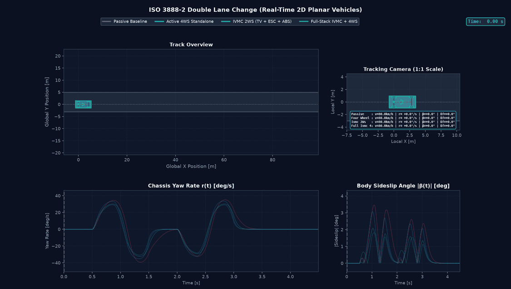
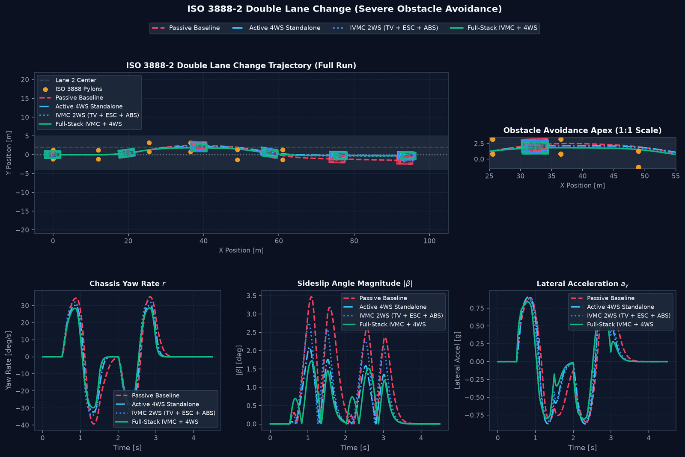
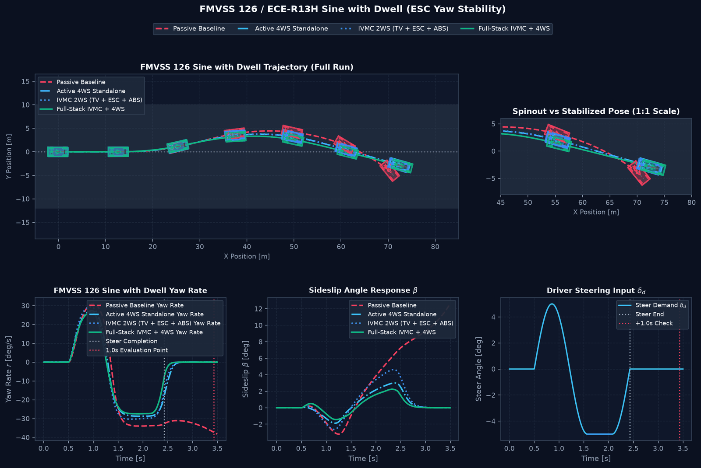
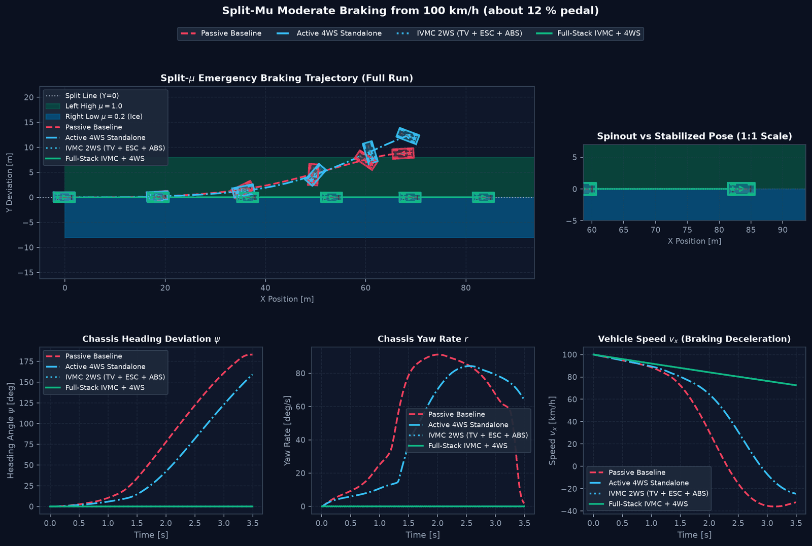
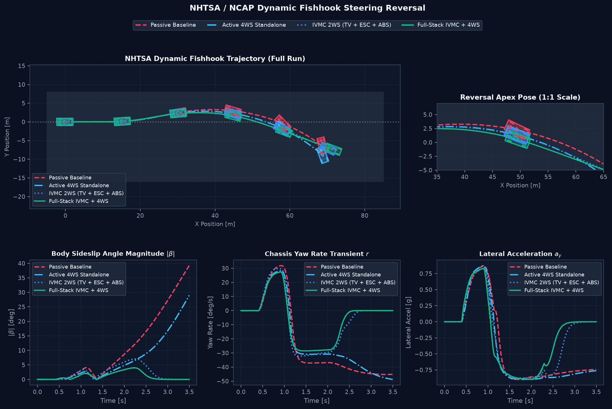

# Automotive Virtual Validation Platform Specification

This document details the standardized maneuvers, kinematic formulas, KPI metrics, and pass/fail acceptance thresholds implemented in the automated virtual validation platform conforming to [Plan.md](../Plan.md) (§16, §19 M8).

---

## 1. Validation Matrix Overview

The validation platform executes 9 standardized virtual testing scenarios designed to evaluate passive baselines and active chassis control systems (IVMC, 4WS, Skyhook):

| Scenario Index | Standard / Maneuver Name | Key Tested Mechanism | Road Condition | Speed |
| :---: | :--- | :--- | :---: | :---: |
| 1 | **ISO 3888-2 Double Lane Change** | Obstacle avoidance & corridor tracking | $\mu = 0.85$ Dry | 80 km/h |
| 2 | **Split-$\mu$ Emergency Braking** | Differential braking yaw stabilization | $\mu = [0.9, 0.2]$ Split | 100 km/h |
| 3 | **FMVSS 126 / ECE-R13H Sine with Dwell** | ESC yaw stability & damping at 1.0s / 1.75s | $\mu = 0.90$ Dry | 80 km/h |
| 4 | **ISO 7401 Transient Step Steer** | Transient response time & linear yaw damping | $\mu = 0.90$ Dry | 100 km/h |
| 5 | **ISO 2631 Ride Comfort Bump** | Skyhook semi-active body acceleration reduction | Continuous bump | 50 km/h |
| 6 | **ISO 7975 Braking in a Turn** | Combined-slip cornering brake control (CBC) | $\mu = 0.85$ Dry | 80 km/h |
| 7 | **NHTSA NCAP Dynamic Fishhook** | Severe steering reversal & rollover prevention | $\mu = 0.90$ Dry | 80 km/h |
| 8 | **Low-Speed Tight Slalom** | Counter-phase 4WS virtual wheelbase reduction | $\mu = 0.90$ Dry | 30 km/h |
| 9 | **High-Speed Highway Lane Change** | In-phase 4WS crab translation & sideslip reduction | $\mu = 0.90$ Dry | 120 km/h |

---

## 2. Mathematical Definition of Engineering KPIs (Plan.md §16.1)

1. **Yaw-Rate Tracking Error ($e_r$):**
   $$e_r(t) = r(t) - r_{\text{des}}(t), \quad r_{\text{des}} = \frac{v_x}{L + K_{us} v_x^2} \delta_f$$
   Evaluates how closely the chassis follows the driver's intended yaw trajectory.
2. **Body Sideslip Angle ($\beta$):**
   $$\beta(t) = \arctan\left(\frac{v_y(t)}{v_x(t)}\right)$$
   Masked at standstill speeds ($v_x < 2.5\text{ m/s}$) to eliminate kinematic division-by-zero singularities.
3. **Heading Deviation ($\Delta \psi$):**
   $$\Delta \psi = |\psi(t_{\text{final}}) - \psi_{\text{ref}}|$$
   Quantifies yaw drift, spinout, or highway departure.
4. **Lateral Path Error ($e_y$):**
   $$e_y(t) = |Y(t) - Y_{\text{corridor}}(t)|$$
   Measures lane deviation and obstacle corridor compliance.
5. **Tyre Friction Utilization ($\mu_{\text{util}}$):**
   $$\mu_{\text{util},i} = \frac{\sqrt{F_{x,i}^2 + F_{y,i}^2}}{\mu_i F_{z,i}} \le 1.0$$
   Strictly checks boundary compliance with Kamm's friction circle.
6. **Sprung Mass Vertical Acceleration RMS (ISO 2631):**
   $$\text{RMS}(\ddot{z}_s) = \sqrt{\frac{1}{T} \int_0^T \ddot{z}_s^2(t) dt}$$
   Measures passenger vertical vibration and suspension ride quality.

---

## 3. Acceptance Criteria & Pass/Fail Thresholds

| Scenario | Candidate Controller | Monitored Metric | Acceptance Threshold | Physical Rationale |
| :--- | :--- | :--- | :---: | :--- |
| `iso_3888_dlc` | 4WS / IVMC | Peak Sideslip Angle | $\le 6.0^\circ$ | Prevents rear-axle spinout in emergency obstacle avoidance |
| `mu_split_braking` | IVMC | Heading Deviation | $\le 15.0^\circ$ | Prevents vehicle yaw departure into oncoming traffic lane |
| `sine_with_dwell` | IVMC | FMVSS 126 Yaw Ratio @ 1.0s | $\le 35.0\%$ | Federal ESC standard ensuring yaw rate decays rapidly after steer |
| `step_steer_iso_7401` | 4WS / IVMC | Peak Sideslip Angle | $\le 10.0^\circ$ | Limits steady-state and transient drift under high lateral accel |
| `ride_comfort_bump` | Semi-Active Skyhook | Sprung Accel RMS Reduction | $\ge 20.0\%$ | ISO 2631 ride comfort threshold for active/semi-active suspension |
| `braking_in_a_turn` | IVMC | Peak Sideslip Angle | $\le 8.5^\circ$ | Mitigates combined-slip lift-off oversteer and spinout |
| `fishhook_ncap` | IVMC | Peak Sideslip Angle | $\le 8.0^\circ$ | Rollover and high-speed spinout mitigation in dynamic steering reversals |
| `low_speed_slalom_4ws` | 4WS / IVMC | Peak Sideslip Angle | $\le 6.0^\circ$ | Verifies agile slalom cornering without rear-axle saturation |
| `high_speed_lane_change` | 4WS / IVMC | Peak Sideslip Angle | $\le 3.0^\circ$ | Ensures smooth in-phase crab translation without fishtailing |

---

## 4. Execution & Artifact Compilation

Run the full validation suite and compile traceable reports:
```bash
python examples/run_validation_platform.py --animations
```

This generates:
- Consolidated HTML Dashboard: [output/validation_report/index.html](../output/validation_report/index.html)
- Traceable Engineering Markdown Report: [output/validation_report/validation_report.md](../output/validation_report/validation_report.md)
- Telemetry Plots (3-column layout): `output/validation_report/figures/*.png`
- Real-Time 20 FPS Maneuver Animations: `output/validation_report/animations/*.gif`

---

<!-- figures:start -->

## Ergebnisbilder

> Alle Bilder sind Simulationsergebnisse mit synthetischen Parametern, keine Messungen. Neu erzeugen: Quellskript ausführen, dann `python tools/publish_doc_figures.py`.



*Doppelspurwechsel nach dem Vorbild von ISO 3888-2 mit allen vier Konfigurationen. Quelle: `python examples/run_validation_platform.py --animations`.*



*Doppelspurwechsel: Bahn mit Pylonen, Gierrate, Schwimmwinkel, Querbeschleunigung. Quelle: `examples/run_validation_platform.py`.*



*Sine with Dwell nach dem Vorbild von FMVSS 126 (Simulation, keine Prüfung nach Vorschrift). Quelle: `examples/run_validation_platform.py`.*



*Split-µ-Bremsung mit gerader Lenkung und 1450 N m *gesamtem* Bremsmoment, also etwa 12 % Pedal: eine moderate Bremsung, keine Vollbremsung. Mit der alten additiven Stellkette bleibt IVMC hier unter der 15°-Grenze (≈ 10°) und dreht sich ab etwa 20 % Pedal ein; über die gemeinsame Allokation (Standard seit V3.0) bleibt er bei jedem Pedal gerade (Konfigurationsmatrix in MOTION_CONTROL.md, Test `test_additive_esc_holds_only_at_the_moderate_brake_level_of_the_validation_matrix`). Quelle: `examples/run_validation_platform.py`.*



*Fishhook nach NCAP-Vorbild. Quelle: `examples/run_validation_platform.py`.*

<!-- figures:end -->
