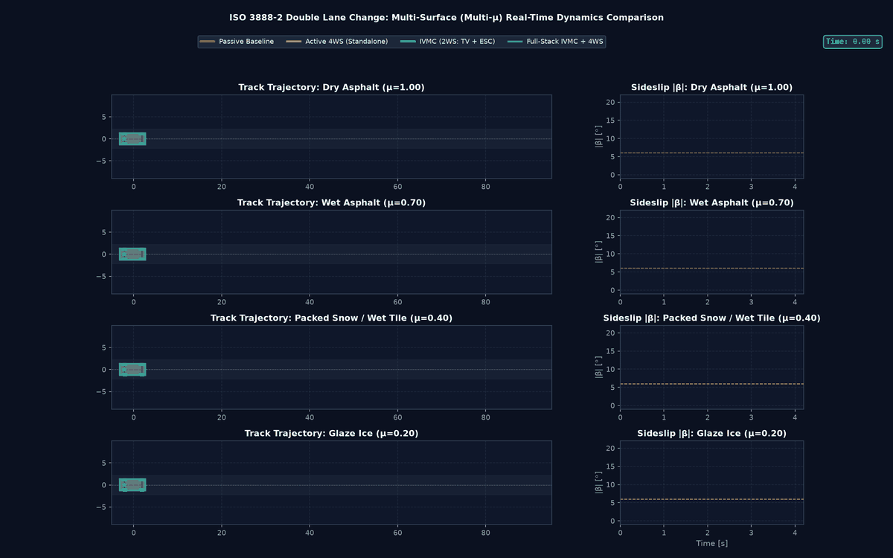
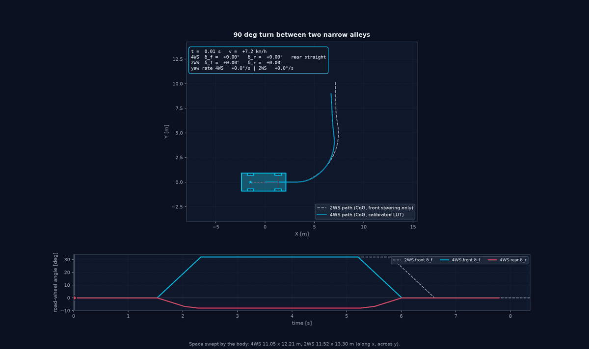

# Visualization & Real-Time Animation Guide

Visualizing vehicle trajectories and wheel-ground kinematics is essential for validating handling dynamics, evaluating active chassis controllers, and debugging stability control interventions.

This document details the visualization engine implemented in `src/vehicle_model/visualization/`:
1. **2D Planar Vehicle Footprint Renderer** (`draw_vehicle`, `VehicleParams`)
2. **Synchronized 20 FPS Multi-Vehicle Animation Generator** (`animate_maneuver`)
3. **NMPC Real-Time Telemetry Dashboard** (`RealTimeDashboard`)

---

## 1. 2D Planar Vehicle Footprint Renderer (`plan_view.py`)

The planar footprint renderer ([plan_view.py](../src/vehicle_model/visualization/plan_view.py)) converts vehicle state coordinates $(X, Y, \psi, \delta_f, \delta_r)$ into geometrically accurate 2D planar polygons:

```
                  ┌───────────────────────┐  ▲
                  │                       │  │ Front Overhang
             ┌───┐│   ═══════╤═══════    │┌───┐
  Front-Left │   ││    Front │ Axle      ││   │ Front-Right Wheel
  Wheel      └───┘│          │           │└───┘ (Steered delta_f)
  (Steered)       │          │ l_f       │
                  │          ▼           │
                  │         (x) CoG      │  Chassis Body Outline
                  │          ▲           │
                  │          │ l_r       │
             ┌───┐│    Rear  │ Axle      │┌───┐
  Rear-Left  │   ││   ═══════╧═══════    ││   │ Rear-Right Wheel
  Wheel      └───┘│                       │└───┘ (Steered delta_r in 4WS)
                  │                       │  │
                  └───────────────────────┘  ▼ Rear Overhang
                             w_f, w_r
```

### 1.1 Physical Dimensions: `VehicleParams`
Standard passenger car dimensions are extracted directly from the 7-DOF model parameters:
```python
v_params = VehicleParams.from_seven_dof_params(model.params)
```
- Wheelbase ($L = l_f + l_r$): $2.70\text{ m}$
- Front/Rear Track Width ($w_f, w_r$): $1.60\text{ m}$
- Overall Chassis Width ($W$): $1.80\text{ m}$
- Front / Rear Overhangs: $0.90\text{ m} / 1.00\text{ m}$
- Tyre Dimensions: Radius $R = 0.33\text{ m}$, Width $w_t = 0.225\text{ m}$

### 1.2 Kinematic Transformations & Polygon Geometry
For any component vertex $(x_{\text{local}}, y_{\text{local}})$ defined in the vehicle CoG frame:
$$\begin{bmatrix} X_{\text{global}} \\ Y_{\text{global}} \end{bmatrix} = \begin{bmatrix} X \\ Y \end{bmatrix} + \begin{bmatrix} \cos \psi & -\sin \psi \\ \sin \psi & \cos \psi \end{bmatrix} \begin{bmatrix} x_{\text{local}} \\ y_{\text{local}} \end{bmatrix}$$

For steered wheels (front angle $\delta_f$, rear angle $\delta_r$):
$$\begin{bmatrix} x_{\text{wheel,rot}} \\ y_{\text{wheel,rot}} \end{bmatrix} = \begin{bmatrix} \cos \delta_i & -\sin \delta_i \\ \sin \delta_i & \cos \delta_i \end{bmatrix} \begin{bmatrix} x_{\text{wheel,patch}} \\ y_{\text{wheel,patch}} \end{bmatrix}$$
The wheel vertices are first rotated by steer angle $\delta_i$, translated to the hub mounting point, and finally transformed into global inertial space by vehicle heading $\psi$.

---

## 2. Synchronized 20 FPS Multi-Vehicle Animation Generator (`animation.py`)

The high-definition animation engine ([animation.py](../src/vehicle_model/visualization/animation.py)) generates synchronized 20 FPS animated GIFs of multi-vehicle comparative maneuvers.

### 2.1 Multi-Panel Ergonomic Layout

```
┌──────────────────────────────────────────────────────────┬───────────────────────────┐
│  Global Track View (Top 65% width)                       │  Tracking Camera (1:1)    │
│  - Road corridors, split-mu friction shading             │  - Close-up centered on   │
│  - Dynamic comparative multi-vehicle trails              │    focus vehicle          │
│  - Real-time steerable rubber tyres & heading arrows     │  - True physical scale    │
│  - Digital Telemetry HUD (speed, yaw rate, sideslip)     │  - Slalom cones & line    │
├──────────────────────────────────────────────────────────┼───────────────────────────┤
│  Telemetry Graph 1: Chassis Yaw Rate r(t) [deg/s]        │  Telemetry Graph 2:       │
│  - Full maneuver static background curves                │  Body Sideslip Angle      │
│  - Dynamic progressive colored traces                    │  |beta(t)| [deg]          │
│  - Synchronized vertical time cursor line (t_current)    │  - Time cursor line       │
└──────────────────────────────────────────────────────────┴───────────────────────────┘
```

### 2.2 Key Architectural Features

1. **True Physical Scale Tracking Camera (1:1):**
   - The right upper panel automatically tracks the primary vehicle in an $18\text{ m} \times 9\text{ m}$ window, keeping tire steering angles, wheel slip, and body orientation clearly visible at true physical scale.
2. **Synchronized Telemetry Cursors:**
   - Synchronized vertical dashed lines advance smoothly across both bottom telemetry subplots ($r(t)$ and $|\beta(t)|$), pinpointing the exact physical instant of peak yaw acceleration, lift-off oversteer, or ESC intervention.
3. **Slalom Cones & Target Trajectory Overlay:**
   - Supports `reference_path=(ref_x, ref_y)` (dashed target trajectory) and `pylons=[(x1, y1), ...]` (orange cone markers), dynamically rendered across both global track and tracking camera.
4. **Optimized Render Performance:**
   - Pre-interpolates all simulation channels (`interp_data`) onto the master animation frame clock (`fps = 20`, $\Delta t_{\text{frame}} = 50\text{ ms}$).
   - Employs selective artist popping (`len(ax.lines) > base_lines`), stripping vehicle polygons every frame while keeping static track lines, background curves, and cones permanently cached in Matplotlib memory.

---

## 3. Generating All Maneuver Animations

Generate all 9 standardized automotive maneuver animations:
```bash
python examples/generate_maneuver_animations.py
```

To re-generate a specific maneuver while preserving the caches of all other animations:
```bash
python examples/generate_maneuver_animations.py nmpc_slalom
```

Generated animation files are saved to `output/validation_report/animations/` and `output/animations/`:
1. `iso_3888_dlc.gif`: ISO 3888-2 Double Lane Change (Passive vs 4WS vs IVMC)
2. `mu_split_braking.gif`: Split-$\mu$ Emergency Braking from 100 km/h
3. `sine_with_dwell.gif`: FMVSS 126 Sine with Dwell (Passive Spinout vs IVMC Stabilization)
4. `step_steer_iso_7401.gif`: ISO 7401 Step Steer Response at 100 km/h
5. `braking_in_a_turn.gif`: ISO 7975 Braking in a Turn (Lift-off Oversteer vs CBC)
6. `fishhook_ncap.gif`: NHTSA Dynamic Fishhook at 80 km/h (Rollover Prevention)
7. `low_speed_slalom_4ws.gif`: Low-Speed Slalom at 30 km/h (Counter-Phase Agility)
8. `high_speed_lane_change.gif`: High-Speed Highway Lane Change at 120 km/h (In-Phase Crab)
9. `nmpc_slalom.gif`: SLSQP NMPC Slalom Path Tracking (4WS LUT vs FWS vs Passive)

---

## 4. Source Code Cross-Reference

| Component | Source File | Unit Tests |
| :--- | :--- | :--- |
| **Plan-View Renderer** | [plan_view.py](../src/vehicle_model/visualization/plan_view.py) | [test_plan_view.py](../tests/vehicle_model/test_plan_view.py) |
| **Animation Generator** | [animation.py](../src/vehicle_model/visualization/animation.py) | [test_animation.py](../tests/vehicle_model/test_animation.py) |
| **NMPC Dashboard** | [dashboard.py](../src/vehicle_model/visualization/dashboard.py) | N/A |

---

<!-- figures:start -->

## Ergebnisbilder

> Alle Bilder sind Simulationsergebnisse mit synthetischen Parametern, keine Messungen. Neu erzeugen: Quellskript ausführen, dann `python tools/publish_doc_figures.py`.



*Spurwechsel auf mehreren Reibwerten mit Nahkamera-Panel und HUD. Quelle: `examples/multi_mu_scenarios_benchmark.py`.*



*4WS-Animation mit Lenkwinkel-Panel: unten Vorder- und Hinterachswinkel mit Cursor auf dem aktuellen Bild. Fahrzeuge werden an der Hinterachse gezeichnet, aus dem Schwerpunkt über l_r berechnet (`VehicleParams.cog_to_rear_axle`). Quelle: `examples/parking_4ws_demo.py`.*

<!-- figures:end -->
