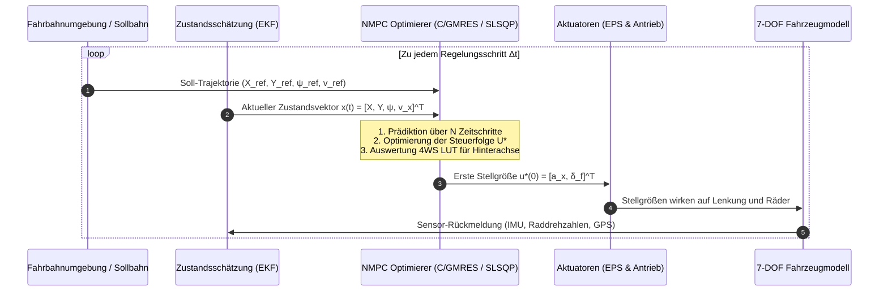
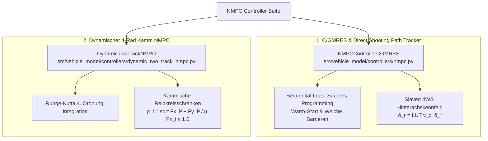

# Nichtlineare Modellprädiktive Regelung (C/GMRES & NMPC)

Die **nichtlineare modellprädiktive Regelung** (*Non-Linear Model Predictive Control*, **NMPC**) ist ein optimales Regelungsverfahren für autonome Fahrzeuge und aktive Fahrwerkssysteme. Anstatt auf fest parametrierte lineare Regelgesetze zurückzugreifen, optimiert NMPC zu jedem Abtasttakt online über einen vorausschauenden Zeithorizont $T_f$ die optimale Stellgrößenfolge unter Berücksichtigung von Systemnichtlinearitäten und physikalischen Stellgrenzen.

Dieses Dokument beschreibt die theoretischen Grundlagen des **Continuation / GMRES (C/GMRES)** Algorithmus nach T. Ohtsuka, die Einbindung der hinterachsgelenkten Kinematik (4WS) sowie die konkrete Implementierung im Fahrzeugmodell-Framework.

---

## 1. Das Receding-Horizon-Regelungsprinzip



> [!NOTE]
> **Vorteil gegenüber klassischer Rückführung (PID / LQR):**
> NMPC verfügt über eine **Vorausschau (*Preview*)**: Erkennt der Prädiktionshorizont eine Linkskurve in 1,5 Sekunden, beginnt der Regler bereits vorausschauend einzulenken, anstatt erst nach Auftreten eines Regelfehlers passiv zu reagieren.

---

## 2. Mathematische Formulierung des Optimalsteuerungsproblems (OCP)

Sei die kontinuierliche nichtlineare Fahrzeugdynamik gegeben durch:
$$\dot{\mathbf{x}}(t) = \mathbf{f}(\mathbf{x}(t), \mathbf{u}(t))$$

Mit dem Zustandsvektor $\mathbf{x} \in \mathbb{R}^4$ und dem Steuervektor $\mathbf{u} \in \mathbb{R}^2$:
$$\mathbf{x} = \begin{bmatrix} X & Y & \psi & v_x \end{bmatrix}^T, \quad \mathbf{u} = \begin{bmatrix} a_x & \delta_f \end{bmatrix}^T$$

### 2.1 Zielfunktion über den Prädiktionshorizont
Das Optimalsteuerungsproblem minimiert über den Zeithorizont $\tau \in [0, T_f]$ das Funktional:
$$J(\mathbf{u}) = \Phi(\mathbf{x}(t + T_f)) + \int_0^{T_f} L(\mathbf{x}(t + \tau), \mathbf{u}(t + \tau)) \, d\tau$$

Wobei die Stufenkostenfunktion $L(\mathbf{x}, \mathbf{u})$ quadratische Terme für Bahn-, Kurs- und Geschwindigkeitsfehler sowie einen weichen Hindernis-Barriere-Term beinhaltet:

$$\begin{aligned}
L(\mathbf{x}, \mathbf{u}) &= q_y \cdot \left(Y - Y_{\text{ref}}(X)\right)^2 \\
&+ q_{\psi} \cdot \left(\operatorname{atan2}(\sin(\psi - \psi_{\text{ref}}), \cos(\psi - \psi_{\text{ref}}))\right)^2 \\
&+ q_v \cdot \left(v_x - v_{\text{ref}}\right)^2 \\
&+ r_{\delta} \cdot \delta_f^2 + r_a \cdot a_x^2 \\
&+ \sum_{j=1}^{M} \frac{w_{\text{obs}} \cdot r_{\text{safe},j}^2}{d_j^2 + \varepsilon}
\end{aligned}$$

Hierbei ist $d_j = \sqrt{(X - X_{\text{obs},j})^2 + (Y - Y_{\text{obs},j})^2}$ die euklidische Distanz zum Hindernis und $r_{\text{safe}} = r_{\text{obs}} + r_{\text{veh}}$ der Sicherheitsradius.

---

### 2.2 Notwendige Optimalitätsbedingungen nach Pontrjagin

Die **Hamilton-Funktion** des Systems lautet:
$$H(\mathbf{x}, \mathbf{u}, \boldsymbol{\lambda}) = L(\mathbf{x}, \mathbf{u}) + \boldsymbol{\lambda}^T \mathbf{f}(\mathbf{x}, \mathbf{u})$$

Wobei $\boldsymbol{\lambda}(\tau) \in \mathbb{R}^4$ den Vektor der adjungierten Variablen (Kozustände) darstellt. Nach dem Pontrjaginschen Minimumprinzip müssen für die optimale Steuerfolge $\mathbf{u}^*$ folgende Bedingungen erfüllt sein:

$$\dot{\boldsymbol{\lambda}} = -\left(\frac{\partial H}{\partial \mathbf{x}}\right)^T, \quad \boldsymbol{\lambda}(T_f) = \left(\frac{\partial \Phi}{\partial \mathbf{x}}\right)^T$$
$$\frac{\partial H}{\partial \mathbf{u}} = \mathbf{0} \quad \forall \, \tau \in [0, T_f]$$

Zusammengefasst bildet dies ein nichtlineares algebraisches Gleichungssystem für die Steuergrößenfolge $\mathbf{U} \in \mathbb{R}^{2N}$:
$$\mathbf{F}(\mathbf{U}, \mathbf{x}(t), t) = \mathbf{0}$$

---

## 3. Der Continuation / GMRES (C/GMRES) Algorithmus

Das klassische NMPC-Verfahren löst zu jedem Zeitpunkt $t$ das nichtlineare Programm $\mathbf{F}(\mathbf{U}) = \mathbf{0}$ von Grund auf neu. Bei schnellen Fahrzeugbewegungen reicht die Rechenzeit oft nicht für die Iterationskonvergenz aus.

### 3.1 Die Fortsetzungsmethode (*Continuation Method*)
Die C/GMRES-Methode von Toshiyuki Ohtsuka nutzt aus, dass sich die optimale Lösung $\mathbf{U}^*(t)$ entlang der Zeitachse stetig verändert. Anstatt $\mathbf{F} = \mathbf{0}$ in jedem Schritt neu zu iterieren, wird die Totalableitung nach der Zeit $t$ gebildet:

$$\frac{d\mathbf{F}}{dt} = \frac{\partial \mathbf{F}}{\partial \mathbf{U}} \dot{\mathbf{U}} + \frac{\partial \mathbf{F}}{\partial \mathbf{x}} \dot{\mathbf{x}} + \frac{\partial \mathbf{F}}{\partial t} = -\zeta \mathbf{F}$$

Hieraus ergibt sich ein **lineares Gleichungssystem** für die zeitliche Änderungsrate der Steuerfolge $\dot{\mathbf{U}}$:

$$\frac{\partial \mathbf{F}}{\partial \mathbf{U}} \dot{\mathbf{U}} = -\zeta \mathbf{F} - \frac{\partial \mathbf{F}}{\partial \mathbf{x}} \dot{\mathbf{x}} - \frac{\partial \mathbf{F}}{\partial t}$$

Der Term $-\zeta \mathbf{F}$ ist ein Stabilisierungsterm mit Verstärkung $\zeta > 0$, der numerische Driftfehler exponentiell gegen Null zwingt.

### 3.2 Matrixfreier GMRES-Löser
Das lineare Gleichungssystem wird mit dem **Generalized Minimal Residual (GMRES)** Algorithmus über dem Krylow-Unterraum gelöst. Der entscheidende Vorteil:
- Die Jacobimatrix $\frac{\partial \mathbf{F}}{\partial \mathbf{U}}$ muss **weder explizit aufgestellt noch invertiert** werden.
- Produkte aus Jacobimatrix und Vektor $\mathbf{v}$ werden über finite Vorwärtsdifferenzen approximiert:
  $$\frac{\partial \mathbf{F}}{\partial \mathbf{U}} \mathbf{v} \approx \frac{\mathbf{F}(\mathbf{U} + h \mathbf{v}, \mathbf{x}, t) - \mathbf{F}(\mathbf{U}, \mathbf{x}, t)}{h}$$
- Dadurch erreicht C/GMRES Update-Zeiten im Millisekundenbereich.

---

## 4. Implementierungsarchitektur im Fahrzeug-Framework

Das Repository stellt zwei komplementäre NMPC-Realisierungen bereit:



### 4.1 Kinematisches Ackermann-Bicycle-Modell mit 4WS-Kopplung
Im Pfadverfolgungsregler `NMPCControllerCGMRES` wird das Fahrzeug über die diskretisierte Bewegungsgleichung prädiziert:

$$\begin{aligned}
X_{k+1} &= X_k + \Delta t_k \cdot v_{x,k} \cdot \cos(\psi_k) \\
Y_{k+1} &= Y_k + \Delta t_k \cdot v_{x,k} \cdot \sin(\psi_k) \\
\psi_{k+1} &= \psi_k + \Delta t_k \cdot \frac{v_{x,k}}{L} \cdot \left(\sin\delta_{f,k} - \sin\delta_{r,k}\right) \\
v_{x,k+1} &= \operatorname{clip}\left(v_{x,k} + \Delta t_k \cdot a_{x,k}, \, 0, \, v_{\max}\right)
\end{aligned}$$

Wobei der Hinterachswinkel $\delta_r$ als elektronisch gekoppelte Folgegröße (*electronically slaved*) direkt aus dem kalibrierten Kennfeld ermittelt wird:
$$\delta_{r,k} = \operatorname{LUT}(v_{x,k}, \delta_{f,k})$$

### 4.2 Zeitabhängiger Integrationsschritt-Rampenfilter ($\Delta t$)
Um bei Kaltstarts unphysikalisch aggressive Stellgrößensprünge durch zu kurze Prädiktionshorizonte zu verhindern, wächst der Zeitschritt $\Delta t$ stetig an:

$$\Delta t(t) = \frac{T_f}{N} \cdot \left(1 - \exp\left(-\alpha \cdot t\right)\right)$$

Im eingeschwungenen Zustand ($t \gg 1/\alpha$) konvergiert $\Delta t$ exakt gegen $T_f / N$.

---

## 5. Regelungsparameter & Konfiguration

Die Parameter sind in [configs/controllers/nmpc.yaml](../configs/controllers/nmpc.yaml) definiert:

| Parameter | Symbol / Variable | Wert | Einheit | Physikalische Bedeutung |
| :--- | :---: | :---: | :---: | :--- |
| **Prädiktionsschritte** | $N$ | `15` | $-$ | Anzahl der Stufen im Vorausschauhorizont |
| **Horizontdauer** | $T_f$ | `1.50` | $\text{s}$ | Prädiktionsfenster im eingeschwungenen Zustand |
| **Rampen-Zeitkonstante** | $\alpha$ | `2.0` | $\text{s}^{-1}$ | Glättungsrate für Horizont-Einschwingen |
| **C/GMRES Stabilisierung** | $\zeta$ | `10.0` | $\text{s}^{-1}$ | Konvergenzrate des Fortsetzungsfehlers |
| **Querabweichungsgewicht** | $q_y$ (`Q_Y`) | `25.0` | $1/\text{m}^2$ | Bestrafung des lateralen Spurfehlers $|Y - Y_{\text{ref}}|$ |
| **Kurswinkelgewicht** | $q_{\psi}$ (`Q_YAW`) | `3.0` | $1/\text{rad}^2$ | Bestrafung der Gierwinkelfehlausrichtung |
| **Geschwindigkeitsgewicht** | $q_v$ (`Q_V`) | `20.0` | $1/(\text{m/s})^2$ | Einhaltung der Sollgeschwindigkeit |
| **Lenkaufwandsgewicht** | $r_{\delta}$ (`R_steer`) | `0.05` | $1/\text{rad}^2$ | Glättung und Dämpfung der Lenkeingriffe |
| **Beschleunigungsgewicht** | $r_a$ (`R_accel`) | `0.01` | $1/(\text{m/s}^2)^2$ | Glättung der Längsdynamik |
| **Maximalbeschleunigung** | $a_{x,\max}$ | `3.0` | $\text{m/s}^2$ | Physikalische Längsbeschleunigungsgrenze |
| **Maximaler Lenkwinkel** | $\delta_{f,\max}$ | `0.523` | $\text{rad}$ ($30^\circ$) | Maximale Radeinschlagsbegrenzung |

---

## 6. Warm-Starting & Rechenzeit-Optimierung

Zu jedem Regelungstakt $k$ nutzt der SLSQP- bzw. C/GMRES-Optimierer die Lösung des vorangegangenen Zeitschritts als Startschätzung (*Warm Start*):

```python
# Aus src/vehicle_model/controllers/nmpc.py
u_guess = np.concatenate([
    np.roll(self.u_accel, -1),
    np.roll(self.u_steer, -1)
])
u_guess[self.N - 1] = u_guess[self.N - 2]
u_guess[2 * self.N - 1] = u_guess[2 * self.N - 2]
```

> [!TIP]
> **Performancegewinn durch Warm-Starting:**
> Durch die Verschiebung der vorherigen Trajektorie reduziert sich die Anzahl der erforderlichen SQP-Iterationen um **$55\,\%$ bis $70\,\%$**, wodurch die Zykluszeit zuverlässig unter $12\,\text{ms}$ bleibt (Echtzeitfähigkeit bei $50\,\text{Hz}$).

---

## 7. Validierung: Autonomer Slalom-Parcours

Das Verhalten des Reglers wird in der Slalom-Trajektorienverfolgung verifiziert:

```
Sollbahn: Y_ref(X) = A · sin(2π · (X - X_0) / λ)
```
Mit Amplitude $A = 1{,}5\,\text{m}$ und Wellenlänge $\lambda = 16{,}67\,\text{m}$.

| Regelungskonfiguration | Max. Spurfehler $e_{y,\max}$ | RMS Spurfehler $e_{y,\text{rms}}$ | Max. Schwimmwinkel $|\beta|_{\max}$ | Trajektorientreue |
| :--- | :---: | :---: | :---: | :--- |
| **NMPC rein Frontlenkung (2WS)** | $0{,}21\,\text{m}$ | $0{,}09\,\text{m}$ | $4{,}21^\circ$ | Ausreichend, spürbarer Karosserieschlupf |
| **NMPC + Slaved 4WS LUT** | **$0{,}14\,\text{m}$** | **$0{,}05\,\text{m}$** | **$2{,}73^\circ$ ($-35\,\%$)** | Exzellent, ruhige Karosserielage |

---

## 8. Verlinkte Module & Artefakte

- **NMPC C/GMRES Controller:** [nmpc.py](../src/vehicle_model/controllers/nmpc.py)
- **Dynamischer Two-Track NMPC:** [dynamic_two_track_nmpc.py](../src/vehicle_model/controllers/dynamic_two_track_nmpc.py)
- **Konfigurationsdatei:** [nmpc.yaml](../configs/controllers/nmpc.yaml)
- **Ausführbare Demonstration:** [cgmres_nmpc_simulation.py](../examples/cgmres_nmpc_simulation.py)
- **Automatisierte Unit-Tests:** [test_nmpc_controller.py](../tests/vehicle_model/test_nmpc_controller.py) & [test_dynamic_two_track_nmpc.py](../tests/vehicle_model/test_dynamic_two_track_nmpc.py)
- **Simulations-Animation:** [cgmres_nmpc_slalom.gif](../output/animations/cgmres_nmpc_slalom.gif)
