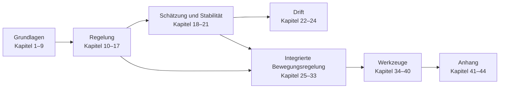

# Vehicle Dynamics

Virtuelle Forschungs- und Entwicklungsplattform für Fahrdynamik, Reifenmodelle, Aktorik und integrierte
Fahrwerkregelung in Python: vom Einspurmodell über 7-DOF- und 14-DOF-Fahrzeugmodelle bis zur abgestimmten
Bewegungsregelung mit Fehlertoleranz.

!!! note "Einordnung der Ergebnisse"
    Alle Ergebnisse sind Simulationen mit synthetischen Parametern, keine Messungen. Manöver sind an Normen angelehnt
    („-inspired“), aber keine Normprüfungen. Die Plattform ist kein Serienprodukt.

## Lesepfad

## Kapitel

| Teil | Inhalt | Einstieg |
|---|---|---|
| **Grundlagen** | Architektur und ISO 8855, Fahrzeugmodelle, Reifen, Kinematik, Aktorik, Handling, Vertikaldynamik | [01 Architektur](01_architecture.md) |
| **Regelung** | Kraftallokation, Regelgesetze, integrierte Fahrwerkregelung, Hinterachslenkung, Split-µ, Fahrermodell, NMPC | [10 Kraftallokation](10_control_allocation.md) |
| **Schätzung und Stabilität** | Zustandsschätzung, Robustheit, nichtlineare Stabilität, robuste Regelung | [18 Zustandsschätzung](18_state_estimation.md) |
| **Drift** | Modellgültigkeit, Driftgleichgewichte und Regler, Ergebnisse | [22 Modellgültigkeit](22_drift_model_validity.md) |
| **Integrierte Bewegungsregelung** | Stellgrößenkette, Bremsfunktionen, Traktion, Wankstabilität, G-Vectoring, Vorschaudämpfung, Hill Descent, Fehlertoleranz, Benchmark-Matrix | [25 Stellgrößenkette](25_actuation_chain.md) |
| **Werkzeuge** | Experimente, Szenariobuch, kritische Szenarien, Auslegung, Validierung, Visualisierung, Workbench | [34 Experimente](34_experiments.md) |
| **Anhang** | Audits, Rückverfolgbarkeit, Literatur, Pläne | [44 Literatur](44_references.md) |

<!-- gallery:start -->
<!-- gallery:end -->

## Stichwortverzeichnis

| Stichwort / Begriff | Kapitel & Dokument | Relevante Gleichungen / Aspekte |
| :--- | :--- | :--- |
| **Ackermann-Geometrie** | [Kap. 2](02_vehicle_models.md) & [Kap. 13](13_rear_wheel_steering.md) | $\delta_{\text{ack}} = L / R$, Spurdifferenzwinkel |
| **Active Roll Stiffness (ARSDC)** | [Kap. 12](12_chassis_control.md) | $\kappa_{\text{roll},f} \in [0.32, 0.82]$, Wankmomentverteilung |
| **Allradlenkung (4WS / RWS)** | [Kap. 13](13_rear_wheel_steering.md) | Gegenphase, Gleichphase, $v_{\text{switch}} \approx 36\,\text{km/h}$ |
| **Bilineare Lookup-Tabelle (LUT)** | [Kap. 13](13_rear_wheel_steering.md) & [Kap. 17](17_nmpc_path_tracking.md) | `configs/steering/lut.json`, $\delta_r(v_x, \delta_f)$ |
| **Bremsen in der Kurve (ISO 7975)** | [Kap. 38](38_validation_platform.md) & [Kap. 14](14_split_mu_dynamics.md) | Kombinierte Brems- und Querkräfte, Lasttransfer |
| **Brake-by-Wire (BBW)** | [Kap. 5](05_actuators.md) | Asymmetrische Gradienten (Aufbau $22\,\text{kN/s}$, Abbau $36\,\text{kN/s}$) |
| **Charakteristische Geschwindigkeit** | [Kap. 7](07_handling_limits.md) | $v_{\text{char}} = \sqrt{L / K_{\text{us}}}$ (für $K_{\text{us}} > 0$) |
| **Crab-Translation (Hundegang)** | [Kap. 13](13_rear_wheel_steering.md) | Parallele Karosserieverschiebung bei Gleichphasen-4WS |
| **Single Shooting** | [Kap. 17](17_nmpc_path_tracking.md) | Nur Stellgrößen als Entscheidungsvariablen, Zustands-Rollout in der Kostenfunktion |
| **Double Lane Change (ISO 3888-2)** | [Kap. 38](38_validation_platform.md) & [Kap. 14](14_split_mu_dynamics.md) | Elchtest / Hindernisausweichen bei $80\,\text{km/h}$ |
| **Driver-in-the-Loop** | [Kap. 15](15_driver_model.md) | MacAdam Vorschauhorizont, Totzeit $\tau_d = 160\,\text{ms}$ |
| **Dynamic Load Transfer ($F_{z,i}$)** | [Kap. 2](02_vehicle_models.md) | $\Delta F_{z,\text{long}} = m a_x h / L$, $\Delta F_{z,\text{lat}} = m a_y h / w$ |
| **Eigenlenkgradient $K_{\text{us}}$** | [Kap. 7](07_handling_limits.md) | $K_{\text{us}} = d\delta_f / da_y - L g / v_x^2$ |
| **Extended Kalman Filter (EKF)** | [Kap. 18](18_state_estimation.md) | Nichtlineare Schwimmwinkelschätzung $\hat{\beta}$ |
| **Fiala Reifenmodell** | [Kap. 3](03_tyre_models.md) | Bürstentheorie, Haftung und Gleitung |
| **Fishhook Manöver (NHTSA)** | [Kap. 38](38_validation_platform.md) & [Kap. 14](14_split_mu_dynamics.md) | Dynamische Lenkumkehr, Wankstabilitätsprüfung |
| **Gegenphasenlenkung** | [Kap. 13](13_rear_wheel_steering.md) | Hinterräder entgegengesetzt zu Vorderrädern ($\delta_r < 0$) |
| **Giermomenten-Aufbauverzögerung (GMR)**| [Kap. 14](14_split_mu_dynamics.md) | Druckanstiegsbegrenzung bei $\mu$-Split-Bremsung |
| **Gleichphasenlenkung** | [Kap. 13](13_rear_wheel_steering.md) | Hinterräder gleichsinnig zu Vorderrädern ($\delta_r > 0$) |
| **Groundhook-Dämpfung** | [Kap. 9](09_suspension_dynamics.md) | Minimierung der Reifenaufstandskraftschwankungen |
| **Handling Limits (Grenzbereich)** | [Kap. 7](07_handling_limits.md) | G-G-Diagramm, $a_{y,\max} \approx \mu \cdot g$ |
| **Hinterachslenkung** | [Kap. 13](13_rear_wheel_steering.md) | Siehe *Allradlenkung (4WS)* |
| **Integrated Chassis Control (IVMC)** | [Kap. 12](12_chassis_control.md) | Koppelung von 4WS, Torque Vectoring & Brems-ESC |
| **ISO 8855 Koordinatensystem** | [Kap. 1](01_architecture.md) | $X$-vor, $Y$-links, $Z$-auf |
| **Kamm'scher Kreis** | [Kap. 3](03_tyre_models.md) & [Kap. 16](16_nmpc_control.md) | $\sqrt{F_x^2 + F_y^2} \le \mu F_z$ |
| **Kritische Geschwindigkeit** | [Kap. 7](07_handling_limits.md) | $v_{\text{crit}} = \sqrt{-L / K_{\text{us}}}$ (für Übersteuern $K_{\text{us}} < 0$) |
| **Multi-Mu Matrix Framework** | [Kap. 14](14_split_mu_dynamics.md) | 6 Manöver $\times$ 4 Reibwerte ($\mu \in [0.20, 1.00]$) |
| **Neuromuskuläre Verzögerung** | [Kap. 15](15_driver_model.md) | Menschliche Muskelzeitkonstante $\tau_n \approx 100\,\text{ms}$ |
| **NMPC (Nichtlineares MPC)** | [Kap. 16](16_nmpc_control.md) & [docs/17_nmpc_path_tracking.md](17_nmpc_path_tracking.md) | Prädiktive Trajektorienoptimierung |
| **Magic Formula (MF 5.2-Teilmenge)** | [Kap. 3](03_tyre_models.md) | $y(x) = D \sin(C \arctan(B x - E (B x - \arctan(B x))))$ |
| **Particle Swarm Optimization (PSO)**| [Kap. 18](18_state_estimation.md) | Globale stochastische Parameteridentifikation |
| **Phasenraum-Hüllkurve $(\beta, \dot{\beta})$**| [Kap. 12](12_chassis_control.md) | Schwimmwinkel-Phasenebene Stabilitätsgrenzen |
| **Recursive Least Squares (RLS)** | [Kap. 18](18_state_estimation.md) | Online-Schätzung des Reibwerts $\hat{\mu}$ |
| **Schwimmwinkel $\beta$** | [Kap. 1](01_architecture.md) & [Kap. 13](13_rear_wheel_steering.md) | $\beta = \arctan(v_y / v_x)$, Karosseriewinkel |
| **Schwimmwinkelfreiheit ($\beta = 0$)** | [Kap. 13](13_rear_wheel_steering.md) | Analytische 4WS-Lenkbedingung |
| **Sine with Dwell (FMVSS 126)** | [Kap. 38](38_validation_platform.md) & [Kap. 14](14_split_mu_dynamics.md) | US-ESC-Stabilitätsprüfnorm bei $80\,\text{km/h}$ |
| **Skyhook-Dämpfung** | [Kap. 9](09_suspension_dynamics.md) | $F_{\text{sky}} = -c_{\text{sky}} \dot{z}_s$, Hubdämpfung |
| **Split-Mu Bremsung (ECE-R13H)** | [Kap. 14](14_split_mu_dynamics.md) | Asymmetrische Reibung links/rechts |
| **Step Steer (ISO 7401)** | [Kap. 38](38_validation_platform.md) & [Kap. 14](14_split_mu_dynamics.md) | Sprunglenkung, Reaktionszeit- & Dämpfungsprüfung |
| **Torque Vectoring** | [Kap. 12](12_chassis_control.md) | Direktes Giermoment $M_{z,\text{tv}} = \Delta F_x \cdot w / 2$ |
| **Understeer (Untersteuern)** | [Kap. 7](07_handling_limits.md) | $K_{\text{us}} > 0$, Schiebt über Vorderräder |
| **Validation Platform** | [Kap. 38](38_validation_platform.md) | Virtuelle Testplattform für Regressionsprüfung |
| **Virtueller Radstand** | [Kap. 13](13_rear_wheel_steering.md) | $l_{\text{virt}} < l$ bei Gegenphasenlenkung |
| **Warm-Starting** | [Kap. 17](17_nmpc_path_tracking.md) | Initialisierung mit der Vorlösung |
| **Zweispurmodell (7-DOF)** | [Kap. 2](02_vehicle_models.md) | Vollständige ebene Dynamik + 4 Raddrehzahlen |
