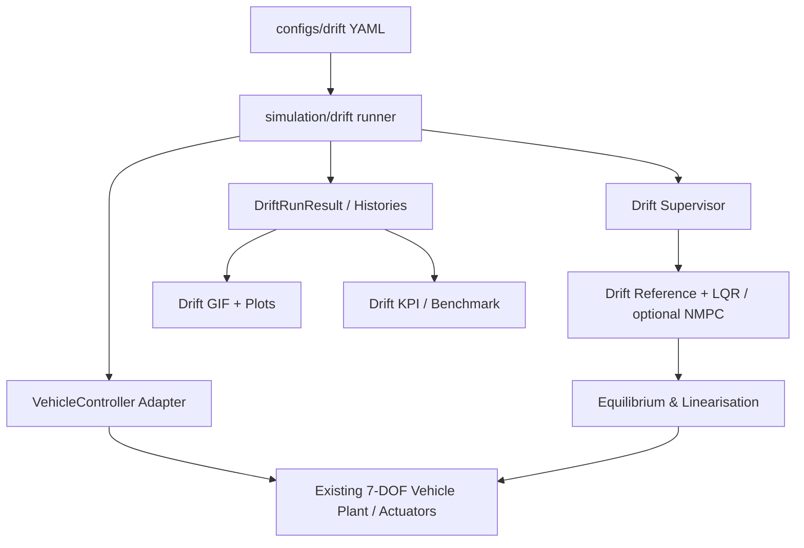
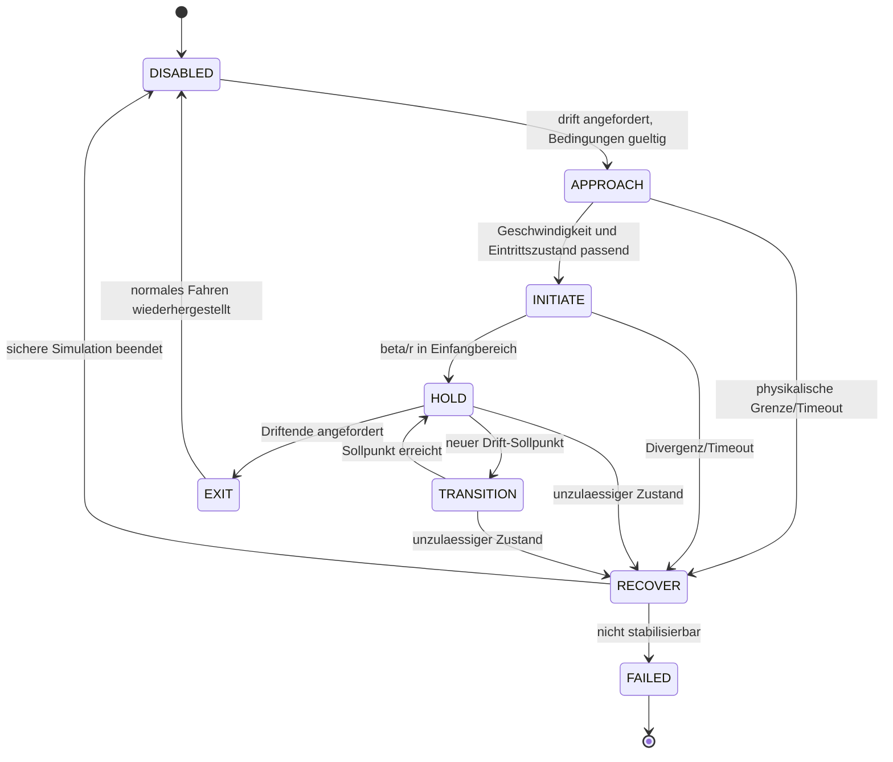

# VEHICLE-DYNAMICS — DRIFT CONTROLLER IMPLEMENTIERUNGSPLAN V1.0

**Repository:** https://github.com/CagriCatik/Vehicle-Dynamics  
**Gepruefter Stand:** `main`, Commit `992cc399e561e80b6be49b9c86ebc628d4475339`, 29.10.2026 (UTC)  
**Ziel:** Autonomer Drift-Controller fuer einen virtuellen Pkw mit physikalisch konsistenter Simulation, Telemetrie, GIF-Animationen, Variantenvergleich und reproduzierbarer virtueller Validierung.  
**Adressaten:** Claude Code, OpenAI Codex, Software- und Fahrdynamikingenieure.  
**Status:** Ausfuehrbarer Implementierungsauftrag; **keine Behauptung, dass die Funktion bereits implementiert oder getestet wurde.**

---

## 0. Agentenauftrag in einem Satz

Implementiere den Drift-Controller **schrittweise im bestehenden Repository**, indem du aus dem echten nichtlinearen Fahrzeugmodell erreichbare Driftgleichgewichte berechnest, diese mit einem lokal entworfenen Regler stabilisierst, Drift-Einleitung und -Beendigung sowie Pfadverfolgung hinzufuegst, die tatsaechliche Fahrzeugbewegung animierst und jedes Modul unter reproduzierbaren, physikalisch belastbaren Tests abnimmst.

**Nicht erlaubt:** Ein neues paralleles Fahrzeugmodell als primaere Simulationsstrecke erfinden; Fahrzeugposition oder Schwimmwinkel nur fuer die Animation vorgeben; Reifenwerte erfinden und als Messwerte ausgeben; bestehende ABS/ESC/IVMC-, Plots-, GIF- und Exportfunktionen loeschen; das Projekt auf ROS/RC-Hardware umstellen; die Aufgabe mit einer neuen Roadmap statt Implementierung beenden.

**Wichtig:** Der autonome Drift ist ein *kontrollierter Grenzbereichszustand*. Der normale ESC-Regelzweck (Schwimmwinkel reduzieren) ist nicht identisch mit dem Drift-Regelzweck (nichtnulligen Schwimmwinkel stabilisieren). Der Driftmodus benoetigt deshalb einen expliziten Supervisor und separate Regelungsprioritaeten, ohne die bestehenden ESC-Module umzuschreiben.

---

## 1. Bestandsaufnahme des Repositories und strikte Wiederverwendung

Die folgenden Dateien sind am oben genannten Commit vorhanden; **vor der Implementierung `git status`, Branch, Commit und tatsaechlichen aktuellen Stand erneut pruefen**, da sich der Branch inzwischen geaendert haben kann.

| Vorhandener Teil | Datei / Verzeichnis | Geplante Nutzung |
|---|---|---|
| 7-DOF-Zweispurstrecke | `src/vehicle_model/vehicle_models/seven_dof.py` | Autoritative Bewegungsgleichungen, Radrotation, Radlasten, Reifen und Integration |
| 7-DOF mit Reifenrelaxation | `src/vehicle_model/vehicle_models/seven_dof_transient.py` | Robustheits-/Transientenvergleich nach erfolgreichem Basisregler |
| 14-DOF-Fahrzeugmodell | `src/vehicle_model/vehicle_models/fourteen_dof.py` | Spaetere Plausibilisierung von Nick/Wank/Radlast, **nicht** die erste Driftstrecke |
| Fahrzeug-/Rad-Typen | `src/vehicle_model/core/types.py` | `SevenDOFParams`, `SevenDOFState`, `SevenDOFControlInput`, `WheelTelemetry`, `WheelIndex` |
| Magic-Formula-Teilmodell | `src/vehicle_model/tire_model/magic_formula.py` | Nichtlineares Reifenverhalten und Combined Slip; synthetische Parameter kennzeichnen |
| Weitere Reifen | `src/vehicle_model/tire_model/combined_slip.py`, `pacejka.py`, `framework.py` | Modellvergleich und Provenienz |
| Front-/Hinterachslenkung | `src/vehicle_model/steering/`, `actuators/steering_actuator.py` | Zunaechst Frontlenkung; optional Aktuatordynamik spaeter |
| 4-Motor-Aktuator | `src/vehicle_model/actuators/powertrain_actuator.py` | Momentenlimits, Verzoegerung, Leistung; RWD-Konfiguration zunaechst |
| Einheitliches Controller-Protokoll | `src/vehicle_model/controllers/framework.py` | `VehicleController.compute_control(...)`, `ControlOutput`, `ControlTarget` |
| Motion/Allocation | `src/vehicle_model/controllers/motion_control.py`, `allocation/wheel_forces.py` | Wiederverwendbare Beschraenkungen, aber Drift-Sollwertlogik gesondert |
| ESC/TCS/IVMC | `src/vehicle_model/controllers/stability_control.py`, `slip_control.py`, `integrated_controller.py` | Unveraenderte Vergleichsbasis; explizite Aktivierung und Arbitration |
| Szenario-Engine | `src/vehicle_model/simulation/scenario_runner.py` | Geschlossener Simulationslauf, `SimulationHistory`, Callback-Adapter |
| Manuever/GIF-Renderer | `src/vehicle_model/visualization/animation.py` | `animate_maneuver(...)`, Planansicht, HUD, GIF mit PillowWriter |
| Fahrzeugzeichnung | `src/vehicle_model/visualization/plan_view.py` | Fahrzeugkoerper und sichtbar eingeschlagene Raeder |
| Experimente | `src/vehicle_model/experiments/`, `configs/experiments/` | Strenge YAML-Validierung, reproduzierbare Benchmarks |
| Test/CI | `tests/vehicle_model/`, `.github/workflows/ci.yml`, `pyproject.toml` | Regression, Python 3.10/3.13, `pytest -m 'not slow'` |

### 1.1 Wichtige Ist-Schnittstellen

- `SevenDOFState` besitzt `vx`, `vy`, `r`, vier `omega`, `X`, `Y`, `psi` und die Eigenschaft `sideslip_angle`.
- `SevenDOFModel.evaluate_dynamics(state, u, road)` liefert Ableitungen und Telemetrie; `step(state, u, dt, road)` integriert die Physik.
- `VehicleController.compute_control(state, target, telemetry=None, dt=0.01)` gibt `ControlOutput` zurueck.
- `ControlOutput` enthaelt `steer_f`, `steer_r`, vier `T_drive`, vier `T_brake`, Status und Diagnostik.
- `ScenarioRunner.run(controller_callback, init_state, duration, dt)` integriert den geschlossenen Regelkreis.
- `animate_maneuver(histories, output_path, fps=20, ...)` erzeugt vorhandene GIFs. Seine derzeitige Weg-/Strassenvisualisierung ist fuer beliebige Kreisbahnen nicht automatisch optimal; fuer Drift darum angepassten Renderer ueber die gleichen Zeichenprimitive bauen.
- `ControlTarget` besitzt noch kein natives Drift-Setpoint-Feld; **nicht** unreflektiert die Schnittstelle aller Controller brechen. Drift-Referenz in eigener typisierter `DriftReference`-Quelle oder optionalem Adapter halten.

### 1.2 Kritische Besonderheit des Streckenmodells

`SevenDOFModel.evaluate_dynamics()` benutzt den internen Fixpunkt-Startwert `_accel_guess` und aktualisiert ihn. Beim numerischen Differenzieren bzw. Root-Finding kann dadurch die **Auswertungsreihenfolge die Residuen beeinflussen**, obwohl die Physik konzeptionell deterministisch sein soll.

Verpflichtende Massnahme: Fuer Gleichgewichtssuche und Jacobian-Schätzung eine wohldefinierte, reproduzierbare Evaluationsfunktion schaffen, die den internen Startwert bei jeder Auswertung kontrolliert initialisiert/wiederherstellt oder einen isolierten Streckenklon verwendet. **Nicht** verdeckt bestehende Streckenimplementierung global umschreiben. Tests fuer mehrfaches identisches Auswerten in verschiedener Reihenfolge anlegen; Nichtkonvergenz der Lastiteration explizit diagnostizieren.

### 1.3 Physikalische Voraussetzungen und Grenzen

- Die vorhandenen Magic-Formula-Parameter sind synthetisch und nicht mit realen Drift-Reifenmessdaten kalibriert.
- Reifenkennfelder bei grossen Schraeglaufwinkeln/Schlupf zuerst auf Plausibilitaet und Grenzverhalten untersuchen, nicht 'reparieren', um einen gewuenschten Drift zu erzwingen.
- Das statische 7-DOF-Modell beschreibt ebene Fahrbahn, quasistatische Radlastverlagerung und Radrotation. Lenksystem- und Motordynamik koennen spaeter opt-in hinzukommen.
- Ein positiver Driftwinkel ist nicht automatisch moeglich. Ein Root-Solver darf `infeasible` zurueckgeben.
- Nur **virtuelle Modellvalidierung**, kein Beleg fuer ein reales Fahrzeug, keine ISO-Homologation.

---

## 2. Funktionale Zieldefinition

### 2.1 Minimal Viable Drift (MVD)

Ein hinterradgetriebenes Fahrzeug soll auf homogener ebener Fahrbahn bei konstantem Reibwert einen berechneten, realisierbaren **stationaeren Kreisdrift** durchlaufen. Die 7-DOF-Strecke erzeugt `X(t), Y(t), psi(t), vx(t), vy(t), r(t), omega_i(t)` selbst; der Regler gibt ausschliesslich physikalisch begrenzte Lenk- und Antriebsmomente vor. Ein GIF zeigt echten Spurverlauf, Fahrzeugausrichtung, Gegenlenken und Telemetrie.

### 2.2 Erweiterte Ziele

1. Aus normaler Geradeaus- bzw. Kurvenfahrt kontrolliert in einen Drift uebergehen.
2. Links- und Rechtsdrift spiegelbildlich behandeln (Achs-/Vorzeichenkonvention beachten).
3. Gegenlenkung und Hinterradmoment einsetzen, um `beta`, `r` und `v` zu stabilisieren.
4. Drift-Kreisradius und Geschwindigkeit innerhalb des erreichbaren Bereichs aendern.
5. Figure-Eight / Transition zwischen links/rechts implementieren.
6. `mu`-Aenderungen, Aktuatorlimits, Rauschen, Delay, Reifenvariation und Stoerungen untersuchen.
7. Optional NMPC zur Pfadverfolgung mit Soll-Schwimmwinkel und stabilisierendem Radschlupf entwerfen.
8. Vergleich mit unreguliertem Fahrzeug, ESC/normalem Motion Controller und Drift-Regler.

### 2.3 Vordefinierte Entwicklungsmodi

- `equilibrium_only`: Gleichgewichtssuche und Residuenreport, keine Simulation.
- `hold`: Initialzustand am berechneten Gleichgewichtspunkt; stationaeren Drift halten. **Zuerst implementieren**.
- `perturbation_recovery`: Definierte Stoerung aus Gleichgewicht ausregeln.
- `initiation`: Vom stabilen Fahrzustand in Drift uebergehen.
- `exit`: Drift kontrolliert beenden.
- `circle_tracking`: Den Kreismittelpunkt/Radialabstand nachfuehren, nicht nur `beta`.
- `figure_eight`: Seitenwechsel mit neuem Gleichgewicht/Trajektorie.
- `variable_mu`: Reibwertsprung und Unsicherheit.
- `nmpc`: Experimenteller fortgeschrittener Controller mit Fallback.

---

## 3. Zielarchitektur und Dependency Rules

### 3.1 Ziel-Dateibaum (Ausschnitt, keine unnötigen Platzhalter)

```text
src/vehicle_model/
  drift/
    __init__.py
    types.py                 # DriftReference, DriftEquilibrium, DriftTelemetry, FailureReason
    plant_adapter.py         # determinstische Auswertung der echten 7-DOF Strecke
    tyre_audit.py            # groesserer Schlupfbereich, Plausibilitaetscheck
    equilibrium.py           # root / least-squares / continuation
    linearization.py         # Jacobians, Skalierung, Stabilitaetspruefung
    lqr.py                   # Gain-Berechnung, lokale Regelung
    supervisor.py            # DISABLED, APPROACH, INITIATE, HOLD, EXIT, RECOVER, FAILED
    path_reference.py        # Kreis- und Figure-Eight-Referenzen
    control_adapter.py       # VehicleController kompatibler Wrapper
    metrics.py               # KPI-Berechnungen, keine Visualisierung
    # nmpc.py                # erst nach abgeschlossener LQR-Meilensteinabnahme
  simulation/
    drift/
      __init__.py
      runner.py              # bestehender ScenarioRunner + Diagnostikadapter
      scenarios.py           # Szenarien, Stoerungen, kontrollierte Starts
      benchmark.py           # faire Variantenvergleiche
  visualization/
    drift_animation.py      # auf bestehendem draw_vehicle / Matplotlib aufbauen
    drift_plots.py          # KPI-, Phasenebenen-, Reifen- und Stabilitaetsplots
configs/
  drift/
    vehicle_rwd.yaml
    tyre_study.yaml
    equilibrium_sweep.yaml
    drift_lqr.yaml
    circle_hold.yaml
    initiation.yaml
    figure_eight.yaml
    variable_mu.yaml
    animation.yaml
examples/
  drift_equilibria_demo.py
  drift_circle_demo.py
  drift_figure_eight_demo.py
tests/vehicle_model/drift/
  test_tyre_audit.py
  test_plant_adapter.py
  test_equilibrium.py
  test_linearization.py
  test_lqr.py
  test_supervisor.py
  test_scenarios.py
  test_animation.py
  test_physical_invariants.py
  test_regressions.py
docs/
  DRIFT_CONTROLLER.md
  DRIFT_MODEL_VALIDITY.md
  DRIFT_RESULTS.md
```

**Bestehende Dateien nur minimal erweitern:** vorhandene `visualization/animation.py` und `plan_view.py` lediglich wiederverwenden; `experiments/spec.py` nur erweitern, falls der neue Drift-Runner tatsaechlich in dessen Schema aufgenommen wird. Keine umfangreiche Umbauaktion an IVMC/ESC als Teil des Drift-Features.

### 3.2 Dependency-Richtung



- `drift/types.py`, `equilibrium.py`, `linearization.py`, `lqr.py` kennen **keine** Matplotlib-, CLI- oder Dateisystemdetails.
- `visualization/` importiert nur Ergebnisdaten, nie Controllerlogik.
- `simulation/drift/` orchestriert, implementiert **keine eigenen Reifen- oder Karosseriekraefte**.
- `control_adapter.py` ist der einzige Adapter zur etablierten `VehicleController`-Schnittstelle.
- `supervisor.py` erzeugt diskrete Modusentscheidungen und Referenzwechsel; `lqr.py` implementiert nur das Regelgesetz.
- Wenn bestehende allgemeine Module genuegen: importieren und wiederverwenden. Neue Pakete nur mit dokumentierter Notwendigkeit.
- Funktionsgranularitaet: ein Verantwortungsbereich pro Funktion; keine 400-Zeilen-`run_drift()`-Monolithen.

### 3.3 Verbindliche Schnittstellen

```python
@dataclass(frozen=True)
class DriftReference:
    speed_mps: float
    curvature_inv_m: float       # vorzeichenbehaftete Soll-Bahnkrümmung
    beta_rad: float              # vorzeichenbehafteter Soll-Schwimmwinkel
    road_mu: float               # fuer idealen Referenzfall; nicht Ground Truth im geschätzten Modus

@dataclass(frozen=True)
class DriftEquilibrium:
    vx: float
    vy: float
    yaw_rate: float
    omega: np.ndarray            # (4,)
    steer_front: float
    wheel_drive_torque: np.ndarray   # (4,)
    wheel_brake_torque: np.ndarray   # (4,)
    residual_norm: float
    physical_feasible: bool
    diagnostics: dict

@dataclass(frozen=True)
class DriftControlDiagnostics:
    mode: str
    beta_ref: float
    beta_actual: float
    yaw_ref: float
    yaw_actual: float
    speed_ref: float
    speed_actual: float
    equilibrium_id: str | None
    actuator_saturation: bool
    status: str
```

Skizzen sind Vertragsvorschlaege, **nicht 1:1 Copy/Paste ohne Code-Abgleich**. Zusätzliche Felder koennen nach Bedarf typisiert werden. `np.ndarray` bei `frozen=True` ist nicht tief-immutable: defensiv kopieren oder schreibschuetzen.

---

## 4. Physikalischer Kern und Vorzeichen

### 4.1 Koordinaten und Bewegung

Verwende die im Repository vorhandene Fahrzeug-/ISO-8855-nahe Koordinatensystemkonvention: x nach vorn, y nach links, z nach oben; positive Gierrate linksherum. Fahrzeuggeschwindigkeit in Karosseriekoordinaten: `vx`, `vy`.

\[
 v = \sqrt{v_x^2+v_y^2},\quad \beta = \mathrm{atan2}(v_y,v_x),\quad \dot\psi=r.
\]

Wichtig: Die Bewegungsrichtung ist `chi = psi + beta`, ihre Drehgeschwindigkeit ist `dot(chi) = r + dot(beta)`. Nur im stationaeren Drift mit `dot(beta)=0` gilt `dot(chi)=r` und `R = v/abs(r)`. Im transienten Drift darf die Bahnkrümmung **nicht** pauschal als `r/v` berechnet werden.

### 4.2 Echte stationaere Driftgleichgewichte

Fuer einen stationaeren Kreisdrift bleiben in Karosseriekoordinaten die sieben dynamischen Zustandsvariablen konstant, *nicht* `X`, `Y`, `psi`:

\[
 q = [v_x,\,v_y,\,r,\,\omega_{FL},\,\omega_{FR},\,\omega_{RL},\,\omega_{RR}]^T.
\]

Gesucht werden `q*` und konstante Eingaben `u* = [delta_f, T_drive_i, T_brake_i]` mit

\[
 f_q(q^*,u^*,\mu)=0
\]

und weiteren Wunschbedingungen

\[
 \sqrt{v_x^{*2}+v_y^{*2}}=v_{ref},\quad
 \mathrm{atan2}(v_y^*,v_x^*)=\beta_{ref},\quad
 r^*=v_{ref}\,\kappa_{path}.
\]

Die 7 dynamischen Nullresiduen stehen fuer `dot(vx)=0`, `dot(vy)=0`, `dot(r)=0` und viermal `dot(omega_i)=0`. In dem bereits implementierten Modell gelten entsprechend `sum(Fx_body)-F_drag-F_roll = -m*r*vy` und `sum(Fy_body)=m*r*vx`. `X`, `Y` und `psi` bleiben **Integrationszustände der Kreisbahn**; sie werden nicht als stationaere Nullbedingungen gefordert.

**Startkonfiguration:** reiner RWD (`FL=FR=0` Antriebsmoment; `RL=RR=T_rear`), nur Frontlenkung, `T_brake=0`, Vorderraeder rotieren frei. Erst nach diesem Basismodell koennen TV/4-Motor-Antrieb aktiviert werden.

**Numerische Methode:** `scipy.optimize.least_squares` mit skalierten Residuen und Schranken; optional `root` nur bei wirklich quadratischer und vollrangiger Problemformulierung. Als Unbekannte zuerst `q(7)`, `delta_f`, `T_rear` -> 9 Unbekannte fuer 7 Dynamikresiduen + Geschwindigkeit + Schwimmwinkel; die Kurvenkrümmung bzw. Gierrate wird zunaechst als **Ergebnis** aus `r*` bestimmt. Fuer einen expliziten Radius-Request entweder eine Variable/Freiheitsgrad sinnvoll freigeben oder eine gewuenschte Bedingung ersetzen; **niemals 10 Gleichungen fuer 9 Unbekannte als exakt loesbar behaupten**. Ein ueberbestimmtes Least-Squares-Problem ist erlaubt, muss aber Restfehler offen ausweisen.

Alternative fuer den ersten Prototyp: Fixiere `v_ref` und `beta_ref`; loese den 9-Gleichungen-Fall und katalogisiere den resultierenden Radius. Danach continuation ueber `beta_ref`, `v_ref` und `mu`.

### 4.3 Erreichbarkeit und physikalische Zulaessigkeit

- `Fz_i >= 0` und Kontakt-/Kippstatus beachten.
- `mu > 0`, finite Zustands- und Aktuatordaten, gueltige Reifenparameter.
- `T_drive`, `T_brake`, `delta_f`, ggf. `steer_rate` innerhalb der im Fahrzeug definierten Grenzen.
- Nur **wirklich auf das Rad wirkendes Moment** verwenden; Antriebsrestriktionen und Drehzahllimits in spaeteren Varianten einbeziehen.
- Von `tyre.forces()` gemeldete `Fx`, `Fy` und kombinierte Schlupfgrenzen auswerten; dem Reifen nicht ausserhalb der Modellgueltigkeit unrealistische Kraefte erlauben.
- Laengs-/Querbeschleunigung, Gesamtenergie, Reifenleistung und Lastiteration diagnostizieren.
- Triviale stationaere Geradeausfahrt (`r≈0`, `beta≈0`) nicht als Drift akzeptieren.
- Driftziel `beta ≈ 15–25°` ist nur eine *Suchprioritaet*, keine erzwungene Abnahmezahl.
- Bei keinem physikalischen Gleichgewicht: `INFEASIBLE`, konkrete Ursache und Diagnostik statt Fake-Loesung.

### 4.4 Reifenkennfeld-Audit

Vor Einsatz des Gleichgewichtssolvers fuer jedes getestete Reifenmodell Kennfelder erzeugen:

1. `Fy(alpha)` fuer mehrere `Fz`, `mu` und kombinierte `kappa`.
2. `Fx(kappa)` fuer mehrere Schraeglaufwinkel.
3. 2D `Fx/Fy`-Combined-Slip-Ausnutzung bis 30–45 Grad `alpha` und geeigneter `kappa`-Grenzen.
4. Seitenkraftabfall nach Peak, Vorzeichenkonsistenz, Stetigkeit und fehlende NaN/Inf.
5. Friktionsgrenze, synthetische Provenienz und **Modell-Extrapolationswarnung** fuer nicht abgesicherte Winkelbereiche.
6. Vergleich der vorhandenen Magic Formula gegen `SimplifiedCombinedSlipTyre` und ggf. Fiala **nur als Sensitivitaet**, nicht als Beweis der Realitaetsnaehe.

**Kein Reifenmodell gezielt so tunen, dass ein Driftbild gut aussieht.** Reifenparametervarianten jeweils mit Datenherkunft kennzeichnen; ohne Messdaten `synthetic`.

---

## 5. Regelungsarchitektur

### 5.1 Lokale Linearisierung

Aus der identischen 7-DOF-Strecke am numerisch validierten Driftgleichgewicht `q*`, `u*`:

\[
 \Delta\dot q = A\,\Delta q+B\,\Delta u,
 \qquad A=\partial f_q/\partial q\big|_* ,\;
 B=\partial f_q/\partial u\big|_*.
\]

Differenzieren mit Einheiten-gerechten Schrittweiten und kontrolliertem internen Modellzustand. Erforderliche Checks:

- Nullpunkt-Residuen vor Linearisierung unter konfigurierter Toleranz.
- Jacobian ueber zentrale Differenzen; Schrittweiten-Sensitivitaet dokumentieren.
- `A`, `B` finite; Zustands- und Eingangsskalierung; Spektrum/Instabilitaeten nachweisen.
- `rank`/Stabilisierbarkeit `(A,B)` pruefen, nicht einfach jeden LQR als erfolgreich deklarieren.
- Bei schwach oder nicht steuerbaren Radgeschwindigkeitsmoden eine dokumentierte reduzierte Regelzustandsauswahl (`vx,vy,r` plus relevante Hinterradrotation) oder geeignetes Wheel-Speed-Innenloop-Design verwenden. Die volle 7-DOF-Strecke bleibt die Simulation.

### 5.2 LQR und Vorsteuerung

\[
 u_{cmd}=u^*-K(q-q^*),\quad
 K=R^{-1}B^TP,
\]

mit `P` als stabilisierender Loesung der algebraischen Riccati-Gleichung (z. B. `scipy.linalg.solve_continuous_are`). Optionaler Integralanteil gegen stationaere Radius-/Geschwindigkeitsabweichung erst nach stabiler Grundauslegung.

**Regel-Eingriffe V1:** Vorderachslenkung und symmetrische Hinterradantriebsmomente. TV und Einzelradmomentverteilung spaeter via explizite Aktuatorallokation. Exakte Vorzeichen der Gegenlenkung aus dem gefundenen Betriebszustand und den Fahrzeugkonventionen ableiten; **keine hartkodierte Aussage `delta<0` fuer jeden Drift**.

**Beschraenkungen:** Lenkwinkel, Lenkwinkelrate, Antriebsmomente, Leistung, Aktuator-Build-up; bei Limit die echte begrenzte Stellgroesse an die Strecke geben, Anti-Windup bei Integratoren, Fallback/Status setzen.

**Kein doppelter Regler:** Die normale ESC-/TCS-Regelung darf den Drift nicht gleichzeitig mit abweichender Soll-Gierrate aufheben. Fuer `drift_mode=ACTIVE` eine explizite, dokumentierte Exklusivitaet der eigentlichen Drift-Motion-Law und einen priorisierten Safety Supervisor implementieren; andere Regelpfade nur, wenn gemeinsam abgestimmt.

### 5.3 Safety Supervisor / Zustandsautomat



Explizite Moduswechsel, Hysterese und Timeouts per YAML. Bei fehlender Realisierbarkeit darf kein permanentes 'HOLD' gemeldet werden. Recovery ist im virtuellen Test als definierter, begrenzter Stellgroessenpfad zu betrachten, nicht als garantierte physische Rettung. Mit unterschiedlichen Friktionsniveaus wird ergebnisoffen simuliert.

### 5.4 State/Reference vs. Ground Truth

Drei Informationsmodi analog zu `chassis_control_platform_plan.md`:

- `ideal_full_state`: Referenzimplementierung mit realen Simulationszustaenden.
- `estimated_motion`: vorhandenen Beta-/Gierratenschaetzer und virtuelle Sensoren verwenden.
- `sensor_constrained`: keine versteckten `mu`-/Reifenkraft-/Radlast-Ground-Truth-Zugriffe durch Controller.

Jedes Ergebnis meldet den Modus. `equilibrium` darf offline exakte Streckenparameter zum Entwurf verwenden, aber Online-Rekalibrierung darf ohne erlaubte Informationen nicht Ground Truth einspeisen.

---

## 6. Meilensteine mit konkreten Akzeptanz-Gates

### D0 — Audit, Baseline, Integration (Gate D0)

**Arbeit:**

1. Branch/Commit/Working-Tree dokumentieren, uncommittete Arbeit nicht ueberschreiben.
2. `python -m pip install -e ".[test]"` aus bestehender Umgebung und vorhandene Unit-Tests ausfuehren.
3. Aktuelle `README.md`, `chassis_control_platform_plan.md`, `docs/ARCHITECTURE.md`, `docs/TYRE_MODELS.md`, `docs/MOTION_CONTROL.md`, `docs/VISUALIZATION_GUIDE.md` lesen.
4. `SevenDOFModel`, `ScenarioRunner`, `ControlOutput`, `animate_maneuver` im Code nachvollziehen; keine nur aus Dokumenten erfundenen APIs.
5. Referenzlaufe (`examples/seven_dof_4ws_tv_demo.py`, vorhandene Animationsbeispiele) ohne Verhaltenseingriff pruefen.
6. `docs/DRIFT_MODEL_VALIDITY.md` mit Grenzen, Konventionen und Reproduktionsinformationen anlegen.

**Gate:** bekannte Testbaseline dokumentiert; keine unerklaerten Regressionen; eindeutig benannte Wiederverwendungsstellen.

### D1 — Reifen-/Plant-Audit und deterministischer Evaluator (Gate D1)

**Implementieren:** `drift/tyre_audit.py`, `drift/plant_adapter.py`, `test_tyre_audit.py`, `test_plant_adapter.py`.

**Arbeit:** Audit-Plots erzeugen; stabile Evaluationsfunktion fuer Root-Solver/Linearisierung schreiben; Grenzen/Fehler sauber kapseln; keine Radkraefte im Controller erfinden.

**Tests:** Null-/Niedrigreibung; grosse Schraeglaufwinkel; Lastabhebung; skalierte Faktoren; identischer Aufruf in unterschiedlicher Reihenfolge mit identischem Ergebnis; Fitpunkt-Bewertung ohne Seiteneffekte.

**Gate:** dieselben Eingaben ergeben im Evaluator innerhalb definierter Toleranz dieselben Residuen und `load_transfer_converged`-Fehler werden nicht verschwiegen.

### D2 — Stationaere Driftgleichgewichte & Continuation (Gate D2)

**Implementieren:** `drift/types.py`, `drift/equilibrium.py`, `configs/drift/equilibrium_sweep.yaml`, `examples/drift_equilibria_demo.py`, `test_equilibrium.py`.

**Arbeit:**

1. RWD-Referenzfahrzeug aus vorhandenen Fahrzeug-/Reifen-YAMLs parametrieren, kein neues Physikmodell.
2. `least_squares` auf `q(7), delta_f, T_rear` mit 7 dynamischen Nullresiduen sowie Geschwindigkeits- und Schwimmwinkelbedingung.
3. Mehrstart-Loesung (deterministische Seeds), Schrankensetzung, physikalische Toleranzen und Verbote triviale Geradeausloesung.
4. `v_ref` x `beta_ref` x `mu`-Raster; Loesungen mittels continuation benachbarter Punkte warm starten.
5. Pro Betriebspunkt Residuen, Steering, vier Radschlupfe, Radlasten, Kraftausnutzung, Drehmomente, Radius, Vorzeichen und Gültigkeitsklasse exportieren.
6. Erkannte unzulaessige bzw. nicht konvergierte Gleichgewichte bewusst als negative Ergebnisse ausweisen.

**Gate:** mindestens ein **physikalisch validierter** nichttrivialer Gleichgewichtspunkt pro gewaehlter Richtung, **sofern Modell/Parameter dies hergeben**. Falls keiner existiert: diagnostizierte Nichtrealisierbarkeit mit Kennfeld- und Solverbefund statt eines erzwungenen 'Pass'. Tests fuer Residuenvektor und Drehmomentgleichgewicht sind zwingend.

### D3 — Lokale Stabilisierung mit LQR (Gate D3)

**Implementieren:** `drift/linearization.py`, `drift/lqr.py`, `drift/control_adapter.py`, `configs/drift/drift_lqr.yaml`, `tests/.../test_linearization.py`, `test_lqr.py`.

**Arbeit:**

1. Jacobians mit reproduzierbarer Auswertung und skalierter finite-difference berechnen.
2. Eigenwerte, Steuerbarkeit/Stabilisierbarkeit und Kondition dokumentieren.
3. LQR bzw. reduzierte LQR-Variante nur bei nachgewiesener Stabilisierbarkeit.
4. `VehicleController`-Adapter liefern, `ControlOutput` und Diagnosefelder befuellen.
5. Ausgangsaufteilung RWD: `T_drive=[0,0,Trear,Trear]`, Bremse null, Vorderachslenkung geregelt.
6. Aktuatorlimits und Begrenzungsdiagnostik; `reset()` setzt Zustand und Warm-Start sauber zurueck.
7. Closed-loop-Hold aus *genau* dem gefundenen Gleichgewicht simulieren (kein manipuliertes Rendering).
8. Tests mit kleinem `beta`-, `r`-, `vx`- und Radgeschwindigkeitsfehler in beide Vorzeichenrichtungen.

**Gate:** stationaerer Sollzustand wird in der 7-DOF-Strecke gehalten; nach kleinen Stoerungen sinkt der lokal definierte Fehler im zugelassenen Einfangbereich; Eigenwerte, Stellgrenzen und Zeitreihen liegen vor. Keine pauschale Behauptung globaler Stabilitaet.

### D4 — Drift Initiation, Exit und Recovery (Gate D4)

**Implementieren:** `drift/supervisor.py`, `simulation/drift/scenarios.py`, `configs/drift/initiation.yaml`, `test_supervisor.py`, `test_scenarios.py`.

**Arbeit:**

- `APPROACH`: regulierte Anfahrt auf Sollgeschwindigkeit.
- `INITIATE`: kontrollierte Lenkmoment-/Antriebsmomentfolge, mit Phasenueberwachung bis in die lokale Einfangregion.
- `HOLD`: Uebergabe an D3-Regler ohne Sprung in der Stellgroesse (bumpless transfer).
- `EXIT`: Soll-Beta und Gierrate gegen normalen Fahrzustand ueber einen zulaessigen Pfad reduzieren.
- `RECOVER/FAILED`: nach unkontrollierter Divergenz, Radabhebung, Grenzverletzung oder Solverfehler.
- Loggen: Statusfolge, Wechselzeitpunkte, Zeit bis Hold, Abbruchursache.

**Gate:** End-to-end-Simulation **vom normalen Anfangszustand** ohne manuelle Zustandsmanipulation; ist der Zustand nicht erreichbar, muss korrekter Abbruch mit Diagnose erfolgen. Exakte Erfolgsraten aus Sweep berichten, keine Show-Demo als Nachweis.

### D5 — Kreis-Drift-Tracking, Variable Reference und Achter (Gate D5)

**Implementieren:** `drift/path_reference.py`, `simulation/drift/benchmark.py`, `configs/drift/circle_hold.yaml`, `figure_eight.yaml`, `test_scenarios.py`.

**Arbeit:**

1. Drift-Referenz um signierte Bahnkrümmung, Kreismittelpunkt und gegebenenfalls Lookahead-/Cross-Track-Error erweitern.
2. `path_heading = psi + beta` und transient `dot(path_heading)=r+dot(beta)` konsistent verwenden.
3. Gleichgewichtspunkte nach Geschwindigkeit, `mu` und Krümmung sequenzieren; Interpolation nur innerhalb gueltigen Bereichs.
4. Positions-/Pfadfehler als separaten Aussenloop behandeln; nicht LQR-Betriebspunkt dynamisch beliebig wegziehen.
5. Figure-Eight zuerst mit supervisor-geregeltem Übergang durch kleinen Driftwinkel; nicht sofort kontinuierlich ±25° erzwingen.
6. Gegenueberstellungen `open_loop`, `ESC`, `drift_lqr` mit gleicher Fahrzeug-/Reifen-/Strassenparametrierung.

**Gate:** bei Kreisfahrt signierter Radiusfehler und Driftwinkel dokumentiert, und keine unerklaerten Spruenge bei Referenzwechsel. Bei Achterfahrt links/rechts und Uebergang als eigene Abschnitte bewertet; Scheitern bei nicht erreichbaren Wechseln explizit.

### D6 — Animation und vollstaendiger Telemetrieexport (Gate D6)

**Implementieren:** `visualization/drift_animation.py`, `visualization/drift_plots.py`, `simulation/drift/runner.py`, `examples/drift_circle_demo.py`, `examples/drift_figure_eight_demo.py`, `tests/.../test_animation.py`.

**Pflichtausgaben:**

```text
output/drift/<scenario>/<variant>/
  run_config_resolved.yaml
  metadata.json
  state_history.csv
  wheel_forces.csv
  controller_diagnostics.csv
  kpi.json
  drift_animation.gif
  trajectory.png
  sideslip_and_yaw.png
  wheel_torques_and_slip.png
  phase_plane.png
  equilibrium_residuals.png
  report.md
```

**GIF-Anforderungen:**

- Draufsicht mit echter Fahrzeugbewegung `X,Y,psi` und sichtbarer Vorderachs-Gegenlenkung.
- Geschwindigkeitsvektor in Weltkoordinaten (aus `vx,vy,psi`) vs. Fahrzeuglaengsachse; `beta` als signierter Winkel.
- Ist-/Soll-Kreis bzw. Achterlinie, Kreismittelpunkt, reale Fahrspur und optional Reifenspuren.
- HUD: Zeit, km/h, `beta [deg]`, `r [deg/s]`, `delta_f [deg]`, `kappa_RL/RR`, `T_RL/RR`, Aktuator-Saturation, Drift-Modus.
- Zusatzplots mit synchronem Zeitcursor; Kurven nicht bei jedem Frame neu berechnen.
- 20 FPS als Standard, `fps`, Aufloesung und `playback_speed` ueber YAML.
- Live-Plot-Option unveraendert erhalten. GIF als optionaler Output, niemals ersetzen.
- Vergleich `open_loop` vs `drift_lqr` in gleich skalierten Plots/Animationen; gescheiterte Laeufe sichtbar beschriften.
- Darstellung nur aus aufgezeichneten Daten; **keine nachtraeglichen rotations-/positionskorrigierenden Tricks**.
- Falls ein generischer `animate_maneuver()` nicht fuer Ringbahn geeignet ist, auf `draw_vehicle` und vorhandene Farb-/Theme-Utilities aufbauen; gemeinsame Logik extrahieren, ohne andere Beispiele zu zerstoeren.

**Gate:** GIF laesst sich oeffnen, mehr als ein Frame, endliche Achsenkoordinaten, Soll-/Ist-Daten synchron, identische Bahn in CSV und GIF. Tests mit `MPLBACKEND=Agg` auch in CI; langsamere Renderingtests `@pytest.mark.slow`.

### D7 — Robustheit, Modellvariation, virtuelle Validierung (Gate D7)

**Arbeit:**

- Sweep ueber `mu`, Reifenparameter, `mass`, `Iz`, `hcog`, Geschwindigkeit und Einfangstoerung.
- Transiente Reifenvariante als gegengerichteter Modelltest (zeitliche Relaxation).
- Verzögerung/Limits des vorhandenen Lenk- und Antriebsaktuators zuschalten.
- Sensorrauschen, geschätzter `beta`-Wert, fehlende Sensorwerte, Steuerzeitabweichung.
- `mu`-Uebergang und Split-µ: dokumentieren, wenn ein Drift physikalisch nicht fortfuehrbar ist.
- Reifen-/Radlast-/Energiebilanzen und RK4-Schrittweitenkonvergenz.
- Nicht-Drift-Benchmarks des gesamten Repositories erneut ausfuehren.

**Gate:** strukturierter Ergebnisbericht mit erfolgreichen/gescheiterten Szenarien, Ursache, KPI, Konfidenzbereich ueber Seeds und Sensitivitaeten. Keine hartkodierten 'alles grün'-Schwellen, bevor die Baseline gemessen wurde. Toleranzen technisch begruenden.

### D8 — Optional Drift-NMPC (erst nach D0–D7)

**Implementieren:** nur bei abgeschlossenen Basisgates `drift/nmpc.py` und Tests.

**Ansatz:** Bestehende NMPC-/MPC-Infrastruktur (`controllers/dynamic_two_track_nmpc.py`, `controllers/constraints.py`, `controllers/solver_diagnostics.py`) wiederverwenden. Zustands-/Stellraten-/Haftungsrestriktionen und limitierten Simulations-/Solver-Zeitbedarf kontrollieren. Vergleich mit D3 unter identischen Voraussetzungen.

**Zielgroessen:** Bahnfehler, `beta-beta_ref`, Geschwindigkeitsfehler, Stellgroessenvariation, Reifen-/Leistungslimits. Fallback auf validierten LQR/Supervisor bei `infeasible`, `timeout`, `suboptimal`.

**Gate:** NMPC laeuft physikalisch identisch und verbessert belegbar mindestens einen KPI ohne unzulässige Regression in anderen; sonst als Forschungsvariante mit dokumentierter Schwaeche belassen. `scipy.optimize` hat **keine garantierte harte Echtzeit**; Solverstatus und physikalische Zulässigkeit getrennt ausweisen.

---

## 7. Szenariokatalog und Vergleichsdesign

| ID | Szenario | Anfangszustand | Vergleich | Wichtigste KPI |
|---|---|---|---|---|
| S01 | Stationaerer Kreisdrift links | exakt auf berechnetem Gleichgewicht | Open Loop vs LQR | RMS/Max `beta_err`, `r_err`, Norm der Gleichgewichtsabweichung |
| S02 | Stationaerer Kreisdrift rechts | gespiegelt | Open Loop vs LQR | Vorzeichen-/Symmetrieabweichung |
| S03 | Stoerung aus Drift | Gleichgewicht + definierter `vy/r/omega`-Impuls | Open Loop vs LQR | Abklingzeit, Overshoot, Einfangbereich |
| S04 | Drift-Start | Geradeaus, betriebsnahe Geschwindigkeit | Supervisor vs ohne | Hold-Erfolgsquote, Eintrittszeit, Stellgrenzen |
| S05 | Drift-Ende | stabiler Drift | Exit vs sofortige Abschaltung | Rest-Beta, Gierratenspitze, Auslaufweg |
| S06 | Kreisbahn-Tracking | Gleichgewicht, Radialversatz | LQR + Pfad-Aussenloop | mittlerer/max. Radiusfehler |
| S07 | Figure-Eight | Normalfahrt | Transition-Strategien | Pfadfehler, Stabilitaet am Nulldurchgang |
| S08 | Reibwertsprung | im Kreisdrift | fixer vs adaptiver Referenzwechsel | Abbrueche, wiedergewonnene Regelbarkeit |
| S09 | Aktuatorsaettigung | im Kreisdrift | ideal vs realistisch limitiert | Saturation-Dauer, Stabilitaetsreserve |
| S10 | Modellunsicherheit | mehrere Reifen/Parameter | nominal vs perturbed | Erfolgsquote, Sensitivitaetsverteilung |
| S11 | Geschätzte Zustaende | normale Startbedingungen | ideal vs estimator feedback | KPI-Verschlechterung, Delay-Toleranz |
| S12 | Optional NMPC | identische S03/S06/S07 | LQR vs NMPC | KPI, Solverstatus, Laufzeit |

**Benutzung der Tests:** `S01–S03` sind die echte Minimalabnahme. `S04` beweist Initiierung ohne Zustands-Teleportation. `S06/S07` beweisen Pfadverfolgung. Ein 'schönes GIF' allein ist kein Akzeptanzkriterium.

### 7.1 Berechnungsregeln fuer KPI

- `beta_rmse_deg = rad2deg(sqrt(mean((beta-beta_ref)^2)))`; Zeitfenster auf `HOLD` begrenzen und gesondert Gesamtmanöver ausweisen.
- `yaw_rmse_deg_s`, `speed_rmse_m_s` analog.
- `path_cross_track_rmse_m` zur korrekten Sollkurve, nicht zu einer aus der Istbahn konstruierten Referenz.
- `radius_error_m` nur fuer Quasi-Stationaritaet und `abs(r)>epsilon` bzw. ueber geometrische Kreisfit-Analyse auf eindeutigem Zeitfenster.
- `control_effort`: Integral von `delta_f^2` und `T_i^2` mit physikalischen Einheiten, getrennt statt dimensionswidrig summiert.
- `saturation_fraction`: Anteil der Zeitschritte mit physischem Stellanschlag.
- `hold_fraction`: Anteil der Soll-Hold-Intervalle, in denen alle tolerierten Regelabweichungen eingehalten werden.
- `stability_loss`: Ereignisse mit definierter Divergenz, Radabheben, Tip-Over, solver failure bzw. Grenzverletzung.
- `force_utilisation`: last-/reifenmodellkonsistent, keine pauschale falsche `<=1`-Behauptung bei anderer Reifendefinition.
- `energy_check`: Aus eingetragenem Moment, Raddrehzahl, Reifenarbeit und Modellverlusten; dokumentierte numerische Toleranz.

### 7.2 Baseline- und Erfolgskriterien

Alle Grenzwerte in `configs/drift/*.yaml` dokumentieren. Vorlaeufige *Engineering-Ziele* (keine OEM-Abnahmewerte):

- Im S01/S02-Hold `beta_rmse_deg <= 3`, `yaw_rmse_deg_s <= 5` **nach Einregelphase**, nur wenn eine geeignete Gleichgewichtsloesung existiert.
- In S03 sollte nach kleinen Stoerungen die Fehlernorm klar abnehmen und die Fahrzeugphysik nicht divergieren.
- Fuer S04 muss die Einleitungszeit begrenzt, der Übergang reproduzierbar und ohne 'Teleportation' nachgewiesen sein.
- Fuer S06/S07 zunaechst Baseline erfassen; Pfadfehler-Grenzen aus erzeugbaren Referenzbahnen und erreichbaren Zuständen herleiten.
- Kein hartes 'pass', wenn eine physikalisch notwendige Grenze verletzt ist. Wenn die initialen Ziele nicht erreichbar sind, Schwellen **nicht stillschweigend lockern**; Diagnose und Testziel begründet anpassen.

---

## 8. YAML-Konfigurationsstandard

Die echten Fahrzeuge und Reifen referenzieren vorhandene Dateien. **Keine** neuen festverdrahteten Pkw-/Reifenparameter im Python-Code. Nachfolgend ein Schemaentwurf, das der Agent mit dem bestehenden Config-Loader abgleichen und strikt validieren muss:

```yaml
name: drift_circle_reference
seed: 42
vehicle: configs/vehicles/seven_dof_passenger.yaml
tyres:
  front: configs/tyres/magic_formula_passenger_synthetic.yaml
  rear: configs/tyres/magic_formula_passenger_synthetic.yaml
powertrain:
  layout: rwd
  driven_wheels: [RL, RR]
road:
  type: uniform
  mu: 0.9
reference:
  speed_mps: 13.0
  beta_deg: 20.0
  turn: left
  # radius_m ist NICHT gleichzeitig harte Gleichung im ersten 9x9-Solver;
  # den resultierenden Radius aus dem Gleichgewicht auslesen.
equilibrium:
  method: bounded_least_squares
  multistart: 12
  residual_tolerance: 1.0e-5  # nach Residuen-Skalierung
  require_contact: true
  require_load_transfer_convergence: true
controller:
  type: equilibrium_lqr
  information_mode: ideal_full_state
  dt_s: 0.005
  # LQR-Gewichte auf skalierten Zuständen, per Test/Studie kalibrieren
  q_scaled: [8.0, 10.0, 25.0, 0.2, 0.2, 1.0, 1.0]
  r_scaled: [5.0, 1.0]
simulation:
  mode: hold
  duration_s: 12.0
  dt_s: 0.005
visualization:
  enable_gif: true
  enable_plots: true
  fps: 20
  dpi: 110
  output_dir: output/drift/circle_hold
```

**Hinweis:** `q_scaled`/`r_scaled` sind Platzhalter fuer einen Entwurf; ihre Dimensionen muessen zur tatsaechlich gewaehlten LQR-Reglerreduktion passen. Bei voller 7-DOF-Linearisierung mit symmetrischem Hinterradmoment gibt es **zwei** Regler-Eingaenge, beim Einzelrad-Ansatz mehr. Fehlerhafte Dimensionen muessen hart fehlschlagen. Die vorgegebenen Werte sind keine belegten physikalischen Kalibrierungen.

Validierung: unbekannte Keys ablehnen, Einheiten und Wertebereiche pruefen, alle Quelldateien aufloesen, auf geloeste Konfiguration im Ergebnisordner schreiben. Gleicher Commit + Seed + Config + Umgebung soll in numerischer Toleranz reproduzierbare Ergebnisse liefern.

---

## 9. Tests gegen bekannte Implementierungsfehler

### 9.1 Unit-/Boundary-Tests

- Positions-/Bahnkinematik korrekt: `chi=psi+beta`, bei transient `dot chi != r` im Allgemeinen.
- Symmetrische Links-/Rechtsdrift nur fuer symmetrisches Fahrzeug/Reifenmodell testweise vergleichen.
- Zero-/Low-Speed: Beta-Berechnung/Schlupfregularisierung ohne NaN; Drift deaktiviert.
- Solver liefert bei absichtlich unmoeglichem Wunschzustand *keinen* Fake-Betriebspunkt.
- Multi-Start-Suche mit anderem Seed liefert physikalisch aehnliche Residuen oder weist unterschiedliche Loesungszweige aus.
- Numerische Jacobians reproduzierbar trotz `_accel_guess`-Cache.
- Controller steuert nicht auf Simulation Ground Truth, wenn Modus `sensor_constrained` gesetzt ist.
- Aktuatorbegrenzungen werden nicht nur am Output, sondern an der **Strecke** wirksam.
- Kein Drehen des Fahrzeug-Sprites bei feststehendem physikalischem `psi`.
- `reset()` verhindert Zustandspollution bei sequentiellen Tests.
- Kein verstecktes Verschieben der Zeitachsen / Datenlaengen zwischen GIF, KPI und CSV.

### 9.2 Integration-/Closed-Loop-Tests

- `S01,S02,S03` als Kern-CI-Tests mit kurzer Dauer.
- `S04,S05,S06,S07,S08,S09,S10,S11` langsame Szenario-Tests (`@pytest.mark.slow`) sowie reproduzierbarer manueller Runner.
- Alle bisherigen `pytest -m 'not slow'` und vorhandenen Experimente mussen weiterhin laufen.
- Monte-Carlo-Sweep mit festen Seeds und erklaerten Hysterese-/Supervisoreinstellungen.
- Kein direct `numpy`-Force-Hack, der vorhandenen `SevenDOFModel` umgeht.
- Regression: Drift aus -> passives, ABS/ESC und IVMC-Verhalten nicht geaendert.

### 9.3 Pflicht-Review je PR/Meilenstein

1. Hat jede neue Klasse genau einen Verantwortungsbereich?
2. Wird das Fahrzeugmodell **nicht dupliziert**?
3. Sind alle Abhaengigkeiten Richtung Kern/Port gerichtet?
4. Werden Zustand, Steuerung, Messung, Schätzung und ideale Ground Truth getrennt?
5. Sind dieselben Grenzen fuer Solver, Regler, Aktuator und Plant konsistent?
6. Gibt es Tests fuer unzulaessige, nicht konvergierte und extreme Faelle?
7. Stimmen Animation, Zeitreihen und KPI exakt ueberein?
8. Sind neue Bibliotheken begruendet und ersetzt kein Framework die vorhandene Infrastruktur?

---

## 10. Arbeits-/Commitreihenfolge und zu liefernde Artefakte

| Commit-Paket | Thema | Pflichtartefakte |
|---|---|---|
| DRIFT-00 | Audit & Validity | `docs/DRIFT_MODEL_VALIDITY.md`, dokumentierte Testbaseline |
| DRIFT-01 | Tyre & Plant | Kennfeldplots, deterministischer Evaluator, Tests |
| DRIFT-02 | Equilibrium | Solver, Sweep-CSV/PNG, in-/feasible Report, Tests |
| DRIFT-03 | LQR Hold | Controller, Steady Drift GIF, Stoerungsantwort, Tests |
| DRIFT-04 | Supervisor | Initiation/Exit/Recovery-Szenarien und Mode-Logs |
| DRIFT-05 | Path tracking | Circle/Figure-Eight, Vergleichsplots und Benchmarks |
| DRIFT-06 | Visuals & Export | Fertige GIFs, CSV, JSON, PNG und Reports |
| DRIFT-07 | Robustness | Monte-Carlo/Transient/Aktuator-Vergleich, Regression |
| DRIFT-08 | Optional NMPC | NMPC-Vergleich, Feasibility- und Solverdiagnostik |

**Ausgabepflicht pro Paket:** implementierter Code, passende YAMLs, Tests, lauffaehiges Beispiel, nachvollziehbarer Report mit echten Resultaten, Liste offener Punkte. Kleine verifizierbare Commits; main nicht blind ueberschreiben, keine irrelevanten Refactorings.

**Definition of Done des Gesamtprojekts:**

- Stationaere Driftgleichgewichte werden anhand des bestehenden Reifen-/7-DOF-Modells numerisch und physikalisch validiert.
- Ein Drift-Controller ist in der echten Closed-Loop-Simulation vorhanden.
- Mindestens Stationary Hold und Stoerungsstabilisierung sind in beide Richtungen reproduzierbar demonstriert oder ihre technische Nichtrealisierbarkeit transparent nachgewiesen.
- Ein kompletter Init-/Hold-/Exit-Ablauf ist implementiert und unter realen Grenzen evaluiert; bei Misserfolg wird richtig abgebrochen.
- Kreis-/Achter-Szenarien sind parametrierbar, auch wenn der anspruchsvolle Achter testweise als `unachievable` endet.
- Die GIF-Animationen entstehen ausschliesslich aus den echten `SimulationHistory`-Werten.
- Alte Beispiele, Unit-Tests, Live-Plots und Exportformate bleiben erhalten.
- Wissenschaftliche Annahmen, numerische Verfahren, Grenzen und Nachweise sind in `docs/DRIFT_CONTROLLER.md` und `docs/DRIFT_RESULTS.md` enthalten.

---

## 11. Wissenschaftliche und technische Referenzen

**R1 — Driftgleichgewichte (primaere Referenz):**  
E. Velenis, E. Frazzoli, P. Tsiotras, *On Steady-State Cornering Equilibria for Wheeled Vehicles with Drift*, 48th IEEE Conference on Decision and Control (CDC), 2009, pp. 3545–3550. DOI: https://doi.org/10.1109/CDC.2009.5399782 . Open manuscript: https://dspace.mit.edu/entities/publication/46bab24d-921d-4fee-99a0-291cce564298 .  
**Verwendung:** Nichtlineare stationaere Drifts, Radschlupf, Lenkwinkel, Momenten-/Kraftgleichgewicht, lokale Stabilisierung. Das Paper verwendet ein Einspurmodell; die Umsetzung **muss** den vorhandenen 7-DOF-Zweispurplant verwenden.

**R2 — Stabilisierung extremer Fahrzustaende:**  
E. Velenis, E. Frazzoli, P. Tsiotras, *Steady-state cornering equilibria and stabilisation for a vehicle during extreme operating conditions*, International Journal of Vehicle Autonomous Systems 8(2/3/4), 2010, pp. 217–241. DOI: https://doi.org/10.1504/IJVAS.2010.035797 .  
**Verwendung:** Lenk-/Momentensteuerung und robuste Referenz fuer Grenzbereichs-Stabilisierung; keine eins-zu-eins Übernahme von Annahmen aus anderem Antriebskonzept.

**R3 — Driftpfadverfolgung mit Gleichgewichtspunkten:**  
J. Y. Goh, J. C. Gerdes, *Simultaneous Stabilization and Tracking of Basic Automobile Drifting Trajectories*, IEEE Intelligent Vehicles Symposium, 2016, pp. 597–602. DOI: https://doi.org/10.1109/IVS.2016.7535448 . Projektbeschreibung: https://ddl.stanford.edu/publications/conference-proceeding/simultaneous-stabilization-and-tracking-basic-automobile .  
**Verwendung:** Lookahead-/Cross-Track-Regelung gemeinsam mit Slip-Angle-Stabilisierung, D5.

**R4 — Drift entlang komplexer Pfade:**  
J. Y. Goh, T. Goel, J. C. Gerdes, *Towards Automated Vehicle Control Beyond the Stability Limits: Drifting Along a General Path*, Journal of Dynamic Systems, Measurement, and Control, 2019. https://ddl.stanford.edu/publications/journal/towards-automated-vehicle-control-beyond-stability-limits-drifting-along .  
**Verwendung:** Trajektorien mit variierender Krümmung, Geschwindigkeit und Schwimmwinkel, nichtlineare Inversion und Wheel-Speed-Control in D5/D8.

**R5 — Reifenmodell:**  
H. B. Pacejka, *Tire and Vehicle Dynamics*, 3rd ed., Elsevier, 2012, ISBN 978-0-08-097016-5, https://shop.elsevier.com/books/tire-and-vehicle-dynamics/pacejka/978-0-08-097016-5 .  
**Verwendung:** Grossschlupf-Kennfelder, Combined Slip, Magic Formula, Reifenmodell-Grenzen, D1.

**R6 — SciPy, numerische Gleichgewichtssuche:**  
https://docs.scipy.org/doc/scipy/reference/generated/scipy.optimize.least_squares.html  
**Verwendung:** Skaliertes bounded Least Squares mit Robustheits-/Mehrstart-Checks.

**R7 — SciPy, LQR-Riccati:**  
https://docs.scipy.org/doc/scipy/reference/generated/scipy.linalg.solve_continuous_are.html  
**Verwendung:** Berechnung der lokalen LQR-Matrix, Stabilisierbarkeitspruefung separat durchfuehren.

**R8 — Bestehende Projektdefinition:**  
https://github.com/CagriCatik/Vehicle-Dynamics/blob/main/chassis_control_platform_plan.md  
https://github.com/CagriCatik/Vehicle-Dynamics/blob/main/docs/ARCHITECTURE.md  
https://github.com/CagriCatik/Vehicle-Dynamics/blob/main/docs/TYRE_MODELS.md  
https://github.com/CagriCatik/Vehicle-Dynamics/blob/main/docs/MOTION_CONTROL.md  
https://github.com/CagriCatik/Vehicle-Dynamics/blob/main/docs/VISUALIZATION_GUIDE.md  
**Verwendung:** Verbindliche Einheiten/Vorzeichen, bestehende Ports, bekannte Limitierungen, Regressionsrichtlinien und Visualisierung.

**Literaturhinweis:** R1 ist eine 2009er Konferenzveröffentlichung (auch wenn eine MIT-Archivseite unter 2010 indexiert ist). R3 hat Feldversuche bis 45° Beta im Forschungskontext, **keine** Garantie, dass der synthetische Reifen dieses Repository entsprechende Winkel realistisch abbildet.

---

## 12. DIREKT AN CLAUDE CODE ODER CODEX UEBERGEBEN

> Du arbeitest als Principal Vehicle Dynamics Engineer, Nonlinear Control Researcher, Numerical Optimization Engineer und Python Software Architect. Implementiere den Plan `DRIFT_CONTROLLER_IMPLEMENTIERUNGSPLAN.md` im EXISTIERENDEN Repository `CagriCatik/Vehicle-Dynamics` — keine neue Projektvorlage, keine reine Roadmap.
>
> **Arbeitsreihenfolge:** Lies zuerst `README.md`, `chassis_control_platform_plan.md`, die vorhandene Architektur-/Reifen-/Regler-/Visualisierungsdokumentation sowie den gesamten Drift-Plan. Ermittle den aktuellen Commit und vergleiche mit der Planbasis `992cc399...`; schütze lokale Änderungen. Führe bestehende Tests aus und dokumentiere die Baseline. Implementiere D0, dann D1 usw. **Jeden Meilenstein nur nach bestandenen Tests/physikalischen Gates abschliessen.**
>
> **Technisches Leitprinzip:** Das bestehende 7-DOF-Modell ist die einzige autoritative Drift-Physik. Berechne zuerst ein *echtes* erreichbares stationaeres Gleichgewicht inklusive aller vier Radgeschwindigkeiten und -momente. Nutze diese Gleichgewichtspunkte fuer Feedforward + lokale LQR-Stabilisierung. Implementiere erst danach kontrollierten Driftstart, Driftende, Kreisverfolgung und Achter. Gehe erst am Schluss optional zu NMPC ueber.
>
> **Strukturelle Vorgaben:** Trenne Domänentypen, Deterministic Plant Evaluation, Gleichgewichtssolver, Linearisierung, LQR, Supervisor, Controller-Adapter, Szenario-Runner, KPI und Renderer. Behalte existierende VehicleController-/ScenarioRunner-/TyreModel-Ports. Keine Controllerlogik in Plots, keine neue Fahrzeugphysik in Szenarios, keine grossen God-Functions, keine neuen Abhaengigkeiten ohne Begründung.
>
> **Unverhandelbare Integritaet:** Keine States fuer GIFs teleportieren. Keine kuenstlich erzeugten Reifenkraefte oder Kurvenbahnen. Kein heimliches Absenken von Testschwellen, keine OEM-Reife behaupten. Root-Solver-Fehler und nicht erreichbare Driftziele als echte Ergebnisse ausgeben; numerische Auswertung reproduzierbar machen, insbesondere das `_accel_guess`-Zustandsproblem beim Ableiten/Optimieren.
>
> **Tests/Reports:** Fuer jedes Paket Unit-/Grenzfall-/Integrationstests, YAML-Konfigurationen, Kommando zum Reproduzieren, Tests vor/nach der Aenderung und echte Ergebnisartefakte (CSV, JSON, PNG, GIF, Markdown) liefern. Vorhandene Live-Plots, andere GIFs, Controller, CLI und Tests nicht entfernen. Fuehre `pytest -m 'not slow'` und relevante schnelle Drift-Tests nach jedem Paket aus; Full Suite vor Abschluss.
>
> **Lieferung:** Implementierter Code mit minimalen, sauberen Commits oder Patch, `docs/DRIFT_CONTROLLER.md`, `docs/DRIFT_MODEL_VALIDITY.md`, `docs/DRIFT_RESULTS.md`, reproduzierbare GIFs und Benchmarks. Am Ende pro Gate PASS/FAIL/INFEASIBLE, Tests, Beispiele, Dateien, physikalische Grenzfaelle und verbleibende Risiken auflisten.
>
> **Beginne jetzt mit D0/D1, erstelle nicht stattdessen eine zweite Planversion.**

---

*Ende des Implementierungsplans V1.0. Referenzen und Dateinamen sind auf den bekannten Repository-Stand abgestimmt; ein Code-Agent muss den aktuellen Branch vor jeder Aenderung erneut pruefen.*
